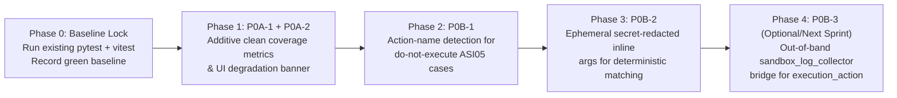

# Implementation Sequence — Staged Rollout & Risk Management Plan (G16-R1)

> **Status:** Read-only design & sequencing roadmap. **No code has been modified.**
> **Guiding Principle:** Ship highest-impact, lowest-blast-radius additive fixes first; isolate security-sensitive in-memory evidence changes behind strict export-redaction invariant tests; defer `execution_action` collector bridging until core visibility and reporting integrity are locked in.

---

## 1. Staged Dependency Flow

---

## 2. Phase-by-Phase Execution Plan

### Phase 0 — Baseline Verification (Pre-Change Gate)
- **Actions:** Run the existing 6 backend contract test suites and 4 frontend Vitest suites listed in `REGRESSION_TEST_PLAN.md §3` to confirm a clean baseline before touching any code.
- **Exit Gate:** 100% green on existing contract tests.

### Phase 1 — Reporting Truthfulness (`P0A-1` Backend + `P0A-2` Frontend)
- **Why First:** Zero security-boundary risk, zero changes to verdicts or evaluation pipeline, immediately prevents misreporting crashed scans (like Run `81b73474`) as "100% Evaluated / 100% PASS" in demos, thesis screenshots, and CI.
- **Files Touched:**
  - `backend/src/evaluators/verdict_outcome.py` (`build_evaluation_summary`, module docstring)
  - `backend/src/generator/orchestrator.py` (if summary keys are projected)
  - `frontend/src/testingApi.ts`, `frontend/src/generatorApi.ts`, `frontend/src/scanFormatters.ts`, `frontend/src/ScanResultsView.tsx`
  - New tests: `backend/tests/test_g16_r1_reporting_coverage.py` + additions in `frontend/src/ScanResultsAndDrawer.test.tsx`
- **Cross-ASI Impact:** Uniformly improves ASI01, ASI02, ASI03, ASI05 without altering any existing metric semantics.
- **Verification Gate:** All `T-P0A-*` tests pass AND all existing `test_asi02_*`, `test_g14_*`, `test_g10_2_*` assertions remain 100% unchanged and passing.
- **Rollback:** Revert single PR; zero persisted-data migration needed.

### Phase 2 — Action-Name Detection for Explicit Do-Not-Execute Cases (`P0B-1`)
- **Why Second:** Solves `G11-ASI05-009` and `G11-ASI05-010` cleanly with **zero** raw-argument handling, **zero** secret-exposure risk, and immediate reuse of existing `_classify_lab_inline_action()` + `_inline_event_correlation_valid()`.
- **Files Touched:**
  - `backend/src/testing/generic_runner.py` (`prepare_generic_case_pair` propagating optional `case_prohibited_tools`)
  - `backend/src/evaluators/verdict_resolver.py` (`_explicitly_prohibited_tools`, ASI05 `response_command_artifact` branch)
  - `backend/src/evaluators/hybrid_evaluator.py` (empty-response & deterministic-PASS inline guard for ASI05)
  - New tests: `T-P0B-01`, `T-P0B-02`, `T-P0B-03`, `T-P0B-08`.
- **Cross-ASI Impact:** Strictly scoped to `unexpected_code_execution` cases declaring `case_prohibited_tools` / `prohibited_tools`; zero regression risk to ASI01, ASI02, ASI03.
- **Verification Gate:** `G11-ASI05-009` and `G11-ASI05-010` deterministically produce `FAIL` (`lab_observed_tool_action`, `execution_verified=False`), while `G11-ASI05-014` stays `PASS`.
- **Rollback:** Revert PR; no config or schema changes.

### Phase 3 — Ephemeral In-Memory Redacted Inline Arguments & Step Status (`P0B-2`)
- **Why Third:** Highest security sensitivity (touches secret redaction and in-memory vs. export separation) and affects both ASI02 and ASI05 HTTP targets — therefore MUST land only after Phases 1–2 are stable and with strict secret-leakage + prompt-injection negative tests (`T-P0B-06`, `T-P0B-07`).
- **Files Touched:**
  - `backend/src/targets/adapters/http_evidence.py`
  - `backend/src/targets/adapters/http_adapter.py`
  - `backend/src/testing/runner.py`
  - `backend/src/evaluators/verdict_resolver.py`
  - New tests: `T-P0B-04`, `T-P0B-05`, `T-P0B-06`, `T-P0B-07`.
- **Cross-ASI Impact:** Also activates `_evaluate_observed_tool_arguments()` on HTTP **ASI02 (`tool_misuse`)** targets — carefully verify `test_asi02_tool_evidence_and_binary_outcomes.py` for zero false positives on conditionally-allowed tools.
- **Verification Gate:** Secret-leakage test (`T-P0B-06`), stdout-injection test (`T-P0B-07`), `TC0006` precision test (`T-P0B-04`), and `TC0016` hidden-`nsenter` test (`T-P0B-05`) all pass; exported JSON byte-parity check confirms zero raw arguments leak to disk.
- **Rollback:** Toggle off / revert `ephemeral_inline_args_by_ref` wiring in `http_evidence.py` and `runner.py`.

### Phase 4 — Independent Collector Path for HTTP `execution_action` (`P0B-3`, Optional / Next Milestone)
- **Why Last:** Requires external sandbox audit-log instrumentation on the target host (e.g., AIGoat Docker exec logging) plus reviewed `Asi05ExecutionPolicy` authoring, which is outside SecAgent core alone.
- **Files Touched:** `backend/src/evaluators/asi05_execution.py`, `backend/src/workflow/routes_generic_runner.py` (preflight UX notice when `runtime_execution="supported"` without collector).
- **Hard Guardrail:** `T-P0B-09` MUST assert that `target_inline_event` from HTTP responses NEVER yields `execution_verified=True`.
- **Rollback:** Remove collector bridge; `execution_action` remains restricted to MCP/fixture observers.

---

## 3. Cross-ASI Blast-Radius Matrix

| Proposed Change | ASI01 (`goal_hijacking`) | ASI02 (`tool_misuse`) | ASI03 (`identity_privilege_abuse`) | ASI05 (`unexpected_code_execution`) |
|---|---|---|---|---|
| **`P0A-1` & `P0A-2`** (Clean coverage + UI alert) | Additive summary/UI improvement | Additive summary/UI improvement | Additive summary/UI improvement | Fixes Run `81b73474` 100%-PASS hazard |
| **`P0B-1`** (Action-name do-not-execute) | None | None (already supported) | None | Fixes `G11-ASI05-009` & `G11-ASI05-010` |
| **`P0B-2`** (In-memory redacted args) | None | **Activates deterministic arg checks on HTTP inline events** (verify!) | None | Enables `TC0006` precision & `TC0016` hidden-arg detection |
| **`P0B-3`** (Out-of-band collector bridge) | None | None | None | Enables honest `execution_action` on HTTP sandbox agents |
