# Diagram 1 — Overall System Architecture (Kiến trúc tổng thể hệ thống SecAgent)

> **Gợi ý chú thích hình luận văn (VI):** *Hình X.1: Kiến trúc tổng thể hệ thống SecAgent phân tách giữa tiến trình triển khai thực tế (loopback processes) và các phân hệ logic nghiệp vụ.*

## Phân biệt tiến trình triển khai (Deployed Processes) và thành phần logic (Logical Subsystems)

Trong triển khai cục bộ hiện tại (`start_secagent_local.py:130-353`), SecAgent chạy **3 tiến trình hệ điều hành độc lập trên `127.0.0.1`** (và tùy chọn tiến trình thứ 4 là Promptfoo Agent Bridge):

1. **Frontend Dev & Loopback Proxy Process** (`127.0.0.1:5173`, Node/Vite + React 19 SPA): vừa phục vụ giao diện web vừa đóng vai trò reverse proxy có danh sách cho phép (allowlist) tuyến đường/phương thức HTTP và tự động chèn header `X-SecAgent-Operator` từ biến môi trường trong RAM.
2. **Workflow API Process** (`127.0.0.1:8092`, Python Flask): tiến trình chính hợp nhất hầu hết các thành phần logic (Target Management, Discovery, Application Context, Dataset Repository, Generator G11, Execution Engine / Generic Runner, Evidence Collector, Hybrid Evaluator / Pi CLI launcher).
3. **Reporting API Process** (`127.0.0.1:8091`, Python Flask, chỉ đọc GET-only): độc lập hoàn toàn về quyền hạn và biến môi trường (không nhận API key hay operator secret), chuyên phục vụ dữ liệu lịch sử đã chuẩn hóa và kiểm tra toàn vẹn tệp.
4. **External Subprocess / Services (ngoài lõi SecAgent):** Pi CLI (`pi --mode text --no-session --no-tools`) được gọi dưới dạng tiến trình con từ Workflow API; DeepSeek HTTP API cho Generator; và Target AI Agent cục bộ/mạng nội bộ (HTTP JSON, OpenAI Chat, MCP JSON-RPC).

```mermaid
flowchart TB
    OP["Operator Browser (Localhost User)"]

    subgraph P1["Process 1: Frontend & Loopback Proxy (127.0.0.1:5173 · Vite 7 + React 19)"]
        UI_TGT["Targets & Onboarding UI\n(TargetConfiguration / TargetManager / ApplicationContext / EvidenceSources)"]
        UI_SCAN["Unified Scan Wizard UI\n(SecurityScanWizard / GenerateAndRunPrepPanel / GeneratorOnlyPanel / ScanPreviewPanel / ScanResultsView / TestcaseDetailDrawer)"]
        UI_REP["Reporting & History UI\n(Overview / Executions / ExecutionDetail / Comparisons)"]
        PROXY["Vite Same-Origin Proxy & Auth Boundary\n(frontend/vite.config.ts)\nInjects X-SecAgent-Operator on /api/testing/*"]
    end

    subgraph P2["Process 2: Workflow API Service (127.0.0.1:8092 · Flask · workflow/api.py)"]
        subgraph M_TGT["Target Management & Context Modules"]
            CAT["ManagedTargetCatalog & DiscoveryEngine\n(catalog.py / management.py / discovery.py / response_inspector.py)"]
            CRED["SessionCredentialStore (RAM-only)\n& Env Credential Aliases"]
            APPCTX["ApplicationContextStore (A-E)\n& ResponsePolicyStore"]
        end

        subgraph M_GEN["Generator Subsystem (G11 · generator/)"]
            G_RDY["Readiness & Context Snapshot\n(readiness.py / skills.py)"]
            G_SVC["GeneratorService & Bounded Chunking\n(service.py / request_builder.py / output_parser.py / validation.py / deduplication.py)"]
            G_ORCH["GenerateAndRunOrchestrator & PreviewStore\n(orchestrator.py / preview_store.py)"]
        end

        subgraph M_EXEC["Execution & Locking Subsystem"]
            LOCKS["TargetExecutionLockRegistry\n(target_id + canonical endpoint)"]
            GRUN["GenericRunService & Runner\n(routes_generic_runner.py / generic_runner.py / runner.py)"]
            ADAPT["Target Adapters\n(HttpTargetAdapter / McpJsonRpcTargetAdapter / OfflineStored / McpAgentRuntime)"]
        end

        subgraph M_EV["Evidence & Evaluation Subsystem"]
            EVCOL["Evidence Collectors & Normalizers\n(http_evidence.py / evidence_collectors.py / evidence_v2.py)"]
            EVAL["HybridEvaluator & VerdictResolver\n(hybrid_evaluator.py / response_evaluator.py / evidence_v2_evaluator.py / verdict_resolver.py / verdict_outcome.py)"]
        end
    end

    subgraph P3["Process 3: Read-Only Reporting API (127.0.0.1:8091 · Flask · reporting/api.py)"]
        R_REPO["ReportDataset Loader & Controlled Run Reader\n(reporting/repository.py / normalizers.py / redaction.py)"]
        R_AGG["Aggregation & Exports\n(reporting/aggregation.py / exports.py)"]
    end

    subgraph STORE["Local File Persistence (No RDBMS / No Message Broker)"]
        FS_DATA["Workflow Data Dir (%LOCALAPPDATA%/SecAgent)\ntargets / application-contexts / datasets /\nresponse-policies / evidence-sources / workflows"]
        FS_RUNS["Scan & Execution Artifacts\nresults/generic-runs/<run_id>/generic-run.json\nresults/local-controlled-runs/<case_run_id>/*.secagent.json"]
        FS_SKILLS["Trusted Skill Files (Read-Only)\ngenerator_skills/*.md & evaluator_skills/security/*.md"]
    end

    subgraph EXT["External Processes & Network Boundaries"]
        LLM_GEN["DeepSeek HTTP API\n(https://api.deepseek.com/chat/completions)\nServer-owned DEEPSEEK_API_KEY"]
        PI_CLI["Pi CLI Subprocess\n(pi --mode text --no-session --no-tools)\nLLM Judge Provider (e.g. DeepSeek)"]
        TARGET["Target AI Agent / MCP Service\n(OpenAI-Chat / HTTP-JSON / MCP JSON-RPC\nLoopback or Private IP for http-json)"]
        EV_SRC["Optional Allowlisted HTTP JSON\nEvidence Endpoint (target_reported)"]
    end

    OP --> UI_TGT
    OP --> UI_SCAN
    OP --> UI_REP
    UI_TGT --> PROXY
    UI_SCAN --> PROXY
    UI_REP --> PROXY

    PROXY -->|"/api/testing/* (GET/POST/DELETE)"| CAT
    PROXY -->|"/api/testing/generator/*"| G_ORCH
    PROXY -->|"/api/testing/generic-runs/*"| GRUN
    PROXY -->|"/api/reports/* (GET only)"| R_REPO

    CAT --> CRED
    CAT --> APPCTX
    G_ORCH --> G_RDY
    G_RDY --> APPCTX
    G_RDY --> CAT
    G_ORCH --> G_SVC
    G_SVC --> FS_SKILLS
    G_SVC -->|"HTTPS JSON mode"| LLM_GEN
    G_ORCH -->|"Auto-save dataset & handoff lock"| GRUN

    GRUN --> LOCKS
    GRUN --> ADAPT
    GRUN --> EVCOL
    GRUN --> EVAL

    ADAPT -->|"POST HTTP / MCP JSON-RPC"| TARGET
    EVCOL -->|"GET read-only snapshot"| EV_SRC
    EVAL --> FS_SKILLS
    EVAL -->|"Subprocess stdin/stdout JSON"| PI_CLI

    CAT --> FS_DATA
    APPCTX --> FS_DATA
    G_ORCH --> FS_DATA
    GRUN --> FS_RUNS
    R_REPO -->|"Read-only SHA-256 verified"| FS_RUNS
    R_REPO --> R_AGG
```

## Source References

- Launcher & 3-process topology: `start_secagent_local.py:130-353`
- Vite loopback proxy & auth injection: `frontend/vite.config.ts:1-120`
- Frontend routing & views: `frontend/src/App.tsx:13-255`
- Workflow API composition & shared locking: `backend/src/workflow/api.py:415-867`, `backend/src/workflow/target_locks.py:1-373`
- Generator G11 modules: `backend/src/generator/service.py:1-1357`, `backend/src/generator/orchestrator.py:1-3386`, `backend/src/generator/providers/deepseek_http.py:1-507`
- Execution & Adapters: `backend/src/workflow/routes_generic_runner.py:785-3240`, `backend/src/testing/generic_runner.py:1-1446`, `backend/src/targets/adapters/http_adapter.py:1-396`, `backend/src/targets/adapters/mcp_jsonrpc_adapter.py:1-272`
- Evidence & Evaluation: `backend/src/observers/evidence_collectors.py:1-1271`, `backend/src/evaluators/hybrid_evaluator.py:1-536`, `backend/src/integrations/external_evaluator/pi.py:1-325`
- Reporting API: `backend/src/reporting/api.py:1-398`, `backend/src/reporting/repository.py:1-331`
