# Diagram 2 — End-to-End Security Scan Flowchart (Lưu đồ quy trình quét bảo mật từ đầu đến cuối)

> **Gợi ý chú thích hình luận văn (VI):** *Hình X.2: Lưu đồ nghiệp vụ quét bảo mật đầu-cuối trong SecAgent, bao gồm ba nhánh nguồn testcase (AI Generate & Run, Generate Only, và Existing/Import Dataset), cổng kiểm tra tiền điều kiện, khóa mục tiêu dùng chung và cơ chế dừng/tiếp tục.*

```mermaid
flowchart TD
    START(["Operator opens #targets / #scan"]) --> ONB["1. Target Onboarding & Review\n(Discovery or Manual HTTP/OpenAI/MCP -> Test Connection -> Save -> Review)"]
    ONB --> CTX["2. Application Context A-E\n(Edit 18 fields -> Mark operator_confirmed -> Save bound to target_revision)"]
    CTX --> SRC{"3. Choose Test Source\nin SecurityScanWizard"}

    SRC -->|"AI Generate & Run\n(Primary Mode)"| G_CFG["Select Target, ASIs (ASI01/02/03/05),\nCounts (1..50, total <= 50), Scope, Focus Note"]
    G_CFG --> G_RDY["POST /api/testing/generator/readiness\nCheck target_revision, confirmed Context A-E,\nscope capability, reviewed policy"]
    G_RDY --> G_RDY_OK{"Readiness\nBlocked?"}
    G_RDY_OK -->|"Yes"| STOP_BLK(["Blocked: Fix Context / Policy / Capability"])
    G_RDY_OK -->|"No (ready / ready_with_warnings)"| G_START["POST /api/testing/generator/generate-and-run\n(authorization_confirmed=true, submission_id)"]
    G_START --> G_LOCK["Reserve Shared Target Lock\n(target_id + canonical endpoint)"]
    G_LOCK --> G_GEN["Stage: generating + validating\nBounded multi-chunk DeepSeek calls ->\nJSON parse -> ASI/context_basis check -> Dedup"]
    G_GEN --> G_SAVE["Stage: saving_dataset\nAuto-save immutable DatasetEnvelope\n(DatasetRepository, SHA-256 verified)"]
    G_SAVE --> G_PRE["Stage: preflight\nGenericRunService.preview_run()\nCheck blockers & skipped cases"]
    G_PRE --> G_HANDOFF["Adopt Target Lock & Start\nGenericRunService.start_run()"]

    SRC -->|"AI Generate Only\n(Preview & Edit)"| GO_GEN["POST /api/testing/generator/generate\nStore in-memory Preview (30m TTL, no auto-save)"]
    GO_GEN --> GO_EDIT["Optional: Edit / Select / Reset candidates\nPOST /generator/previews/<id>/edit"]
    GO_EDIT --> GO_SAVE["Explicit Save: POST /generator/previews/<id>/save\nRe-verify target/context/policy revisions -> DatasetRepository"]
    GO_SAVE --> DS_SEL

    SRC -->|"Existing Dataset\nor Inline Import"| DS_SEL["Select Saved Dataset (or Validate & Import JSON/JSONL/YAML)\nSelect Target, Testcase Subset, Mode (live/offline), Engine (hybrid/rule_only)"]
    DS_SEL --> PRE["Step 2: POST /api/testing/generic-runs/preview\n0 Target requests · 0 Judge requests\nCompute ready/blocked/unsupported & budgets"]
    PRE --> PRE_OK{"Preflight Blocker\nor Target Busy?"}
    PRE_OK -->|"Yes"| STOP_PRE(["Blocked in Step 2 Preview"])
    PRE_OK -->|"No + Operator Consent"| RUN_START["POST /api/testing/generic-runs/start\nVerify expected_target_revision & session_credential_generation\nAcquire TargetExecutionLockRegistry"]

    G_HANDOFF --> LOOP
    RUN_START --> LOOP

    subgraph EXEC_LOOP["Background Worker Loop (GenericRunService._execute_worker -> run_generic_cases)"]
        LOOP["For each ready TestCase"] --> CHK_CANCEL{"cancel_event\nset?"}
        CHK_CANCEL -->|"Yes"| FINAL_CANCEL["Finalize status='cancelled'\nPreserve completed cases; mark remaining NOT_EXECUTED"]
        CHK_CANCEL -->|"No"| CHKPT["Write Pre-Dispatch Checkpoint\n(generic-run.json atomic write)"]
        CHKPT --> CALL_TGT["Invoke Target Adapter\n(HTTP JSON / OpenAI Chat / MCP JSON-RPC / Offline Stored)"]
        CALL_TGT --> COLLECT["Extract Inline Evidence + Run Scoped Collectors\n(HttpCallback / SandboxLog / FileArtifact)\nBuild Evidence v2 & Provenance Tiers"]
        COLLECT --> EVAL_CASE["Evaluate Case\n(Deterministic Rules + Evidence v2 + Optional Hybrid Pi Judge)\nResolve Binary PASS/FAIL + evaluation_status"]
        EVAL_CASE --> PERSIST_CASE["Persist Native Report (.secagent.json) +\nrun-summary.json + Update generic-run.json"]
        PERSIST_CASE --> MORE{"More cases?"}
        MORE -->|"Yes"| LOOP
        MORE -->|"No"| VERIFY_INV["Verify Completion Invariants\n(counts, binary verdicts, SHA-256 report files)"]
    end

    VERIFY_INV --> DONE_RUN["Status = 'completed'\nRelease Target Lock"]
    FINAL_CANCEL --> RESUME_OPT{"Operator clicks\nResume Scan?"}
    DONE_RUN --> RESULTS["Step 3: ScanResultsView & TestcaseDetailDrawer\nKPIs, Binary PASS/FAIL, Technical Failures, Evidence Drawer, JSON Export"]
    RESULTS --> REP_API["Optional Read-Only Reporting API (:8091)\nOverview / Executions / Rule-Pi Comparisons"]

    RESUME_OPT -->|"Yes"| RES_PRE["POST /generic-runs/<id>/resume/preview\nClassify Completed / Uncertain / Skipped / Pending across lineage\nVerify dataset/target/policy/context/judge revisions"]
    RES_PRE --> RES_START["POST /generic-runs/<id>/resume/start\nNew linked continuation run (continuation_of_run_id)\nPreserves completed cases untouched"]
    RES_START --> LOOP
    RESUME_OPT -->|"No"| RESULTS
```

## Source References

- Onboarding & Context UI/API: `frontend/src/TargetConfiguration.tsx:1-81`, `frontend/src/TargetManager.tsx:1-450`, `frontend/src/ApplicationContext.tsx:1-175`, `backend/src/workflow/routes_targets.py:1-1071`
- Unified Scan Wizard: `frontend/src/SecurityScanWizard.tsx:1-1350`, `frontend/src/GenerateAndRunPrepPanel.tsx:1-800`, `frontend/src/GeneratorOnlyPanel.tsx:1-800`, `frontend/src/ScanPreviewPanel.tsx:1-413`
- Generator Orchestration: `backend/src/generator/orchestrator.py:1-3386`, `backend/src/generator/readiness.py:1-990`
- Generic Runner Execution, Invariants, Cancel & Resume: `backend/src/workflow/routes_generic_runner.py:664-784, 1701-3240, 4200-4928`, `backend/src/testing/generic_runner.py:1-1446`
- Results & Resume UI: `frontend/src/ScanResultsView.tsx:1-800`, `frontend/src/ScanResumePanel.tsx:1-347`
