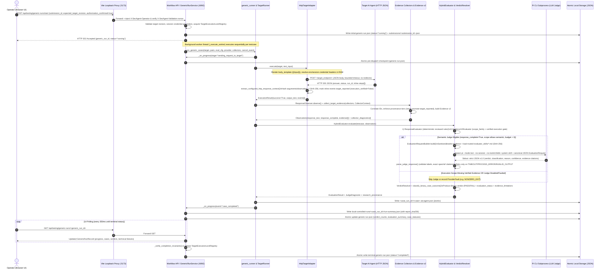

# Diagram 3 — Single Testcase Execution Lifecycle Sequence (Biểu đồ tuần tự vòng đời một testcase)

> **Gợi ý chú thích hình luận văn (VI):** *Hình X.3: Biểu đồ tuần tự thực thi một testcase thực tế từ giao diện người dùng qua Vite Proxy, Workflow API, Target Adapter (HTTP JSON), bộ thu thập bằng chứng, bộ đánh giá lai (Hybrid Evaluator + Pi CLI Judge) đến khi lưu kết quả nguyên tử trên đĩa.*

## Source References

- Frontend Start & Poll: `frontend/src/SecurityScanWizard.tsx:505-566, 875-982`
- Proxy Boundary: `frontend/vite.config.ts:40-115`
- Start Run, Pre-Dispatch Checkpoint, Progress & Invariants: `backend/src/workflow/routes_generic_runner.py:2028-3110`
- Generic Runner & Target Runner: `backend/src/testing/generic_runner.py:1000-1446`, `backend/src/testing/runner.py:1-350`
- HTTP Adapter & Inline Evidence Redaction/Hashing: `backend/src/targets/adapters/http_adapter.py:45-396`, `backend/src/targets/adapters/http_evidence.py:204-319`
- Collectors & Evidence v2: `backend/src/observers/evidence_collectors.py:805-1271`, `backend/src/core/evidence_v2.py:1-500`
- Hybrid Judge, Pi CLI & Binary Verdict Classification: `backend/src/evaluators/hybrid_evaluator.py:1-536`, `backend/src/evaluators/evaluation_request_builder.py:1-264`, `backend/src/integrations/external_evaluator/pi.py:1-325`, `backend/src/integrations/external_evaluator/validation.py:1-101`, `backend/src/evaluators/verdict_outcome.py:314-611`
