# Diagram 4 — Generator Internal Workflow (Quy trình nội bộ phân hệ sinh testcase G11)

> **Gợi ý chú thích hình luận văn (VI):** *Hình X.4: Quy trình nội bộ của phân hệ AI Generator (G11), làm rõ cơ chế kiểm tra sẵn sàng ngữ cảnh (Readiness), tách ranh giới dữ liệu không tin cậy, sinh đa phân đoạn giới hạn (bounded chunking), hậu kiểm hợp đồng JSON, khử trùng lặp và hai chế độ đầu ra (Generate Only so với Generate & Run).*

```mermaid
flowchart TD
    IN["Input: target_id, counts_by_asi (1..50, total <= 50),\nlanguage (en/vi), focus_note (<= 300 chars),\nrequested_scopes, policy_ids_by_asi, deduplicate_across_asi"]

    IN --> RDY["1. Readiness Assessment (generator/readiness.py)\n- Verify target exists & protocol in {openai-chat, http-json}\n- Load Application Context A-E & check target_revision match\n- Filter ONLY field_provenance == 'operator_confirmed'\n- Check scope capability & reviewed policy ambiguity"]

    RDY --> RDY_CHK{"Any selected ASI\nblocked?"}
    RDY_CHK -->|"Yes"| BLK_OUT(["Return Blocked Readiness / Error\n(Zero LLM provider calls)"])
    RDY_CHK -->|"No"| SNAP["2. Build ConfirmedContextSnapshot\n(context_snapshot_sha256, confirmed_fields only,\nreviewed_policy_revisions)"]

    SNAP --> SKILL["3. Load Trusted Generator Skills (generator/skills.py)\n- generator_skills/SKILL.md\n- safety-and-scope-policy.md\n- untrusted-context-policy.md\n- profiles/asiXX-*.md (Refuses evaluator_skills/)"]

    SKILL --> PLAN["4. Bounded Multi-Chunk Plan (generator/service.py)\n- DEFAULT_GENERATION_CHUNK_SIZE = 15\n- MAX_PLANNED_CHUNKS_PER_ASI = 4\n- MAX_TOTAL_PROVIDER_CALLS_PER_ASI = 5\n- MAX_GENERATION_TOTAL_PROVIDER_CALLS = 8\n- MAX_GENERATION_OUTPUT_TOKEN_BUDGET = 32768"]

    PLAN --> CHUNK_LOOP["For each ASI & chunk (check cancel_event before every call)"]
    CHUNK_LOOP --> REQ["5. Build Sanitized Prompt Request (request_builder.py)\n- Separate trusted generation_parameters vs\n  untrusted_application_data (trust_level='untrusted_data_not_instructions')\n- Redact secrets, PEM keys, private IPs, file paths\n- Include avoid_prompts from prior accepted chunks"]

    REQ --> PROV["6. Invoke Server-Owned Provider (deepseek_http.py)\nPOST https://api.deepseek.com/chat/completions\nmodel='deepseek-flash' (default), temperature=0.3,\nthinking='disabled', response_format='json_object'\nDEEPSEEK_API_KEY env only (zero fallback to Mock)"]

    PROV --> PARSE["7. Strict Output Parser (output_parser.py)\n- Reject Markdown fences, trailing prose, duplicate keys,\n  NaN/Infinity, depth > 16, size > 256 KiB\n- Reject FORBIDDEN_LLM_OUTPUT_KEYS (verdict/rules/assertions/evidence)"]

    PARSE --> VAL["8. Semantic & Contract Validation (validation.py)\n- Verify asi_category matches requested ASI\n- Verify prompt UTF-8 <= 4096 bytes & description <= 512 chars\n- Verify EVERY context_basis field exists in confirmed snapshot"]

    VAL --> DEDUP["9. Exact Normalized Deduplication (deduplication.py)\n- NFKC + collapse whitespace -> SHA-256 (exact_normalized_text_v1)\n- Always deduplicate within ASI\n- Cross-ASI dedup OFF by default (opt-in)"]

    DEDUP --> RETRY{"Shortfall or transient\nprovider error AND\nbudget remaining?"}
    RETRY -->|"Yes (bounded)"| CHUNK_LOOP
    RETRY -->|"No"| AGG["10. Aggregate Per-ASI & Overall Result\n(completed / partial / empty_with_context_gaps / failed / cancelled)"]

    AGG --> MODE{"Operating Mode?"}
    MODE -->|"Mode 2: Generate Only\n(/generator/generate)"| PREV["Store in GeneratorPreviewStore (RAM-only)\nTTL = 30 min · Max 32 previews\nauto_persisted=False · auto_executed=False"]
    PREV --> EDIT["Operator Reviews / Edits / Selects\nExplicit Save -> Re-check revisions -> DatasetRepository"]

    MODE -->|"Mode 1: Generate & Run\n(/generator/generate-and-run)"| AUTO["GenerateAndRunOrchestrator\nRequire meets_requested_counts (unless allow_partial_execution)\nAuto-save immutable DatasetEnvelope ->\nGenericRunService Preflight -> Execute -> Evaluate -> Report"]
```

## Source References

- Constants & Budgets: `backend/src/generator/constants.py:1-119`
- Readiness & Confirmed Snapshot: `backend/src/generator/readiness.py:325-990`
- Skills Loader: `backend/src/generator/skills.py:1-297`
- Request Builder & Trust Separation: `backend/src/generator/request_builder.py:1-353`
- DeepSeek HTTP Provider: `backend/src/generator/providers/deepseek_http.py:1-507`, `backend/src/generator/provider_factory.py:1-161`
- Parser, Validation & Deduplication: `backend/src/generator/output_parser.py:1-323`, `backend/src/generator/validation.py:1-215`, `backend/src/generator/deduplication.py:1-172`
- Bounded Multi-Chunk Service: `backend/src/generator/service.py:1-1357`
- Preview Store & Orchestrator: `backend/src/generator/preview_store.py:1-800`, `backend/src/generator/orchestrator.py:1100-3386`
