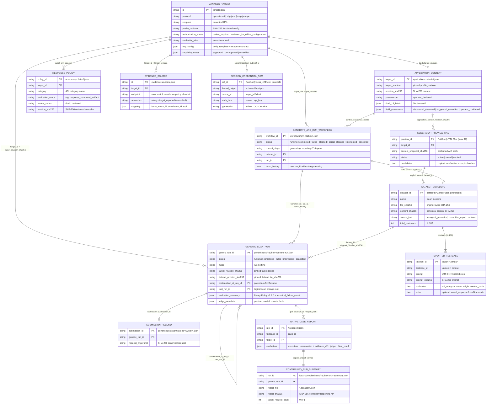

# Diagram 6 — Data and Persistence Model (Mô hình dữ liệu và lưu trữ bền vững)

> **Gợi ý chú thích hình luận văn (VI):** *Hình X.6: Mô hình thực thể dữ liệu và liên kết băm SHA-256 (lineage & provenance) của SecAgent trên hệ thống tệp JSON cục bộ và kho bộ nhớ tạm (RAM-only).*

## Lưu ý kiến trúc lưu trữ thực tế

SecAgent **không sử dụng cơ sở dữ liệu quan hệ (RDBMS)** hay hệ quản trị hàng đợi (message broker). Toàn bộ trạng thái bền vững được ghi nguyên tử (write temp -> flush -> atomic replace) dưới dạng tệp JSON có kiểm chứng băm SHA-256 tại hai gốc thư mục chính (`<data_dir>` mặc định `%LOCALAPPDATA%\SecAgent` và `results/`), kết hợp với **3 kho chỉ lưu trên RAM** bị xóa khi khởi động lại tiến trình (`SessionCredentialStore`, `GeneratorPreviewStore`, `TargetExecutionLockRegistry`).

## Source References

- Managed Targets & Revisions: `backend/src/workflow/management.py:141-154, 533-637`
- RAM-Only Session Credentials: `backend/src/workflow/session_credentials.py:1-467`
- Application Context A-E: `backend/src/workflow/application_context.py:1-133`
- Response Policies & Evidence Sources: `backend/src/workflow/response_policies.py:1-435`, `backend/src/workflow/evidence_sources.py:1-374`
- Immutable Dataset Repository: `backend/src/workflow/dataset_repository.py:1-80`, `backend/src/workflow/dataset_normalizer.py:1-382`
- Generator Preview Store & Workflows: `backend/src/generator/preview_store.py:1-400`, `backend/src/generator/orchestrator.py:1100-1800`
- Generic Scan Runs, Submissions, Lineage & Controlled Run Summaries: `backend/src/workflow/routes_generic_runner.py:1799-2255, 2617-2741, 3987-4347`
- Reporting API Verification of Controlled Runs: `backend/src/reporting/repository.py:63-203`
