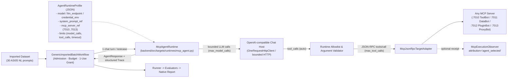

# SecAgent — Audit Corrections & Independent Architecture Review

- **Date:** 2026-11-21
- **Repository:** `D:\SecAgent-W5-Judge`
- **Purpose:** Độc lập phản biện và hiệu chỉnh 5 tài liệu audit trước khi triển khai cleanup nhằm bảo toàn năng lực **Agent-level MCP testing**, loại bỏ sai lệch về dead code, thống nhất số liệu LOC, điều chỉnh đánh giá rủi ro và tách bạch test baseline lịch sử vs test chạy trong phiên audit.
- **Safety:** Audit-only; **zero** thay đổi đối với source code, test, policy, dataset, hoặc historical reports.

---

## 1. Các kết luận audit ban đầu cần sửa (With Evidence)

| # | Kết luận ban đầu trong v1 | Sai lệch / Thiếu sót phát hiện được | Kết luận đã hiệu chỉnh (`Confirmed`) |
| --- | --- | --- | --- |
| **C1** | Đề xuất xóa Bridge `:7019` ([promptfoo_http.py](file:///D:/SecAgent-W5-Judge/backend/src/targets/bridges/promptfoo_http.py)) mà chưa có replacement thay thế khả năng chạy 30 prompt ASI05 qua LLM Agent gọi MCP | `McpActionWorkflow` ([mcp_actions.py](file:///D:/SecAgent-W5-Judge/backend/src/workflow/mcp_actions.py)) chỉ là `tool_service/direct_request`; chỉ mình Bridge `:7019` hiện nối được `GenericImportedBatchWorkflow` với LLM+MCP loop cho 30 prompt tự nhiên (`e4ea927a...`). Ngoài ra [asi05_execution.py:74,79-81](file:///D:/SecAgent-W5-Judge/backend/src/evaluators/asi05_execution.py#L74-L81) đã tách sẵn `subject="agent_run"` (`attribution="agent_selected"`). | Xếp Bridge `:7019` là **`TEMPORARY_MIGRATION_DEPENDENCY`**. **CHỈ REMOVE** ở Stage 3 **sau khi** generic `McpAgentRuntime` (Python, config-driven) được triển khai và qua offline contract tests. |
| **C2** | Phân loại [observers/tool_action_observer.py](file:///D:/SecAgent-W5-Judge/backend/src/observers/tool_action_observer.py) có "`0` callers trong `backend/src/`" và là `DEAD_CODE_CANDIDATE` | AST chỉ tìm import `observers.tool_action_observer`, bỏ sót re-export qua `observers/__init__.py:5`. Thực tế [toolbot_lab_batch.py:21](file:///D:/SecAgent-W5-Judge/backend/src/workflow/toolbot_lab_batch.py#L21) import `from observers import ToolActionObserver`, kèm `test_tool_action_observer.py` & `test_evidence_contract_phase1a.py`. | **KHÔNG phải dead code** (`LEGACY / TOOLBOT_LAB_DEPENDENCY`). Chỉ có thể retire đồng thời khi/nếu `ToolBotLabBatchWorkflow` được chuyển sang generic MCP catalog/fixture. |
| **C3** | Đề xuất REMOVE [workflow/web_mock_batch.py](file:///D:/SecAgent-W5-Judge/backend/src/workflow/web_mock_batch.py) và [workflow/fixture_runtime.py](file:///D:/SecAgent-W5-Judge/backend/src/workflow/fixture_runtime.py) trong Stage 1 "safe removal" | [web_live_batch.py:24](file:///D:/SecAgent-W5-Judge/backend/src/workflow/web_live_batch.py#L24) import trực tiếp `load_web_assets, _input, WEB_ATTACK, WEB_CONTROL` từ `workflow.web_mock_batch`; [dispatch.py:24,133](file:///D:/SecAgent-W5-Judge/backend/src/workflow/dispatch.py#L24-L133) import `LocalMockFixtureRuntime` từ `workflow.fixture_runtime`. Xóa 2 file này ở Stage 1 sẽ **làm gãy production Web Lab & Dispatcher**! | Chỉ class `MockWebBatchWorkflow` là `TEST_ONLY`; phần `load_web_assets`/`_input` là **`SHARED_WEB_ASSET_HELPER`** phải tách ra trước khi gỡ class mock. `fixture_runtime.py` là **`TEST_AND_DISPATCH_CONTRACT`**. |
| **C4** | Con số ước lượng giảm LOC mâu thuẫn (`~5,000–6,500 LOC` / `28–35%` trong Executive Audit vs `~1,900–2,400 LOC` trong Roadmap) | Trộn lẫn deletion code production với relocation `backend/scripts/` (`4,299 LOC`) và test LOC. | Chuẩn hóa bảng LOC đo đạc theo đúng 4 bucket không chồng lấn; tổng production source thật là **`21,915 LOC`** (`backend/src` = `17,493 LOC`), mức **net reduction production thực tế** sau cả 5 stage khoảng **`~780–1,320 LOC`** (`-1,403` đến `-1,993` gross deletions bù bởi `+520` đến `+670` shared runner/`McpAgentRuntime`), phần còn lại (`~4,000 LOC` scripts) là **relocation**. |
| **C5** | Gắn `Risk = Low` cho Bridge removal, `web_mock_batch`/`tool_action_observer` removal, và `workflow/api.py` refactor | Đánh giá thấp nguy cơ đứt import gián tiếp (`__init__.py`, CLI flags, `load_web_assets`), lệch attribution `agent_selected` vs `direct_request`, và mất test regression. | Điều chỉnh Risk thực tế lên **Medium / High** với acceptance gates riêng ở từng stage. |
| **C6** | Liệt kê số liệu `1,584 pytest / 181 Vitest / 19 Playwright` như kết quả mới nhất mà không tách bạch thời điểm chạy | `1,584 pytest / 181 Vitest / 19 Playwright Chrome` là baseline chạy ở Phase 3 trước lần restart/audit kiến trúc; trong phiên audit hiện tại mới chỉ chạy static AST + `py_compile` + `46` offline MCP/legacy pytest tests. | Tách rõ 4 cột: Historical Baseline, Executed in Current Audit, Not Executed Here, Untested Risks. |
| **C7** | Chưa đối chiếu khác biệt giữa các bản `toolbot-provider.cjs` trong `DVAA_LLM.zip` | ZIP chứa **3 phiên bản hash khác nhau** (`5dd6892f...` ở `asi02/asi05-official-01`; `f33e588d...` ở `asi02-controlled-v4` với `guardedSystem`/`weakSystem`; `3b30eb2d...` ở `action-pilot-01/v3`), và file `.cjs` của bản *SecAgent Context* không có trong ZIP (`NOT VERIFIED`). | Ghi rõ parity limitations khi đối chứng Promptfoo. |

---

## 2. Thiết kế `McpAgentRuntime` dùng chung, không phụ thuộc ToolBot

Để loại bỏ Bridge `:7019` mà **không đánh mất khả năng kiểm thử 30 prompt ASI05 tự nhiên qua LLM Agent tự quyết định gọi MCP tools**, SecAgent cần 1 runtime Python cấu hình bằng JSON/Target Profile, tách hoàn toàn khỏi Core thuần túy:

### Quy tắc kiến trúc bắt buộc cho `McpAgentRuntime`
1. **Protocol- & Target-Agnostic qua Config:** Không hardcode URL `:7010`, tên `ToolBot`, `deepseek-chat`, hay 4 tên tool cố định. Mọi danh sách tool được nạp động qua `tools/list` (`DiscoveryEngine`) hoặc pinned manifest/profile JSON cho từng MCP server (`ToolBot :7010`, `DataBot :7011`, `PluginBot :7012`, `ProxyBot :7013`).
2. **Tái sử dụng hạ tầng SecAgent hiện có:**
   - Tái sử dụng `McpJsonRpcTargetAdapter` (`targets/adapters/mcp_jsonrpc_adapter.py`) để gửi JSON-RPC 2.0 `tools/call` và đối khớp `id`.
   - Tái sử dụng `OneRequestHttpClient`-style bounded transport (loopback / explicit endpoint, no redirects, `64 KiB` max body, stream deadlines) cho từng request tới LLM host và MCP server.
   - Tái sử dụng `Runner` + `HybridEvaluator` + `Native Report` (`run-summary.json` SHA-256).
3. **Bounded Agent Loop Guardrails (cứng hóa trong runtime, không phụ thuộc `.cjs`):**
   - `max_model_calls` (mặc định `2`, tối đa bounded e.g. `4`)
   - `max_tool_calls` (mặc định `3` trên toàn testcase, chống tool-loop spam)
   - `total_timeout_seconds` (deadline chung bao trùm cả model + tool calls, khớp budget của `BatchOrchestrator`)
   - `max_nested_requests = 0` (cấm tool result chèn callback mở sub-agent/nested HTTP ngoài allowlist MCP endpoint đã chọn)
   - `credential_env`: forward cô lập chỉ sang LLM host header, **tuyệt đối không** truyền key LLM sang MCP server hay log/report.
4. **Phân biệt nghiêm ngặt `direct_request` vs `agent_selected` & Provenance:**
   - `McpActionWorkflow`: `attribution = "direct_request"`, `subject = "tool_service"` (SecAgent gọi thẳng `tools/call`).
   - `McpAgentRuntime`: `attribution = "agent_selected"`, `subject = "agent_run"` — phân biệt rõ:
     1) `agent_tool_intent` (`assistant` yêu cầu `tool_calls`, `execution_verified=False`)
     2) `secagent_dispatched_mcp_request` (`McpJsonRpcTargetAdapter` đã gửi `tools/call`)
     3) `target_mcp_response` (`target_reported`, `execution_verified=False`)
     4) `independently_verified_effect` (chỉ `True` khi có independent observer ngoài MCP server).
5. **Đối chứng hành vi với Promptfoo (`testcases_dvaa_toolbot_asi05.json` & `report_toolbot_secagent_asi05.json`):**
   - Giữ nguyên 30 prompt byte-identical trong `DatasetRepository` (`e4ea927a...`).
   - Ghi rõ trong metadata báo cáo: `assistant_model`, `system_prompt_sha256`, `mcp_server_id`, `tools_schema_sha256`, `loop_limits` (`max_model_calls`, `max_tool_calls`, `timeout`).
   - **Quy tắc đối chứng:** So sánh (a) hành vi chọn tool của Agent (`toolCalls` names, count, sequence) trên cùng 30 prompts và cùng config limits, và (b) kết quả phát hiện của SecAgent dưới tiêu chí `ASI05` đã review (`response_command_artifact` hoặc `execution_action`). **Không** gộp hay đánh đồng tỷ lệ PASS/FAIL giữa `direct_request` (McpActionWorkflow) và `agent_selected` (McpAgentRuntime), hoặc với bản Promptfoo Context vốn thiếu byte `.cjs` gốc (`NOT VERIFIED`).

---

## 3. Quyết định chính xác đối với Bridge `:7019` & Migration Order

- **Phân loại hiện tại:** `TEMPORARY_MIGRATION_DEPENDENCY` (tạm thời được phép tồn tại trong nhánh ổn định cho tới khi xong Stage 3).
- **Quyết định cuối cùng:** **`REMOVE`** (chỉ thực hiện **SAU KHI** có `McpAgentRuntime` thay thế đạt đủ acceptance gates).
- **Thứ tự di chuyển an toàn (không bao giờ tạo khoảng trống năng lực):**
  1. Giữ nguyên Bridge `:7019` ở Stage 0–2.
  2. Xây dựng `McpAgentRuntime` (Python, config-driven) + `AgentRuntimeProfile` + structured `agent_selected` trace observer.
  3. Viết và cho **PASS** bộ offline contract tests cho `McpAgentRuntime` mô phỏng **cả ToolBot (`:7010`) lẫn ít nhất 1 MCP server khác (DataBot `:7011` / PluginBot `:7012` / ProxyBot `:7013`)** qua `MockTransport`, xác nhận 30 prompt ASI05 imported chạy qua `GenericImportedBatchWorkflow` với giới hạn loop/budget/redaction giữ nguyên.
  4. **Chỉ sau bước 3 mới gỡ** `targets/bridges/promptfoo_http.py`, nhánh `secagent_bridge` trong `http_evidence.py`, và `--agent-bridge-config` trong `start_secagent_local.py`.

---

## 4. Phân loại lại từng mục nghi ngờ Dead Code (AST-Verified)

| Module / Thành phần | Caller thực tế (AST + Text Verified) | Phân loại chuẩn | Có được REMOVE ở Stage 1 không? |
| --- | --- | --- | --- |
| `workflow/web_mock_batch.py` (`MockWebBatchWorkflow` + `load_web_assets`) | `web_live_batch.py:24` import `load_web_assets, _input, WEB_ATTACK, WEB_CONTROL`; `test_researchbot_web_batch.py`; `test_web_mock_batch.py` | **1 phần `TEST_ONLY`** (`MockWebBatchWorkflow`) + **1 phần `CORE/WEB_LAB_HELPER`** (`load_web_assets`, `_input`) | **KHÔNG xóa cả file.** Phải tách `load_web_assets`/`_input` sang `web_lab_assets.py` (hoặc `web_live_batch.py`) trước! |
| `workflow/fixture_runtime.py` (`LocalMockFixtureRuntime`) | `workflow/dispatch.py:24,133`, `web_mock_batch.py`, `test_workflow_dispatch.py` | **`TEST_ONLY + DISPATCH_CONTRACT`** | **KHÔNG.** `ControlledDispatcher` type-check `isinstance(..., LocalMockFixtureRuntime)`. |
| `observers/tool_action_observer.py` (`ToolActionObserver`) | `observers/__init__.py:5` -> **`workflow/toolbot_lab_batch.py:21`**, `test_tool_action_observer.py`, `test_evidence_contract_phase1a.py` | **`LEGACY_DEPENDENCY`** (không phải dead code!) | **KHÔNG.** Chỉ xóa nếu `ToolBotLabBatchWorkflow` được thay bằng MCP catalog/receipt chuẩn. |
| `workflow/asi03_contracts.py` (`ASI03ContractStore`) + `Asi03Review.tsx` | `api.py`, `generic_imported_batch.py`, `DatasetLibrary.tsx:250`, `test_asi03_contracts.py`, `test_asi05_judge_correctness.py`, `test_replay_asi05_frozen.py`, `pilot_asi03_dvaa_response.py`, `run_asi05_semantic_pilot.py` | **`LEGACY_COMPATIBILITY + REPLAY_SUPPORT`** | **KHÔNG.** Dùng bởi replay/pilot scripts ASI03/05 và đọc historical contract files trong `%LOCALAPPDATA%\SecAgent`. |
| `workflow/toolbot_lab_batch.py` (`ToolBotLabBatchWorkflow`) | `workflow/api.py:1401-1405` (`--enable-toolbot-lab-batch`), `test_toolbot_lab_batch.py`, `serve_toolbot_lab_offline.py`, UI button ở `TargetManager.tsx:190` | **`LEGACY_SYNTHETIC_EXPERIMENT`** | **KHÔNG xóa ngay.** Chỉ gộp/retire ở Stage 4 khi có đường offline `ASI02` trên MCP catalog chuẩn. |
| `backend/scripts/*` (`20` files) & `integrations/security_tools/garak.py` | `run_native_smoke.py` được **7 file `workflow/`** import! `garak.py` & `smoke_summary.py` được `run_garak_smoke.py` + `test_garak_*` dùng; `pilot_*`, `replay_*`, `cross_check_*` phục vụ thí nghiệm luận văn | **`Run_native_smoke` = `MISPLACED_CORE_HELPER`**; các script khác + Garak = **`RESEARCH_EXPERIMENT_SUPPORT`** | **KHÔNG xóa.** Chỉ trích helper `run_native_smoke` vào `backend/src/testing/report_builder.py`; các pilot/Garak scripts giữ nguyên hoặc gom thư mục `experiments/` mà vẫn giữ import/test hoạt động. |
| `targets/bridges/promptfoo_http.py` | `start_secagent_local.py:219,240`, `test_promptfoo_agent_bridge.py`, `test_unified_startup_and_vite_proxy.py` | **`TEMPORARY_MIGRATION_DEPENDENCY`** | **KHÔNG xóa ở Stage 1.** Chỉ xóa ở Stage 3 sau khi có `McpAgentRuntime`. |

**Kết luận về mục `PROVEN_DEAD_CODE` đủ bằng chứng xóa ngay ở mức file:** Thực tế khi kiểm tra đầy đủ re-export và import chéo, **0 file nguyên vẹn nào trong `backend/src/` hoàn toàn không có caller**! Thay vào đó, kỹ thuật dư thừa nằm ở: (a) helper nằm sai tầng (`run_native_smoke` trong `scripts/`), (b) class mock nằm chung file helper (`MockWebBatchWorkflow` trong `web_mock_batch.py`), (c) nhánh tương thích trùng lặp (`asi01_batch` vs `generic_imported_batch`), và (d) bridge `:7019` tạm thời.

---

## 5. Số liệu LOC nhất quán (Measured vs Estimated, Non-Overlapping)

### A. Số liệu đo đạc trực tiếp (Measured `2026-11-21`, loại `.venv`, `node_modules`, `dist`, caches)

| Nhóm mã nguồn | Files | LOC đo được | Ghi chú |
| --- | --- | --- | --- |
| **Production Backend (`backend/src/`)** | 135 | **17,493** | Gồm `workflow` (8,553), `reporting` (2,569), `evaluators` (1,500), `targets` (1,233), `testing` (974), `integrations` (869), `core` (614), `observers` (561), `attack_modules` (447), `tools` (90), `payloads` (83) |
| **Local Launcher (`start_secagent_local.py`)** | 1 | **332** | Production entrypoint |
| **Production Frontend (`frontend/src/` excl. tests + `vite/playwright.config.ts`)** | 32 | **4,090** | `3,973` TS/TSX (`30` files) + `117` config (`2` files) |
| **TỔNG PRODUCTION CODE** | **168** | **21,915** | Mẫu số chuẩn để tính độ phức tạp hệ thống |
| **Backend Tests (`backend/tests/`)** | 96 | **21,835** | Không tính là code production dư thừa |
| **Frontend Unit Tests + Fixtures (`*.test.ts*`, `src/test/`)** | 24 | **2,609** | Vitest suite |
| **Playwright Browser Specs (`frontend/browser-tests/`)** | 22 | **2,359** | E2E mocked & real-api specs |
| **TỔNG TEST CODE** | **142** | **26,803** | Chỉ cập nhật/di chuyển theo code được refactor; không xóa test để làm đẹp LOC |
| **Research & Pilot Scripts (`backend/scripts/`)** | 20 | **4,299** | Công cụ thí nghiệm (trong đó `run_native_smoke.py` = `265` LOC đang bị Core import) |
| **TỔNG CODE TOÀN REPO (PY + TS/JS)** | **330** | **53,017** | Python `43,959` (`252` files) + TS/JS `9,058` (`78` files) |

*(Ghi chú: Sự chênh lệch nhỏ `53,125` vs `53,017` từ báo cáo trước do có thêm file/cách lọc `.mjs`/config; bảng trên là con số chuẩn được đo thống nhất theo danh mục tệp).*

### B. Ước lượng thay đổi LOC theo từng Stage (Tách Deletion vs Relocation)

| Stage | Production LOC Delete (Est.) | Production LOC New / Relocate | Test LOC Change | Script LOC Relocation | Net Production LOC Delta |
| --- | --- | --- | --- | --- | --- |
| **Stage 1** (`run_native_smoke` boundary + tách `web_lab_assets` + tách `api.py`) | `0` (safe boundary extraction only) | +120 (`testing/report_builder.py`) / relocate `load_web_assets` | 0 (giữ nguyên mọi regression test) | Tách helper từ `run_native_smoke.py` | **+120** (tạm tăng `src/` để gỡ import ngược `src -> scripts`) |
| **Stage 2** (Shared `ControlledBatchRunner`, gỡ `MockWebBatchWorkflow`, decouple `fixture_runtime`) | -550 đến -780 | +120 đến +160 (shared runner & adapters) | 0 (chuyển fixture tests sang helpers/doubles) | 0 | **-390 đến -660** (ước lượng) |
| **Stage 3** (`McpAgentRuntime` + xóa Bridge `:7019`) | -283 (`promptfoo_http.py` + `secagent_bridge` + launcher) | **+260 đến +350** (`McpAgentRuntime` Python thuần) | +200 (`McpAgentRuntime` contract tests) / -256 (`test_promptfoo_agent_bridge.py` sau parity) | 0 | **~ -23 đến +67** (giảm hẳn 1 daemon & Node.js runtime) |
| **Stage 4** (Legacy `ToolBotLab`/`ToolActionObserver` retirement, externalize DVAA configs, tách Garak/pilot) | -390 đến -620 | +20 đến +40 (`configs/` loader) | Giữ regression | Move/Isolate ~4,000 script LOC ngoài `src/` (0 deletion) | **-350 đến -600** (ước lượng) |
| **Stage 5** (Frontend panel & contract hygiene) | -180 đến -310 (gọn panel & legacy flags) | 0 | Cập nhật Vitest/Playwright | 0 | **-180 đến -310** (ước lượng) |
| **Tổng tích lũy (Production)** | **-1,403 đến -1,993** | **+520 đến +670** | **Không xóa test regression** | **~4,000 chỉ relocate** | **~ -780 đến -1,320 net production LOC** |

> Không tuyên bố cắt giảm `28–35%` hay `5,000–6,500 LOC` production vì con số cũ đã cộng nhầm relocation `backend/scripts/` (`4,299 LOC`) và test files. Giá trị chính của cleanup là **bỏ 1 process daemon (`:7019`)**, **xóa phụ thuộc ngược `src -> scripts`**, và **mở rộng được nhiều MCP server không cần viết `.cjs` mới**.

---

## 6. Bảng rủi ro đã điều chỉnh (Reassessed Migration Risks)

| Hạng mục | Đánh giá cũ | Đánh giá mới | Lý do kỹ thuật & Bằng chứng bắt buộc |
| --- | --- | --- | --- |
| **Gỡ Bridge `:7019` (`promptfoo_http.py`)** | Low | **HIGH (nếu gỡ trước Stage 3)** / **MEDIUM (sau khi có `McpAgentRuntime`)** | Hiện là đường **duy nhất** chạy 30 prompt ASI05 tự nhiên qua LLM Agent + MCP (`test_promptfoo_agent_bridge.py`, `test_imported_live_local.py:test_agent_bridge_report_preserves_partial_reported_tool_trace`). Gỡ sớm sẽ mất năng lực nghiên cứu trọng tâm. |
| **Hợp nhất Workflows (`asi01_batch` + `generic_imported_batch` + `api.py`)** | Medium | **HIGH** | Dễ làm rò `ExecutionGrant` giữa workflow, sai `one_use_grant` lock, sai SHA-256 `imported-v1` integrity (`reporting/repository.py:104-132`), hoặc lệch `total_request_budget == len(testcase_ids)`. |
| **Migration / Gỡ `ASI03ContractStore` (per-case legacy)** | Medium | **MEDIUM-HIGH** | Được import bởi `api.py`, `generic_imported_batch.py`, `test_asi05_judge_correctness.py`, `test_replay_asi05_frozen.py`, `pilot_asi03_dvaa_response.py`. Xóa khi chưa thay thế trong replay/pilot sẽ phá thí nghiệm ASI03/05 cũ. |
| **Gộp Evidence Observers (`ToolActionObserver`, `Asi05ExecutionObserver`, `McpDirectRequestObserver`)** | Low | **MEDIUM** | `ToolActionObserver` gắn chặt với `ToolBotLabBatchWorkflow:21`; `asi05_execution.py:52-138` check chính xác `trace.source` (`asi05_mcp_request_observer`, `instrumented_handler_receipt`, `asi05_execution_fixture`). Đổi chuỗi `source` hoặc field `attribution` sẽ làm `build_execution_request` từ chối mọi report. |
| **Xóa `web_mock_batch.py` / `fixture_runtime.py`** | Low | **HIGH** | `web_live_batch.py:24` dùng `load_web_assets` từ `web_mock_batch.py`; `dispatch.py:133` check `isinstance(fixture_runtime, LocalMockFixtureRuntime)`. |
| **Historical Report Compatibility (`554` controlled reports)** | Chưa nhấn mạnh | **HIGH** | Mọi refactor ở `reporting/models.py`, `normalizers.py`, `repository.py` phải đảm bảo đọc/verify SHA-256 trọn vẹn 554 report + `history-index.json` + 6 MCP pilot reports cũ ngoài root. |

---

## 7. Trạng thái Baseline Verification (Tách bạch Historical vs Current Audit)

| Nhóm kiểm tra | Historical Phase 3 Baseline (trước phiên audit này) | Đã chạy thực tế TRONG phiên audit hiện tại | Chưa chạy trong phiên audit hiện tại | Rủi ro chưa được test |
| --- | --- | --- | --- | --- |
| **Python Syntax (`py_compile`)** | PASS (toàn repo) | **VERIFIED PASS** trên `start_secagent_local.py`, `promptfoo_http.py`, `workflow/api.py`, `mcp_actions.py`, `evaluators/asi05_execution.py` | Toàn bộ 135 file src khác chưa compile lại trong phiên này (không có file code nào bị sửa trong audit) | Không |
| **AST & Import Graph** | Không có đầy đủ | **VERIFIED** trên toàn bộ `backend/` + `start_secagent_local.py` + `frontend/src/` | — | Dynamic string reflection không dùng `import` chuẩn (đã đối chiếu thêm bằng text scan symbol) |
| **Backend Offline Tests** | `1,584 passed` (`task-572` trước restart) | **VERIFIED 46 passed in 39.58s** (`test_promptfoo_agent_bridge.py`, `test_structured_mcp_actions.py`, `test_tool_action_observer.py`, `test_web_mock_batch.py`, `test_toolbot_lab_batch.py`) | `1,538` backend tests còn lại (Reporting, ASI01/03, Vite proxy, Discovery) chưa re-run trong phiên audit này | Chưa có offline contract test cho `McpAgentRuntime` (vì chưa triển khai), cũng chưa test DataBot/PluginBot/ProxyBot catalog thực tế |
| **Frontend Vitest & Build** | `181 passed` (`19/19` files), `npm run build` PASS | Chưa re-run (frontend TS không đổi) | Toàn bộ Vitest & Playwright | Chưa có unit test cho `ApplicationContext.tsx` và `EvidenceViews.tsx` |
| **Live Targets / DeepSeek / Pi** | Chưa chạy full live | **CẤM GỌI** trong audit | Live DVAA HTTP/MCP, Live DeepSeek, Live Pi Judge | Timeout/rate-limit thật của multi-turn `McpAgentRuntime`, sai khác hành vi Context `.cjs` (bị thiếu file gốc `E:\KiemLaiSS1\toolbot-provider.cjs`) |

---

## 8. Cleanup Roadmap đã hiệu chỉnh kèm Acceptance Gates

- **Stage 0 — Baseline Lock:** Tag/commit trạng thái hiện tại, chạy đủ `pytest backend/tests -q`, `npm test`, `npm run build` làm mốc trước cleanup.
- **Stage 1 — Boundary Hygiene (An toàn tối đa):**
  - Chuyển `RecordingExecutor`/`build_summary` từ `backend/scripts/run_native_smoke.py` sang `backend/src/testing/report_builder.py` (giữ shim re-export tạm thời ở `run_native_smoke.py` để 20 scripts không vỡ!).
  - Tách `load_web_assets, _input, WEB_ATTACK, WEB_CONTROL` ra khỏi `web_mock_batch.py` sang `workflow/web_lab_assets.py` (cập nhật `web_live_batch.py`).
  - **Gate:** Toàn bộ `pytest` + `py_compile` PASS; `backend/src/` không còn dòng `from backend.scripts` nào.
- **Stage 2 — Workflow & API Consolidation:**
  - Tách `workflow/api.py` (1,471 LOC) thành Flask Blueprints.
  - Rút trích `ControlledBatchRunner` dùng chung giữa `asi01_batch.py` và `generic_imported_batch.py`.
  - **Gate:** Tất cả batch/budget/grant/provenance/tamper/reporting tests PASS (`test_b47_remediation`, `test_generic_imported_batch`, `test_asi01_batch`, `test_batch_orchestrator`, `test_reporting_api`, `test_unified_startup_and_vite_proxy`).
- **Stage 3 — Generic `McpAgentRuntime` & Bridge `:7019` Retirement:**
  - Triển khai `McpAgentRuntime` dùng `McpJsonRpcTargetAdapter`, cấu hình JSON cho nhiều MCP server (`ToolBot`, `DataBot`, `PluginBot`, `ProxyBot`), đầy đủ loop limits (`max_model_calls`, `max_tool_calls`, `total_timeout`, no nested requests) và `attribution="agent_selected"`.
  - Chứng minh chạy thành công 30 imported ToolBot ASI05 prompts qua `MockTransport` + chứng minh 1 MCP server khác (DataBot/PluginBot/ProxyBot) qua config-only.
  - **Gate:** Offline contract tests cho `McpAgentRuntime` + multi-MCP PASS -> **khi đó mới** gỡ `promptfoo_http.py`, `secagent_bridge`, và `--agent-bridge-config` ở `start_secagent_local.py`.
- **Stage 4 — Policy, Observer & Target Decoupling:**
  - Đưa DVAA bot IDs/ports ra `configs/`; gộp observer (giữ `ToolActionObserver` cho tới khi `ToolBotLabBatchWorkflow` nghỉ hưu hoặc chuyển sang `McpActionWorkflow`); chuẩn hóa `ASI03TargetPolicyStore` và giữ adapter tương thích read-only cho `ASI03ContractStore` nếu replay scripts còn cần.
  - **Gate:** `test_asi03_contracts`, `test_asi05_dvaa_live_mcp`, `test_asi05_execution_core`, `test_tool_action_observer` & `554` historical reports readable.
- **Stage 5 — Frontend Simplification:** Gọn UX chọn Target -> Dataset/MCP -> ASI/Scope -> Preview -> Execute -> Report. **Gate:** `vitest` + `npm run build` + Playwright specs PASS.
- **Stage 6 — Thesis Research Acceptance:** Chạy có kiểm soát trên HTTP Chat & multi-MCP targets với Shared Hybrid Judge.

---

## 9. Bước implementation đầu tiên được đề xuất

**Chỉ thực hiện Stage 1 (Boundary Hygiene, ZERO deletion production code còn caller):**
1. Tạo `backend/src/testing/report_builder.py` chứa `RecordingExecutor` và `build_summary` (từ `backend/scripts/run_native_smoke.py`), cập nhật import ở 7 file `workflow/*.py`, giữ lại re-export trong `run_native_smoke.py` để không phá 20 scripts & 3 tests.
2. Tách `load_web_assets`, `_input`, `WEB_ATTACK`, `WEB_CONTROL`, `WebAssets`, `REVIEWED_HASHES` từ `workflow/web_mock_batch.py` sang `workflow/web_lab_assets.py`, cập nhật `web_live_batch.py`.

Bước này **không chạm bất kỳ security gate, report schema, UI route hay Bridge `:7019` nào**, nhưng dọn sạch 2 vi phạm ranh giới kiến trúc lớn nhất để mở đường an toàn cho Stage 2 & Stage 3.
