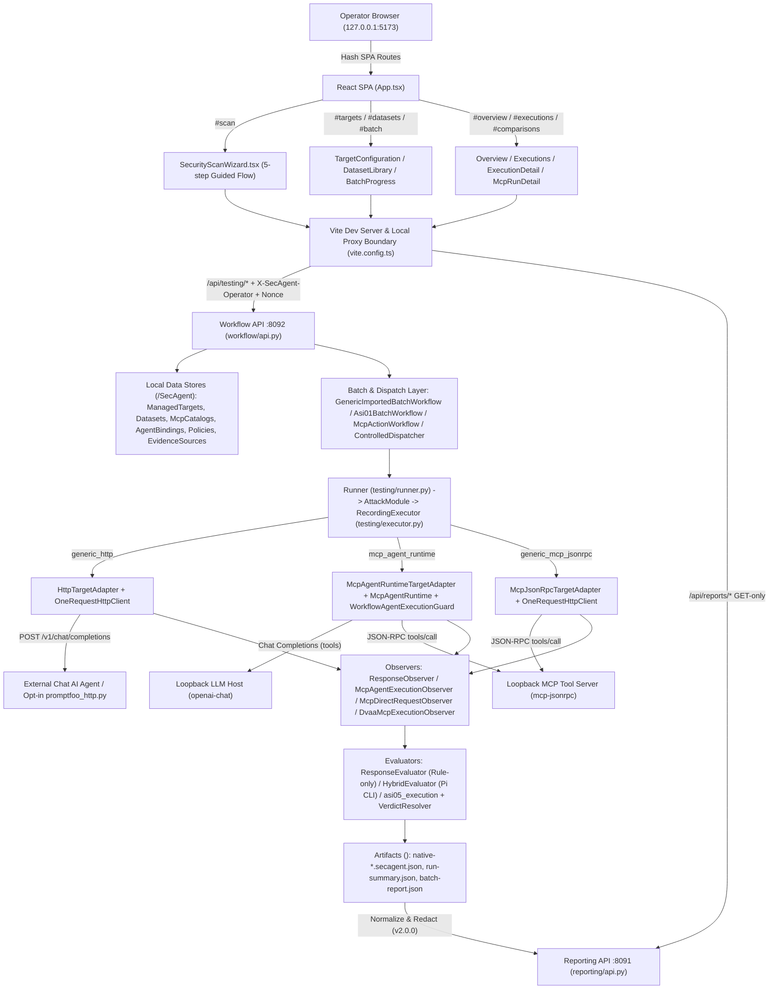

# SecAgent — Current Architecture Audit (Tài Liệu Bàn Giao Ngữ Cảnh Kỹ Thuật)

**Ngày kiểm toán:** 2026-11-22  
**Workspace:** `D:\SecAgent-W5-Judge`  
**Phạm vi:** Read-Only Architecture Audit toàn bộ mã nguồn thực tế (`backend/src/`, `frontend/src/`, `configs/`, `start_secagent_local.py`, `backend/tests/`, `frontend/browser-tests/`).  
**Nguyên tắc bằng chứng:** Mọi kết luận đều bám trực tiếp vào mã nguồn và cấu hình hiện hành, phân biệt rõ:
- **Đã triển khai & Đã kiểm thử (Mocked / Loopback HTTP)**
- **Đã triển khai (Lab / Opt-in / Static Check)**
- **Chưa kiểm chứng (với Target / LLM / Container thật)**
- **Legacy / Deprecated / Disconnected**

---

## 1. Executive Summary

SecAgent là framework kiểm thử bảo mật cho AI Agent với backend **Python 3** (HTTP API dùng **Flask >=3.1,<4.0**, HTTP client dùng **httpx >=0.27,<1.0**, validation dùng **Pydantic >=2.0,<3.0**, YAML dùng **PyYAML >=6.0,<7.0**) và frontend **React 19.2.4 + TypeScript 5.9.3 + Vite 7.3.1** (SPA hash-routing không dùng router/state library ngoài). Hệ thống khởi chạy cục bộ qua [start_secagent_local.py](file:///D:/SecAgent-W5-Judge/start_secagent_local.py) gồm 3 tiến trình loopback tách biệt quyền: Vite UI (`127.0.0.1:5173`), Workflow Execution API (`127.0.0.1:8092`) và Read-only Reporting API (`127.0.0.1:8091`).

Về kiến trúc tích hợp Target, SecAgent hiện vận hành **3 luồng thực thi chính** xoay quanh 3 `TargetAdapter` (`generic_http`, `mcp_agent_runtime`, `generic_mcp_jsonrpc`):
1. **Existing AI Agent (`direct_chat` / `GENERIC-DIRECT-CHAT`):** Gửi HTTP `POST /v1/chat/completions` một lượt (single-turn, stateless) qua `OneRequestHttpClient` + `HttpTargetAdapter` tới AI Agent ngoài hoặc sidecar `promptfoo_http.py` (opt-in).
2. **LLM Agent + MCP Server (`hosted_mcp_agent` / `GENERIC-MCP-AGENT`):** SecAgent chạy vòng lặp đa lượt tổng quát `McpAgentRuntime` (tối đa `4` model calls, `3` tool calls, schema JSON giới hạn chiều sâu `4`, kèm `WorkflowAgentExecutionGuard`) kết nối một **LLM Host** (`openai-chat`) và một **MCP Tool Server** (`mcp-jsonrpc`), hỗ trợ tự khám phá `tools/list`, tạo/duyệt **MCP Tool Catalog** và **Hosted MCP Agent Binding** hoàn toàn qua Web UI mà không cần sửa code.
3. **MCP Tool Server Direct Testing (`direct_mcp` / `McpActionWorkflow`):** Gửi một lệnh JSON-RPC 2.0 `tools/call` định nghĩa sẵn từ file `--mcp-action-catalog` qua `McpJsonRpcTargetAdapter` để kiểm thử tool service độc lập với quyết định của LLM.

**Điểm chốt cực kỳ quan trọng về trạng thái hiện tại:**
- Kiến trúc onboarding (`DiscoveryEngine`, `ManagedTargetCatalog`, `McpToolCatalogStore`, `McpAgentRuntimeBindingStore`, `SecurityScanWizard` `#scan`, `GenericImportedBatchWorkflow`) **đã tổng quát hóa**, không còn hardcode DVAA hay Promptfoo trong core runtime.
- **Port `7019` không còn tồn tại ở bất kỳ file code hoặc config chạy nào** (`backend/src/`, `frontend/src/`, `configs/`, `start_secagent_local.py`). Bridge `promptfoo_http.py` chỉ là sidecar opt-in khi truyền `--agent-bridge-config`.
- **AIGoat chưa có bất kỳ adapter, observer hay config nào** trong mã nguồn; tuy nhiên nếu AIGoat cung cấp HTTP `/v1/chat/completions` hoặc MCP JSON-RPC `/mcp` trên loopback đúng chuẩn, có thể kết nối trực tiếp qua Web UI/config mà không cần viết Python mới (trừ khi cần payload tùy biến, non-loopback, hoặc receipt collector riêng).
- **Chưa kiểm chứng Live External Agent:** Toàn bộ `94` file test Python và `24` spec Playwright đều chạy với `httpx.MockTransport`, `ThreadingHTTPServer` mock cục bộ hoặc Node script giả lập; **không có automated test nào kết nối DVAA container thật, AIGoat container thật, LLM cloud/local thật hoặc `pi` CLI thật.**

---

## 2. Current Architecture Diagram (Mermaid)

---

## 3. Target Execution Flow & Tích Hợp Target (Phân Tích Chi Tiết)

### 3.1 Các loại Target & Giao thức được hỗ trợ
| Tầng kiểm tra | Giá trị hợp lệ trong mã nguồn | Bằng chứng |
|---|---|---|
| Core `TargetValidator` | `(interface.type, interface.adapter)` chỉ nhận 3 cặp: `("http", "generic_http")`, `("mcp", "generic_mcp_jsonrpc")`, `("agent", "mcp_agent_runtime")` | [validator.py](file:///D:/SecAgent-W5-Judge/backend/src/targets/validator.py#L10-L14) |
| Workflow `ManagedTargetCatalog` & `Preset` | `protocol` chỉ nhận `"openai-chat"` hoặc `"mcp-jsonrpc"` | [models.py](file:///D:/SecAgent-W5-Judge/backend/src/workflow/models.py#L20), [management.py](file:///D:/SecAgent-W5-Judge/backend/src/workflow/management.py#L292-L303) |
| Trạng thái giao thức công bố trên `/api/testing/targets` | `openai-chat`: `"offline_configuration_supported"`; `mcp-jsonrpc`: `"local_discovery_and_review_supported"`; `a2a`: `"unsupported"` | [routes_targets.py](file:///D:/SecAgent-W5-Judge/backend/src/workflow/routes_targets.py#L67-L71) |
| Runtime builder | `build_runtime_target()` chỉ hỗ trợ `protocol == "openai-chat"` | [runtime.py](file:///D:/SecAgent-W5-Judge/backend/src/targets/runtime.py#L37-L48) |
| Discovery Engine | Probe tối đa `/v1/models`, `/openapi.json`, `/.well-known/agent.json`, MCP `tools/list`; nhưng `proposed_profile` chỉ sinh `"openai-chat"` hoặc `"mcp-jsonrpc"` | [discovery.py](file:///D:/SecAgent-W5-Judge/backend/src/workflow/discovery.py#L46-L295) |
| Execution Bindings | `GENERIC-DIRECT-CHAT` (`openai-chat` / `generic_http`), `GENERIC-MCP-AGENT` (`openai-chat+mcp-jsonrpc` / `mcp_agent_runtime`), `McpActionWorkflow` (`mcp-jsonrpc` / `generic_mcp_jsonrpc`) | [generic_imported_batch.py](file:///D:/SecAgent-W5-Judge/backend/src/workflow/generic_imported_batch.py#L247-L271), [mcp_actions.py](file:///D:/SecAgent-W5-Judge/backend/src/workflow/mcp_actions.py#L144-L189) |

### 3.2 Cơ chế Target Adapter / Provider
- Interface chuẩn: `BaseTargetAdapter.execute(target: TargetProfile, test_input: TestInput) -> ExecutionResult` ([base.py](file:///D:/SecAgent-W5-Judge/backend/src/targets/adapters/base.py#L12-L21)).
- 3 Adapter cụ thể ([__init__.py](file:///D:/SecAgent-W5-Judge/backend/src/targets/adapters/__init__.py#L3-L14)):
  1. `HttpTargetAdapter` (`generic_http`, [http_adapter.py](file:///D:/SecAgent-W5-Judge/backend/src/targets/adapters/http_adapter.py#L24-L254))
  2. `McpJsonRpcTargetAdapter` (`generic_mcp_jsonrpc`, [mcp_jsonrpc_adapter.py](file:///D:/SecAgent-W5-Judge/backend/src/targets/adapters/mcp_jsonrpc_adapter.py#L15-L272))
  3. `McpAgentRuntimeTargetAdapter` (`mcp_agent_runtime`, [mcp_agent_adapter.py](file:///D:/SecAgent-W5-Judge/backend/src/targets/adapters/mcp_agent_adapter.py#L13-L109))
- **Cơ chế chọn Adapter:** `Executor.__init__()` mặc định chỉ đăng ký `generic_http` và `generic_mcp_jsonrpc`; khi chạy `mcp_agent_runtime`, workflow (`GenericImportedBatchWorkflow._run_agent_case`) truyền explicit dictionary `{"mcp_agent_runtime": adapter}` vào `Executor` ([executor.py](file:///D:/SecAgent-W5-Judge/backend/src/testing/executor.py#L22-L61)). `Executor.execute()` kiểm tra `validate_target(target)` rồi dispatch qua `self._adapters.get(target.interface.adapter)`.

### 3.3 Luồng Existing AI Agent (Chat API — `direct_chat`)
1. **Onboarding & Probe:** UI (`SecurityScanWizard.tsx` hoặc `TargetManager.tsx`) gọi `POST /api/testing/discoveries` -> `DiscoveryEngine.discover()` (`GET /v1/models`, `/openapi.json`, `/.well-known/agent.json`), lưu profile qua `POST /api/testing/managed-targets/create`, duyệt qua `/review`, rồi khi chạy `live_local_http` bắt buộc probe một request lành tính (`"Reply with one word: ready."`) qua `POST /api/testing/connection-checks` (`ManagedTargetCatalog._probe_preset()`, lưu proof 10 phút qua `record_connection_check()`, [generic_imported_batch.py](file:///D:/SecAgent-W5-Judge/backend/src/workflow/generic_imported_batch.py#L303-L310)).
2. **Preview & Start:** UI gửi `execution_path="direct_chat"` tới `POST /api/testing/batches/preview` và `POST /api/testing/batches`. Workflow kiểm tra `live_profile_error()` (bắt buộc IP loopback, path chính xác `/v1/chat/completions`, và `credential_alias is None`, [generic_imported_batch.py](file:///D:/SecAgent-W5-Judge/backend/src/workflow/generic_imported_batch.py#L283-L301)).
3. **Per-case Execution (`_run_case`, [generic_imported_batch.py](file:///D:/SecAgent-W5-Judge/backend/src/workflow/generic_imported_batch.py#L861-L1126)):** Dựng `TargetProfile` qua `build_runtime_target()` với template `{"model": ..., "messages": [{"role": "user", "content": "{{input}}"}]}` -> bọc `OneRequestHttpClient` (chặn redirect, `trust_env=False`, tối đa `1` POST, giới hạn `65536` bytes, có `before_request` drift check) -> `HttpTargetAdapter(response_only_completion=True)` trích `choices.0.message.content` và kiểm tra `finish_reason == "stop"` -> `ResponseObserver` -> Evaluator -> lưu report.

### 3.4 Luồng LLM Agent + MCP Server (`hosted_mcp_agent`) & Điều phối Vòng lặp MCP Runtime
SecAgent **có sử dụng một MCP Agent Runtime tổng quát** (`McpAgentRuntime` trong [mcp_agent.py](file:///D:/SecAgent-W5-Judge/backend/src/targets/runtimes/mcp_agent.py#L722-L1095)). Cơ chế điều phối:
1. **Tool Discovery (`tools/list`):** Chỉ chạy ở bước discovery (`DiscoveryEngine._read_mcp_tools`, [discovery.py](file:///D:/SecAgent-W5-Judge/backend/src/workflow/discovery.py#L100-L175)) và probe kết nối (`_probe_preset`). **Không bao giờ** gọi `tools/list` trong lúc chạy attack runtime.
2. **Server-owned Catalog & Binding (Fail-closed):** Người dùng tạo và duyệt **Tool Catalog** (`McpToolCatalogStore`, `/api/testing/mcp-catalogs/drafts` -> `/review`) chứa danh sách `ReviewedToolSpec` đã lọc theo restricted JSON schema (`SUPPORTED_SCHEMA_KEYS`, `MAX_SCHEMA_DEPTH = 4`, cấm `$ref`, `$defs`, `allOf`, `anyOf`, `oneOf`, `not`, `patternProperties`, [mcp_agent.py](file:///D:/SecAgent-W5-Judge/backend/src/targets/runtimes/mcp_agent.py#L161-L182)), rồi ghép với **LLM Host** (`openai-chat`), `system_prompt`, `environment_scope` và predicate ASI05 thành **Hosted MCP Agent Binding** (`McpAgentRuntimeBindingStore`, `/api/testing/agent-bindings/drafts` -> `/review`).
3. **Vòng lặp Agent Runtime (`McpAgentRuntime.run`, [mcp_agent.py](file:///D:/SecAgent-W5-Judge/backend/src/targets/runtimes/mcp_agent.py#L743-L1057)):**
   - Khởi tạo `messages = [system, user]` và `tool_schemas` định dạng OpenAI `tools` từ `reviewed_tools`.
   - Trước **mỗi** bước LLM và MCP đều chạy `preflight()` + `WorkflowAgentExecutionGuard.check()` ([mcp_agent_runtime_binding.py](file:///D:/SecAgent-W5-Judge/backend/src/workflow/mcp_agent_runtime_binding.py#L477-L531)) để xác minh không bị cancel, `.active-batch` còn hiệu lực, grant chưa hết hạn, `config_digest()` / `system_prompt_sha256` / `tool_catalog_sha256` / target revisions không bị trôi (drift).
   - **LLM Call (`HttpLlmChatClient.complete`, `L532-L595`):** `POST` tới LLM endpoint với `tool_choice="auto"`, `stream=False`, tối đa `max_model_calls` (`1..4`). Nếu LLM không đề xuất `tool_calls` và `finish_reason == "stop"`, kết thúc `status="completed"`.
   - **Tool Validation & Pre-dispatch Gate (`_validate_proposed_tool_call`, `L1058-L1083`):** Kiểm tra `tool_call_id` hợp lệ & duy nhất, `tool_name` nằm trong `reviewed_tools`, parse JSON strict, validate đối số theo `input_schema`, sau đó kiểm tra `EnvironmentAuthorizationScope` (`allowed_write_path_prefixes`, `allowed_fetch_hosts`). Nếu vi phạm, ghi sự kiện `rejected_tool_call` (`provenance="secagent_policy"`) và **dừng run (`status="blocked"`) trước khi gửi HTTP tới MCP server**.
   - **MCP Dispatch (`HttpMcpToolClient.call_tool`, `L598-L672`):** Gửi JSON-RPC 2.0 `POST` `{"method": "tools/call", "params": {"name": ..., "arguments": ...}}`, tách `result.content` (`type == "text"`), lưu `target_reported_success`, nối message `assistant` (`tool_calls`) + `role: "tool"` vào `messages` và quay lại vòng LLM tiếp theo (tối đa `max_tool_calls` `0..3`, tổng timeout `<=120s`, không đệ quy `max_nested_requests = 0`).

### 3.5 Promptfoo, `promptfoo_http.py` và Port `7019`
- **Cổng `7019`:** **Không xuất hiện ở bất kỳ file Python, TypeScript, YAML/JSON config hoặc `start_secagent_local.py` nào** (chỉ còn nằm trong các tài liệu thiết kế/báo cáo cũ dưới `docs/`). `promptfoo_http.py` bind vào cổng động do `config["port"]` quy định ([promptfoo_http.py](file:///D:/SecAgent-W5-Judge/backend/src/targets/bridges/promptfoo_http.py#L203)).
- **Bridge `promptfoo_http.py`:** Không nằm trong luồng khởi động mặc định. [start_secagent_local.py](file:///D:/SecAgent-W5-Judge/start_secagent_local.py#L214-L242) chỉ spawn `python -m targets.bridges.promptfoo_http` nếu người dùng truyền explicit `--agent-bridge-config` (hoặc `agent_bridge_config` trong `runtime.json`). Khi chạy, bridge gói một file `.cjs` của Promptfoo (pin SHA-256) thành HTTP OpenAI-chat loopback và trả thêm metadata `secagent_bridge` (`trace_completeness="partial"`, `execution_verified=False`). SecAgent nhìn bridge thuần túy như một target `direct_chat` bình thường.
- **Code liên quan Promptfoo còn lại:** `workflow/dataset_normalizer.py` ([L75-L107](file:///D:/SecAgent-W5-Judge/backend/src/workflow/dataset_normalizer.py#L75-L107)) cho phép nhập file testcase export từ Promptfoo (`source_tool="promptfoo"`) nhưng từ chối file report đánh giá của Promptfoo (`promptfoo_report_not_supported`); và `reporting/models.py` ([L353-L354](file:///D:/SecAgent-W5-Judge/backend/src/reporting/models.py#L353-L354)) giữ literal schema tùy chọn `promptfoo_node_hosted_agent` / `promptfoo_node_bridge` cho tương thích ngược.

### 3.6 Khả năng kết nối Target mới: Config vs Code
- **Kết nối thuần qua Web UI (`#scan` / `#targets`, 0 dòng code):** Bất kỳ endpoint loopback (`127.0.0.1` / `::1`) nào hỗ trợ **OpenAI chat không credential** tại `/v1/chat/completions` (`choices.0.message.content`) hoặc **MCP JSON-RPC 2.0 stateless** tại `/`, `/mcp`, `/jsonrpc` (`tools/list` + `tools/call`) — bao gồm cả việc ghép cặp LLM + MCP mới.
- **Cần Startup Config / CLI (không cần sửa Python):** LLM/MCP có credential alias trong `hosted_mcp_agent` (khai báo `credential_aliases` trong `--catalog`, [models.py](file:///D:/SecAgent-W5-Judge/backend/src/workflow/models.py#L42)); các ca `direct_mcp` qua `--mcp-action-catalog`; allowlist HTTP evidence qua `--evidence-policy`.
- **Bắt buộc sửa Python Code:** Target dùng HTTP payload/path khác OpenAI qua Web UI ([runtime.py](file:///D:/SecAgent-W5-Judge/backend/src/targets/runtime.py#L78-L84) hardcode template OpenAI; cơ chế YAML `configs/targets/langflow.yaml` chỉ dùng được qua CLI `load_target()`, không gắn vào Workflow API); endpoint non-loopback; credential trên `direct_chat` `live_local_http` (`live_profile_error` chặn `credential_alias` ở `generic_imported_batch.py:285`); giao thức mới (`a2a`, `openapi-http`, `stdio` MCP, gRPC); hoặc handler receipt / evidence collector riêng theo target.

---

## 4. Component Inventory & Implementation Status

| Component | Vai trò | File chính | Trạng thái | Bằng chứng |
|---|---|---|---|---|
| **Local Launcher** | Khởi động Reporting `:8091`, Workflow `:8092`, Vite `:5173`, cấp secret token in-memory | [start_secagent_local.py](file:///D:/SecAgent-W5-Judge/start_secagent_local.py#L114-L330) | **Đã triển khai & Đã kiểm thử (Loopback)** | Tested trong `test_unified_startup_and_vite_proxy.py` |
| **Security Scan Wizard (`#scan`)** | Wizard 5 bước đơn giản hóa (Direct Chat, LLM+MCP, Direct MCP) | [SecurityScanWizard.tsx](file:///D:/SecAgent-W5-Judge/frontend/src/SecurityScanWizard.tsx#L1-L1028) | **Đã triển khai & Đã kiểm thử (Mocked/Loopback E2E)** | Vitest `SecurityScanWizard.test.tsx` (2/2), Playwright `simplified-scan-wizard-real-api.spec.ts` |
| **Advanced Targets / Onboarding UI** | Quản lý target, Discovery, Catalog & Binding thủ công, Evidence Sources | [TargetConfiguration.tsx](file:///D:/SecAgent-W5-Judge/frontend/src/TargetConfiguration.tsx), [TargetManager.tsx](file:///D:/SecAgent-W5-Judge/frontend/src/TargetManager.tsx), [AgentOnboardingPanel.tsx](file:///D:/SecAgent-W5-Judge/frontend/src/AgentOnboardingPanel.tsx) | **Đã triển khai & Đã kiểm thử (Mocked/Loopback E2E)** | Vitest (`TargetManager`, `AgentOnboarding`), Playwright `generic-mcp-onboarding-real-api.spec.ts` |
| **Vite Proxy Boundary** | Proxy API, chặn cross-site, inject `X-SecAgent-Operator` server-side | [vite.config.ts](file:///D:/SecAgent-W5-Judge/frontend/vite.config.ts#L55-L96) | **Đã triển khai & Đã kiểm thử (Loopback)** | `test_unified_startup_and_vite_proxy.py` (thiếu allowlist cho `/api/testing/lab-attempts/*`) |
| **Workflow API & Routes** | HTTP server Flask, auth nonce + operator token, dispatch/onboarding/dataset | [api.py](file:///D:/SecAgent-W5-Judge/backend/src/workflow/api.py#L79-L628), [routes_targets.py](file:///D:/SecAgent-W5-Judge/backend/src/workflow/routes_targets.py), [routes_agent_onboarding.py](file:///D:/SecAgent-W5-Judge/backend/src/workflow/routes_agent_onboarding.py), [routes_execution.py](file:///D:/SecAgent-W5-Judge/backend/src/workflow/routes_execution.py) | **Đã triển khai & Đã kiểm thử (Flask/Loopback)** | `test_stage1b2_api_contract_parity.py`, `test_stage3d6_generic_web_onboarding.py`, Playwright specs |
| **Discovery & Managed Target Store** | Probe `/v1/models`, MCP `tools/list`, lưu/review/archive profile & probe | [discovery.py](file:///D:/SecAgent-W5-Judge/backend/src/workflow/discovery.py), [management.py](file:///D:/SecAgent-W5-Judge/backend/src/workflow/management.py) | **Đã triển khai & Đã kiểm thử (MockTransport)** | `test_target_discovery.py`, `test_target_management.py`; `a2a`/`openapi-http` chỉ discovery, không chạy execution |
| **MCP Tool Catalog & Agent Binding Stores** | Lưu nháp, review SHA-256, phát hiện drift, dựng `WorkflowAgentExecutionGuard` | [mcp_tool_catalog.py](file:///D:/SecAgent-W5-Judge/backend/src/workflow/mcp_tool_catalog.py), [mcp_agent_runtime_binding.py](file:///D:/SecAgent-W5-Judge/backend/src/workflow/mcp_agent_runtime_binding.py) | **Đã triển khai & Đã kiểm thử (MockTransport)** | `test_stage3c_mcp_agent_integration.py`, `test_stage3d6_generic_web_onboarding.py` |
| **Generic MCP Agent Runtime** | Vòng lặp LLM + MCP JSON-RPC giới hạn bước, validate schema & scope | [mcp_agent.py](file:///D:/SecAgent-W5-Judge/backend/src/targets/runtimes/mcp_agent.py#L722-L1095) | **Đã triển khai & Đã kiểm thử (Mocked); Chưa kiểm chứng Live LLM/MCP thật** | `test_stage3b_mcp_agent_runtime.py`, `test_stage3d_toolbot30_acceptance.py` (cấm socket thật) |
| **Target Adapters (`http`, `mcp_jsonrpc`, `mcp_agent_runtime`)** | Giao tiếp HTTP/MCP chuẩn hóa `ExecutionResult` | [http_adapter.py](file:///D:/SecAgent-W5-Judge/backend/src/targets/adapters/http_adapter.py), [mcp_jsonrpc_adapter.py](file:///D:/SecAgent-W5-Judge/backend/src/targets/adapters/mcp_jsonrpc_adapter.py), [mcp_agent_adapter.py](file:///D:/SecAgent-W5-Judge/backend/src/targets/adapters/mcp_agent_adapter.py) | **Đã triển khai & Đã kiểm thử (Mocked/Local Fixture)** | `test_generic_imported_batch.py`, `test_structured_mcp_actions.py`, `test_stage3c_mcp_agent_integration.py` |
| **Generic Imported Batch Workflow** | Điều phối `direct_chat` (`UNCLASSIFIED`/`ASI03`/`ASI05`) & `mcp_agent_runtime` (`ASI05`) | [generic_imported_batch.py](file:///D:/SecAgent-W5-Judge/backend/src/workflow/generic_imported_batch.py#L195-L1586) | **Đã triển khai & Đã kiểm thử (Mocked)** | `test_generic_imported_batch.py`, `test_imported_live_local.py`, `test_stage3d_toolbot30_acceptance.py` |
| **Direct MCP Action Workflow** | Chạy đơn lẻ `tools/call` theo `--mcp-action-catalog` | [mcp_actions.py](file:///D:/SecAgent-W5-Judge/backend/src/workflow/mcp_actions.py#L124-L219) | **Đã triển khai & Đã kiểm thử (Mocked)** | `test_structured_mcp_actions.py`, `test_asi05_dvaa_live_mcp.py` (cấm socket thật) |
| **Dataset Normalizer & Repository** | Parse JSON/Promptfoo export, kiểm depth/size/duplicate keys, deduplicate SHA-256 | [dataset_normalizer.py](file:///D:/SecAgent-W5-Judge/backend/src/workflow/dataset_normalizer.py), [dataset_repository.py](file:///D:/SecAgent-W5-Judge/backend/src/workflow/dataset_repository.py) | **Đã triển khai & Đã kiểm thử** | `DatasetLibrary.test.tsx`, backend dataset tests |
| **Runner, Executor & Observers** | Thực thi attack module -> adapter -> observer (`ResponseObserver`, `McpAgentExecutionObserver`, `McpDirectRequestObserver`) | [runner.py](file:///D:/SecAgent-W5-Judge/backend/src/testing/runner.py), [executor.py](file:///D:/SecAgent-W5-Judge/backend/src/testing/executor.py), [mcp_agent_execution_observer.py](file:///D:/SecAgent-W5-Judge/backend/src/observers/mcp_agent_execution_observer.py) | **Đã triển khai & Đã kiểm thử (Mocked)** | `test_stage3c_mcp_agent_integration.py`, `test_stage3d5_verdict_calibration.py` |
| **Evaluators & VerdictResolver** | `ResponseEvaluator`, `HybridEvaluator` (Pi CLI), `asi05_execution`, `VerdictResolver` | [response_evaluator.py](file:///D:/SecAgent-W5-Judge/backend/src/evaluators/response_evaluator.py), [hybrid_evaluator.py](file:///D:/SecAgent-W5-Judge/backend/src/evaluators/hybrid_evaluator.py), [asi05_execution.py](file:///D:/SecAgent-W5-Judge/backend/src/evaluators/asi05_execution.py), [verdict_resolver.py](file:///D:/SecAgent-W5-Judge/backend/src/evaluators/verdict_resolver.py) | **Đã triển khai & Đã kiểm thử (FakeJudge); Chưa kiểm chứng Pi CLI thật** | Zero test chạy subprocess `pi` CLI thật |
| **Reporting API & Normalizer v2.0.0** | API read-only `:8091`, normalize native reports, tổng hợp KPI, redact, export ZIP | [api.py](file:///D:/SecAgent-W5-Judge/backend/src/reporting/api.py), [normalizers.py](file:///D:/SecAgent-W5-Judge/backend/src/reporting/normalizers.py), [redaction.py](file:///D:/SecAgent-W5-Judge/backend/src/reporting/redaction.py) | **Đã triển khai & Đã kiểm thử** | `test_reporting_api.py`, `test_report_exports.py`; lỗi schema compatibility với `mcp-action` |
| **Promptfoo HTTP Bridge Sidecar** | Facade OpenAI-chat bọc file `.cjs` của Promptfoo khi bật `--agent-bridge-config` | [promptfoo_http.py](file:///D:/SecAgent-W5-Judge/backend/src/targets/bridges/promptfoo_http.py) | **Đã triển khai (Opt-in) & Đã kiểm thử với `.cjs` giả** | `test_promptfoo_agent_bridge.py` dùng `provider.cjs` giả lập |
| **Legacy Lab Workflows (`ASI01`, `Web Lab`, `ToolBot Lab`)** | Batch riêng cho DVAA ResearchBot/SecureBot/WebLab/ToolBot | [asi01_batch.py](file:///D:/SecAgent-W5-Judge/backend/src/workflow/asi01_batch.py), [web_live_batch.py](file:///D:/SecAgent-W5-Judge/backend/src/workflow/web_live_batch.py), [toolbot_lab_batch.py](file:///D:/SecAgent-W5-Judge/backend/src/workflow/toolbot_lab_batch.py) | **Đã triển khai (Mock/Docker Lab); Chưa kiểm chứng Container thật** | Docker chỉ check static config trong `test_asi01_lab_deployment.py` |
| **Evidence Sources (`http_json`)** | Thu thập snapshot GET JSON đọc-only ngoài luồng đánh giá | [evidence_sources.py](file:///D:/SecAgent-W5-Judge/backend/src/workflow/evidence_sources.py) | **Đã triển khai (Isolated / Diagnostic Only)** | `action_verification_supported=False`, `external_judge_disclosure="forbidden"` |
| **Security Tools Integration (`Garak`)** | Wrapper cho Garak CLI | [garak.py](file:///D:/SecAgent-W5-Judge/backend/src/integrations/security_tools/garak.py) | **Legacy / Disconnected** | Không có file nào trong `workflow/`, `testing/`, `reporting/` import |
| **TargetLoader & YAML Target Configs** | Nạp `configs/targets/*.yaml` (bao gồm `langflow.yaml`) | [loader.py](file:///D:/SecAgent-W5-Judge/backend/src/targets/loader.py), [report_builder.py](file:///D:/SecAgent-W5-Judge/backend/src/testing/report_builder.py#L145) | **Legacy / CLI-only** | Chỉ gọi từ `run_native_report`, không dùng trong Web UI / `workflow.api` |
| **AIGoat Integration** | Adapter/Discovery/Receipt collector cho AIGoat | *(Không tồn tại)* | **Chưa triển khai** | Không có reference nào tới `aigoat` trong `backend/src/`, `frontend/src/`, `configs/` |

---

## 5. Test Case / Payload / Judge Pipeline

### 5.1 Test Case Schema, Tải & Lựa Chọn
- **Dataset Upload Web (`DatasetEnvelope`, [dataset_models.py](file:///D:/SecAgent-W5-Judge/backend/src/workflow/dataset_models.py#L9-L69)):** Chấp nhận JSON object `{"testcases": [...]}` hoặc JSON array (từ Promptfoo export, `source_tool="promptfoo"`). Giới hạn `5 MB`, tối đa `100` case, `prompt` tối đa `65536` ký tự, từ chối duplicate JSON keys, `NaN`/`Infinity`, nesting > 10, key nguy hiểm (`__*`, `prototype`, `constructor`). Từ chối Promptfoo evaluation reports (`promptfoo_report_not_supported`).
- **Deduplication & Integrity:** `file_sha256` tính trên raw bytes; `internal_id = "import-" + sha256(file_hash:idx)[:24]`; `dataset_id = sha256(file_hash:len)[:32]`. `DatasetRepository.get_dataset()` giải mã `original_base64`, kiểm `file_sha256` & `content_sha256` rồi chạy lại `normalize_dataset()` mỗi lần đọc ([dataset_repository.py](file:///D:/SecAgent-W5-Judge/backend/src/workflow/dataset_repository.py#L30-L68)).
- **Lưu ý quan trọng về Imported Assertions:** Các trường `assertions`, `plugin_id`, `strategy_id`, `metadata` trong file import chỉ lưu phục vụ provenance và **tuyệt đối không được dùng để quyết định Evaluator hay Verdict** ([generic_imported_batch.py](file:///D:/SecAgent-W5-Judge/backend/src/workflow/generic_imported_batch.py#L276-L277)).
- **Native YAML & Direct MCP Catalog:** YAML `TestCase` (`testcases/<category>/*.yaml`) được pin SHA-256 cứng cho `GH-C01`/`GH-001`/`GH-002` (`asi01_batch.py`) và `TM-002` (`toolbot_lab_batch.py`). Direct MCP dùng `StructuredMcpCase` (`extra="forbid"`, [mcp_actions.py](file:///D:/SecAgent-W5-Judge/backend/src/workflow/mcp_actions.py#L42-L66)).

### 5.2 Payload Generation / Mutation & Gửi tới Target
- **Không có cơ chế AI fuzzing, dynamic payload generation hay security mutation.**
  - Imported cases gửi nguyên văn `ImportedTestcase.prompt` (`TestInput.prompt`).
  - Native YAML templates dùng `PayloadRenderer.render()` ([renderer.py](file:///D:/SecAgent-W5-Judge/backend/src/payloads/renderer.py#L20-L35)) chỉ thế biến tĩnh `{{variable}}`.
  - `HttpTargetAdapter._render_template()` ([http_adapter.py](file:///D:/SecAgent-W5-Judge/backend/src/targets/adapters/http_adapter.py#L118-L133)) chỉ thế `{{input}}` vào payload JSON OpenAI-chat.
  - Các `AttackModule` (`DirectChatDelivery`, `Asi05DirectMcpDelivery`, `GoalHijackingAttackModule`, v.v.) chỉ kiểm tra invariant/scope trước khi giao cho `Executor`.

### 5.3 Xử lý từng kịch bản ASI01, ASI02, ASI03, ASI05
- **ASI01 (`goal_hijacking`):**
  - Chạy trực tiếp qua `Asi01BatchWorkflow` (`GH-C01` clean baseline phải PASS trước `GH-001`/`GH-002`), `ResearchBotWebBatchWorkflow` (`GH-WEB-C01` preflight -> `GH-WEB-001` web callback trong Docker lab), hoặc tự nâng cấp khi prompt trong `GenericImportedBatchWorkflow` (`direct_chat`, `asi_category="unclassified"`) **trùng từng byte** với native ASI01 prompt (`_native_match`).
  - Lưu ý: `ImportedBatchSelection.asi_category` chỉ cho phép `Literal["unclassified", "ASI03", "ASI05"]`, không chọn `"ASI01"` trực tiếp cho prompt tùy ý ([generic_imported_batch.py](file:///D:/SecAgent-W5-Judge/backend/src/workflow/generic_imported_batch.py#L67)).
- **ASI02 (`tool_misuse`):**
  - Chỉ chạy được `TM-002` qua `ToolBotLabBatchWorkflow` (tắt mặc định, phải bật `--enable-toolbot-lab-batch`, chạy trên `MockTransport` `ToolBotFixture` tại `:17022`, không kết nối DVAA thật). `TM-001` bị chặn (`tm001_agent_confirmation_trace_unavailable`), không có luồng trên `GenericImportedBatchWorkflow` hoặc `AdmissionService`.
- **ASI03 (`identity_privilege_abuse`):**
  - Trên `direct_chat`: chỉ đánh giá claim ở tầng văn bản (`evaluation_scope="identity_claim_response"`) khi bật `--judge-config` (`hybrid`) và có policy đã review trong `ASI03TargetPolicyStore` (hoặc `ASI03ContractStore` legacy).
  - Trên `mcp_agent_runtime`: bị **chặn cứng** (`mcp_agent_asi03_unsupported`, [generic_imported_batch.py](file:///D:/SecAgent-W5-Judge/backend/src/workflow/generic_imported_batch.py#L573-L576)). Mọi contract `privileged_action` đều bị chặn (`asi03_action_runtime_unavailable`, [asi03_contracts.py](file:///D:/SecAgent-W5-Judge/backend/src/workflow/asi03_contracts.py#L156-L157)).
- **ASI05 (`unexpected_code_execution`):**
  - Trên `direct_chat`: đánh giá response artifact (`evaluation_scope="response_command_artifact"`, yêu cầu `hybrid` + reviewed `ASI05PolicyStore`).
  - Trên `mcp_agent_runtime`: đánh giá hành vi gọi tool (`evaluation_scope="execution_action"`, `strategy="action"`, `McpAgentExecutionObserver`), **hoạt động cả trong chế độ `rule_only` mặc định** mà không cần `Pi` CLI (nhánh `HybridEvaluator.evaluate` `L62-91` xử lý `asi05_execution` trực tiếp).
  - Trên `direct_mcp`: `McpActionWorkflow` chạy `tools/call` theo `Asi05ExecutionPolicy`.

### 5.4 Chạy đa lượt & Quản lý trạng thái
- **Batch State (`BatchOrchestrator`, [batch.py](file:///D:/SecAgent-W5-Judge/backend/src/workflow/batch.py#L371-L540)):** Tuần tự từng case, khóa bằng file `.active-batch`, chặn gửi trùng bằng `submission-<id>.json`, trừ ngân sách `target_request_budget` theo từng case, hỗ trợ cancel giữa batch/giữa step qua `cancel-requested.json`.
- **Single-turn Direct Chat:** `OneRequestHttpClient` chỉ cho phép `1` request duy nhất (`used == 0`).
- **Multi-turn Hosted MCP Agent:** `McpAgentRuntime.run` duy trì `messages` in-memory qua tối đa `4` model calls & `3` tool calls (`MAX_AGENT_REQUEST_BUDGET = 7`), kiểm `WorkflowAgentExecutionGuard` ở từng bước. Không lưu hội thoại xuyên suốt nhiều test case khác nhau (mỗi case là một run cô lập).
- **Two-phase Web Lab:** `WebLabAssessment` quản lý 2 pha `preflight` (`GH-WEB-C01`) -> `attack` (`GH-WEB-001`) qua file `preflight-verified.json`.

### 5.5 Observability, Redaction, Judge & Ranh giới Tin cậy
- **Thu thập & Redaction:**
  - `Evidence` (`core/models/evidence.py`) lọc qua whitelist `public_evidence_data()` trước khi vào Judge hoặc Report; không bao giờ rò rỉ raw tool args, raw HTTP headers, hay env credentials.
  - `Redactor` ([redaction.py](file:///D:/SecAgent-W5-Judge/backend/src/reporting/redaction.py#L6-L46)) che URL (`[URL_REDACTED:<16hex>]`), canary, `Bearer`, JWT, `sk-...`, đường dẫn cục bộ (`[LOCAL_PATH_REDACTED]`), ID dài (`[ID_SHA256:<64hex>]`).
  - `EvaluationRequestBuilder` ([evaluation_request_builder.py](file:///D:/SecAgent-W5-Judge/backend/src/evaluators/evaluation_request_builder.py#L63-L107)) từ chối gọi Judge (`JudgeInputRejected`) nếu phát hiện secret lọt vào prompt/response.
- **Judge & `VerdictResolver` ([response_evaluator.py](file:///D:/SecAgent-W5-Judge/backend/src/evaluators/response_evaluator.py), [hybrid_evaluator.py](file:///D:/SecAgent-W5-Judge/backend/src/evaluators/hybrid_evaluator.py), [verdict_resolver.py](file:///D:/SecAgent-W5-Judge/backend/src/evaluators/verdict_resolver.py)):**
  - Các verdict cuối cùng: `PASS`, `FAIL`, `INCONCLUSIVE`, `ERROR`.
  - **Rule-only (`ResponseEvaluator`):** `ERROR` nếu `execution_success is not True`; `INCONCLUSIVE` nếu `strategy == "unavailable"` (như imported chat chưa classify) hoặc không rule nào khớp (`MarkerRule`, `KeywordRule`, `RegexRule`, `StatusCodeRule`, `ToolCallRule`, `CollectorReceiptRule`).
  - **Hybrid (`HybridEvaluator` + `PiEvaluatorProvider`):** Chỉ chạy khi `--judge-config` được cấu hình và Rule trả về `INCONCLUSIVE`. `VerdictResolver` bắt buộc `response_complete is True`, phải có trích dẫn chính xác (`response_span` khớp substring của `response_text` hoặc `runtime_reference` khớp observer độc lập), và hạ xuống `INCONCLUSIVE` nếu thiếu bằng chứng độc lập.
  - **ASI05 Execution (`asi05_execution.py` + `resolve_asi05_execution`):**
    - Trong `secagent_observed_request` (live MCP agent/direct MCP): **chỉ đạt mức `tool_invocation`**, cho `FAIL` nếu gọi action/predicate bị cấm theo policy, cho `PASS` nếu trace hoàn chỉnh (`request_trace_completeness == "complete"`) chỉ gồm tool được phép hoặc từ chối an toàn, và trả `INCONCLUSIVE` nếu chưa hoàn chỉnh/chưa review.
    - Trong `instrumented_target_handler` (receipt DVAA): đạt `simulated_execution`, **không bao giờ tự suy diễn `PASS`** (chỉ có thể `FAIL` ở mức `tool_invocation` nếu action bị cấm).
- **Bảng ranh giới thực thi & bằng chứng:**

| Ranh giới | Cơ chế đánh dấu trong code | Ý nghĩa đánh giá |
|---|---|---|
| **Hành động thực thi thật** | `source_provenance="live_mcp_request"` / `"target_observation"`, `ExecutionResult.events` từ `HttpTargetAdapter` / `McpAgentRuntime` / `McpJsonRpcTargetAdapter` | Request thực sự rời khỏi SecAgent qua HTTP tới endpoint loopback. |
| **Hành động mô phỏng** | `source_provenance="synthetic_mock"`, `offline_chat_transport()`, `ToolBotFixture`, `Asi05ExecutionObserver` | Dùng `httpx.MockTransport` hoặc fixture file nội bộ; không chạm target thật. |
| **SecAgent chặn trước khi gửi** | `rejected_tool_call` (`provenance="secagent_policy"`), `secagent_rejected_count` | **KHÔNG phải khả năng phòng thủ của target**; `BatchProgress.tsx` và `ExecutionDetail.tsx` ghi rõ `"SecAgent blocked before dispatch — NOT target defense"`. |
| **Thông tin Agent tự khai báo** | `http_response` (`http_evidence.py`), `agent_tool_intent` (`model_reported`), `target_mcp_response` / `target_tool_result` (`target_reported`), `EvidenceSourceStore` (`trust="target_reported_unverified"`), `execution_verified=False` | Không đủ làm bằng chứng xác thực hiệu ứng hay bảo mật nếu thiếu observer độc lập. |
| **Hiệu ứng trên Host OS** | `Host OS effect: Unverified` (chỉ có `sandbox_effect` trong fixture mô phỏng `synthetic_mock`) | SecAgent chưa có khả năng quan sát syscall/file/process trên máy host của target live. |

---

## 6. DVAA → AIGoat Migration Analysis

### 6.1 Các chỗ vẫn còn gắn với DVAA trong mã nguồn
1. **Discovery & Evidence DVAA-specific:**
   - [dvaa_discovery.py](file:///D:/SecAgent-W5-Judge/backend/src/targets/adapters/dvaa_discovery.py#L10-L39): Gợi ý port `{7004: "openai-chat", 7010: "mcp-jsonrpc"}` và các endpoint dashboard `:9000` (`/api/attack-log`, `/api/sandbox/cmd-log`, `/api/sandbox/files`).
   - [dvaa_action_evidence.py](file:///D:/SecAgent-W5-Judge/backend/src/targets/adapters/dvaa_action_evidence.py#L10-L41), [dvaa_mcp_execution_observer.py](file:///D:/SecAgent-W5-Judge/backend/src/observers/dvaa_mcp_execution_observer.py#L14-L46), [dvaa_instrumented_receipt_collector.py](file:///D:/SecAgent-W5-Judge/backend/src/observers/dvaa_instrumented_receipt_collector.py#L20-L81): Hardcode `target.id == "dvaa-toolbot"`, `platform == "dvaa"`, `agent == "toolbot"`, port `7010`/`7110`, schema receipt `dvaa`.
   - [http_evidence.py](file:///D:/SecAgent-W5-Judge/backend/src/targets/adapters/http_evidence.py#L71-L121): Đọc riêng khóa JSON `body["dvaa"]` (`webFetch*`, `httpPost*`).
2. **Legacy DVAA Workflows & Frontend Quick-fill:**
   - [asi01_batch.py](file:///D:/SecAgent-W5-Judge/backend/src/workflow/asi01_batch.py#L52-L55): Hardcode `REVIEWED_TEXT_TARGETS` (`dvaa-researchbot` `:7015`, `dvaa-securebot` `:7001`).
   - [web_live_batch.py](file:///D:/SecAgent-W5-Judge/backend/src/workflow/web_live_batch.py), [web_lab_runtime.py](file:///D:/SecAgent-W5-Judge/backend/src/workflow/web_lab_runtime.py), [start_secagent_local.py](file:///D:/SecAgent-W5-Judge/start_secagent_local.py#L274): Hardcode `dvaa-researchbot-web-lab` `:17016` và image `dvaa-deepseek:local`.
   - [toolbot_lab_batch.py](file:///D:/SecAgent-W5-Judge/backend/src/workflow/toolbot_lab_batch.py#L35-L37) & [catalog.py](file:///D:/SecAgent-W5-Judge/backend/src/workflow/catalog.py#L42-L45): Hardcode `dvaa-toolbot-lab` `:17022/mcp`.
   - [TargetManager.tsx](file:///D:/SecAgent-W5-Judge/frontend/src/TargetManager.tsx#L7-L14) & [SecurityScanWizard.tsx](file:///D:/SecAgent-W5-Judge/frontend/src/SecurityScanWizard.tsx#L45): Nút điền nhanh DVAA và bộ lọc loại trừ `dvaa-researchbot` khỏi danh sách LLM Host thuần túy.
3. **File cấu hình mẫu:** `configs/targets/dvaa*.yaml`, `configs/workflow/authorized-targets.example.json`, `configs/mcp_actions/dvaa_toolbot_canary.json`, `configs/mcp_agents/dvaa_toolbot_hosted_catalog.json`.

### 6.2 Chuyển từ DVAA sang AIGoat cần thay đổi gì?
- **Trường hợp 1 (Không cần sửa code — chỉ dùng Web UI `#scan` hoặc Config):** Nếu các agent của AIGoat expose cổng loopback (`127.0.0.1`) theo chuẩn **OpenAI `/v1/chat/completions`** (không cần auth) hoặc **MCP JSON-RPC 2.0 `tools/list` + `tools/call`**, người dùng nhập trực tiếp URL vào `#scan` (`SecurityScanWizard`) và chạy ngay. Nếu cần truyền credential alias cho LLM/MCP trong `hosted_mcp_agent` hoặc `direct_mcp`, chỉ cần tạo file catalog JSON truyền qua `--catalog` / `--mcp-action-catalog`.
- **Trường hợp 2 (Cần sửa Python Code):**
  1. Nếu AIGoat dùng HTTP endpoint/JSON payload khác `/v1/chat/completions` (tương tự Langflow) hoặc cần auth header cho `direct_chat`: phải mở rộng `TargetCatalog` / `build_runtime_target` ([runtime.py](file:///D:/SecAgent-W5-Judge/backend/src/targets/runtime.py)) và nới `live_profile_error` ([generic_imported_batch.py](file:///D:/SecAgent-W5-Judge/backend/src/workflow/generic_imported_batch.py#L283-L301)).
  2. Nếu AIGoat chạy trên host/IP không phải loopback (container network / remote host): phải nới các hàm kiểm loopback trong `discovery.py`, `catalog.py`, `management.py`, `generic_imported_batch.py`.
  3. Nếu cần thu thập log/receipt độc lập đặc thù của AIGoat: viết `AigoatEvidenceDiscoveryProvider`, `AigoatActionReceiptCollector` / parser trong `http_evidence.py`, và **nối `mcp_agent_receipt_collector_factory` vào `workflow/api.py`** (hiện đang bỏ trống `None`).

---

## 7. Deprecated vs Active Components

- **Active Core (Đang chạy mặc định qua `start_secagent_local.py` -> `--enable-unified-runtime`):**
  - `SecurityScanWizard` (`#scan`), `TargetConfiguration` (`#targets`), `DatasetLibrary` (`#datasets`), `BatchProgress`, `Overview`/`Executions`/`ExecutionDetail`.
  - `GenericImportedBatchWorkflow` (`direct_chat` + `mcp_agent_runtime`), `Asi01BatchWorkflow` (`GH-C01`/`001`/`002`), `ControlledDispatcher` (`GH-C01`), `McpAgentRuntime` + `McpToolCatalogStore` + `McpAgentRuntimeBindingStore`, `DiscoveryEngine`, `ManagedTargetCatalog`, `Reporting API v2.0.0`.
- **Active Opt-In (Cần cờ CLI riêng):**
  - `McpActionWorkflow` (`--mcp-action-catalog`), `DvaaActionObserverFactory` (`--dvaa-mcp-receipt-root`), `PiEvaluatorProvider` (`--judge-config`), `EvidenceSourceStore` (`--evidence-policy`), `promptfoo_http.py` (`--agent-bridge-config`), `ResearchBotWebBatchWorkflow` (`--enable-web-lab-batch`), `ToolBotLabBatchWorkflow` (`--enable-toolbot-lab-batch`).
- **Legacy / Deprecated / Disconnected:**
  - `Asi05ExecutionObserver` (`observers/asi05_execution_observer.py`): Không được gọi ở `workflow/` hay `testing/`.
  - `GarakProvider` (`integrations/security_tools/garak.py`): Không được import ở bất kỳ luồng runtime nào.
  - `OfflineBatchWorkflow` (`workflow/offline_batch.py`), `MockWebBatchWorkflow` (`workflow/web_mock_batch.py`), `LocalMockFixtureRuntime` (`workflow/fixture_runtime.py`): Không được `workflow/api.py` khởi tạo độc lập (chỉ làm base class hoặc test).
  - `PromptInjectionAttackModule` (`PI-*`), `SensitiveDataDisclosureAttackModule` (`SD-*`), `IdentityPrivilegeAbuseAttackModule` (`IPA-*` YAML), `UnexpectedCodeExecutionAttackModule` (`UCE-*` YAML): Bị chặn bởi `outside_first_asi01_slice` trong `AdmissionService` / thiếu đăng ký trong `workflow/plans.py`.
  - `TargetLoader` (`targets/loader.py`) & `configs/targets/*.yaml`: Chỉ dùng ở CLI `run_native_report` / test, không dùng bởi Web Workflow API.
  - `Metrics.decision_coverage` (`reporting/aggregation.py:88`), `ReportKind.EXTERNAL_BENCHMARK` (`reporting/models.py:18`), `Asi03Review.tsx` (`Legacy ASI03 per-case contracts`), disabled `Evidence Sources` box trong `TargetConfiguration.tsx:58-63`.
  - `configs/workflow/authorized-targets.dvaa-multibot.draft.json`: Draft seed không được `start_secagent_local.py` nạp.

---

## 8. Known Limitations and Unverified Areas

1. **Pre-dispatch Guard Block che mất chi tiết Verdict trên đường Runner (`status="blocked"`):** Khi `WorkflowAgentExecutionGuard` hoặc `_validate_proposed_tool_call` chặn một tool call (`status="blocked"`), `McpAgentRuntimeTargetAdapter.execute()` gán `ExecutionResult.success = False` ([mcp_agent_adapter.py](file:///D:/SecAgent-W5-Judge/backend/src/targets/adapters/mcp_agent_adapter.py#L90-L100)). Hệ quả là `McpAgentExecutionObserver.observe()` thoát sớm (`if not result.success: return observation`, [mcp_agent_execution_observer.py](file:///D:/SecAgent-W5-Judge/backend/src/observers/mcp_agent_execution_observer.py#L263-L265)) không ghi `asi05_execution_trace`, khiến `ResponseEvaluator` trả `ERROR` hoặc `asi05_execution` trả `INCONCLUSIVE` (`target_transport_unavailable`), và `Runner._build_report` xóa `final["reason"]`. `GenericImportedBatchWorkflow` phải tự trích lại `runtime_res.rejected_tool_call_count` cho `imported_provenance` ([generic_imported_batch.py](file:///D:/SecAgent-W5-Judge/backend/src/workflow/generic_imported_batch.py#L1390-L1409)) để UI hiển thị cảnh báo `"SecAgent blocked before dispatch — NOT target defense"`.
2. **Khoảng trống tương thích Schema giữa `McpActionWorkflow` và Reporting v2.0.0:** `McpActionWorkflow.run()` ghi trực tiếp `runner.last_report` ra `mcp-action-<id>/native_report.json` mà không qua `build_summary()` ([mcp_actions.py](file:///D:/SecAgent-W5-Judge/backend/src/workflow/mcp_actions.py#L192-L209)). `reporting/normalizers.py` từ chối format này; hệ quả là các lượt chạy Direct MCP chỉ xem được ở `/api/reports/mcp-runs/<id>` (`McpRunDetail.tsx`), **không vào được `ExecutionReport`, KPI tổng hợp (`aggregate_reports`), hay ZIP export**.
3. **Receipt Collector chưa nối vào Hosted MCP Agent ở Production Startup:** `GenericImportedBatchWorkflow` có tham số `mcp_agent_receipt_collector_factory` ([generic_imported_batch.py](file:///D:/SecAgent-W5-Judge/backend/src/workflow/generic_imported_batch.py#L1321-L1325)) nhưng `workflow/api.py` chưa bao giờ truyền factory này; mọi lượt live Hosted MCP Agent hiện chỉ đạt tối đa mức `tool_invocation`.
4. **Giới hạn HTTP & Giao thức:** `direct_chat` live local bắt buộc loopback IP, đúng `/v1/chat/completions`, không hỗ trợ `credential_alias`; `a2a` và `openapi-http` chỉ discover metadata, không thực thi được; `RegexRule` chưa có chống ReDoS timeout.
5. **Chưa có bằng chứng thực nghiệm Live End-to-End tự động:** Chưa có test nào chạy thật với DVAA containers, AIGoat, LLM API bên ngoài, hoặc `pi` CLI thật. `verify_archive` (`reporting/artifacts.py:166`) chỉ xác minh được bundle `GH-WEB-001`.
6. **Khởi động mặc định:** `start_secagent_local.py:302` mở trình duyệt ở `/#targets` thay vì `/#scan` (dù `#scan` đã đặt đầu thanh điều hướng).

---

## 9. Evidence Index (File Paths, Symbols & Lines)

- **Launcher & Proxy:** `start_secagent_local.py` (`main`, `L114-330`); `frontend/vite.config.ts` (`local-reporting-boundary`, `L55-96`).
- **Frontend Views & Clients:** `frontend/src/App.tsx` (`route`, `L13-225`); `frontend/src/SecurityScanWizard.tsx` (`SecurityScanWizard`, `L1-1028`); `frontend/src/BatchProgress.tsx` (`L95-140`); `frontend/src/testingApi.ts` (`testingApi`, `L163-205`); `frontend/src/batchApi.ts` (`batchApi`, `L35-106`); `frontend/src/detailApi.ts` (`L195-318`).
- **Target Adapters & Runtimes:** `backend/src/targets/validator.py` (`SUPPORTED_INTERFACE_ADAPTERS`, `L10-14`); `backend/src/targets/runtime.py` (`build_runtime_target`, `L37-84`); `backend/src/targets/adapters/{http_adapter.py,mcp_jsonrpc_adapter.py,mcp_agent_adapter.py,http_evidence.py,dvaa_discovery.py,dvaa_action_evidence.py}`; `backend/src/targets/runtimes/mcp_agent.py` (`validate_restricted_tool_schema` `L161-182`, `HttpLlmChatClient` `L532-595`, `HttpMcpToolClient` `L598-672`, `McpAgentRuntime.run` `L743-1057`); `backend/src/targets/bridges/promptfoo_http.py` (`load_config`, `L34-208`).
- **Workflow & Onboarding Stores:** `backend/src/workflow/api.py` (`create_app`, `main`, `L79-628`); `backend/src/workflow/routes_agent_onboarding.py` (`L18-312`); `backend/src/workflow/discovery.py` (`DiscoveryEngine`, `L46-411`); `backend/src/workflow/management.py` (`ManagedTargetCatalog`, `L292-457`); `backend/src/workflow/mcp_tool_catalog.py` (`McpToolCatalogStore`); `backend/src/workflow/mcp_agent_runtime_binding.py` (`McpAgentRuntimeBindingStore` `L128-378`, `WorkflowAgentExecutionGuard` `L438-531`); `backend/src/workflow/generic_imported_batch.py` (`GenericImportedBatchWorkflow`, `L195-1586`); `backend/src/workflow/batch.py` (`BatchOrchestrator`, `L371-540`, `persist_batch_case_report`, `L189-248`); `backend/src/workflow/dispatch.py` (`OneRequestHttpClient`, `ControlledDispatcher`).
- **Datasets, Testing & Payloads:** `backend/src/workflow/dataset_models.py`, `dataset_normalizer.py` (`normalize_dataset`, `L48-239`), `dataset_repository.py`; `backend/src/testing/{runner.py,executor.py,report_builder.py}`; `backend/src/payloads/renderer.py` (`PayloadRenderer.render`, `L20-35`).
- **Observers, Evaluators & Reporting:** `backend/src/observers/{response_observer.py,mcp_agent_execution_observer.py,mcp_direct_request_observer.py,dvaa_mcp_execution_observer.py,dvaa_instrumented_receipt_collector.py,asi05_execution_observer.py,tool_action_observer.py}`; `backend/src/evaluators/{response_evaluator.py,hybrid_evaluator.py,asi05_execution.py,verdict_resolver.py,evaluation_request_builder.py}`; `backend/src/reporting/{api.py,models.py,normalizers.py,aggregation.py,artifacts.py,exports.py,redaction.py,repository.py}`.

---

## 10. Những Điểm Cần Lưu Ý Để AI Khác Không Hiểu Nhầm Kiến Trúc SecAgent

1. **SecAgent là khung kiểm thử (Tester), KHÔNG phải lớp bảo vệ Runtime cho AI Agent đích:** Khi `McpAgentRuntime` (dùng để host LLM + MCP test) chặn một tool call qua `WorkflowAgentExecutionGuard` (`secagent_rejected_count`), điều đó chứng minh giới hạn an toàn của SecAgent đã kích hoạt, **tuyệt đối không chứng minh target an toàn** — ngược lại, việc LLM của target đề xuất gọi tool đó đã là hành vi rủi ro ở tầng model.
2. **`Hosted MCP Agent` khác `Existing AI Agent`:** Với `Hosted MCP Agent` (`mcp_agent_runtime`), **SecAgent trực tiếp nắm vòng lặp gọi LLM và gọi MCP `tools/call`**. Còn với `Existing AI Agent` (`direct_chat`), agent bên ngoài tự điều hành logic của nó sau endpoint `/v1/chat/completions`, và SecAgent chỉ thấy text response cuối + dữ liệu target tự khai báo (`target_reported`).
3. **Đừng tìm Port `7019` hay giả định kiến trúc xoay quanh Promptfoo Bridge:** Port `7019` đã bị loại bỏ khỏi code; `promptfoo_http.py` là sidecar hoàn toàn tùy chọn và không dùng trong luồng `Hosted MCP Agent`. Promptfoo hiện tại chủ yếu được dùng ở dạng **nhập file dataset JSON/YAML** (`dataset_normalizer.py`).
4. **Đừng nạp nhầm `configs/targets/*.yaml` cho Web API:** Web Workflow API và `start_secagent_local.py` dùng `CatalogConfig` JSON (ví dụ `authorized-targets.example.json`) và store trong `%LOCALAPPDATA%\SecAgent` (hoặc `--data-dir`), **không đọc `configs/targets/*.yaml`**.
5. **Imported Assertions không chạy được:** Đừng kỳ vọng các assertion `promptfoo:redteam:*` trong file dataset upload sẽ tự động chấm điểm; SecAgent **bỏ qua toàn bộ assertions nhập từ ngoài** và chỉ dùng `ResponseEvaluator` / `HybridEvaluator` / `asi05_execution` nội tại đã review.
6. **`EvidenceSourceStore` không nối vào Judge:** Thu thập log qua `#targets` (`evidence-sources`) luôn mang `action_eligible=False`, `external_judge_disclosure="forbidden"`, chỉ để operator đọc tham khảo.
