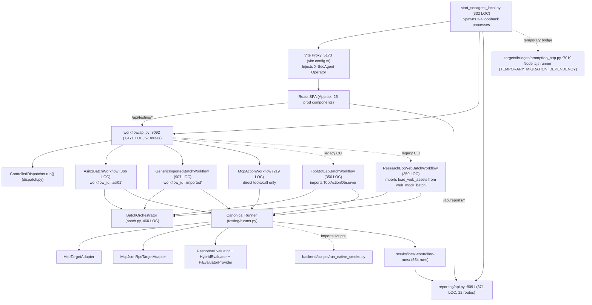

# SecAgent — Full Project Architecture Audit & Technical Debt Analysis (Revised)

- **Audit Date:** 2026-11-21
- **Repository:** `D:\SecAgent-W5-Judge` (commit `ce1c776` + uncommitted Unified Runtime stabilization)
- **Correction Companion:** [SECAGENT_AUDIT_CORRECTIONS.md](file:///D:/SecAgent-W5-Judge/docs/audits/SECAGENT_AUDIT_CORRECTIONS.md)

---

## 1. Executive Summary

SecAgent enforces strong security boundaries (loopback binding, anti-CSRF nonces, one-use `ExecutionGrant`, SHA-256 provenance, credential-echo blocking before Judge invocation, and strict `PASS`/`FAIL`/`INCONCLUSIVE`/`ERROR` separation). However, iterative development introduced **horizontal workflow duplication, monolithic routing, and lab-specific coupling**:

- **Measured Codebase Scope (non-overlapping):** **`53,017` total code LOC** across `330` code files:
  - **Production Source:** **`21,915` LOC** (`168` files: `backend/src` `17,493`, `start_secagent_local.py` `332`, `frontend/src` prod `3,973`, `frontend` Vite/Playwright configs `117`).
  - **Tests:** **`26,803` LOC** (`142` files: `backend/tests` `21,835`, FE unit/fixtures `2,609`, Playwright specs `2,359`).
  - **Research Scripts:** **`4,299` LOC** (`20` files in `backend/scripts/`).
- **API & Workflow Sprawl:** `69` routes (`57` in `workflow/api.py` [1,471 LOC]; `12` in `reporting/api.py` [371 LOC]) backing `7` batch/action classes + `ControlledDispatcher.run()` + `:7019` Node bridge.
- **Unified Runtime Reality (`Confirmed`):** `--enable-unified-runtime` (`workflow/api.py:1389-1392`) unifies *session coexistence and mutual exclusion*, not execution engines: `Asi01BatchWorkflow` and `GenericImportedBatchWorkflow` still duplicate grant/client/report boilerplate, and `McpActionWorkflow` manages its own lock and report layout.
- **Agent-Level MCP Architecture (`Confirmed`):** `McpActionWorkflow` handles only `tool_service/direct_request`. Bridge `:7019` (`promptfoo_http.py`) is currently the **only live path** for running the 30 natural-language ASI05 cases (`testcases_dvaa_toolbot_asi05.json`) through an autonomous LLM+MCP loop — making Bridge `:7019` a **`TEMPORARY_MIGRATION_DEPENDENCY`** until replaced by a generic Python **`McpAgentRuntime`** (`agent_selected`).
- **Realistic Complexity Reduction:** Consolidating duplicated workflows, splitting `workflow/api.py`, replacing Bridge `:7019` with `McpAgentRuntime`, and decoupling DVAA configs yields an estimated **net ~780–1,320 production LOC reduction** (plus relocating ~4,000 script LOC out of Core coupling and eliminating 1 Node/HTTP sidecar daemon), while **preserving 100% of Agent-level MCP testing and regression tests**.

---

## 2. Reconstructed Real Architecture (As Implemented)

---

## 3. Top 10 Architectural & Technical Debt Findings (AST-Verified)

| Rank | Severity | Area | Finding & Concrete Evidence |
| --- | --- | --- | --- |
| 1 | **P0** | MCP Agent Gap & Bridge | **`McpActionWorkflow` handles only direct `tools/call`; Bridge `:7019` (`promptfoo_http.py`) handles Agent-level MCP via hardcoded `.cjs`.** Replacing `:7019` requires implementing generic `McpAgentRuntime` (`agent_selected`) first. (**Confirmed**) |
| 2 | **P0** | Layer Boundary | **7 `workflow/` modules import from `backend/scripts/run_native_smoke.py`** (`dispatch.py:17`, `asi01_batch.py:19`, `generic_imported_batch.py:18`, `offline_batch.py:20`, `toolbot_lab_batch.py:19`, `web_live_batch.py:12`, `web_mock_batch.py:18`). (**Confirmed**) |
| 3 | **P1** | API Monolith | **`workflow/api.py` (`1,471` LOC, `57` routes)** mixes target management, discovery, evidence sources, policies, datasets, legacy planning, batches, MCP actions, and lab prep in one `create_app()`. (**Confirmed**) |
| 4 | **P1** | Workflow Duplication | **`asi01_batch.py` (`366` LOC) & `generic_imported_batch.py` (`907` LOC)** duplicate `_prune_grants()`, grant-file creation, `OneRequestHttpClient` setup, and native report + `run-summary.json` serialization. (**Confirmed**) |
| 5 | **P1** | Mixed Shared Helpers & Test Code | **`web_live_batch.py:24` imports `load_web_assets, _input, WEB_ATTACK, WEB_CONTROL` from `web_mock_batch.py`**, while `MockWebBatchWorkflow` itself is test-only; `dispatch.py:133` type-checks `LocalMockFixtureRuntime` (`fixture_runtime.py`). (**Confirmed**) |
| 6 | **P1** | Hardcoded Target Logic in Core | DVAA IDs/ports (`7001/7015/7010/7110/9000/17022`) live inside `asi01_batch.py:52-55`, `toolbot_lab_batch.py:35-37`, `dvaa_action_evidence.py`, `dvaa_discovery.py`, `dvaa_mcp_execution_observer.py`. (**Confirmed**) |
| 7 | **P1** | ASI03 Policy Duplication | Per-case `ASI03ContractStore` (`asi03_contracts.py:40-200`, UI `Asi03Review.tsx`) overlaps per-target `ASI03TargetPolicyStore` (`asi03_contracts.py:201-316`, UI `Asi03TargetPolicy.tsx`), but remains referenced by replay/pilot scripts (`test_replay_asi05_frozen.py`, `pilot_asi03_dvaa_response.py`). (**Confirmed**) |
| 8 | **P1** | Observer Sprawl & `asi05_execution` Source Coupling | `observers/` has 7 concrete classes (`ToolActionObserver` is used by `toolbot_lab_batch.py:21` via `observers/__init__.py:5` re-export — **not dead**); `evaluators/asi05_execution.py:52-138` hardcodes exact trace `source` strings. (**Confirmed**) |
| 9 | **P2** | Disconnected Experiments | `integrations/security_tools/garak.py` + `smoke_summary.py` (`225` LOC) and 19 other experiment scripts in `backend/scripts/` are research artifacts decoupled from Unified Runtime UI. (**Confirmed**) |
| 10 | **P2** | Frontend Workflow Split | Users navigate 3 separate execution paths (`PlanWizard/LocalExecution` legacy `GH-C01`, `DatasetLibrary` chat batches, `McpActionPanel`) plus 2 stacked history tables (`SavedRuns` + `Executions`). (**Confirmed**) |

---

## 4. Verification Status Summary (Separated)

- **Historical Pre-Audit Baseline (Phase 3):** `1,584` backend pytest passed; `181` Vitest passed; `19` mocked Playwright Chrome specs passed (`1` real-dataset skipped); `554` historical controlled reports readable.
- **Executed During Current Audit:** `py_compile` on key runtime/bridge/mcp/evaluator modules (`PASS`), AST/symbol dependency graph scan across all `backend/` & `frontend/src/` files, `DVAA_LLM.zip` SHA-256 audit of 6 `toolbot-provider.cjs` copies (`3` distinct revisions), `554` saved run summaries read-only scan, and **focused offline pytest check: `46 passed in 39.58s`** (`test_promptfoo_agent_bridge`, `test_structured_mcp_actions`, `test_tool_action_observer`, `test_web_mock_batch`, `test_toolbot_lab_batch`).
- **Not Executed Here:** Live DVAA targets, live DeepSeek API, live Pi Judge.
