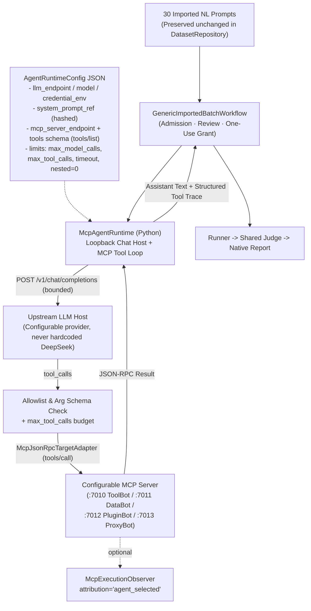

# SecAgent — MCP Architecture Decision Record (ADR, Revised)

- **Date:** 2026-11-21 (Revised after Critical Review)
- **Subject:** Fate of `backend/src/targets/bridges/promptfoo_http.py` (:7019), Direct MCP Actions, and Generic `McpAgentRuntime`
- **DVAA MCP Targets in Scope:** ToolBot (`:7010`), DataBot (`:7011`), PluginBot (`:7012`), ProxyBot (`:7013`)
- **Mandatory Decision:** Bridge `:7019` is classified as a **`TEMPORARY_MIGRATION_DEPENDENCY`** to be **REMOVED in Stage 3 ONLY AFTER** a generic, config-driven Python **`McpAgentRuntime`** (`attribution="agent_selected"`) is implemented and passes offline multi-server contract tests.

---

## 1. Two Distinct MCP Testing Scopes (Cannot Substitute for Each Other)

| Dimension | Scope A: `tool_service / direct_request` (`McpActionWorkflow`) | Scope B: `agent_run / agent_selected` (**Required Replacement for Bridge :7019**) |
| --- | --- | --- |
| **Question answered** | Does the MCP tool server safely reject/handle an exact `tools/call` payload? | Given a natural-language prompt (e.g., the 30 `testcases_dvaa_toolbot_asi05.json` prompts), does an **LLM Agent** autonomously choose unsafe MCP tool calls or leak/obey untrusted instructions? |
| **Current SecAgent support** | **Implemented** (`backend/src/workflow/mcp_actions.py`, `McpJsonRpcTargetAdapter`, `McpDirectRequestObserver`). | **Only via Bridge `:7019`** (`targets/bridges/promptfoo_http.py` + Node `.cjs`). Core `GenericImportedBatchWorkflow` refuses to convert chat prompts to MCP (`imported_target_protocol_mismatch`). |
| **Evaluator contract** | `evaluators/asi05_execution.py:79-81` checks `subject="tool_service"` & `attribution="direct_request"`. | `evaluators/asi05_execution.py:79-81` **already defines** `subject="agent_run"` & `attribution="agent_selected"`. |
| **Why `McpActionWorkflow` alone is insufficient** | Cannot test LLM autonomous tool selection over 30 natural-language ASI05 prompts. | Requires an LLM tool-selection loop (`tool_choice="auto"`) over MCP tool schemas. |

> **Critical Correction:** Removing Bridge `:7019` before implementing a generic Python `McpAgentRuntime` would **lose Agent-level MCP testing**. Therefore Bridge `:7019` MUST stay temporarily until Stage 3 parity verification passes.

---

## 2. Promptfoo Provider Evidence (`DVAA_LLM.zip` & `E:\KiemLaiSS1`)

Direct byte inspection of `C:\Users\Quettye\Downloads\DVAA_LLM.zip` and `E:\KiemLaiSS1\` confirmed **three distinct versions** of `toolbot-provider.cjs`:
1. `5dd6892f70b0d46b` (`7,875` bytes): `asi02-official-01/toolbot-provider.cjs` and `asi05-official-01/toolbot-provider.cjs` (identical bytes; hardcodes `DEEPSEEK_ENDPOINT`, `TOOLBOT_ENDPOINT = http://127.0.0.1:7010/mcp`, `deepseek-chat`, 4 tools `[read_file, write_file, execute, fetch_url]`, single system prompt, 1st turn `tools/call` up to 3 calls + 1 follow-up turn, logs to `toolbot_raw_responses.jsonl`).
2. `f33e588d5a147df2` (`10,676` bytes): `asi02-controlled-v4/toolbot-provider.cjs` (adds dual `guardedSystem` vs `weakSystem` switching — **NOT equivalent** to `official-01`!).
3. `3b30eb2d516129fa` (`9,082` bytes): `asi02-action-pilot-01` and `asi02-action-pilot-v3` (pilot versions).
4. **SecAgent Context Run (`E:\KiemLaiSS1`):** `promptfooconfig_toolbot_asi05_secagent_context.yaml` references `file://./toolbot-provider.cjs`, which is **absent** from `E:\KiemLaiSS1` (`NOT VERIFIED`). The 30 prompts in `testcases_dvaa_toolbot_asi05.json` (`e4ea927a...`) match `report_toolbot_secagent_asi05.json` 30/30 (`EXACT_MATCH: True`), and **0/30** match `report_dvaa-llm-toolbot-asi05-official-01.json`.

**Conclusion:** Promptfoo itself has zero generic MCP orchestration; orchestration sits inside target-specific Node `.cjs` scripts. Wrapping `.cjs` files inside Bridge `:7019` does not scale beyond `:7010` ToolBot.

---

## 3. Target Replacement Design: Generic `McpAgentRuntime`

### Mandatory Contracts for `McpAgentRuntime`
1. **No hardcoded bot or LLM provider:** LLM endpoint, model ID, system prompt SHA-256, and MCP server endpoint (`:7010` / `:7011` / `:7012` / `:7013`) come strictly from reviewed config. Tool schema comes from reviewed catalog or `tools/list` snapshot.
2. **Strict Loop & Nesting Limits:** Enforces `max_model_calls <= 4`, `max_tool_calls <= 3` (or policy-configured cap), unified `total_timeout_seconds`, `max_nested_requests = 0` (MCP tool servers cannot redirect or trigger arbitrary outbound hosts), and isolated LLM `credential_env` (never forwarded to MCP server, Vite, Reporting, or Reports).
3. **Structured Trace & Provenance Separation:** Emits distinct evidence events (`agent_tool_intent`, `secagent_mcp_request`, `target_mcp_response`, and optional `handler_receipt`/`independent_effect`), tagging `attribution="agent_selected"` and preserving `execution_verified=False` unless an independent observer verifies side effects.
4. **Promptfoo Parity Comparison Protocol:** Preserves the exact 30 imported prompts (`e4ea927a...`), records `model`, `system_prompt_sha256`, `mcp_server_id`, and `limits` in `native-*.secagent.json` so behavioral diffs (e.g., which tools the Agent chose) can be compared transparently without equating different evaluation scopes (`response_command_artifact` vs `execution_action`) or unverified historical `.cjs` versions.

---

## 4. Multi-MCP Target Compatibility Matrix (Config-Only)

| MCP Server | Port | Tools / Schema Differences | Policy Differences | Needs Custom Adapter or Bridge? |
| --- | --- | --- | --- | --- |
| **ToolBot** | `:7010` | `read_file`, `write_file`, `execute`, `fetch_url` | ASI02/ASI05 file & simulated-shell bounds | **No** — `McpJsonRpcTargetAdapter` + `McpAgentRuntime` + ToolBot JSON config |
| **DataBot** | `:7011` | Data/query tools (discovered via `tools/list`) | Data exfiltration / privilege policy | **No** — same adapter/runtime + DataBot JSON config |
| **PluginBot** | `:7012` | Plugin install/exec tools | Supply-chain / unauthorized plugin policy | **No** — same adapter/runtime + PluginBot JSON config |
| **ProxyBot** | `:7013` | Proxy/fetch tools | SSRF / egress allowlist policy | **No** — same adapter/runtime + ProxyBot JSON config |

---

## 5. Safe Migration & Removal Checklist (Stage 3 Only)

- **Before Removal (Prerequisite Gates):**
  - [ ] Implement `McpAgentRuntime` reusing `McpJsonRpcTargetAdapter` and bounded HTTP transport.
  - [ ] Verify offline contract tests with mocked LLM + mock MCP servers covering **ToolBot + at least 1 other MCP profile (e.g., DataBot/PluginBot)**, loop-limit enforcement, `agent_selected` provenance, credential non-disclosure, and running the 30 imported ASI05 testcases.
- **Removal Actions (Only After Gates Pass):**
  - [ ] Remove `backend/src/targets/bridges/promptfoo_http.py` (`208` LOC).
  - [ ] Remove `secagent_bridge` parser in `backend/src/targets/adapters/http_evidence.py:122-151` (`30` LOC) and bridge evidence fields in `core/models/evidence.py:106-126`.
  - [ ] Remove `--agent-bridge-config` & `bridge_env` daemon launch from `start_secagent_local.py` (`~45` LOC).
  - [ ] Retire `backend/tests/test_promptfoo_agent_bridge.py` and update `test_imported_live_local.py` / `test_unified_startup_and_vite_proxy.py` to cover `McpAgentRuntime`.
