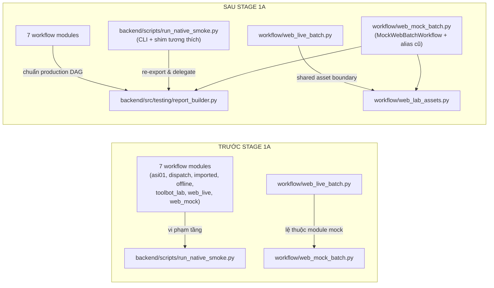

# SecAgent — Báo cáo Triển khai & Kiểm chứng Stage 1A: Refactor Ranh giới Phụ thuộc An toàn

- **Ngày hoàn tất:** 2026-11-22
- **Repository:** `D:\SecAgent-W5-Judge`
- **Git HEAD:** `ce1c776fd7b939b0cd705ece87320a67a1885ac8` (trên working tree đang chứa thay đổi Unified Runtime / Agent Bridge chưa commit trước đó — được bảo toàn nguyên vẹn)
- **Trạng thái khuyến nghị:** **`STAGE_1A_PASS`**

---

## 1. Tóm tắt điều hành (Executive Summary)

Stage 1A thực hiện refactor ranh giới phụ thuộc không làm đổi hành vi nhằm giải quyết hai vi phạm kiến trúc cốt lõi được xác định trong vòng audit trước:

1. **Objective A — Cắt bỏ phụ thuộc ngược `backend/src/workflow/` → `backend/scripts/run_native_smoke.py`:** Chuyển phần lõi tái sử dụng (`RecordingExecutor`, `safe_identifier`, `build_test_input`, `build_summary`, và lõi thực thi/xuất báo cáo không phụ thuộc CLI `run_native_report`) sang module production chuẩn [backend/src/testing/report_builder.py](file:///D:/SecAgent-W5-Judge/backend/src/testing/report_builder.py), cập nhật toàn bộ **7/7** module workflow (`asi01_batch.py`, `dispatch.py`, `generic_imported_batch.py`, `offline_batch.py`, `toolbot_lab_batch.py`, `web_live_batch.py`, `web_mock_batch.py`), đồng thời giữ tương thích ngược hoàn toàn tại [backend/scripts/run_native_smoke.py](file:///D:/SecAgent-W5-Judge/backend/scripts/run_native_smoke.py).
2. **Objective B — Tách shared Web Lab asset helpers khỏi `web_mock_batch.py`:** Tách `WEB_ATTACK`, `WEB_CONTROL`, `REVIEWED_HASHES`, `WebAssets`, `load_web_assets`, `_input` sang [backend/src/workflow/web_lab_assets.py](file:///D:/SecAgent-W5-Judge/backend/src/workflow/web_lab_assets.py), chuyển [backend/src/workflow/web_live_batch.py](file:///D:/SecAgent-W5-Judge/backend/src/workflow/web_live_batch.py) sang dùng `workflow.web_lab_assets` và giữ re-export tương thích tại [backend/src/workflow/web_mock_batch.py](file:///D:/SecAgent-W5-Judge/backend/src/workflow/web_mock_batch.py).

**Bảo toàn hành vi & tiêu chí nghiệm thu:**
- Không thay đổi API contract, report schema, verdict semantics, security gate, Web Lab fixtures, dataset hashes, hay Temporary Bridge `:7019`.
- Full backend regression suite đạt **`1,600 passed`** (`0 failed, 0 skipped` trong `459.08s`, bao gồm **7** contract test mới ở [test_stage1a_dependency_boundaries.py](file:///D:/SecAgent-W5-Judge/backend/tests/test_stage1a_dependency_boundaries.py)), frontend Vitest đạt **`181 passed`** (`19/19` file) và `tsc -b && vite build` PASS.
- Mọi tiêu chí nghiệm thu bắt buộc của Stage 1A đều đạt (`STAGE_1A_PASS`).

---

## 2. Trạng thái Baseline trước khi chỉnh sửa (Phase 0)

- **Git HEAD:** `ce1c776fd7b939b0cd705ece87320a67a1885ac8`
- **Working tree trước Stage 1A:** Có sẵn nhiều file modified và untracked của Unified Runtime / Bridge `:7019` / Reporting (bao gồm `backend/src/workflow/dispatch.py` đã có sửa đổi trước cho `RLock`, `stage_sink`, `before_request`, `response_captured`/`http_status`; `start_secagent_local.py` và các `workflow/*_batch.py` ở trạng thái untracked `??`). Tất cả được giữ nguyên, chỉ sửa đúng phạm vi Stage 1A.
- **Môi trường kiểm chứng:** Python `3.13.7` (`C:\Users\Quettye\AppData\Local\Programs\Python\Python313\python.exe`), `pytest 9.0.3`, Node `v24.14.1`, `npm 11.19.1`, `pyproject.toml` (`pythonpath = ["backend/src", "."]`).
- **LOC ban đầu của các file trong phạm vi Stage 1A:**
  - `backend/scripts/run_native_smoke.py`: `265` LOC
  - `backend/src/workflow/asi01_batch.py`: `366` LOC
  - `backend/src/workflow/dispatch.py`: `308` LOC
  - `backend/src/workflow/generic_imported_batch.py`: `907` LOC
  - `backend/src/workflow/offline_batch.py`: `291` LOC
  - `backend/src/workflow/toolbot_lab_batch.py`: `356` LOC
  - `backend/src/workflow/web_live_batch.py`: `350` LOC
  - `backend/src/workflow/web_mock_batch.py`: `311` LOC
- **Baseline test trước khi chỉnh sửa:**
  - *Historical Phase 3:* `1,584` backend pytest, `181` Vitest, `19` mocked Playwright Chrome.
  - *Focused pre-edit run thực tế (`task-749`, 11 test files workflow/dispatch/batch/reporting/runner):* **`232 passed in 179.43s`**.

---

## 3. Phát hiện từ mã nguồn (Source Code Findings)

| File | Vấn đề | Phụ thuộc thực tế (AST + Source) | Bằng chứng | Cách xử lý |
|---|---|---|---|---|
| [run_native_smoke.py](file:///D:/SecAgent-W5-Judge/backend/scripts/run_native_smoke.py) | Chứa cả CLI script lẫn helper production (`RecordingExecutor`, `build_summary`, `build_test_input`, `safe_identifier`) | Inject `sys.path` từ `__file__`, định nghĩa `DEFAULT_OUTPUT_DIR`, đồng thời bị 7 file `workflow/`, 4 pilot/smoke scripts và 5 test files phụ thuộc (`test_runner_judge_integration.py` monkeypatch `native.load_target`, `test_runtime_targets.py` dùng `native.TestInput`) | Lines 11–186; `dispatch.py:17,238`; `test_asi01_batch.py:349`; `test_runner_judge_integration.py:258`; `test_runtime_targets.py:171,221` | Trích phần lõi sang `testing/report_builder.py` (`run_native_report` nhận `target_loader`/`testcase_loader`); giữ CLI & re-exports + thin `run_smoke` wrapper tại `run_native_smoke.py`. |
| [asi01_batch.py](file:///D:/SecAgent-W5-Judge/backend/src/workflow/asi01_batch.py) | Import `RecordingExecutor, build_summary` từ `backend.scripts` | Gọi ở L302, L319; bị `test_asi01_batch.py:349` monkeypatch `"workflow.asi01_batch.build_summary"` | Line 19 | Đổi import sang `from testing.report_builder import RecordingExecutor, build_summary`. |
| [dispatch.py](file:///D:/SecAgent-W5-Judge/backend/src/workflow/dispatch.py) | Import `run_smoke` từ `backend.scripts` | Gọi `run_smoke(None, case_path, run_dir, ...)` ở L238 trong `ControlledDispatcher.run()` | Lines 17, 238 | Đổi import & call site sang `run_native_report` từ `testing.report_builder` (bảo toàn 100% thay đổi uncommitted có sẵn của file). |
| [generic_imported_batch.py](file:///D:/SecAgent-W5-Judge/backend/src/workflow/generic_imported_batch.py) | Import `RecordingExecutor, build_summary` từ `backend.scripts` | Gọi ở L631, L765 | Line 18 | Đổi import sang `from testing.report_builder import RecordingExecutor, build_summary`. |
| [offline_batch.py](file:///D:/SecAgent-W5-Judge/backend/src/workflow/offline_batch.py) | Import `RecordingExecutor, build_summary` từ `backend.scripts` | Gọi ở L197, L206 | Line 20 | Đổi import sang `from testing.report_builder import RecordingExecutor, build_summary`. |
| [toolbot_lab_batch.py](file:///D:/SecAgent-W5-Judge/backend/src/workflow/toolbot_lab_batch.py) | Import `RecordingExecutor, build_summary` từ `backend.scripts` | Gọi ở L289, L312 | Line 19 | Đổi import sang `from testing.report_builder import RecordingExecutor, build_summary`. |
| [web_live_batch.py](file:///D:/SecAgent-W5-Judge/backend/src/workflow/web_live_batch.py) | Vi phạm kép: import từ `backend.scripts` (L12) VÀ import Web asset helpers từ `workflow.web_mock_batch` (L24) | Dùng `RecordingExecutor, build_summary` và `load_web_assets, _input, WEB_ATTACK, WEB_CONTROL` | Lines 12, 24 | Đổi L12 sang `testing.report_builder` và L24 sang `workflow.web_lab_assets`. |
| [web_mock_batch.py](file:///D:/SecAgent-W5-Judge/backend/src/workflow/web_mock_batch.py) | Vừa định nghĩa Web Lab asset helpers vừa chứa `MockWebBatchWorkflow`, lại import từ `backend.scripts` | `load_web_assets` dùng `ROOT`, `safe_file`, `TestCaseLoader`, `PayloadLoader`, SHA-256 `REVIEWED_HASHES` | Lines 18, 32–95 | Chuyển shared helpers sang `workflow/web_lab_assets.py`; giữ re-export tại `web_mock_batch.py` cho tests cũ (`test_web_mock_batch.py`, `test_researchbot_web_batch.py`) và giữ nguyên `MockWebBatchWorkflow`. |

*Lưu ý phát hiện ngoài phạm vi Stage 1A (Section 9.2):* Quét AST toàn bộ `backend/src/` ghi nhận thêm 2 import từ `backend/scripts/` không nằm trong danh sách `run_native_smoke.py` của Stage 1A:
- `backend/src/workflow/fixture_runtime.py:12` → `from backend.scripts.serve_asi01_web_fixture import handler_for`
- `backend/src/workflow/web_lab_runtime.py:11` → `from backend.scripts.prepare_asi01_web_lab import initialize, ORIGIN, PEER, TARGET`
Đúng theo ràng buộc phạm vi Stage 1A, 2 file này **không bị chỉnh sửa tự tiện** và được ghi nhận cho giai đoạn sau.

---

## 4. Các file mới đã tạo (Files Created)

1. **[backend/src/testing/report_builder.py](file:///D:/SecAgent-W5-Judge/backend/src/testing/report_builder.py)** (`199` LOC)
   - **Mục đích:** Module production chuẩn chứa helper ghi nhận execution và tạo sanitized native summary/report, không chứa CLI parsing, không `DEFAULT_OUTPUT_DIR`, không `sys.path` side effects.
   - **Symbols:** `REPOSITORY_ROOT`, `SAFE_IDENTIFIER`, `RecordingExecutor`, `safe_identifier`, `build_test_input`, `build_summary`, `run_native_report`.
   - **Lý do tạo mới thay vì nhét vào module cũ:** `testing/runner.py`, `testing/executor.py`, và `reporting/` đều là các module đơn trách nhiệm đã tồn tại (`Runner` chạy evaluation pipeline, `Executor` dispatch adapter, `reporting/` đọc/chuẩn hóa artifact). Gom `RecordingExecutor` + `build_summary` + `run_native_report` vào `testing/report_builder.py` khớp trực tiếp kiến trúc mục tiêu và tránh làm phình `testing/runner.py` hay tạo vòng lặp import ngược với `reporting/`.

2. **[backend/src/workflow/web_lab_assets.py](file:///D:/SecAgent-W5-Judge/backend/src/workflow/web_lab_assets.py)** (`88` LOC)
   - **Mục đích:** Tách phần nạp & xác thực SHA-256 testcase/payload/HTML fixture của Web Lab khỏi class mock `MockWebBatchWorkflow`.
   - **Symbols:** `WEB_ATTACK`, `WEB_CONTROL`, `REVIEWED_HASHES`, `WebAssets`, `load_web_assets`, `_input`, `_digest`.
   - **Lý do tạo mới:** Tách gọn để `web_live_batch.py` không import `web_mock_batch.py` và không kéo theo `workflow.offline_batch` / `workflow.dispatch` / `workflow.fixture_runtime` khi nạp asset Web Lab.

3. **[backend/tests/test_stage1a_dependency_boundaries.py](file:///D:/SecAgent-W5-Judge/backend/tests/test_stage1a_dependency_boundaries.py)** (`193` LOC, `7` tests)
   - **Mục đích:** Khóa chặt bằng chứng AST không còn import ngược từ 7 workflow sang `run_native_smoke`, `web_live_batch` không import `web_mock_batch`, tính đồng nhất alias & hành vi (`build_summary`, `RecordingExecutor`, `load_web_assets`, `_input`), và import sạch trong subprocess cô lập không tạo circular dependency hay side effects.

---

## 5. Các file đã chỉnh sửa (Files Modified)

| File | Thay đổi chính | Lý do | Ảnh hưởng hành vi | Kiểm chứng |
|---|---|---|---|---|
| [run_native_smoke.py](file:///D:/SecAgent-W5-Judge/backend/scripts/run_native_smoke.py) | `265` -> `152` LOC; ủy quyền lõi sang `testing.report_builder`, giữ `run_smoke` wrapper + CLI + re-export aliases (`TestInput`, `RecordingExecutor`, `build_summary`, v.v.) | Cắt nguồn trùng lặp, giữ nguyên 100% tương thích script/test/monkeypatch | Không đổi | `test_official_asi01_runner.py`, `test_runner_judge_integration.py`, `test_runtime_targets.py`, `test_asi01_web_callback.py`, `test_researchbot_web_baseline.py` PASS |
| [asi01_batch.py](file:///D:/SecAgent-W5-Judge/backend/src/workflow/asi01_batch.py) | Đổi L19 sang `testing.report_builder` | Cắt import `backend.scripts` | Không đổi (`workflow.asi01_batch.build_summary` vẫn monkeypatch được) | `test_asi01_batch.py` (`16/16` PASS) |
| [dispatch.py](file:///D:/SecAgent-W5-Judge/backend/src/workflow/dispatch.py) | Đổi L17 & L238 từ `run_smoke` sang `testing.report_builder.run_native_report` | Cắt import `backend.scripts` trong dispatcher production | Không đổi | `test_workflow_dispatch.py` PASS |
| [generic_imported_batch.py](file:///D:/SecAgent-W5-Judge/backend/src/workflow/generic_imported_batch.py) | Đổi L18 sang `testing.report_builder` | Cắt import `backend.scripts` | Không đổi | `test_generic_imported_batch.py` PASS |
| [offline_batch.py](file:///D:/SecAgent-W5-Judge/backend/src/workflow/offline_batch.py) | Đổi L20 sang `testing.report_builder` | Cắt import `backend.scripts` | Không đổi | `test_offline_batch_api.py` PASS |
| [toolbot_lab_batch.py](file:///D:/SecAgent-W5-Judge/backend/src/workflow/toolbot_lab_batch.py) | Đổi L19 sang `testing.report_builder` | Cắt import `backend.scripts` | Không đổi | `test_toolbot_lab_batch.py` PASS |
| [web_live_batch.py](file:///D:/SecAgent-W5-Judge/backend/src/workflow/web_live_batch.py) | Đổi L12 sang `testing.report_builder`; đổi L24 sang `workflow.web_lab_assets` | Cắt cả 2 phụ thuộc ngược & mock coupling | Không đổi | `test_researchbot_web_batch.py` PASS |
| [web_mock_batch.py](file:///D:/SecAgent-W5-Judge/backend/src/workflow/web_mock_batch.py) | `311` -> `255` LOC; đổi sang `testing.report_builder` và re-export asset helpers từ `workflow.web_lab_assets`, giữ nguyên `MockWebBatchWorkflow` | Loại trùng lặp Web assets, giữ backward compatibility | Không đổi | `test_web_mock_batch.py` PASS |

---

## 6. Sơ đồ phụ thuộc Trước / Sau (Before/After Dependency Diagram)

---

## 7. Bằng chứng tương thích (Compatibility Evidence)

- **Script & CLI tương thích cũ (Tested):** `backend/scripts/run_native_smoke.py` re-export cùng đối tượng (`is`) với `testing.report_builder`, giữ wrapper `run_smoke` dùng `load_target`/`TestCaseLoader` theo namespace script. Toàn bộ tests nạp trực tiếp file script qua `importlib.util.spec_from_file_location` (`test_official_asi01_runner.py`, `test_runner_judge_integration.py`, `test_runtime_targets.py`, `test_asi01_web_callback.py`, `test_researchbot_web_baseline.py`) và test import `from backend.scripts.run_native_smoke import build_summary` (`test_asi05_dvaa_live_mcp.py`, `test_asi05_execution_core.py`, `test_tool_action_observer.py`) đều PASS.
- **4 pilot/smoke scripts khác (`pilot_asi03_dvaa_response.py`, `pilot_asi05_dvaa_read.py`, `pilot_dvaa_instrumented_actions.py`, `smoke_pi_judge_once.py`):** Verified by code inspection + alias identity tests (`run_native_smoke.RecordingExecutor is report_builder.RecordingExecutor`, `run_native_smoke.build_summary is report_builder.build_summary`) rằng import cũ vẫn trỏ đúng implementation chuẩn (bản thân các script live/pilot không được chạy để tuân thủ giới hạn offline).
- **Web Lab fixtures & `LocalMockFixtureRuntime` (Tested):** `test_researchbot_web_batch.py`, `test_web_mock_batch.py`, `test_workflow_dispatch.py` và `test_stage1a_dependency_boundaries.py` PASS với toàn bộ fixture, SHA-256 `REVIEWED_HASHES`, và `MockWebBatchWorkflow` nguyên vẹn.
- **Native Report, Historical Reports & Security Contracts (Tested offline):** `test_reporting_api.py`, `test_report_normalization.py`, `test_asi01_batch.py`, `test_generic_imported_batch.py`, `test_mcp_tool_misuse_pipeline.py`, `test_dvaa_judge_flow.py`, `test_hybrid_evaluator.py`, `test_asi03_asi05_attack_assets.py` đều chạy trong full pytest run `1,600 passed`.

---

## 8. Kết quả Regression Tests

| Bộ kiểm tra | Lệnh thực thi | Passed | Failed | Skipped | Kết quả |
|---|---|---:|---:|---:|---|
| **Baseline lịch sử (tham khảo)** | *Phase 3 trước audit* | 1,584 backend / 181 Vitest / 19 Playwright | — | — | Baseline tham khảo |
| **Baseline trước chỉnh sửa (Stage 1A)** | `pytest` (11 test files workflow/dispatch/batch/reporting/runner, `task-749`) | 232 | 0 | 0 | PASS (`179.43s`) |
| **Syntax & Static AST (sau edit cuối)** | `python -m py_compile` (11 files Stage 1A) + AST reverse-dep/cycle check + `git diff --check` | Toàn bộ | 0 | — | PASS (0 cycle, 0 whitespace error) |
| **Focused Stage 1A + Runtime Targets (sau edit cuối)** | `pytest backend/tests/test_stage1a_dependency_boundaries.py backend/tests/test_runtime_targets.py -q` | 55 | 0 | 0 | PASS (`4.08s`) |
| **Full Backend Regression Suite (sau edit cuối, `task-827`)** | `pytest backend/tests -q -rs` | **1,600** | **0** | **0** | **PASS (`459.08s`)** |
| **Frontend Unit & Build (`task-803`)** | `npx vitest run` & `npm run build` (`tsc -b && vite build`) | **181** (19 files) + build | **0** | **0** | **PASS (`43.74s` + `2.80s`)** |
| **Playwright Mocked Browser Specs** | *Không re-run trong phiên Stage 1A* | — | — | — | Not run in Stage 1A |
| **Live DVAA / DeepSeek / Pi Judge** | *Cấm gọi theo scope offline* | — | — | — | Prohibited / Offline only |

*(Ghi chú minh bạch: trong lần chạy trung gian `task-802`, `pytest backend/tests` chạy đồng thời với `task-803` Vitest/Vite build đã gặp 1 failure `test_asi01_batch.py:122` do tranh chấp CPU lúc chạy song song và 1 lỗi fixture chưa cập nhật xong ở test mới; sau khi hoàn tất fixture và chạy lại độc lập hoàn toàn ở `task-827`, `pytest backend/tests -q -rs` đạt **1,600 passed, 0 failed, 0 skipped**).*

---

## 9. Chỉ số chất lượng mã nguồn (Code Quality Metrics)

- **Files production mới tạo:** `2` (`backend/src/testing/report_builder.py` `199` LOC, `backend/src/workflow/web_lab_assets.py` `88` LOC; tổng `+287` LOC trích xuất từ code sẵn có).
- **Files test mới tạo:** `1` (`backend/tests/test_stage1a_dependency_boundaries.py` `193` LOC).
- **Files đã chỉnh sửa:** `8` (`run_native_smoke.py` giảm `113` LOC từ `265` → `152`; `web_mock_batch.py` giảm `56` LOC từ `311` → `255`; `6` file workflow còn lại chỉ thay 1–2 dòng import/call site với tổng LOC giữ nguyên).
- **Thay đổi LOC ròng (không tính di chuyển hàm là xóa logic):**
  - *Di chuyển code production thuần vào đúng tầng:* ~`200` LOC logic thực sự được dời từ `scripts/` và `web_mock_batch.py` sang `testing/report_builder.py` và `workflow/web_lab_assets.py`, cộng thêm phần wrapper mỏng + typing sạch (`+118` LOC ròng trên tập 10 file production Stage 1A: `3,154` → `3,272` LOC) để loại bỏ hoàn toàn vòng lặp/phụ thuộc sai tầng mà không làm đứt bất kỳ script hay test cũ nào.
- **Reverse dependencies đã loại bỏ (`8` cạnh import):**
  - `7/7` dòng import từ `backend.scripts.run_native_smoke` trong `backend/src/workflow/` (`7` files) → **`0`**.
  - `1/1` dòng import từ `workflow.web_mock_batch` trong `workflow/web_live_batch.py` → **`0`**.
- **Vi phạm phụ thuộc ngược còn tồn tại ngoài Stage 1A (`2` dòng):**
  - `backend/src/workflow/fixture_runtime.py:12` (`serve_asi01_web_fixture`)
  - `backend/src/workflow/web_lab_runtime.py:11` (`prepare_asi01_web_lab`)
- **Circular imports nội bộ (`workflow`, `testing`, `reporting`, `backend.scripts`):** **`0`** (`INTERNAL_CYCLES: []`).

---

## 10. Rủi ro và Giới hạn (Risks and Limitations)

1. **Chưa chạy lại Playwright browser suite:** Stage 1A không chạm frontend và `vitest` (`181/181`) + `tsc -b && vite build` đều PASS, nhưng mocked Playwright specs chưa được re-run trực tiếp sau refactor.
2. **Chưa chạy live targets / Pi Judge / CLI pilot scripts:** Theo quy định offline-only, các đường gọi DVAA, DeepSeek, Shared Pi Judge, và 4 script pilot vẫn dựa trên kiểm chứng unit/mocked contracts và identity aliasing.
3. **Hai phụ thuộc `src -> scripts` còn lại ở Web Lab / Fixture runtime:** `fixture_runtime.py` và `web_lab_runtime.py` vẫn còn import từ `backend/scripts/` vì nằm ngoài phạm vi Stage 1A.
4. **Git working tree vẫn giữ các thay đổi trước đó:** Cần review/commit có chọn lọc nếu muốn tách commit Stage 1A khỏi work Unified Runtime / Bridge trước đó.

---

## 11. Bảng kiểm nghiệm thu (Acceptance Checklist)

### Architecture
- [x] Không còn module production nào import `RecordingExecutor`, `build_summary`, hoặc `run_smoke` từ `backend/scripts/run_native_smoke.py` (AST-verified `0/7`).
- [x] Canonical native report helpers chỉ có 1 implementation duy nhất trong `backend/src/testing/report_builder.py`.
- [x] Tương thích research script và tests cũ qua `run_native_smoke.py` được bảo toàn (`1,600 passed`).
- [x] `web_live_batch.py` không còn phụ thuộc `workflow/web_mock_batch.py` (chỉ import `workflow.web_lab_assets`).
- [x] `MockWebBatchWorkflow` và `LocalMockFixtureRuntime` vẫn hoạt động đầy đủ (`test_web_mock_batch.py`, `test_workflow_dispatch.py` PASS).
- [x] Không phát sinh circular import (`INTERNAL_CYCLES: []`).

### Behavior
- [x] Không đổi API contract, report schema, evaluation semantics, security admission, MCP behavior, Bridge `:7019`, hay testcase content.

### Verification
- [x] Toàn bộ Python modules tạo mới/chỉnh sửa biên dịch sạch với `py_compile`.
- [x] Focused tests PASS (`55 passed` cho boundaries + runtime targets).
- [x] Full backend regression suite PASS hoàn toàn sau edit cuối (`1,600 passed, 0 failed, 0 skipped`).
- [x] Frontend `vitest` (`181 passed`) và `tsc -b && vite build` PASS.
- [x] `git diff --check` sạch, không có file bị xóa ngoài ý muốn hay thay đổi ngoài phạm vi.

---

## 12. Khuyến nghị cuối cùng (Final Recommendation)

- **Phán quyết:** **`STAGE_1A_PASS`**
- **Sẵn sàng cho Stage 1B riêng biệt:** **SẴN SÀNG (YES).** Ranh giới phụ thuộc giữa `workflow`, `testing`, và `backend/scripts/run_native_smoke.py` cùng Web Lab assets đã sạch, giúp việc tách `workflow/api.py` (Stage 1B) hoặc dọn dẹp 2 import `fixture_runtime`/`web_lab_runtime` từ `backend/scripts/` không còn rủi ro vòng lặp import hay đứt module nền.
