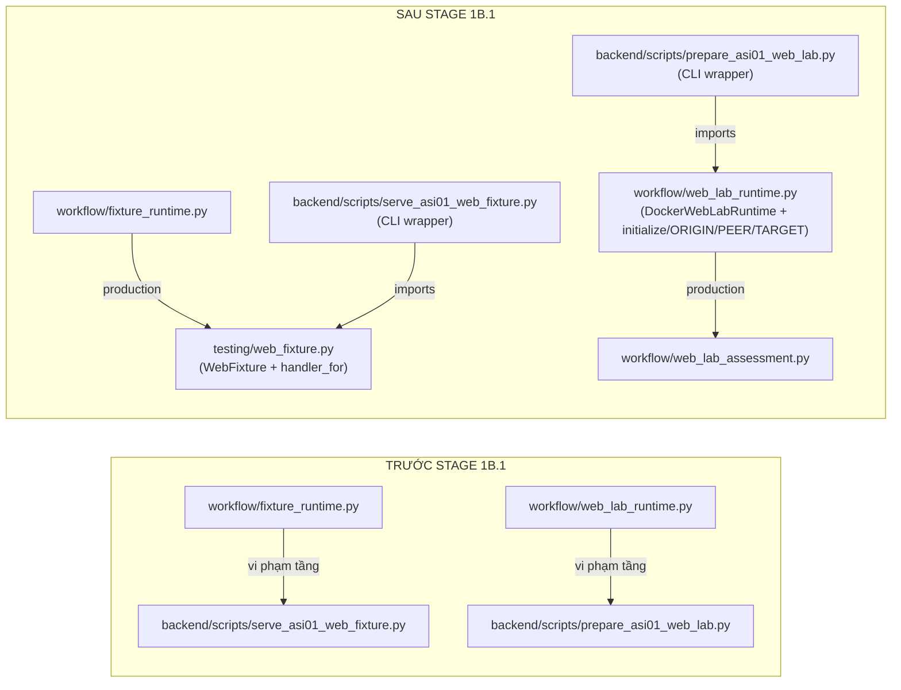

# SecAgent — Báo cáo Triển khai & Kiểm chứng Stage 1B.1: Loại bỏ Hoàn toàn Phụ thuộc Ngược Production → Scripts Còn lại

- **Ngày hoàn tất:** 2026-11-22
- **Repository:** `D:\SecAgent-W5-Judge`
- **Git HEAD:** `ce1c776fd7b939b0cd705ece87320a67a1885ac8`
- **Phán quyết nghiệm thu:** **`STAGE_1B1_PASS`**

---

## 1. Tóm tắt điều hành (Executive Summary)

Stage 1B.1 giải quyết dứt điểm **2 phụ thuộc ngược `backend/src/workflow/ -> backend/scripts/` cuối cùng** được ghi nhận sau Stage 1A:

1. **Dependency A (`fixture_runtime.py -> serve_asi01_web_fixture.py`):** Chuyển `handler_for(fixture)` sang module production sẵn có [backend/src/testing/web_fixture.py](file:///D:/SecAgent-W5-Judge/backend/src/testing/web_fixture.py) (nơi định nghĩa `WebFixture`), cập nhật [backend/src/workflow/fixture_runtime.py](file:///D:/SecAgent-W5-Judge/backend/src/workflow/fixture_runtime.py) và giữ [backend/scripts/serve_asi01_web_fixture.py](file:///D:/SecAgent-W5-Judge/backend/scripts/serve_asi01_web_fixture.py) làm CLI wrapper mỏng.
2. **Dependency B (`web_lab_runtime.py -> prepare_asi01_web_lab.py`):** Chuyển quyền sở hữu `ORIGIN`, `TARGET`, `PEER`, `SUBNETS`, `output`, `check_networks`, `reviewed_image`, `reviewed_base`, `initialize` vào thẳng [backend/src/workflow/web_lab_runtime.py](file:///D:/SecAgent-W5-Judge/backend/src/workflow/web_lab_runtime.py), và biến [backend/scripts/prepare_asi01_web_lab.py](file:///D:/SecAgent-W5-Judge/backend/scripts/prepare_asi01_web_lab.py) thành CLI entrypoint mỏng.

**Kết quả:**
- Tạo **`0` module production mới** (tái sử dụng trực tiếp 2 module hiện có); bổ sung `1` file test nhỏ tập trung vào hành vi thực tế ([test_stage1b1_dependency_boundaries.py](file:///D:/SecAgent-W5-Judge/backend/tests/test_stage1b1_dependency_boundaries.py)).
- Quét AST toàn bộ `backend/src/` ghi nhận **`0` phụ thuộc ngược `src -> scripts`** (`SRC_SCRIPT_IMPORTS: []`) và **`0` circular imports** (`INTERNAL_CYCLES: []`).
- Toàn bộ backend offline regression suite đạt **`1,604 passed`** (`0 failed, 0 skipped` trong `494.49s`). **Stage 1B.1 đạt `STAGE_1B1_PASS`**.

---

## 2. Trạng thái Baseline (Phase 0)

- **Git HEAD:** `ce1c776fd7b939b0cd705ece87320a67a1885ac8`.
- **Working tree trước Stage 1B.1:** Đã bao gồm kết quả Stage 1A (`testing/report_builder.py`, `workflow/web_lab_assets.py`, `test_stage1a_dependency_boundaries.py`), cùng các file từ Unified Runtime / Agent Bridge / Web Lab (`testing/web_fixture.py` đã có caching `_page_content`, `fixture_runtime.py` là tracked modified `M`, `web_lab_runtime.py` và `prepare_asi01_web_lab.py` là untracked `??`). Mọi thay đổi sẵn có đều được bảo toàn nguyên vẹn.
- **LOC baseline (trước chỉnh sửa Stage 1B.1):**
  - `backend/src/testing/web_fixture.py`: `168` LOC
  - `backend/src/workflow/fixture_runtime.py`: `43` LOC
  - `backend/scripts/serve_asi01_web_fixture.py`: `76` LOC
  - `backend/src/workflow/web_lab_runtime.py`: `204` LOC
  - `backend/scripts/prepare_asi01_web_lab.py`: `91` LOC
- **Baseline test trước chỉnh sửa Stage 1B.1:**
  - *Stage 1A post-edit:* `1,600 passed` (backend), `181 passed` (Vitest), `tsc -b && vite build` PASS.
  - *Focused pre-edit run (`task-861`, 6 file fixture/dispatch/web-lab):* **`90 passed in 141.50s`**.

---

## 3. Phân tích Dependency A (`fixture_runtime.py` ↔ `serve_asi01_web_fixture.py`)

- **Quan hệ gốc:** [fixture_runtime.py](file:///D:/SecAgent-W5-Judge/backend/src/workflow/fixture_runtime.py#L12) (`LocalMockFixtureRuntime.open()`) import `from backend.scripts.serve_asi01_web_fixture import handler_for` để gắn HTTP request handler phục vụ `page_url` và `callback_path` cho `WebFixture`.
- **Phân tích hàm `handler_for(fixture)` (`serve_asi01_web_fixture.py:14-37`):** Chỉ phụ thuộc `BaseHTTPRequestHandler` (`http.server`), `urlsplit` (`urllib.parse`), và các phương thức `page_url`, `callback_path`, `record()`, `page()` của `WebFixture`. Không dùng bất kỳ CLI flag hay `sys.path` hack nào.
- **Các caller khác cần bảo toàn:**
  - `test_asi01_web_callback.py:21-33,220,247-252` nạp trực tiếp `backend/scripts/serve_asi01_web_fixture.py` bằng `spec_from_file_location`, monkeypatch `server.ThreadingHTTPServer`, gọi `server.handler_for(f)` và `server.main(...)`.
  - `deploy/asi01-lab/compose.yaml` & `backend/src/workflow/lab_attachment.py` mount `/workspace/backend/src` và `/workspace/backend/scripts/serve_asi01_web_fixture.py` làm entrypoint CLI trong Docker.
  - `backend/scripts/serve_asi01_web_lab.py` (Web Lab hai-fixture dùng `WebLabAssessment`) có hàm `handler_for(assessment: WebLabAssessment)` riêng và được băm SHA-256 trong `DockerWebLabRuntime.identity()`, đồng thời không bị production source nào import — giữ nguyên không chạm.

---

## 4. Phân tích Dependency B (`web_lab_runtime.py` ↔ `prepare_asi01_web_lab.py`)

- **Quan hệ gốc:** [web_lab_runtime.py](file:///D:/SecAgent-W5-Judge/backend/src/workflow/web_lab_runtime.py#L11) import `from backend.scripts.prepare_asi01_web_lab import initialize, ORIGIN, PEER, TARGET` để chuẩn bị thư mục state (`assessment.json` + `compose.env`) và kiểm tra xung đột subnet Docker/host trước khi `docker compose up`.
- **Phân tích mã nguồn gốc (`prepare_asi01_web_lab.py:15-72`):** Định nghĩa các hằng số `ORIGIN`, `TARGET`, `PEER`, `SUBNETS` và các hàm `output()`, `check_networks()`, `reviewed_image()`, `reviewed_base()`, `initialize()`. Phụ thuộc vào `ROOT` (`D:\SecAgent-W5-Judge`) và `WebLabAssessment` (`workflow.web_lab_assessment`).
- **Bảo toàn đường dẫn & ngoại lệ:**
  - `ROOT` trong `workflow/web_lab_runtime.py` (từ `workflow.plans`) phân giải tới đúng `D:\SecAgent-W5-Judge`, khớp `Path(__file__).resolve().parents[2]` trong `prepare_asi01_web_lab.py`.
  - Giữ nguyên hàm `output()` dùng `subprocess.run(..., check=True, timeout=30)` tách với `_command(..., timeout=120)` của `DockerWebLabRuntime` để không đổi kiểu exception (`CalledProcessError` vs `RuntimeError`).
  - Quét AST/text toàn repo xác nhận không có caller production hay test nào khác import `prepare_asi01_web_lab`.

---

## 5. Quyết định kiến trúc (Architecture Decision)

- **Dependency A — Áp dụng Option A (Tái sử dụng module sẵn có):** Chuyển `handler_for(fixture)` trực tiếp vào [testing/web_fixture.py](file:///D:/SecAgent-W5-Judge/backend/src/testing/web_fixture.py), vì module này đã sở hữu lớp `WebFixture` và đã được cả `fixture_runtime.py` lẫn `serve_asi01_web_fixture.py` import sẵn.
- **Dependency B — Áp dụng Option C (Chuyển quyền sở hữu vào production runtime module):** Chuyển `ORIGIN`, `TARGET`, `PEER`, `SUBNETS`, `output`, `check_networks`, `reviewed_image`, `reviewed_base`, `initialize` trực tiếp vào [workflow/web_lab_runtime.py](file:///D:/SecAgent-W5-Judge/backend/src/workflow/web_lab_runtime.py), vốn là module sở hữu `DockerWebLabRuntime` và vòng đời Web Lab.
- **Tránh phình code / file thừa:** Hoàn toàn **`0` file production mới** được tạo thêm, không thêm wrapper lồng wrapper, chỉ 1 bản implementation duy nhất cho mỗi nhóm hàm, còn 2 file script trở thành CLI parser/entrypoint thuần túy.

---

## 6. Danh sách file thay đổi (Files Changed)

| File | Thay đổi | Lý do | Kiểm chứng |
|---|---|---|---|
| [backend/src/testing/web_fixture.py](file:///D:/SecAgent-W5-Judge/backend/src/testing/web_fixture.py) | `168` → `199` LOC: thêm `BaseHTTPRequestHandler` import & `handler_for(fixture)` | Đưa handler HTTP về đúng nơi sở hữu `WebFixture` (Option A) | `test_stage1b1_dependency_boundaries.py`, `test_asi01_web_callback.py`, `test_workflow_dispatch.py` |
| [backend/src/workflow/fixture_runtime.py](file:///D:/SecAgent-W5-Judge/backend/src/workflow/fixture_runtime.py) | `43` → `42` LOC: đổi `handler_for` sang `testing.web_fixture` | Cắt Dependency A (`src -> scripts`) | `test_workflow_dispatch.py`, `test_web_mock_batch.py`, `test_stage1b1_dependency_boundaries.py` |
| [backend/scripts/serve_asi01_web_fixture.py](file:///D:/SecAgent-W5-Judge/backend/scripts/serve_asi01_web_fixture.py) | `76` → `50` LOC: gỡ định nghĩa trùng `handler_for`, re-export từ `testing.web_fixture` | Giữ CLI & backward-compat (`server.main`, `server.handler_for`) | `test_asi01_web_callback.py` PASS |
| [backend/src/workflow/web_lab_runtime.py](file:///D:/SecAgent-W5-Judge/backend/src/workflow/web_lab_runtime.py) | `204` → `264` LOC: sở hữu `ORIGIN`, `PEER`, `TARGET`, `SUBNETS`, `check_networks`, `reviewed_image`, `reviewed_base`, `initialize`; xóa import `prepare_asi01_web_lab` | Cắt Dependency B (`src -> scripts`) theo Option C | `test_stage1b1_dependency_boundaries.py`, `test_researchbot_web_batch.py` |
| [backend/scripts/prepare_asi01_web_lab.py](file:///D:/SecAgent-W5-Judge/backend/scripts/prepare_asi01_web_lab.py) | `91` → `38` LOC: giữ CLI `main()` & import từ `workflow.web_lab_runtime` | Giữ CLI entrypoint chuẩn, không nhân đôi logic | `test_stage1b1_dependency_boundaries.py` (`prepare_asi01_web_lab.main`) |
| [backend/tests/test_stage1b1_dependency_boundaries.py](file:///D:/SecAgent-W5-Judge/backend/tests/test_stage1b1_dependency_boundaries.py) | Tạo mới (`142` LOC, `4` tests) | Khóa AST `0` `src -> scripts`, kiểm hành vi `handler_for`, `initialize`/CLI và `PYTHONPATH=backend/src` thuần | `task-889` + `task-893` PASS |

---

## 7. Sơ đồ phụ thuộc Trước / Sau (Before/After Dependencies)

---

## 8. Bảo toàn An ninh và Tương thích (Security & Compatibility)

- **Fixture HTTP & Collector security (Tested):** `handler_for` giữ nguyên quy tắc từ chối query string / `Transfer-Encoding` / `Content-Length != "0"` (`400`), từ chối path lạ (`404`), header `Cache-Control: no-store`, ghi nhận `"page"` / `"receipt"` vào `events.jsonl` không lộ canary hay header nhạy cảm (`test_stage1b1_dependency_boundaries.py`, `test_asi01_web_callback.py`).
- **Docker Web Lab validation & identity (Tested with mocks + code inspection):** Các kiểm tra `sha256:` image digest (`reviewed_image`), `repository@sha256:` guard base digest (`reviewed_base`), ràng buộc `parent` ngoài repo và không chứa ký tự đặc biệt (`initialize`), ghi `compose.env` (`DVAA_IMAGE`, `FIXTURE_IMAGE`, `PROXY_IMAGE`, `GUARD_BASE_IMAGE`, `WEB_LAB_STATE_DIR`) giữ nguyên hành vi và thông báo lỗi (`test_stage1b1_dependency_boundaries.py`). Phần gọi `docker` / `docker compose` thật trên container không chạy do phạm vi offline (`code inspection only` cho nhánh Docker runtime thực).
- **Dispatcher, Mock/Live Web Batch, Reporting, Judge, Bridge `:7019` (Tested offline):** Toàn bộ `test_workflow_dispatch.py`, `test_web_mock_batch.py`, `test_researchbot_web_batch.py`, `test_web_lab_assessment.py`, `test_asi01_lab_deployment.py`, `test_workflow_lab_attachment.py` và phần còn lại của 1,604 backend tests đều PASS.

---

## 9. Kết quả Regression Tests

| Suite | Lệnh thực thi | Passed | Failed | Skipped | Kết quả |
|---|---|---:|---:|---:|---|
| **Baseline trước chỉnh sửa (`task-861`)** | `pytest` (6 file workflow_dispatch/web_mock/researchbot_web/web_lab_assessment/web_callback/lab_deployment) | 90 | 0 | 0 | PASS (`141.50s`) |
| **Compilation & Static AST (`task-889`)** | `python -m py_compile` (6 file Stage 1B.1) + AST cycle/reverse-import scan | Toàn bộ | 0 | — | PASS (`INTERNAL_CYCLES: []`, `SRC_SCRIPT_IMPORTS: []`) |
| **Focused Stage 1B.1 + Stage 1A + Web Lab (`task-889`)** | `pytest backend/tests/test_stage1b1_dependency_boundaries.py backend/tests/test_stage1a_dependency_boundaries.py backend/tests/test_web_lab_assessment.py backend/tests/test_asi01_web_callback.py backend/tests/test_asi01_lab_deployment.py backend/tests/test_workflow_lab_attachment.py -q` | 74 | 0 | 0 | PASS (`29.12s`) |
| **Full Backend Regression (`task-893`, sau edit cuối)** | `pytest backend/tests -q -rs` + `git diff --check` | **1,604** | **0** | **0** | **PASS (`494.49s`)** |
| **Frontend Vitest & Build (từ Stage 1A, không sửa FE)** | `npx vitest run` & `npm run build` | 181 + build | 0 | 0 | PASS (unchanged FE) |
| **Live Docker Web Lab / DVAA / DeepSeek / Pi** | *Ngoài phạm vi offline* | — | — | — | Not run |

---

## 10. Giảm Technical Debt & Chỉ số Code Quality

- **Phụ thuộc ngược `src -> scripts` đã loại bỏ:**
  - `backend/src/workflow/fixture_runtime.py` → `backend.scripts.serve_asi01_web_fixture`: **`0` còn lại**
  - `backend/src/workflow/web_lab_runtime.py` → `backend.scripts.prepare_asi01_web_lab`: **`0` còn lại**
  - Toàn bộ Stage 1A (`7` workflow files → `run_native_smoke`): giữ **`0` còn lại**
  - **Tổng phụ thuộc `backend/src -> backend/scripts` toàn repo:** **`0`** (`SRC_SCRIPT_IMPORTS: []`)
- **Circular dependencies (`workflow`, `testing`, `reporting`, `targets`, `backend.scripts`):** **`0`** (`INTERNAL_CYCLES: []`)
- **Biến động LOC production (không tính di chuyển hàm là xóa logic):**
  - *Trước Stage 1B.1 (5 file liên quan):* `168 + 43 + 76 + 204 + 91 = 582` LOC (trong đó production `415` LOC, scripts `167` LOC).
  - *Sau Stage 1B.1:* `199 + 42 + 50 + 264 + 38 = 593` LOC (production `505` LOC do chuyển `+90` LOC phần lõi vào `testing/web_fixture.py` và `workflow/web_lab_runtime.py`; scripts giảm `-79` LOC từ `167` → `88`; thay đổi ròng toàn 5 file là `+11` LOC chủ yếu do docstring/signature import gọn gàng).
  - *Production files tạo mới:* **`0`** (`+1` file test `test_stage1b1_dependency_boundaries.py` `142` LOC).
  - *Files chỉnh sửa:* `5` (`3` tracked modified trong git diff: `web_fixture.py`, `fixture_runtime.py`, `serve_asi01_web_fixture.py`; `2` untracked trước đó: `web_lab_runtime.py`, `prepare_asi01_web_lab.py`).
  - *Trùng lặp loại bỏ / Abstraction mới:* Không nhân đôi logic; **`0` abstraction mới**.

---

## 11. Giới hạn kiểm chứng (Limitations)

1. Nhánh chạy `docker` / `docker compose` thật trong `DockerWebLabRuntime._verify()` / `verify_startup()` và chạy live HTTP server trong `serve_asi01_web_fixture` trên container chỉ được kiểm qua code inspection và mock subprocess/HTTP handler vì quy định offline.
2. Không re-run Playwright hoặc Vitest trong bước Stage 1B.1 do không sửa bất kỳ file frontend hay HTTP API nào (Vitest `181/181` & build đã PASS ngay trước đó ở Stage 1A).

---

## 12. Phán quyết nghiệm thu (Acceptance Verdict)

- **Kết luận:** **`STAGE_1B1_PASS`**
- **Sẵn sàng cho Stage 1B.2 (tách Blueprints cho `workflow/api.py`):** **YES.** Toàn bộ đồ thị import nội bộ hiện không còn bất kỳ cạnh `backend/src -> backend/scripts` nào (`0`), không có circular import (`[]`), và cả `workflow`, `testing` lẫn `api.py` đều import được độc lập dưới `PYTHONPATH=backend/src` thuần túy.
