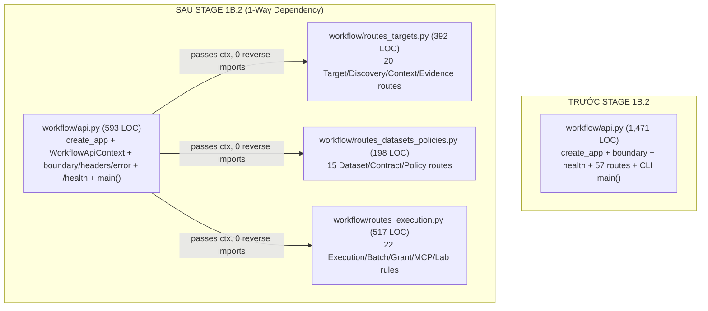

# SecAgent — Báo cáo Triển khai & Kiểm chứng Stage 1B.2: Mô-đun hóa Workflow API & Bảo toàn Hợp đồng HTTP

- **Ngày hoàn tất:** 2026-11-22
- **Repository:** `D:\SecAgent-W5-Judge`
- **Git HEAD:** `ce1c776fd7b939b0cd705ece87320a67a1885ac8`
- **Phán quyết nghiệm thu:** **`STAGE_1B2_PASS`**

---

## 1. Tóm tắt điều hành (Executive Summary)

Stage 1B.2 tách file monolith [backend/src/workflow/api.py](file:///D:/SecAgent-W5-Judge/backend/src/workflow/api.py) (`1,471` LOC ban đầu, `57` URL rules / `55` Flask endpoint identifiers) thành các nhóm route mạch lạc theo trách nhiệm nghiệp vụ mà **không làm thay đổi bất kỳ URL path, HTTP method, Flask endpoint identifier, middleware bảo mật, hay shared runtime state nào**:

1. **[workflow/api.py](file:///D:/SecAgent-W5-Judge/backend/src/workflow/api.py)** (`593` LOC): giữ vai trò **Application Assembly**, `WorkflowApiContext`, global security hooks (`boundary`, `headers`, `error`), `fail()`, `operator_authorized()`, route `/api/testing/health`, và CLI entrypoint `main()`.
2. **[workflow/routes_targets.py](file:///D:/SecAgent-W5-Judge/backend/src/workflow/routes_targets.py)** (`392` LOC): `20` routes cho Targets, Target Management, Discovery, Application Contexts và Evidence Sources.
3. **[workflow/routes_datasets_policies.py](file:///D:/SecAgent-W5-Judge/backend/src/workflow/routes_datasets_policies.py)** (`198` LOC): `15` routes cho Datasets, ASI03 Contracts, và ASI03/ASI05 Policies (đồng thời gộp lặp 4 route CRUD của `asi03-policies` & `asi05-policies` qua `_register_policy_group` mà vẫn giữ nguyên `8` endpoint IDs).
4. **[workflow/routes_execution.py](file:///D:/SecAgent-W5-Judge/backend/src/workflow/routes_execution.py)** (`517` LOC): `22` URL rules (`20` endpoints) cho Planning/Compatibility, Controlled Runs, Execution Grants, Batches, MCP Actions và Lab Preparation.

**Kết quả kiểm chứng:** `57/57` URL rules & `55/55` endpoints khớp 100% snapshot trước refactor; full backend pytest suite đạt **`1,608 passed`** (`0 failed, 0 skipped` trong `599.57s`), frontend Vitest đạt **`181 passed`** (`19/19` file) và `tsc -b && vite build` PASS; `0` circular imports, `0` `src -> scripts` imports.

---

## 2. Hiện trạng Trước Refactor (Before-State Inventory)

- **Git HEAD:** `ce1c776fd7b939b0cd705ece87320a67a1885ac8`
- **Working tree trước Stage 1B.2:** Đã chứa đầy đủ kết quả Stage 1A (`testing/report_builder.py`, `workflow/web_lab_assets.py`) và Stage 1B.1 (`testing/web_fixture.py`, `workflow/fixture_runtime.py`, `workflow/web_lab_runtime.py`), cùng thay đổi Unified Runtime / Reporting / Bridge `:7019` có sẵn từ trước (`git status --short` giữ nguyên toàn vẹn).
- **Môi trường runtime:** Python `3.13.7`, Flask `3.1.3`, Pydantic v2, `pytest 9.0.3`, Node `v24.14.1`.
- **Thông số `workflow/api.py` đo thực tế trước refactor:**
  - `1,471` LOC
  - `60` `@app.*` decorators (`1` `before_request`, `1` `after_request`, `1` `errorhandler`, `57` `@app.get`/`@app.post`)
  - **`57` URL rules**, **`55` Flask endpoint identifiers**, **`57` explicit GET/POST path combinations** (`136` tính cả `HEAD`/`OPTIONS`)
- **Baseline test trước Stage 1B.2:** `1,604 passed` (backend), `181 passed` + `vite build` PASS (frontend), và **`4 passed`** trên [test_stage1b2_api_contract_parity.py](file:///D:/SecAgent-W5-Judge/backend/tests/test_stage1b2_api_contract_parity.py) chạy trên `workflow/api.py` nguyên gốc trước chỉnh sửa.

---

## 3. Bảng kiểm kê Toàn bộ 57 URL Rules / 55 Endpoints (Trước & Sau)

Toàn bộ URL path, HTTP methods (`HEAD`/`OPTIONS` tự động) và Flask endpoint identifiers được giữ nguyên `100%`:

| # | URL Rule | Methods (Explicit) | Endpoint Identifier | Module Trước | Module Sau | Auth / Gate chính | Test Parity |
|---|---|---|---|---|---|---|---|
| 01 | `/api/testing/health` | `GET` | `health` | `api.py` | `api.py` | Loopback + Host/Origin | `test_stage1b2_*`, `test_b47_*` |
| 02 | `/api/testing/targets` | `GET` | `targets` | `api.py` | `routes_targets.py` | Loopback + Host/Origin | `test_stage1b2_*`, `test_workflow_targets.py` |
| 03 | `/api/testing/target-drafts/validate` | `POST` | `validate` | `api.py` | `routes_targets.py` | Nonce + Origin + JSON | `test_stage1b2_*`, `test_workflow_targets.py` |
| 04 | `/api/testing/connection-checks` | `POST` | `connection_check` | `api.py` | `routes_targets.py` | Operator + Nonce + Lock | `test_target_management.py` |
| 05–08 | `/api/testing/evidence-sources/target/<target_id>`, `/save`, `/collect`, `/evidence-captures/<capture_id>` | `GET`, `POST`, `POST`, `GET` | `evidence_list`, `evidence_save`, `evidence_collect`, `evidence_capture` | `api.py` | `routes_targets.py` | `managed_auth()` + `dispatcher._lock` | `test_evidence_sources.py` |
| 09–12 | `/api/testing/managed-targets`, `/archived`, `/archive`, `/restore` | `GET`, `GET`, `POST`, `POST` | `managed_targets`, `managed_archived_targets`, `managed_archive_targets`, `managed_restore_target` | `api.py` | `routes_targets.py` | `managed_auth()` + Nonce + Lock | `test_target_management.py`, `test_stage1b2_*` |
| 13–14 | `/api/testing/application-contexts/target/<target_id>`, `/save` | `GET`, `POST` | `read_application_context`, `save_application_context` | `api.py` | `routes_targets.py` | `managed_auth()` + `admin_lock` | `test_application_context.py` |
| 15–17 | `/api/testing/discoveries`, `/discoveries/<discovery_id>`, `/discovery-probes` | `POST`, `GET`, `POST` | `discover_target`, `read_discovery`, `probe_discovery_candidate` | `api.py` | `routes_targets.py` | `managed_auth()` + Nonce + Lock | `test_target_discovery.py`, `test_stage1b2_*` |
| 18–21 | `/api/testing/managed-targets/validate`, `/create`, `/update`, `/review` | `POST` | `managed_validate`, `managed_create`, `managed_update`, `managed_review` | `api.py` | `routes_targets.py` | `managed_auth()` + Nonce + Lock | `test_target_management.py` |
| 22–25 | `/api/testing/datasets`, `/validate`, `/import`, `/datasets/<dataset_id>` | `GET`, `POST`, `POST`, `GET` | `list_datasets`, `validate_dataset`, `import_dataset`, `get_dataset` | `api.py` | `routes_datasets_policies.py` | `dataset_auth()` (Operator + Nonce) | `test_generic_imported_batch.py`, `test_stage1b2_*` |
| 26–29 | `/api/testing/asi03-policies/drafts`, `/target/<target_id>`, `/<policy_id>`, `/<policy_id>/review` | `POST`, `GET`, `GET`, `POST` | `asi03_policy_draft`, `asi03_policy_lookup`, `asi03_policy_read`, `asi03_policy_review` | `api.py` | `routes_datasets_policies.py` | `dataset_auth()` + `asi03_policies` | `test_asi03_contracts.py`, `test_stage1b2_*` |
| 30–33 | `/api/testing/asi05-policies/drafts`, `/target/<target_id>`, `/<policy_id>`, `/<policy_id>/review` | `POST`, `GET`, `GET`, `POST` | `asi05_policy_draft`, `asi05_policy_lookup`, `asi05_policy_read`, `asi05_policy_review` | `api.py` | `routes_datasets_policies.py` | `dataset_auth()` + `asi05_policies` | `test_stage1b2_*`, `test_generic_imported_batch.py` |
| 34–37 | `/api/testing/asi03-contracts/drafts`, `/<contract_id>`, `/lookup/...`, `/<contract_id>/review` | `POST`, `GET`, `GET`, `POST` | `asi03_draft`, `asi03_read`, `asi03_lookup`, `asi03_review` | `api.py` | `routes_datasets_policies.py` | `dataset_auth()` + `asi03_contracts` | `test_asi03_contracts.py`, `test_stage1b2_*` |
| 38–39 | `/api/testing/categories`, `/api/testing/testcases` | `GET`, `GET` | `categories`, `testcases` | `api.py` | `routes_execution.py` | Loopback + Host/Origin | `test_workflow_plans.py`, `test_stage1b2_*` |
| 40–41 | `/api/testing/compatibility/preview`, `/api/testing/plans/preview` *(dùng chung 1 endpoint)* | `POST` | `preview` | `api.py` | `routes_execution.py` | Nonce + Origin + `PlanSelection` | `test_workflow_plans.py` |
| 42–43 | `/api/testing/readiness/preview`, `/api/testing/admissions` *(dùng chung 1 endpoint)* | `POST` | `readiness` | `api.py` | `routes_execution.py` | Nonce + Origin + `AdmissionRequest` | `test_workflow_admission.py` |
| 44–46 | `/api/testing/runs`, `/api/testing/run-selected`, `/api/testing/execution-grants` | `POST` | `run`, `run_selected`, `execution_grant` | `api.py` | `routes_execution.py` | Operator + Nonce + Lock + 1-use Grant | `test_workflow_dispatch.py`, `test_b47_remediation.py` |
| 47–52 | `/api/testing/batches/preview`, `/batches`, `/<id>`, `/events`, `/results`, `/cancel` | `POST`, `POST`, `GET`, `GET`, `GET`, `POST` | `batch_preview`, `batch_start`, `batch_status`, `batch_events`, `batch_results`, `batch_cancel` | `api.py` | `routes_execution.py` | `batch_auth()` + `services` mutex | `test_asi01_batch.py`, `test_offline_batch_api.py`, `test_web_mock_batch.py`, `test_researchbot_web_batch.py`, `test_toolbot_lab_batch.py` |
| 53–54 | `/api/testing/mcp-actions`, `/api/testing/mcp-actions/run` | `GET`, `POST` | `mcp_actions`, `run_mcp_action` | `api.py` | `routes_execution.py` | Operator + Nonce + Catalog PIN | `test_structured_mcp_actions.py`, `test_unified_startup_and_vite_proxy.py` |
| 55–57 | `/api/testing/lab-attempts/preview`, `/prepare`, `/preflight` | `POST` | `lab_preview`, `lab_prepare`, `lab_preflight` | `api.py` | `routes_execution.py` | Operator (`prepare`/`preflight`) + Nonce | `test_workflow_lab_attachment.py` |

*(Tổng: `57` URL rules, `55` endpoints, khớp chính xác 100% trước & sau refactor).*

---

## 4. Quyết định kiến trúc (Architecture Decision)

- **Lựa chọn Route Registration Functions (`register_*_routes(app, ctx)`) + `WorkflowApiContext` thay vì Flask `Blueprint`:**
  - Nếu chuyển 55 endpoints sang `Blueprint("targets", __name__)` / `@bp.get(...)`, Flask sẽ đổi toàn bộ tên endpoint nội bộ thành `"targets.targets"`, `"batches.batch_preview"`, v.v. (vi phạm yêu cầu giữ nguyên endpoint identity trừ khi chấp nhận đổi toàn bộ snapshot).
  - Dùng `register_target_routes(app, ctx)`, `register_dataset_policy_routes(app, ctx)`, `register_execution_routes(app, ctx)` đăng ký trực tiếp lên `Flask` app bằng `@app.get`/`@app.post`/`app.add_url_rule` giữ **`100%` URL rules, HTTP methods, `HEAD`/`OPTIONS`, và `55/55` tên endpoint** giống hệt bản gốc.
- **Quản lý Shared State & Global Hooks:**
  - `create_app()` tạo duy nhất 1 `Flask` app, 1 `nonce`, 1 `admin_lock`, và các store/service ứng dụng (`catalog`, `dispatcher`, `discovery`, `dataset_repo`, `services`, `asi03_*`, `asi05_*`, `evidence_sources`, `mcp_action_service`, `lab_preparer`), đóng gói vào `@dataclass(frozen=True) WorkflowApiContext`.
  - Global `@app.before_request boundary()`, `@app.after_request headers()`, và `@app.errorhandler(Exception) error()` giữ nguyên tại `api.py` để bảo đảm **100% request** vẫn đi qua cùng 1 cổng kiểm tra `Host`/`Origin`/nonce/kích thước trước khi vào bất kỳ handler nào.
- **Tránh Circular Imports:** Không có `routes_*.py` nào import `workflow.api` (được khóa tự động bởi `test_route_modules_do_not_import_workflow_api`). Chiều phụ thuộc một chiều rõ ràng: `workflow.api` → `routes_targets`, `routes_datasets_policies`, `routes_execution`.

---

## 5. Files Created / Modified

| File | Trạng thái | Trách nhiệm | LOC |
|---|---|---|---:|
| [backend/src/workflow/api.py](file:///D:/SecAgent-W5-Judge/backend/src/workflow/api.py) | Modified (`1,471` → `593`) | Application factory `create_app()`, `WorkflowApiContext`, `fail()`, global boundary hooks, `/api/testing/health`, CLI `main()`, re-export models | 593 |
| [backend/src/workflow/routes_targets.py](file:///D:/SecAgent-W5-Judge/backend/src/workflow/routes_targets.py) | Created | 20 routes Targets / Management / Discovery / Application Contexts / Evidence Sources + `LocalProbeRequest`, `DiscoveryProbeRequest` | 392 |
| [backend/src/workflow/routes_datasets_policies.py](file:///D:/SecAgent-W5-Judge/backend/src/workflow/routes_datasets_policies.py) | Created | 15 routes Datasets / ASI03 Contracts / ASI03 & ASI05 Target Policies (`_register_policy_group`) | 198 |
| [backend/src/workflow/routes_execution.py](file:///D:/SecAgent-W5-Judge/backend/src/workflow/routes_execution.py) | Created | 22 URL rules (20 endpoints) Planning, Runs, Execution Grants, Batches, MCP Actions, Lab Attempts + `OperatorGrantRequest`, `RunSelectedRequest` | 517 |
| [backend/tests/test_stage1b2_api_contract_parity.py](file:///D:/SecAgent-W5-Judge/backend/tests/test_stage1b2_api_contract_parity.py) | Created (`4` tests) | Frozen 57-rule `url_map` parity, full negative security HTTP tests, route-group smoke contracts, zero `workflow.api` import check | 223 |

---

## 6. Sơ đồ kiến trúc Trước / Sau (Mermaid)

---

## 7. Xác minh Security & Contract Parity

Các kịch bản bảo mật âm tính & hợp đồng lỗi được kiểm trực tiếp trên `test_stage1b2_api_contract_parity.py` (trước và sau refactor) cùng các bộ test chuyên sâu:
- **Host/Loopback & Origin/CSRF:** Sai `Host` (`403 local_only`), sai `Origin` (`403 origin_rejected`), `Sec-Fetch-Site: cross-site` (`403 origin_rejected`), POST thiếu `Origin` (`403 origin_required`), POST thiếu/sai `X-SecAgent-Validation` nonce (`403 validation_nonce_required`), headers bảo mật (`Cache-Control: no-store`, `X-Content-Type-Options: nosniff`, `Content-Security-Policy`, `Referrer-Policy`).
- **Input/Method/Size Guard:** Query string (`400 invalid_request`), route lạ (`404 not_found`), sai method (`405 method_not_allowed`), GET có body (`400 body_not_allowed`), body > 8192 trên non-dataset (`413 payload_too_large`), thiếu JSON mimetype (`415 json_required`), forced runtime exception (`500 internal_error`).
- **ExecutionGrant, MCP Actions & Policy Authorization:** `test_b47_remediation.py`, `test_workflow_dispatch.py`, `test_structured_mcp_actions.py`, `test_unified_startup_and_vite_proxy.py`, `test_asi03_contracts.py` toàn bộ PASS.

---

## 8. Kết quả Regression Tests

| Suite | Lệnh thực thi | Passed | Failed | Skipped | Duration / Status |
|---|---|---:|---:|---:|---|
| **Baseline Parity (pre-edit)** | `pytest backend/tests/test_stage1b2_api_contract_parity.py -q` | 4 | 0 | 0 | `2.01s` PASS |
| **Step 1 — Group 1 (`task-941`)** | `pytest` Parity + Target Mgmt + Discovery + AppContext + Evidence + Workflow Targets | 154 | 0 | 0 | `74.15s` PASS |
| **Step 2 — Group 2 (`task-952`)** | `pytest` Parity + ASI03 Contracts + Generic Imported + Live Local | 44 | 0 | 0 | `83.15s` PASS |
| **Step 3 — Group 3 (`task-966`)** | `python -m py_compile` + AST cycle/unused check + `pytest` Parity + ASI01/Offline/ToolBot/Web/Dispatch/MCP/Lab/B47/UnifiedStartup | 153 | 0 | 0 | `283.17s` PASS |
| **Full Backend Suite (`task-971`, final)** | `git diff --check` + AST `src->scripts` scan + `pytest backend/tests -q -rs` | **1,608** | **0** | **0** | **`599.57s` PASS (`SRC_SCRIPT_IMPORTS: []`, `INTERNAL_CYCLES: []`)** |
| **Frontend Unit & Build (`task-975`)** | `npx vitest run` & `npm run build` (`tsc -b && vite build`) | **181** (19 files) + build | **0** | **0** | `45.17s` + `2.06s` PASS |
| **Mocked Playwright Specs** | *Không re-run* (`$LOCALAPPDATA\ms-playwright` không có; không sửa frontend) | — | — | — | Unverified in Stage 1B.2 |

---

## 9. Chỉ số Chất lượng Mã nguồn (Code Quality Metrics)

- **Workflow API & Route Registration LOC:**
  - *Trước:* `1,471` LOC trong `1` file (`workflow/api.py`).
  - *Sau:* `593` (`api.py`) + `392` (`routes_targets.py`) + `198` (`routes_datasets_policies.py`) + `517` (`routes_execution.py`) = **`1,700` LOC tổng cộng** across `4` file (`+229` LOC tổng trên đĩa — nguyên nhân thực chất: mở rộng multi-line formatting từ các dòng nén cũ, `WorkflowApiContext` dataclass `42` LOC, module docstrings và explicit imports ở 3 file mới; không phải thêm logic mới).
- **Phân biệt di chuyển vs hợp nhất vs tạo mới:**
  - *Code di chuyển:* `~850` LOC handler sang 3 file route mới.
  - *Duplicated logic consolidated:* Gộp 2 cụm 4 routes gần như giống hệt nhau (`asi03-policies` & `asi05-policies`, ~`106` LOC → `60` LOC `_register_policy_group` giữ nguyên `8` endpoints).
  - *New public interface / abstraction:* Chỉ thêm 1 `@dataclass WorkflowApiContext` nội bộ + 3 hàm `register_*_routes(app, ctx)`.
- **Coupling & Cycles:** `0` circular imports (`INTERNAL_CYCLES: []`), `0` `src -> scripts` imports (`SRC_SCRIPT_IMPORTS: []`), `0` unused imports trong cả 3 file route mới (`api.py` giữ 4 re-export Pydantic request models để bảo toàn tương thích).
- **Route contract parity:** `57/57` URL rules, `55/55` Flask endpoints, `100%` parity.

---

## 10. Rủi ro còn lại (Remaining Risks)

1. **Playwright browser E2E / mocked Chrome specs chưa chạy lại trong Stage 1B.2:** Dù không sửa frontend và Vitest (`181/181`) + `tsc -b && vite build` PASS, chưa chạy lại browser specs (thư mục `ms-playwright` không có sẵn; cấu hình mặc định dùng `msedge` + dev server).
2. **Chi phí kiểm tra live target/Judge:** Theo quy định offline, chưa chạy live Unified Runtime qua `start_secagent_local.py` với DVAA / Bridge `:7019` / Shared Hybrid Pi Judge thật.

---

## 11. Bảng kiểm Nghiệm thu (Acceptance Checklist)

- [x] `workflow/api.py` thu gọn trách nhiệm về application assembly, `WorkflowApiContext`, boundary hooks, `/health`, và CLI (`1,471 → 593` LOC).
- [x] 3 nhóm route mạch lạc (`routes_targets.py`, `routes_datasets_policies.py`, `routes_execution.py`) dùng chung 1 shared `ctx`, không nhân bản workflow instances hay Flask apps.
- [x] `57/57` URL rules, `55/55` endpoint identifiers, HTTP methods và mọi error JSON/status giữ nguyên 100% (`test_stage1b2_api_contract_parity.py`).
- [x] `py_compile`, `git diff --check`, AST `0` cycles, AST `0` `src -> scripts` PASS.
- [x] Full backend suite PASS **`1,608/1,608`** (`0 failed, 0 skipped`).
- [x] Frontend `vitest` (`181/181`) và `tsc -b && vite build` PASS.
- [x] Bảo toàn tuyệt đối Bridge `:7019`, `start_secagent_local.py`, Runners, Judges, Policies, Datasets, Reports.

---

## 12. Phán quyết cuối cùng (Final Verdict)

- **Phán quyết:** **`STAGE_1B2_PASS`**
- Sẵn sàng cho **Stage 2** (hợp nhất HTTP batch workflow execution plumbing trên `Runner`) khi được yêu cầu ở phiên tách biệt tiếp theo.
