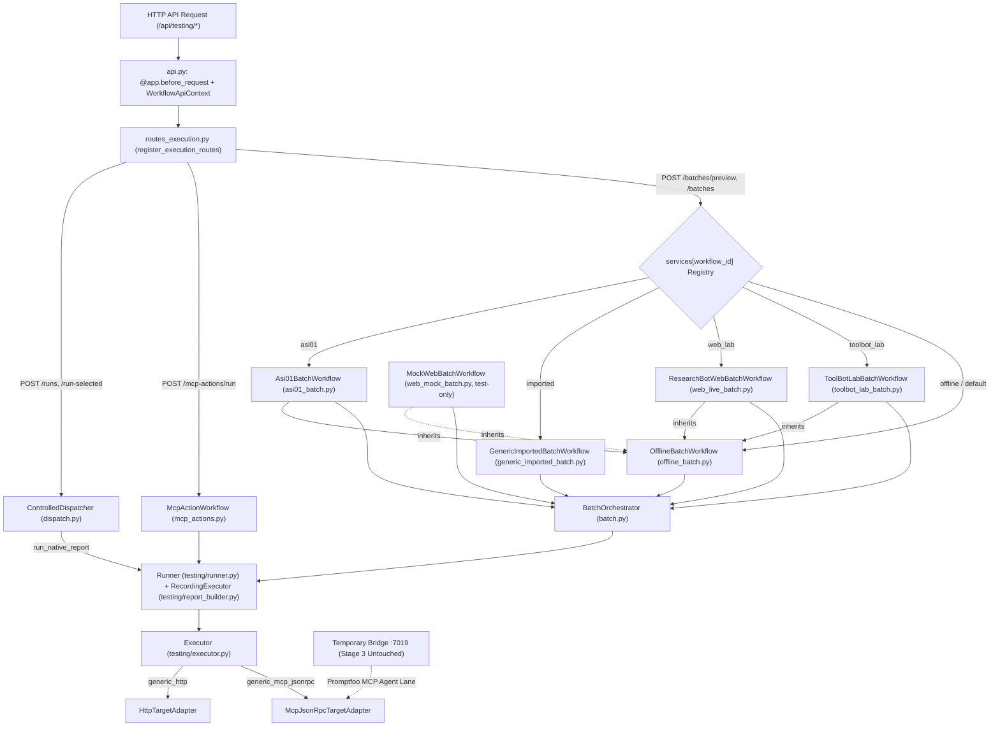
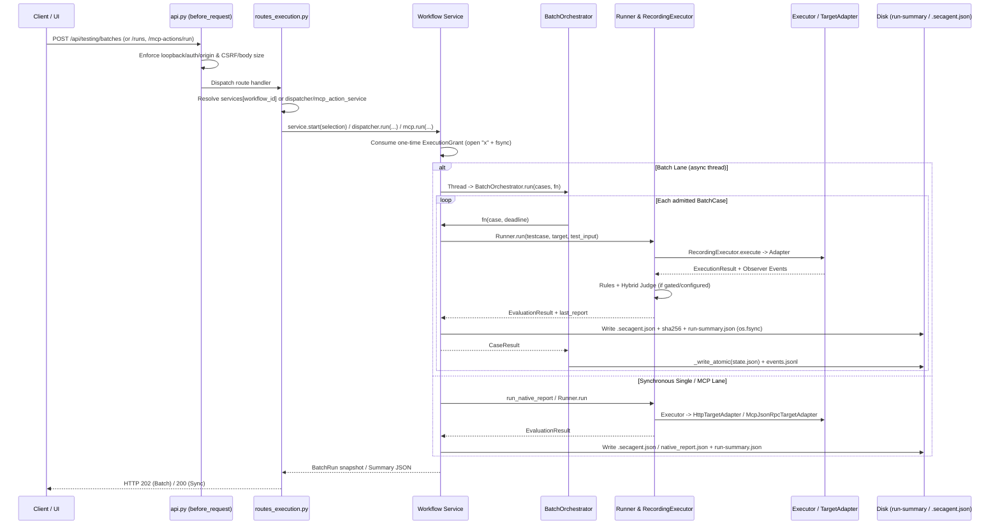

# BÁO CÁO KIỂM TOÁN STAGE 2A: TRÙNG LẶP WORKFLOW VÀ THIẾT KẾ HỢP NHẤT AN TOÀN

**Dự án:** SecAgent Framework (`D:\SecAgent-W5-Judge`)  
**Giai đoạn:** Stage 2A — Comprehensive Workflow Duplication Audit & Safe Consolidation Design (Chỉ đọc / Read-only Audit)  
**Ngày thực hiện:** 2026-11-22  
**Trạng thái đề xuất:** `STAGE_2A_PASS`

---

## 1. Executive Summary

Kiểm toán Stage 2A đã hoàn tất rà soát tĩnh và rà soát ngữ nghĩa trên toàn bộ **33 module** trong `backend/src/workflow/` (**8,873 LOC**) và **9 module** trong `backend/src/testing/` (**1,204 LOC**), truy vết đầy đủ luồng gọi hàm từ HTTP endpoints (`routes_execution.py`, `api.py`) xuống các workflow thực thi, `BatchOrchestrator`, `Runner`, `Executor`, `testing/report_builder.py`, Evidence Observers và lớp persistence báo cáo.

### Kết luận cốt lõi

1. **Đã có mức tái sử dụng chuẩn khá cao nhờ kiến trúc nền và Stage 1A:**
   - Toàn bộ **6 batch workflow** hiện hành đều đã dùng `BatchOrchestrator` (`workflow/batch.py:171`, `6` call sites), `Runner` (`testing/runner.py:27`, `7` call sites tính cả `McpActionWorkflow`), `RecordingExecutor` và `build_summary` từ `testing/report_builder.py` (`Stage 1A`).
   - **4/6 batch workflow** (`Asi01BatchWorkflow`, `ResearchBotWebBatchWorkflow`, `MockWebBatchWorkflow`, `ToolBotLabBatchWorkflow`) đã kế thừa `OfflineBatchWorkflow` (`workflow/offline_batch.py:102`).
2. **Trùng lặp thật sự tập trung ở lớp "plumbing" ngoại vi, không phải ở lõi điều phối:**
   - Phần trùng lặp thực chất là: (a) ghi file độc quyền `"x"` + `os.fsync` cho `grant-*` / `submission-*` / `run-summary.json` (`11` vị trí `grant-`, `6` vị trí `submission-`, `26` lần gọi `os.fsync`), (b) khối đuôi lưu native report `.secagent.json` + tính `sha256` + ghi `run-summary.json` + trả `CaseResult` lặp lại y hệt về cấu trúc ở **6 file** (`offline_batch.py`, `asi01_batch.py`, `generic_imported_batch.py`, `web_live_batch.py`, `web_mock_batch.py`, `toolbot_lab_batch.py`), (c) validator `unique_and_rule_only` trong **3 cặp** Pydantic models, (d) boilerplate khởi tạo worker thread + `dispatcher._lock` + `_active` + `Event.wait(5)` trong `start()`, và (e) kiểm tra profile/drifts lặp lại nội bộ ngay trong `generic_imported_batch.py` (`907` LOC — file lớn nhất thư mục `workflow/`).
   - Phát hiện thêm một lỗi nhỏ có sẵn trong `generic_imported_batch.py:784` và `generic_imported_batch.py:788`: key `"model": selection.target.model,` bị khai báo lặp hai lần trong cùng dict `runtime_snapshot` (ghi nhận cho Stage 2B xử lý, không sửa trong Stage 2A).
3. **Ước tính từ các kiểm toán cũ trước Stage 1A cần điều chỉnh thực tế:**
   - Ước tính Stage 0 trước đây (`-520` đến `-730` LOC) đã lỗi thời một phần vì Stage 1A đã rút `RecordingExecutor` và `build_summary` ra `testing/report_builder.py`. Mức giảm ròng thực tế, an toàn cho Stage 2B khi chỉ hợp nhất các nhóm loại **A/B** hợp lệ là khoảng **~210–315 LOC** mã sản xuất (`-265..385` dòng lặp bị xóa/thay thế, cộng `+55..70` dòng helper thuần trong `workflow/batch.py` và nội bộ `generic_imported_batch.py`).
4. **Quyết định kiến trúc then chốt:** **KHÔNG** tạo một lớp `ControlledBatchRunner` đa năng để gộp chung `OfflineBatchWorkflow`, `GenericImportedBatchWorkflow`, `ResearchBotWebBatchWorkflow`, `MockWebBatchWorkflow`, `ToolBotLabBatchWorkflow`, `ControlledDispatcher` và `McpActionWorkflow`. Các ranh giới tin cậy (offline mock vs live local vs Docker Web Lab có cặp control+attack vs MCP direct request), cơ chế cô lập grant (`_owned_grants`, cổng baseline `GH-C01`), và provenance báo cáo là **chuyên biệt có chủ đích (Category C)**. Stage 2B là đáng làm nếu giới hạn chặt chẽ vào các helper thuần hạ tầng và dọn nội bộ `GenericImportedBatchWorkflow`.

---

## 2. Repository and Baseline

- **Repository:** `D:\SecAgent-W5-Judge`
- **Git HEAD:** `ce1c776fd7b939b0cd705ece87320a67a1885ac8`
- **Môi trường Python:** `Python 3.13.7`
- **Trạng thái Working Tree (`git status --short`):** `248` mục chưa commit gồm `65` file sửa đổi (`M`) và `183` file chưa theo dõi (`??`) — đây là hiện trạng hợp pháp của các giai đoạn Stage 1A, 1B.1, 1B.2 và artifacts nghiên cứu trước đó.
- **`git diff --check`:** `0` lỗi khoảng trắng (exit code `0`, chỉ có cảnh báo CRLF/LF của Git trên Windows).
- **Xác nhận cấu trúc sau Stage 1B.2:**
  - `backend/src/workflow/routes_targets.py` (`392` LOC) — tồn tại, đăng ký qua `register_target_routes(app, ctx)` tại `workflow/api.py:399`.
  - `backend/src/workflow/routes_datasets_policies.py` (`198` LOC) — tồn tại, đăng ký qua `register_dataset_policy_routes(app, ctx)` tại `workflow/api.py:400`.
  - `backend/src/workflow/routes_execution.py` (`517` LOC) — tồn tại, đăng ký qua `register_execution_routes(app, ctx)` tại `workflow/api.py:401`.
  - `backend/src/workflow/api.py` (`593` LOC) — đóng vai trò module lắp ráp ứng dụng (`WorkflowApiContext`, `create_app`, `main`) và error sanitization/auth hooks.
- **Số liệu kiểm chứng từ báo cáo Stage 1B.2 (kết quả lịch sử, không chạy lại toàn bộ trong Stage 2A):**
  - `1,608` backend tests pass, `181` frontend Vitest tests pass, `57/57` Workflow API URL rules parity, `55/55` Flask endpoint parity, không phát hiện production-to-script reverse imports hoặc import cycle nội bộ.
- **Kiểm chứng thực chạy trong Stage 2A (read-only):**
  - Chạy bộ AST/regex scan trên toàn bộ `backend/src/workflow/*.py` (`33` files, `8,873` LOC) và `backend/src/testing/*.py` (`9` files, `1,204` LOC).
  - Đã chạy kiểm chứng suite kiểm thử ngoại tuyến cốt lõi cho các workflow trong phạm vi Stage 2A gồm 10 file (`test_batch_orchestrator.py`, `test_offline_batch_api.py`, `test_asi01_batch.py`, `test_generic_imported_batch.py`, `test_researchbot_web_batch.py`, `test_web_mock_batch.py`, `test_toolbot_lab_batch.py`, `test_workflow_dispatch.py`, `test_structured_mcp_actions.py`, `test_stage1b2_api_contract_parity.py`): **`114 passed in 237.41s` (`0` failed, `0` skipped)**.

---

## 3. Current Workflow Architecture

Hệ thống hiện tổ chức thực thi thành **5 làn chính** cộng với **1 cầu nối tạm thời (Stage 3)**, tất cả được lắp ráp bởi `workflow/api.py` và điều tuyến HTTP bởi `workflow/routes_execution.py`:

### Ranh giới sở hữu hiện tại

| Thành phần | Trách nhiệm chính | Ranh giới / Giới hạn |
| :--- | :--- | :--- |
| `workflow/api.py` (`593` LOC) | Lắp ráp `Flask app`, `WorkflowApiContext`, auth/origin middleware, error sanitization | Không tự thực thi testcase hay giữ logic chấm điểm |
| `workflow/routes_execution.py` (`517` LOC) | Routing HTTP, giải quyết `workflow_id`, tạo grant đơn lẻ (`issue_scoped_grant`) | Chứa ánh xạ exception -> HTTP status (`BatchRejected`, `DispatchRejected`, `McpActionRejected`) |
| `workflow/batch.py` (`460` LOC) | `BatchOrchestrator`, `BatchPlan`, `CaseResult`, `_write_atomic`, `evaluation_reason_from_summary` | Không biết về HTTP transport, target profile hay testcase semantics |
| `workflow/offline_batch.py` (`291` LOC) | Lớp nền cho batch nội bộ + mock transport mặc định | `__init__` từ chối `target.transport != "mock"` trừ khi subclass override (`_run_case`) |
| `workflow/generic_imported_batch.py` (`907` LOC) | Thực thi imported dataset (`offline_mock` / `live_local`), connection check, session grant isolation | Tự chứa logic chuẩn hóa `TestInput`, drift guard và persistence gần 350 dòng (`_run_case`) |
| `testing/runner.py` (`249` LOC) & `testing/report_builder.py` (`199` LOC) | Vòng thực thi canonical (`Runner.run`), `RecordingExecutor`, `build_summary`, `run_native_report` | Chỉ xử lý 1 testcase mỗi lần gọi; không quản lý batch state hay grant |

---

## 4. Workflow Inventory

### 4.1. Các module điều phối và thực thi chính (`backend/src/workflow/`)

1. **`batch.py` (`460` LOC):**
   - Functions: `_now@L24-25`, `_owner_alive@L28-53`, `_write_atomic@L56-72`, `evaluation_reason_from_summary@L162-168`.
   - Classes: `BatchCase@L76-91`, `BatchPlan@L95-119`, `CaseResult@L123-155`, `BatchRejected(ValueError)@L158-159`, `BatchOrchestrator@L171-460` (`__init__`, `state`, `_verify_imported_state`, `cancel_remaining`, `cancellation_requested`, `run`).
   - Phụ thuộc: stdlib (`hashlib`, `json`, `os`, `pathlib`, `threading`, `time`). Không import ngược bất kỳ workflow nào.

2. **`offline_batch.py` (`291` LOC):**
   - Functions/Models: `_digest@L32-34`, `OfflineBatchSelection@L37-49`, `OfflineBatchStart@L52-61`, `OfflineCaseBinding@L65-99`.
   - Class: `OfflineBatchWorkflow@L102-291` (`__init__`, `_grant`, `_request_budget_for_case`, `_admit_case`, `preview`, `_run_case`, `start`).
   - Phụ thuộc: `ControlledDispatcher`, `BatchOrchestrator`, `Runner`, `RecordingExecutor`, `build_summary`, `build_test_input`, `OfflineExecutor`.

3. **`asi01_batch.py` (`366` LOC):**
   - Models/Loaders: `ReviewedTextTarget@L44-47`, `TextTargetRejected(BatchRejected)@L58-61`, `Asi01BatchSelection@L64-69`, `Asi01BatchStart@L72-77`, `NativeTextBinding@L81-88`, `load_text_binding@L91-122`.
   - Class: `Asi01BatchWorkflow(OfflineBatchWorkflow)@L125-366` (override `_grant`, `_request_budget_for_case`, `_admit_case`, `preview`, `start`, `_run_case` -> `_run_text_case@L287-366`).
   - Chuyên biệt: Ràng buộc 7 text cases `GH-C01` + `GH-001..GH-006`, target allowlist `REVIEWED_TEXT_TARGETS`, chặn `GH-001..GH-006` nếu baseline `GH-C01` chưa PASS, hỗ trợ `HybridEvaluator` / `evaluation_config`.

4. **`generic_imported_batch.py` (`907` LOC):**
   - Helpers/Models: `offline_chat_transport@L40-44`, `ImportedBatchSelection@L47-54`, `ImportedBatchStart@L57-64`.
   - Class: `GenericImportedBatchWorkflow@L67-907` (standalone, không kế thừa `OfflineBatchWorkflow`).
   - Phụ thuộc: `DatasetRepository`, `ControlledDispatcher`, `BatchOrchestrator`, `Runner`, `RecordingExecutor`, `build_summary`, `HttpTargetAdapter`, `ExecutionConfig`, `DatasetVerifier`, ASI03/ASI05 policy contracts (`asi03_contracts.py`, `asi05_policy.py`), evidence sources (`evidence_sources.py`).
   - Chuyên biệt: Hỗ trợ hai chế độ `offline_mock` và `live_local`, `connection_check`, `_owned_grants` (cô lập grant theo session), `before_request` drift guard, chuẩn hóa payload/system prompt/evidence sources theo ASI01/ASI02/ASI03/ASI05.

5. **`web_live_batch.py` (`350` LOC):**
   - Classes: `WebLabPreviewRejected(BatchRejected)@L28-33`, `_CancellableClient(OneRequestHttpClient)@L36-44`, `ResearchBotWebBatchWorkflow(OfflineBatchWorkflow)@L47-350`.
   - Phụ thuộc: `DockerWebLabRuntime` (`web_lab_runtime.py`), `load_web_assets` (`web_lab_assets.py`), `WebLabAssessment` (`web_lab_assessment.py`), `check_networks`, `approval.json` verification (`GH-WEB-C01`, `GH-WEB-001`).
   - Chuyên biệt: Chạy **2 request/case** (`control` preflight trước, `attack` sau), kiểm tra mạng Docker cô lập, gắn `WebFixture` collector receipt.

6. **`web_mock_batch.py` (`255` LOC):**
   - Class: `MockWebBatchWorkflow(OfflineBatchWorkflow)@L40-255`.
   - Phụ thuộc: `LocalMockFixtureRuntime` (`fixture_runtime.py`), `load_web_assets` (`web_lab_assets.py`). Test-only synthetic mock lab.

7. **`toolbot_lab_batch.py` (`356` LOC):**
   - Helpers/Classes: `ToolBinding@L44-51`, `load_tool_binding@L54-82`, `ToolBotFixture@L85-130`, `ToolBotLabBatchWorkflow(OfflineBatchWorkflow)@L133-356`.
   - Phụ thuộc: `ToolActionObserver` (`observers/tool_action_observer.py`), synthetic fixture cho `TM-002`, daemon cleanup thread cho grant hết hạn.

8. **`dispatch.py` (`308` LOC):**
   - Classes/Funcs: `DispatchRejected(ValueError)@L28-29`, `OneRequestHttpClient@L32-83`, `sanitized@L86-97`, `ControlledDispatcher@L100-308` (`authorized`, `_admission`, `readiness`, `_available_claim_key`, `run`).
   - Vai trò: Điều phối **single-run đồng bộ** cho `POST /api/testing/runs` và `POST /api/testing/run-selected`, đồng thời đóng vai trò giữ `catalog`, `policy`, `output_root`, `_lock`, `_active`, `evaluation_config`, `judge_provider` cho các batch workflows.

9. **`mcp_actions.py` (`219` LOC):**
   - Classes/Funcs: `McpActionRejected@L27-28`, `McpActionRunRequest@L31-39`, `StructuredMcpCase@L42-66`, `load_cases@L69-85`, `McpActionWorkflow@L88-219` (`public_cases`, `run`).
   - Vai trò: Thực thi trực tiếp `McpJsonRpcTargetAdapter` (`subject="tool_service"`, `attribution="tool_service/direct_request"`), không qua `BatchOrchestrator`, xuất `native_report.json` với `report_kind="mcp_action"`.

10. **Các module `workflow/` hỗ trợ và ngữ cảnh khác (tổng `33` files = `8,873` LOC):**
    - Routing & API: `api.py` (`593`), `routes_execution.py` (`517`), `routes_targets.py` (`392`), `routes_datasets_policies.py` (`198`).
    - Target, Admission & Discovery: `management.py` (`457`), `lab_attachment.py` (`368`), `evidence_sources.py` (`364`), `discovery.py` (`359`), `asi03_contracts.py` (`316`), `web_lab_runtime.py` (`264`), `dataset_normalizer.py` (`239`), `admission.py` (`171`), `catalog.py` (`164`), `web_lab_assessment.py` (`137`), `asi05_policy.py` (`131`), `plans.py` (`126`), `application_context.py` (`117`), `models.py` (`98`), `web_lab_assets.py` (`88`), `dataset_models.py` (`84`), `dataset_repository.py` (`80`), `execution_bindings.py` (`55`), `fixture_runtime.py` (`42`), `__init__.py` (`1`).

### 4.2. Các thành phần chuẩn tại `backend/src/testing/` (`9` files = `1,204` LOC)

- `runner.py` (`249` LOC): `Runner@L27-249` (`run`, `_run`, `_judge_sensitive_values`, `_build_report`).
- `report_builder.py` (`199` LOC): `RecordingExecutor@L28-51`, `safe_identifier@L54-59`, `build_test_input@L62-99`, `build_summary@L102-126`, `run_native_report@L129-199`.
- `executor.py` (`61` LOC): `Executor@L15-61` (điều tuyến `validate_target` + adapter `generic_http` / `generic_mcp_jsonrpc`).
- Khác: `archived_crosscheck.py` (`306`), `web_fixture.py` (`199`), `evaluation_config.py` (`98`), `testcase_binding.py` (`43`), `testcase_loader.py` (`34`), `__init__.py` (`15`).

---

## 5. Full Execution Call Graph

### 5.1. Tổng quan luồng điều tuyến từ API (`api.py` + `routes_execution.py`)

### 5.2. Chi tiết 5 nhóm làn thực thi

1. **HTTP Agent Testing (Single Controlled + ASI01 Batch):**
   - **Controlled Single (`dispatch.py`):** `POST /api/testing/runs` hoặc `/run-selected` (`routes_execution.py:96,142`) -> `ControlledDispatcher.run()` (`dispatch.py:188`) kiểm tra readiness, claim slot một lần (`claim-` tại `L184,210`) -> gọi `run_native_report()` (`testing/report_builder.py:129`) -> `OneRequestHttpClient` + `HttpTargetAdapter` -> `Runner.run()` -> `sanitized()` -> ghi `.secagent.json` và `run-summary.json` (`L286,303`).
   - **ASI01 Text Batch (`asi01_batch.py`):** `POST /api/testing/batches` (`workflow_id="asi01"`) -> `Asi01BatchWorkflow.start()` (`L254`) tạo grant cho tập `GH-C01` + `GH-001..GH-006`, ép thứ tự `_ordered` (`GH-C01` chạy trước) -> `BatchOrchestrator.run()` -> `_run_text_case()` (`L287`) nạp `NativeTextBinding`, kiểm tra `_grant()` (`_baseline_pass` chặn các case sau nếu `GH-C01` không PASS tại `L237-240`), gọi `Runner.run()` với `OneRequestHttpClient` và Hybrid Judge nếu cấu hình -> ghi `.secagent.json` + `run-summary.json`.

2. **Imported Dataset Execution (`generic_imported_batch.py`):**
   - `POST /api/testing/batches` (`workflow_id="imported"`) -> `GenericImportedBatchWorkflow.start()` (`L402`) -> kiểm tra `transport_mode` (`offline_mock` hoặc `live_local`), kiểm tra `connection_state()` cho target, lưu `submission-{batch_run_id}.json` + cấp grant theo từng case ghi nhận vào `self._owned_grants` (`L490-510`) -> thread `BatchOrchestrator.run()` -> `_run_case()` (`L558`) tái kiểm tra profile/credential/policy drift trong `before_request` closure (`L588-620`), dựng `TestInput` kèm provenance dataset + ASI03/ASI05 contracts + evidence sources -> `Runner.run()` (`L739`) -> làm sạch metadata, ghi `.secagent.json` + `run-summary.json` (`L857-891`).

3. **Offline Execution (`offline_batch.py` + `offline_chat_transport`):**
   - `OfflineBatchWorkflow` (`offline_batch.py:102`) chỉ nhận `target.transport == "mock"` (`L109`). Không gửi HTTP thật; dùng `offline_chat_transport()` hoặc `OfflineExecutor` mô phỏng phản hồi chat chuẩn. Không cho phép gộp chung đường thực thi trực tiếp với `live_local` nếu không tách biệt `mock` vs `live` adapter rõ ràng vì `offline_batch` mặc định mô phỏng `ExecutionResult` mà không đòi hỏi chứng thực kết nối/network live.

4. **Web Lab Execution (`web_mock_batch.py` vs `web_live_batch.py`):**
   - **Mock Web Lab (`MockWebBatchWorkflow`, `web_mock_batch.py:40`):** Dùng `LocalMockFixtureRuntime` (`fixture_runtime.py:15`) bật HTTP server `127.0.0.1:0` tạm cho 2 pha `control` và `attack`, gắn `source_provenance="synthetic_mock"`, ghi nhận qua `OfflineBatchWorkflow` inheritance. Chỉ phục vụ kiểm thử đơn vị/tích hợp nội bộ.
   - **Live Web Lab (`ResearchBotWebBatchWorkflow`, `web_live_batch.py:47`):** Dùng `DockerWebLabRuntime` (`web_lab_runtime.py`), xác minh `approval.json`, kiểm tra mạng Docker (`check_networks`) trước khi chạy; dùng `_CancellableClient` (`L36`) để cắt request đang chờ khi bị cancel; bắt buộc control preflight PASS trước khi chạy attack `GH-WEB-001` và đối chiếu collector receipt thực.

5. **ToolBot / MCP Execution (Phân tách 2 làn rõ rệt):**
   - **Làn A — Direct MCP tool-service (`McpActionWorkflow`, `mcp_actions.py:88`):** `POST /api/testing/mcp-actions/run` (`routes_execution.py:463`) -> `McpActionWorkflow.run()` (`L124`) dựng `TestInput` JSON-RPC gọi thẳng tool mục tiêu trên `McpJsonRpcTargetAdapter` (`subject="tool_service"`, `attribution="tool_service/direct_request"`), chạy `Runner` (`L188`), ghi `native_report.json` (`report_kind="mcp_action"`, `L209-216`). ToolBot synthetic lab (`ToolBotLabBatchWorkflow`, `toolbot_lab_batch.py:133`) là fixture nội bộ cho `TM-002` với `ToolActionObserver`.
   - **Làn B — Autonomous Agent-level MCP testing (Bridge `:7019` hiện tại -> Stage 3 `McpAgentRuntime`):** Nơi LLM Agent tự chọn và gọi công cụ (`subject="agent_run"`, `attribution="agent_selected"`). Làn này **KHÔNG** đi qua `McpActionWorkflow` và Bridge `:7019` được giữ nguyên vẹn trong Stage 2.

---

## 6. Responsibility Comparison Matrix (16 Columns)

| 1. Workflow / Module | 2. Public Entrypoint | 3. Testcase Types | 4. Target Protocol | 5. Execution Mode | 6. Batch Orchestration | 7. Auth / ExecutionGrant | 8. Payload Preparation | 9. Runner Usage | 10. Evidence Collection | 11. Judge Integration | 12. Report Generation | 13. Cancellation / Concurrency | 14. Special-case Behavior | 15. Current Tests | 16. Potentially Duplicated Responsibilities |
| :--- | :--- | :--- | :--- | :--- | :--- | :--- | :--- | :--- | :--- | :--- | :--- | :--- | :--- | :--- | :--- |
| **`OfflineBatchWorkflow`** (`offline_batch.py`) | `preview()`, `start()` | `GH-C01` + text assets (`OfflineCaseBinding`) | Mock transport (`transport=="mock"`) | Offline batch async thread | `BatchOrchestrator` (`batch.py:171`) | `grant-{id}` `"x"` + `fsync` (`_grant` `L126`) | `build_test_input` (`report_builder.py:62`) | `Runner` + `RecordingExecutor` (`L197-198`) | Adapter/mock events | `rule_only` | `build_summary` + `.secagent.json` + `run-summary.json` | `_active` lock + `cancel_remaining` | Rejects non-mock transport at `__init__` (`L109`) | `test_offline_batch_api.py` (`5`) | Base plumbing reused by 4 subclasses; `"x"`+`fsync` & tail report pattern mirrored by `generic_imported_batch` |
| **`Asi01BatchWorkflow`** (`asi01_batch.py`) | `preview()`, `start()` | 7 curated ASI01 text cases (`GH-C01`, `GH-001..006`) | HTTP Chat (`REVIEWED_TEXT_TARGETS`) | Live HTTP batch async | Inherits `OfflineBatchWorkflow` + `BatchOrchestrator` | Batch creates scoped grants; `_grant` enforces `GH-C01` pass (`L237`) | `load_text_binding` (`L91`) + `NativeTextBinding` | `Runner` + `RecordingExecutor` + `OneRequestHttpClient` | HTTP adapter evidence (`execution.events`) | `rule_only` hoặc `hybrid_judge` | `build_summary` + `.secagent.json` + `run-summary.json` | `_active` lock + thread + `BatchOrchestrator` | Baseline `GH-C01` gates `GH-001..006` (`_baseline_pass`) | `test_asi01_batch.py` (`11`) | Selection `unique_and_rule_only` validator; `submission-*`/tail report `.secagent.json` + `run-summary.json` block |
| **`GenericImportedBatchWorkflow`** (`generic_imported_batch.py`) | `preview()`, `start()`, `connection_state()` | Imported datasets (ASI01/02/03/05) | HTTP Chat (`offline_mock` or `live_local`) | Offline Mock hoặc Live Local async | Standalone `BatchOrchestrator` (`L89`) | `_owned_grants` isolation + `_prune_grants` + `"x"` (`L187-204`) | Dataset normalization + ASI03/05 binding (`_run_case` `L558+`) | `Runner` + `RecordingExecutor` (`L631,739`) | HTTP + `evidence_sources` (`action`, `dvaa`, etc.) | `rule_only` hoặc `hybrid_judge` | `build_summary` + `.secagent.json` + `run-summary.json` + duplicate `"model"` (`L784,788`) | `_active` lock + `except BaseException` cleanup (`L530+`) | `before_request` closure (`L588`) re-validates drift & credentials mid-run | `test_generic_imported_batch.py` (`8`), `test_imported_live_local.py` (`8`) | Re-implements `"x"`+`fsync`, `start()` thread lock, `Selection/Start` validator, trailing report block, internal drift checks |
| **`ResearchBotWebBatchWorkflow`** (`web_live_batch.py`) | `preview()`, `start()` | `GH-WEB-C01`, `GH-WEB-001` | HTTP + Docker Web Lab | Live guarded Web Lab async | Inherits `OfflineBatchWorkflow` + `BatchOrchestrator` | `submission-*` + `grant-*` (`_grant` inherited + `L197`) | `load_web_assets` (`web_lab_assets.py`) | `Runner` + `RecordingExecutor(fixture)` (`L275-277`) | `WebFixture` collector receipt + `WebLabAssessment` | `rule_only` hoặc configured Judge | `build_summary` + `control_preflight` + `.secagent.json` + `run-summary.json` | `_CancellableClient` (`L36`) + `_active` lock | 2 requests/case (`control` preflight + `attack`); verifies `approval.json` & Docker network | `test_researchbot_web_batch.py` (`6`), `test_researchbot_web_baseline.py` | `grant-*` `"x"`+`fsync` open, trailing `.secagent.json` + `sha256` + `run-summary.json` tail |
| **`MockWebBatchWorkflow`** (`web_mock_batch.py`) | `preview()`, `start()` | `GH-WEB-C01`, `GH-WEB-001` | Local loopback mock HTTP fixture | Synthetic mock batch (test-only) | Inherits `OfflineBatchWorkflow` + `BatchOrchestrator` | Inherited `_grant` + `"x"` (`L129`) | `load_web_assets` + `LocalMockFixtureRuntime` | `Runner` + `RecordingExecutor(fixture)` (`L193-195`) | Loopback `WebFixture` receipt (`synthetic_mock`) | `rule_only` | `build_summary` + `source_provenance="synthetic_mock"` + `.secagent.json` | Inherits `OfflineBatchWorkflow.start` | Test-only fixture; marks limitation as synthetic mock | `test_web_mock_batch.py` (`6`) | Identical trailing report persistence tail (`.secagent.json` + `sha256` + `run-summary.json`); Stage 4 retirement target |
| **`ToolBotLabBatchWorkflow`** (`toolbot_lab_batch.py`) | `preview()`, `start()` | `TM-002` (ToolBot lab fixture) | Synthetic MCP/ToolBot callable (`ToolBotFixture`) | Synthetic mock async | Inherits `OfflineBatchWorkflow` + `BatchOrchestrator` | `grant-*` `"x"` + `_prune_grants` + daemon cleanup thread (`L255`) | `load_tool_binding` (`L54`) + `ToolBinding` | `Runner` + `RecordingExecutor` (`L289-290`) | `ToolActionObserver` (`observers/tool_action_observer.py`) | `rule_only` | `build_summary` + `.secagent.json` + `run-summary.json` | Daemon cleanup thread + `_active` lock | Synthetic MCP fixture lab (`TM-002`); Stage 4 cleanup candidate | `test_toolbot_lab_batch.py` (`10`) | `grant-*`/`submission-*` `"x"`+`fsync`, `_prune_grants` vs `generic_imported_batch`, trailing report tail |
| **`ControlledDispatcher`** (`dispatch.py`) | `run()`, `readiness()`, `_admission()` | Single curated testcase (`GH-C01` etc.) | HTTP Chat (`OneRequestHttpClient`) | Synchronous single-run HTTP | None (1 case/request) | Consumes scoped grant from `POST /execution-grants` + `claim-` (`L184,210`) | Delegated to `run_native_report` | `run_native_report()` -> `Runner` (`report_builder.py:129`) | Adapter events via `RecordingExecutor` | `rule_only` or `hybrid_judge` | `run_native_report` -> `.secagent.json` + `run-summary.json` (`L286,303`) | Single `_lock` + `_active` (`_available_claim_key`) | Synchronous `/runs` & `/run-selected` admission flow | `test_workflow_dispatch.py` (`24`) | `sanitized()` helper vs `batch` report sanitization (canonical candidate for `report_builder.py`) |
| **`McpActionWorkflow`** (`mcp_actions.py`) | `public_cases()`, `run()` | Structured MCP direct tool cases | MCP JSON-RPC (`McpJsonRpcTargetAdapter`) | Synchronous direct tool request | None (1 action/request) | Operator catalog + route policy check (`routes_execution.py:463`) | `StructuredMcpCase` (`L42`) -> `TestInput(parameters={"tool_call":...})` | `Runner` (`L188`) directly | `McpJsonRpcTargetAdapter` direct response + `mcp_direct_request_observer` | `rule_only` / policy evaluation | `native_report.json` (`report_kind="mcp_action"`, `L209-216`) + `run-summary.json` (`L210`) | Request-level synchronous | Sets `subject="tool_service"`, `attribution="tool_service/direct_request"` (NOT agent-selected!) | `test_structured_mcp_actions.py` (`8`), `test_mcp_jsonrpc_target_adapter.py` | Minimal (`sanitized` usage from `dispatch.py`); distinct protocol & schema (Category C) |

---

## 7. Duplication Findings

Phân tích tĩnh (AST + pattern matching) và phân tích ngữ nghĩa (hợp đồng đầu vào, side effect, bảo mật, schema) xác định **9 ứng viên** phân loại theo **A / B / C / D**:

### 7.1. Candidate C1 — Ghi file độc quyền (`grant-*`, `submission-*`, `os.fsync`) & Khối đuôi lưu Native Report của Batch

- **File/function/line references:**
  - Exclusive JSON claim `"x"` + `os.fsync`: `offline_batch.py:134,186-190,251-259`, `asi01_batch.py:264,294-298`, `generic_imported_batch.py:202,454-465,569-573`, `web_live_batch.py:171,197-200`, `toolbot_lab_batch.py:171,233,263,275-278`, `routes_execution.py:133-139,168,213`.
  - Trailing report persistence (`build_summary` -> gắn fields -> `sanitized()` -> viết `.secagent.json` `"x"`+`fsync` -> tính `sha256` -> viết `run-summary.json` `"x"`+`fsync` -> `CaseResult(..., reason=evaluation_reason_from_summary(summary))`):
    - `offline_batch.py:203-239`
    - `asi01_batch.py:316-366`
    - `generic_imported_batch.py:761-903`
    - `web_live_batch.py:291-350`
    - `web_mock_batch.py:199-255`
    - `toolbot_lab_batch.py:297-351`
- **Description:** Cả **6 batch workflow** lặp lại gần như từng dòng toàn bộ chu trình ghi `native-{id}-{batch_run_id}.secagent.json`, băm SHA256, ghi `run-summary.json`, và tạo `CaseResult`, dù mọi bước chuẩn hóa điểm và tóm tắt cơ bản đều đã dùng `build_summary` (`testing/report_builder.py:102`). Song song đó, mẫu `with path.open("x", encoding="utf-8") ... json.dump(...) ... os.fsync(...)` lặp tại **9+ điểm**.
- **Behavioral comparison:** Hợp đồng đĩa (`"x"` exclusive create, `os.fsync`, `sha256`, `CaseResult`) hoàn toàn đồng nhất giữa 6 batch workflow. Sự khác biệt duy nhất nằm ở dict `summary` được làm giàu thêm metadata trước khi serialize (ví dụ `control_preflight`, `runtime_snapshot`, `source_provenance`). *Lưu ý:* `mcp_actions.py:206-216` ghi `native_report.json` (`report_kind="mcp_action"`) và `dispatch.py:238-305` dùng `run_native_report()` với schema tên file `native-{stamp}-...secagent.json` — hai nhánh này khác hợp đồng nên giữ riêng.
- **Classification:** **A — Safe shared logic**
- **Current canonical component:** `workflow/batch.py` (đã giữ `_write_atomic@L56` và `evaluation_reason_from_summary@L162`) và `testing/report_builder.py` (giữ `build_summary`).
- **Recommended action:** Thêm 2 helper thuần vào `workflow/batch.py`: (1) `write_exclusive_json(path, payload)` (`"x"` + `flush` + `os.fsync`), và (2) `persist_batch_case_report(run_dir, testcase_id, batch_run_id, summary, ...)` để 6 batch workflow truyền `summary` đã chuẩn bị và nhận về `CaseResult`.
- **Security risk:** Thấp — giữ nguyên `open("x")` (ngăn race/overwrite), giữ nguyên `os.fsync`, giữ nguyên toàn bộ schema trường JSON đầu ra.
- **Potential reduction:** **~125–175 net LOC** (`~160–210` dòng xóa, `+35` dòng helper trong `batch.py`).

### 7.2. Candidate C2 — Trùng lặp Pydantic Validator `unique_and_rule_only` & Lỗi key lặp `model`

- **File/function/line references:**
  - `offline_batch.py:46-49` (`OfflineBatchSelection.unique_and_rule_only`) và `L58-61` (`OfflineBatchStart.confirmed`).
  - `asi01_batch.py:64-69` (`Asi01BatchSelection.unique_and_rule_only`) và `L72-77` (`Asi01BatchStart.unique_and_rule_only`).
  - `generic_imported_batch.py:47-54` (`ImportedBatchSelection.unique_and_rule_only`) và `L57-64` (`ImportedBatchStart.unique_and_rule_only`).
  - Lỗi trùng key từ điển: `generic_imported_batch.py:784` và `generic_imported_batch.py:788` đều khai báo `"model": selection.target.model,` trong `summary["runtime_snapshot"]`.
- **Description:** Ba cặp Selection/Start models lặp lại logic kiểm tra danh sách `testcase_ids` không trùng và kiểm tra tập giá trị `evaluation_mode` hợp lệ (`{"rule_only"}` vs `{"rule_only", "hybrid_judge"}`).
- **Behavioral comparison:** Hợp đồng giống hệt nhau, chỉ khác tập `allowed_modes` (`ClassVar[frozenset[str]]`) và một biến điều kiện `allow_empty_testcases` / `allowed_testcases`.
- **Classification:** **A — Safe shared logic**
- **Current canonical component:** `OfflineBatchSelection` / `OfflineBatchStart` trong `workflow/offline_batch.py:37-61`.
- **Recommended action:** Parameterize `allowed_evaluation_modes: ClassVar[tuple[str, ...]] = ("rule_only",)` trên `OfflineBatchSelection` để `Asi01BatchSelection`/`ImportedBatchSelection` không cần override lại toàn bộ validator; xóa key `"model"` trùng tại `generic_imported_batch.py:788`.
- **Security risk:** Rất thấp — giữ nguyên validation rule `ClosedModel` và tên thông báo lỗi `ValueError`.
- **Potential reduction:** **~18–25 net LOC**.

### 7.3. Candidate C3 — Boilerplate khởi chạy Worker Thread trong `start()`

- **File/function/line references:**
  - `offline_batch.py:241-291` (`OfflineBatchWorkflow.start`)
  - `asi01_batch.py:254-282` (`Asi01BatchWorkflow.start`)
  - `toolbot_lab_batch.py:223-264` (`ToolBotLabBatchWorkflow.start`)
  - `generic_imported_batch.py:402-556` (`GenericImportedBatchWorkflow.start`)
- **Description:** Cả `OfflineBatchWorkflow.start` và `GenericImportedBatchWorkflow.start` cùng thực hiện: kiểm tra `dispatcher._lock` + `_active`, từ chối nếu đang chạy (`"Execution already active."`), ghi `submission-{id}.json` độc quyền, dựng `BatchPlan`, khởi động `Thread` chờ `started = Event(); started.wait(timeout=5)`.
- **Behavioral comparison:** Khác biệt quan trọng về dọn dẹp lỗi & cleanup thread: `GenericImportedBatchWorkflow.start` (`L525-555`) có khối `except BaseException:` chặt chẽ hơn để giải phóng `dispatcher._active = False`, gọi `_prune_grants()`, và chạy non-daemon worker; `ToolBotLabBatchWorkflow.start` (`L255-263`) tạo thread nền dọn `grant-*`; `Asi01BatchWorkflow.start` (`L266-280`) cấp hàng loạt grant với `_baseline_pass`.
- **Classification:** **B — Conditionally shareable logic**
- **Current canonical component:** `workflow/batch.py` (`BatchOrchestrator`).
- **Recommended action:** Rút hàm trợ giúp nhỏ `launch_batch_worker(dispatcher, started_cb, worker_fn, cleanup_cb=None)` trong `workflow/batch.py` chỉ đảm nhận khóa `_active`, khởi tạo thread an toàn (`started.wait(5)`), và nhả `_active` khi xảy ra ngoại lệ trước khi thread chạy, giữ nguyên toàn bộ logic nghiệp vụ tạo plan/grant ở từng workflow.
- **Security risk:** Trung bình — cần giữ nguyên lock ordering của `dispatcher._lock` và không làm mất `_prune_grants()` hoặc đổi semantics của `submission-{id}.json`.
- **Potential reduction:** **~30–45 net LOC**.

### 7.4. Candidate C4 — Quản lý `ExecutionGrant` (`_grant` lookup & `_prune_grants`)

- **File/function/line references:**
  - `_grant`: `offline_batch.py:126-136`, `asi01_batch.py:237-240`, `generic_imported_batch.py:194-204`.
  - `_prune_grants` & dọn grant: `generic_imported_batch.py:187-192,490-510,533,543`, `toolbot_lab_batch.py:162-177,255-263`.
  - Route grant issuer: `routes_execution.py:109-140` (`issue_scoped_grant`).
- **Description:** Mẫu đọc JSON từ `output_root / f"grant-{key}.json"`, kiểm tra `expires_at`, và xóa grant quá hạn xuất hiện ở 3 nơi.
- **Behavioral comparison:** **Ranh giới bảo mật khác nhau!** `GenericImportedBatchWorkflow` lưu `self._owned_grants` (`L125,187`) để **chỉ xóa các grant do chính batch đó sở hữu**, không đụng grant của session khác; trong khi `ToolBotLabBatchWorkflow._prune_grants` (`L162-177`) quét thư mục và xóa file hết hạn dựa trên pattern; còn `Asi01BatchWorkflow._grant` (`L237-240`) kết hợp cổng `self._baseline_pass` cho `GH-001..GH-006`.
- **Classification:** **B — Conditionally shareable logic**
- **Current canonical component:** `workflow/admission.py` (`ExecutionGrant`) / `workflow/batch.py`.
- **Recommended action:** Chỉ nên chuẩn hóa hàm đọc-kiểm-tra `load_valid_grant(output_root, key)` (đọc JSON an toàn + check expiry), giữ nguyên `_owned_grants` isolation và cổng `_baseline_pass` tại lớp gọi.
- **Security risk:** Cao nếu gộp nhầm (có thể gây cross-session grant deletion hoặc bypass `GH-C01` baseline gate).
- **Potential reduction:** **~15–25 net LOC**.

### 7.5. Candidate C5 — Kiểm tra trùng lặp nội bộ Profile / Policy Drift trong `GenericImportedBatchWorkflow`

- **File/function/line references:**
  - `generic_imported_batch.py:231-276` (`_target_error`), `L313-340` (`preview`), `L588-620` (`before_request` closure), `L652-666` (`_run_case`).
- **Description:** Trong nội bộ file 907 dòng `generic_imported_batch.py`, logic xác thực cấu hình target hiện hành (URL/adapter/model/credential/dataset binding/ASI03-ASI05 policy drift) bị kiểm tra lặp và đan xen dài dòng giữa `preview()`, `before_request`, và `_run_case()`.
- **Behavioral comparison:** Cùng kiểm một bộ bất biến (`_binding_contract`, `target_snapshot`, `connection_state`, `policy`), chỉ khác ngữ cảnh trả về (`preview` trả dict blockers vs `before_request`/`_run_case` nâng lỗi hoặc gắn reason). Tuyệt đối **không gộp** với `Asi01BatchWorkflow._target_error` (`L159`, chốt cứng `REVIEWED_TEXT_TARGETS`) hay `ResearchBotWebBatchWorkflow._target_issue` (`L79`, kiểm Docker Web Lab).
- **Classification:** **B — Conditionally shareable logic** (nội bộ `generic_imported_batch.py`)
- **Current canonical component:** `GenericImportedBatchWorkflow` (`generic_imported_batch.py`).
- **Recommended action:** Tách phương thức private nội bộ `_ensure_live_target_consistent(...)` và `_build_imported_test_input(...)` ngay trong `generic_imported_batch.py` để làm gọn `_run_case` (`349` dòng: `L558-907`).
- **Security risk:** Trung bình — phải giữ 100% kiểm tra drift ngay trước thời điểm gửi request (`before_request` closure) nhằm ngăn TOCTOU khi target profile đổi giữa lúc batch đang chạy.
- **Potential reduction:** **~25–45 net LOC** + giảm độ sâu lồng nhau của `_run_case`.

### 7.6. Candidate C6 — Ý tưởng gộp chung tất cả Batch Workflows thành `ControlledBatchRunner`

- **File/function/line references:** Toàn bộ 6 lớp batch (`offline_batch.py`, `asi01_batch.py`, `generic_imported_batch.py`, `web_live_batch.py`, `web_mock_batch.py`, `toolbot_lab_batch.py`) + `dispatch.py` + `mcp_actions.py`.
- **Description:** Nhìn bề ngoài cả 6 batch đều có `preview()`, `start()`, gọi `BatchOrchestrator` và `Runner`.
- **Behavioral comparison:** Bản chất thực thi khác nhau sâu sắc:
  1. `OfflineBatchWorkflow` buộc `transport == "mock"`.
  2. `GenericImportedBatchWorkflow` điều phối `offline_mock` / `live_local`, connection check, ASI03/ASI05 contract, dataset provenance, `_owned_grants`.
  3. `ResearchBotWebBatchWorkflow` chạy **cặp 2 request** (`control` preflight -> `attack`), xác minh mạng Docker và `approval.json`.
  4. `MockWebBatchWorkflow` & `ToolBotLabBatchWorkflow` là test/synthetic fixtures thuộc diện loại bỏ/cô lập ở Stage 4 — gộp chúng vào code sản xuất ở Stage 2 sẽ tạo nợ kiến trúc ngược chiều.
  5. `ControlledDispatcher` là synchronous single-run `/runs`; `McpActionWorkflow` là direct JSON-RPC MCP tool call.
- **Classification:** **C — Intentional specialization**
- **Current canonical component:** Đã có `BatchOrchestrator` và `Runner` làm lõi chung.
- **Recommended action:** **KHÔNG GỘP** (`REJECTED`). Không tạo lớp `ControlledBatchRunner` mới.
- **Security risk:** Rất cao (làm mờ ranh giới mock vs live, mất kiểm soát 2-request Web Lab preflight, pha loãng `_owned_grants`).
- **Potential reduction:** `0` LOC (việc gộp sẽ sinh thêm abstraction phức tạp hơn).

### 7.7. Candidate C7 — HTTP & Target Transport Clients (`OneRequestHttpClient`, `_CancellableClient`, `offline_chat_transport`)

- **File/function/line references:** `dispatch.py:32-83`, `web_live_batch.py:36-44`, `generic_imported_batch.py:40-44`.
- **Description:** Các adapter wrapper phục vụ giới hạn số request (`OneRequestHttpClient` chỉ cho phép đúng 1 HTTP call/instance), hỗ trợ hủy giữa chừng (`_CancellableClient` kiểm tra `orchestrator.cancellation_requested()`), hoặc giả lập mock (`offline_chat_transport`).
- **Behavioral comparison:** Hợp đồng vòng đời và giới hạn ngân sách request khác nhau (`OneRequestHttpClient` khóa chặt 1 lần gọi cho ASI01/single run; `web_live_batch` mở 2 client độc lập cho `control` và `attack` kèm cancellation flag; `generic_imported_batch` kiểm tra TOCTOU trong `before_request`).
- **Classification:** **C — Intentional specialization**
- **Current canonical component:** `workflow/dispatch.py` & `targets/adapters/`.
- **Recommended action:** **GIỮ RIÊNG**.
- **Security risk:** Cao (gộp sai có thể vô hiệu hóa giới hạn 1-request budget).
- **Potential reduction:** `0` LOC.

### 7.8. Candidate C8 — Các hàm tiện ích nhỏ `_digest`, `_write_atomic`, `redact_text`

- **File/function/line references:** `offline_batch.py:32-34` (`_digest`), `web_lab_assets.py:15` (`_digest`), `admission.py:50-51` (`digest`), `batch.py:56-72` (`_write_atomic`).
- **Description:** `_digest` 3 dòng tính `hashlib.sha256(...).hexdigest()` xuất hiện ở vài nơi; `_write_atomic` nằm trong `batch.py` và đã được `web_live_batch.py:17` và `web_mock_batch.py:21` import trực tiếp.
- **Behavioral comparison:** Trong Stage 1A, `web_lab_assets.py` giữ `_digest` 3 dòng tại chỗ để tránh kéo phụ thuộc ngược vào `offline_batch -> dispatch`.
- **Classification:** **C — Intentional specialization** (anti-cycle boundary)
- **Current canonical component:** `workflow/batch.py` (cho file I/O) / giữ nguyên `_digest` cục bộ 3 dòng tại `web_lab_assets.py`.
- **Recommended action:** **KHÔNG TÁCH FILE MỚI**, không để `web_lab_assets.py` import `offline_batch.py`.
- **Security risk:** Không đáng kể (tránh import cycle).
- **Potential reduction:** `0` LOC.

### 7.9. Candidate C9 — `ExecutionBindingRegistry` & `TestcaseCatalog`

- **File/function/line references:** `execution_bindings.py:17-55` (`55` LOC), `plans.py:48-126` (`TestcaseCatalog`).
- **Description:** `ExecutionBindingRegistry` cung cấp map đăng ký binding native testcase; `TestcaseCatalog` quét `testcases/<category>/*.yaml` độc lập với `DatasetRepository`.
- **Behavioral comparison:** `ExecutionBindingRegistry` chỉ dài `55` LOC nhưng được kiểm thử đơn vị tham chiếu trực tiếp để kiểm chứng tính toàn vẹn binding tĩnh; `TestcaseCatalog` phục vụ endpoint `/api/testing/plans/preview` & `/compatibility/preview` trước khi có `DatasetRepository` cho imported datasets. Chưa đủ bằng chứng lợi ích nếu xóa ngay trước Stage 3/4.
- **Classification:** **D — Uncertain**
- **Current canonical component:** `workflow/execution_bindings.py`, `workflow/plans.py`.
- **Recommended action:** **HOÃN (DEFER)** sang sau Stage 3/4 khi dọn tài sản mock/legacy hoàn tất.
- **Security risk:** Trung bình (có thể phá vỡ compatibility/plans preview contracts hoặc monkeypatch tests).
- **Potential reduction:** `~0` LOC trong Stage 2B.

---

## 8. Existing Shared Components

Kiểm toán xác nhận các thành phần dùng chung chuẩn đã tồn tại và hoạt động tốt:

1. **`Runner` (`testing/runner.py:27-249`):**
   - Sở hữu: Vòng thực thi 1 testcase (`run`, `_run`), áp rule evaluators (`ToolCallRule`, v.v.), kiểm tra cổng điều kiện và gọi `HybridEvaluator` (`_judge_sensitive_values`), redact dữ liệu nhạy cảm trước khi sinh `last_report`, trả về `EvaluationResult` (`PASS`/`FAIL`/`INCONCLUSIVE`/`ERROR`).
   - **KHÔNG tái triển khai:** Logic đánh giá rule/Judge hoặc chuẩn hóa `EvaluationResult` ở tầng workflow.
2. **`Executor` (`testing/executor.py:15-61`) & `RecordingExecutor` (`testing/report_builder.py:28-51`):**
   - Sở hữu: Kiểm tra `validate_target(target)`, điều tuyến đến `HttpTargetAdapter` hoặc `McpJsonRpcTargetAdapter`, giữ `last_result` và tự động gắn collector evidence từ `WebFixture` khi được truyền vào.
   - **KHÔNG tái triển khai:** Logic gọi trực tiếp HTTP/MCP adapter ngoài `Executor` (trừ client wrapper `OneRequestHttpClient` được inject vào adapter theo đúng hợp đồng).
3. **`BatchOrchestrator` (`workflow/batch.py:171-460`):**
   - Sở hữu: Quản lý trạng thái batch (`state.json`), vòng lặp thực thi tuần tự các `BatchCase` có deadline, `cancel_remaining`, `cancellation_requested`, ghi sự kiện `events.jsonl`, tổng hợp `BatchPlan`.
   - **KHÔNG tái triển khai:** Vòng lặp chạy batch hoặc ghi `state.json`/`events.jsonl` trong từng workflow.
4. **`testing/report_builder.py` (`build_summary@L102`, `build_test_input@L62`, `run_native_report@L129`):**
   - Sở hữu: Chuẩn hóa khung JSON tóm tắt black-box an toàn (`engine: "native"`, `black_box_evidence_semantics`, `safe_identifier`), dựng `TestInput` từ YAML payload, và toàn bộ pipeline single-run `run_native_report`.
   - **KHÔNG tái triển khai:** Các trường lõi của `build_summary` trong các batch workflow; phần còn thiếu ở Stage 1A là khâu persist file `.secagent.json` + SHA256 + `run-summary.json` + `CaseResult` ở 6 batch workflow (Candidate **C1**).

---

## 9. Security and Evidence Boundaries

Mọi thay đổi trong Stage 2B **bắt buộc** bảo toàn các bất biến sau:

1. **Authorization & ExecutionGrant:**
   - Giữ nguyên `@app.before_request` trong `api.py:233` (loopback check, token auth, content length cap 8192 trừ datasets).
   - Mỗi `ExecutionGrant` chỉ tiêu thụ **một lần** bằng file mode `"x"` + `os.fsync`; kiểm tra `expires_at` và allowlist `target_id`/`testcase_ids`/`plan_id`.
   - Bảo toàn cô lập `_owned_grants` trong `GenericImportedBatchWorkflow` (không xóa grant của phiên khác).
   - Bảo toàn cổng baseline `GH-C01` (`_baseline_pass` trong `Asi01BatchWorkflow`) và control preflight trước attack trong `ResearchBotWebBatchWorkflow`.
   - Giữ nguyên request budget (`OneRequestHttpClient` 1 request/execution) và `_active` concurrency lock (`1` active execution tại một thời điểm trên `ControlledDispatcher`).
2. **Judge Boundaries:**
   - Bảo toàn 4 trạng thái `PASS` / `FAIL` / `INCONCLUSIVE` / `ERROR` và cơ chế gate không gọi Judge khi thiếu `HybridEvaluator` hợp lệ hoặc thiếu bằng chứng cần thiết; giữ nguyên redaction dữ liệu nhạy cảm. Không kéo logic chấm điểm Judge lên tầng workflow.
3. **Evidence & Provenance:**
   - Phân tách tuyệt đối: ý định mô hình, yêu cầu tool-call, phản hồi target, kết quả thực thi tool, quan sát giả lập (`source_provenance="synthetic_mock"`), và hiệu ứng phụ được xác minh độc lập (collector receipt / Docker network).
   - Tuyệt đối không đồng nhất `subject="tool_service"` + `attribution="tool_service/direct_request"` (`McpActionWorkflow`) với `subject="agent_run"` + `attribution="agent_selected"` (Bridge `:7019` / Stage 3 `McpAgentRuntime`).
4. **Reports Schema & Historical Compatibility:**
   - Giữ nguyên tên file (`native-{tc_id}-{batch_run_id}.secagent.json` cho batch, `native-{stamp}-{tc}-{target}.secagent.json` cho controlled single run, `native_report.json` cho `mcp_actions`), giữ nguyên trường `sha256`, `batch_run_id`, `runtime_snapshot`, `source_provenance`, `target_snapshot`.
5. **Fair Promptfoo Comparison (30 ToolBot ASI05 Testcases):**
   - Không sửa nội dung payload, system prompt hay model config của 30 testcase ToolBot ASI05 nhập từ Promptfoo. Mọi tối ưu trong Stage 2B phải giữ nguyên hoàn toàn chuỗi chuẩn bị `TestInput` khi chạy qua `GenericImportedBatchWorkflow` và không đụng Bridge `:7019`.

---

## 10. Test Coverage Matrix

Tổng hợp 17 file test trực tiếp liên quan (đo trực tiếp từ AST thư mục `backend/tests/`):

| Candidate | Tests hiện có (tên file, LOC, số `test_`) | Đã bao phủ | Khoảng trống (Missing Coverage cần bổ sung ở Stage 2B) |
| :--- | :--- | :--- | :--- |
| **C1** (Exclusive JSON + Tail Persistence) | `test_asi01_batch.py` (`384` LOC, `11`), `test_generic_imported_batch.py` (`408` LOC, `8`), `test_offline_batch_api.py` (`273` LOC, `5`), `test_toolbot_lab_batch.py` (`372` LOC, `10`), `test_researchbot_web_batch.py` (`283` LOC, `6`), `test_web_mock_batch.py` (`303` LOC, `6`), `test_reporting_api.py` (`516` LOC, `30`) | Hành vi end-to-end từng workflow sinh `.secagent.json`, `run-summary.json` và đọc lại qua Reporting API | Thiếu unit test trực tiếp cho helper mới `write_exclusive_json` (collision `FileExistsError`) và `persist_batch_case_report` (SHA256 mismatch / partial write cleanup) |
| **C2** (`unique_and_rule_only` + dup key `model`) | `test_asi01_batch.py`, `test_generic_imported_batch.py`, `test_offline_batch_api.py` | Reject `evaluation_mode != rule_only` khi Hybrid chưa bật & trùng `testcase_ids` | Thiếu test kiểm tra `runtime_snapshot["model"]` nhất quán khi xóa key trùng `L788` (dễ viết unit test xác nhận schema đầy đủ) |
| **C3** (Worker `start()` & `_active` lock) | `test_batch_orchestrator.py` (`232` LOC, `7`), `test_workflow_dispatch.py` (`513` LOC, `24`), `test_asi01_batch.py`, `test_generic_imported_batch.py` | Chặn concurrent run (`409`), hủy batch (`cancel_remaining`), trạng thái `state.json` | Thiếu fault-injection test khi `BatchPlan` / thread spawn raise exception trước `started.set()` -> xác minh `_active` được nhả ở mọi workflow |
| **C4** (`_grant` & `_prune_grants`) | `test_b47_remediation.py` (`441` LOC, `21`), `test_generic_imported_batch.py`, `test_asi01_batch.py`, `test_toolbot_lab_batch.py` | Grant 1 lần, expiry, `GH-C01` baseline gating, `_owned_grants` isolation | Cần regression test riêng xác minh helper `load_valid_grant` không thay đổi semantics lỗi giữa `offline_batch`, `asi01`, và `generic_imported` |
| **C5** (`GenericImportedBatchWorkflow` internal cleanup) | `test_generic_imported_batch.py` (`8`), `test_imported_live_local.py` (`317` LOC, `8`), `test_asi05_execution_core.py` (`399` LOC, `19`), `test_b47_remediation.py` (`21`) | `offline_mock` + `live_local`, ASI03/ASI05 contracts, `before_request` drift rejection | Cần đảm bảo không làm gãy monkeypatch points (`Runner`, `HttpTargetAdapter`, `RecordingExecutor`) trong `test_imported_live_local.py` |
| **C6–C8** (Keep Separate / Invariants) | `test_structured_mcp_actions.py` (`171` LOC, `8`), `test_tool_action_observer.py` (`173` LOC, `7`), `test_stage1a_dependency_boundaries.py` (`193` LOC, `7`), `test_stage1b1_dependency_boundaries.py` (`142` LOC, `4`), `test_stage1b2_api_contract_parity.py` (`223` LOC, `4`) | Route parity `57/57`, không production-to-script import, phân biệt `mcp_actions` (`tool_service`), AST boundary checks | Tiếp tục chạy các test Stage 1A/1B1/1B2 làm gate bắt buộc sau mỗi bước Stage 2B |

---

## 11. Complexity and LOC Analysis

### 11.1. Đo lường hiện trạng thực tế (`backend/src/workflow/` và `backend/src/testing/`)

- **`backend/src/workflow/`:** `33` files, tổng **`8,873` LOC**. Trong đó Top 10 file lớn nhất:
  1. `generic_imported_batch.py`: `907` LOC *(điểm nóng duy nhất vượt ngưỡng `>600` LOC)*
  2. `api.py`: `593` LOC
  3. `routes_execution.py`: `517` LOC
  4. `batch.py`: `460` LOC
  5. `management.py`: `457` LOC
  6. `routes_targets.py`: `392` LOC
  7. `lab_attachment.py`: `368` LOC
  8. `asi01_batch.py`: `366` LOC
  9. `evidence_sources.py`: `364` LOC
  10. `discovery.py`: `359` LOC
  *(Cộng `toolbot_lab_batch.py` `356`, `web_live_batch.py` `350`, `asi03_contracts.py` `316`, `dispatch.py` `308`, `offline_batch.py` `291`, `web_lab_runtime.py` `264`, `web_mock_batch.py` `255`, `dataset_normalizer.py` `239`, `mcp_actions.py` `219`, `routes_datasets_policies.py` `198`, `admission.py` `171`, `catalog.py` `164`, `web_lab_assessment.py` `137`, `asi05_policy.py` `131`, `plans.py` `126`, `application_context.py` `117`, `models.py` `98`, `web_lab_assets.py` `88`, `dataset_models.py` `84`, `dataset_repository.py` `80`, `execution_bindings.py` `55`, `fixture_runtime.py` `42`, `__init__.py` `1`.)*
- **`backend/src/testing/`:** `9` files, tổng **`1,204` LOC** (`archived_crosscheck.py`: `306`, `runner.py`: `249`, `report_builder.py`: `199`, `web_fixture.py`: `199`, `evaluation_config.py`: `98`, `executor.py`: `61`, `testcase_binding.py`: `43`, `testcase_loader.py`: `34`, `__init__.py`: `15`).

### 11.2. Ước tính biến động LOC cho Stage 2B (Phân tách Deleted / Moved / Added / Net)

| Tiểu giai đoạn Stage 2B | Xóa thực (Deleted) | Di chuyển vào helper (Moved) | Thêm mới (Added) | Giảm ròng ước tính (Net) |
| :--- | :--- | :--- | :--- | :--- |
| **2B.1** (`C1` + `C2`: `write_exclusive_json`, `persist_batch_case_report`, validator & fix `L788`) | `~180–230` | `~30–40` | `~35–45` | **`~145–190` LOC** |
| **2B.2** (`C3` + `C4`: `launch_batch_worker`, `load_valid_grant`) | `~55–80` | `~20–25` | `~20–30` | **`~35–55` LOC** |
| **2B.3** (`C5`: tách private helpers nội bộ trong `generic_imported_batch.py`) | `~35–55` | `~15–20` | `~15–20` | **`~20–35` LOC** (và hạ `_run_case` từ ~350 dòng xuống <180 dòng) |
| **Tổng Stage 2B (Thực tế)** | **`~270–365`** | **`~65–85`** | **`~70–95`** | **`~200–280` net LOC** *(biên độ an toàn 200–315 LOC)* |

*(Ghi chú minh bạch: Kết quả thực tế thấp hơn con số `-520..730` LOC trong tài liệu roadmap cũ vì `testing/report_builder.py` ở Stage 1A và kế thừa `OfflineBatchWorkflow` đã xử lý trước hơn 200 LOC trùng lặp ở vòng đời Runner/Summary.)*

---

## 12. Prioritized Stage 2B Roadmap

### Stage 2B.1 — Hợp nhất lớp ghi đĩa độc quyền, đuôi lưu Native Report và Selection Validator *(Ưu tiên cao nhất — Rủi ro thấp nhất)*
- **Files & Symbols:**
  - `backend/src/workflow/batch.py`: thêm `write_exclusive_json(path, payload)` và `persist_batch_case_report(...)`.
  - `backend/src/workflow/offline_batch.py`: thêm `allowed_evaluation_modes` trên `OfflineBatchSelection`; gọi helper tại `_grant`, `start`, `_run_case`.
  - `backend/src/workflow/asi01_batch.py`, `generic_imported_batch.py`, `web_live_batch.py`, `web_mock_batch.py`, `toolbot_lab_batch.py`, `routes_execution.py`: thay các đoạn `"x"`+`os.fsync` và khối đuôi `.secagent.json`+`sha256`+`run-summary.json` bằng hai helper mới; sửa lặp key `"model"` tại `generic_imported_batch.py:788`.
- **Acceptance Gate:** `10` test files workflow + `test_reporting_api.py` + `test_stage1a/1b1/1b2` PASS 100%, giữ nguyên y hệt JSON keys/hashes trên mọi `.secagent.json` và `run-summary.json`.

### Stage 2B.2 — Chuẩn hóa khởi tạo Worker Thread (`start`) và Helper đọc `ExecutionGrant` *(Rủi ro trung bình)*
- **Files & Symbols:**
  - `backend/src/workflow/batch.py`: thêm `launch_batch_worker(...)` và `load_valid_grant(...)`.
  - `backend/src/workflow/offline_batch.py`, `generic_imported_batch.py`, `asi01_batch.py`, `toolbot_lab_batch.py`: gọi `launch_batch_worker` và `load_valid_grant` trong khi giữ nguyên `_owned_grants`, `_baseline_pass`, và daemon cleanup hook riêng của từng lớp.
- **Acceptance Gate:** Bổ sung unit test fault-injection nhả `_active` khi thread fail + xác minh `_owned_grants` isolation (`test_b47_remediation.py` + full backend suite PASS).

### Stage 2B.3 — Tái cấu trúc nội bộ `GenericImportedBatchWorkflow._run_case` *(Rủi ro trung bình — Độ phức tạp code giảm mạnh)*
- **Files & Symbols:**
  - Chỉ chỉnh nội bộ `backend/src/workflow/generic_imported_batch.py` (`_run_case@L558-907`): trích các helper nội bộ `_verify_runtime_binding_and_drift(...)`, `_build_imported_runner_inputs(...)`, và tái dùng cho `preview()` / `before_request` / `_run_case()`.
- **Acceptance Gate:** `test_generic_imported_batch.py`, `test_imported_live_local.py`, `test_asi05_execution_core.py`, `test_b47_remediation.py`, và full Vitest/Playwright parity không gãy bất kỳ monkeypatch hay schema trường nào.

---

## 13. KEEP / MERGE / DEFER Table

| Hạng mục / Module / Trách nhiệm | Quyết định | Lý do nguồn chứng minh |
| :--- | :--- | :--- |
| `Runner`, `Executor`, `RecordingExecutor`, `build_summary`, `run_native_report` | **KEEP** | Đã là canonical core chuẩn tại `testing/runner.py`, `executor.py`, `report_builder.py` |
| `BatchOrchestrator` (`batch.py:171`) | **KEEP** | Đã dùng chung bởi cả 6 batch workflows |
| `McpActionWorkflow` (`mcp_actions.py`) | **KEEP (Separate)** | Ranh giới `tool_service/direct_request` & `native_report.json` riêng (Category C) |
| `ControlledDispatcher.run()` (`dispatch.py`) | **KEEP (Separate)** | Synchronous single-run HTTP lane qua `run_native_report` |
| `ResearchBotWebBatchWorkflow` (`web_live_batch.py`) | **KEEP (Separate lane)** | Control+Attack 2-request preflight + Docker network + `approval.json` |
| `GenericImportedBatchWorkflow` vs `OfflineBatchWorkflow` | **KEEP (Separate classes)** | Không hợp nhất thành `ControlledBatchRunner`; khác biệt mock-only vs live_local + `_owned_grants` |
| Bridge `:7019` (Promptfoo MCP Agent) | **KEEP (Stage 3 scope)** | Ngoài phạm vi Stage 2; không thay thế trước Stage 3 |
| `"x"`+`os.fsync` JSON writer + 6-workflow trailing report persistence (`C1`) | **MERGE (into `workflow/batch.py`)** | Hợp đồng đĩa + SHA256 + `run-summary.json` đồng nhất (Category A) |
| `OfflineBatchSelection` / `Asi01` / `Imported` validator & key `"model"` lặp (`C2`) | **MERGE (parameterize base model)** | Loại bỏ lặp validator & fix bug dict key trùng `L788` (Category A) |
| Worker `start()` lock/event boilerplate (`C3`) & grant expiry reader (`C4`) | **MERGE (helpers with hooks)** | Rút phần plumbing chung vào `batch.py`, giữ nguyên hooks bảo mật riêng (Category B) |
| `GenericImportedBatchWorkflow._run_case` profile/drift helpers (`C5`) | **MERGE (internally in file)** | Giảm kích thước hàm 349 dòng thành các bước rõ ràng, không đụng class khác (Category B) |
| `MockWebBatchWorkflow` (`web_mock_batch.py`) & `ToolBotLabBatchWorkflow` (`toolbot_lab_batch.py`) | **DEFER (to Stage 4)** | Là mock/synthetic test labs; chỉ rút phần `C1` ở chỗ dùng chung, để Stage 4 cô lập/xóa bỏ |
| `ExecutionBindingRegistry` (`execution_bindings.py`) & `TestcaseCatalog` (`plans.py`) | **DEFER (post-Stage 3)** | `execution_bindings.py` chỉ `55` LOC, tránh rủi ro gãy test kế thừa (Category D) |

---

## 14. Risk Assessment

| Nhóm rủi ro | Mức độ | Kịch bản hỏng hóc cụ thể | Biện pháp giảm thiểu bắt buộc |
| :--- | :--- | :--- | :--- |
| **Bảo mật / Grant Isolation** | **Cao** | Hợp nhất `_prune_grants` sai làm `GenericImportedBatchWorkflow` xóa mất grant thuộc session khác, hoặc bỏ qua `_baseline_pass` ở `Asi01BatchWorkflow` | Không gộp logic chọn tập file xóa; chỉ dùng helper đọc `load_valid_grant`; giữ `_owned_grants` và `_baseline_pass` ở workflow sở hữu |
| **Evidence / Mock vs Live** | **Cao** | Vô tình truyền nhầm `source_provenance` hoặc cho phép `OfflineBatchWorkflow` chạy target live HTTP | Giữ nguyên guard `target.transport != "mock"` tại `offline_batch.py:109` và giữ riêng 6 lớp workflow |
| **Regression / Monkeypatching** | **Trung bình** | Test (`test_generic_imported_batch.py`, `test_imported_live_local.py`, `test_asi01_batch.py`) monkeypatch trực tiếp `Runner`, `RecordingExecutor`, hoặc `HttpTargetAdapter` trong module workflow tương ứng | Khi chuyển đuôi lưu report vào `batch.py`, `Runner` và `RecordingExecutor` VẪN phải được khởi tạo tại module workflow gọi nó (hoặc truyền kết quả đã chạy vào `persist_batch_case_report`) |
| **Report Schema & Hash** | **Trung bình** | Thay đổi thứ tự trường / định dạng dấu phẩy / làm mất trường phụ dẫn tới sai `sha256` hoặc gãy `reporting/normalizers.py` | Giữ nguyên 100% chuỗi `summary` truyền vào `persist_batch_case_report`, chạy đối chiếu toàn bộ `test_reporting_api.py` & `test_report_normalization.py` |
| **Kiến trúc (Overengineering)** | **Thấp–Trung bình** | Thêm một framework mới (`BatchRunnerBase`) làm tăng tầng trừu tượng mà không giảm độ phức tạp | Giới hạn Stage 2B ở các hàm helper thuần không trạng thái (`stateless helpers`) trong `batch.py` |

---

## 15. Impact on Stage 3

Stage 3 sẽ triển khai **Generic `McpAgentRuntime`** cho làn **autonomous agent-level MCP testing** (`subject="agent_run"`, `attribution="agent_selected"`, có giới hạn vòng lặp chọn tool của LLM, model call cap, tool call cap, tổng timeout) nhằm thay thế sạch Bridge `:7019` cho 30 testcase ToolBot ASI05.

Kế hoạch Stage 2B **hỗ trợ trực tiếp** Stage 3 theo 3 cách:
1. **Giữ sạch ranh giới 2 làn MCP:** Việc xếp `McpActionWorkflow` (`tool_service/direct_request`) vào Category **C** ngăn chặn việc trộn lẫn làn tool-call trực tiếp với làn agent-level của Stage 3.
2. **Làm gọn tầng hạ tầng `workflow/batch.py` trước khi cắm làn mới:** Khi `write_exclusive_json`, `persist_batch_case_report`, `launch_batch_worker`, và `load_valid_grant` đã nằm gọn trong `batch.py`, `McpAgentRuntime` (khi gắn vào `GenericImportedBatchWorkflow` hoặc batch orchestrator ở Stage 3) có thể tái sử dụng ngay lớp lưu trữ an toàn và worker lifecycle mà không phải copy-paste thêm 150 dòng đĩa/lock nữa.
3. **Làm sạch `_run_case` của `GenericImportedBatchWorkflow` (Stage 2B.3):** File `generic_imported_batch.py` hiện nặng `907` LOC là nơi tự nhiên nhất để hỗ trợ `McpAgentRuntime` cho 30 ToolBot ASI05 imported testcases; tách rõ bước `_verify_runtime_binding_and_drift` và `_build_imported_runner_inputs` giúp việc tích hợp transport mới trong Stage 3 không làm phình file lên `>1,200` LOC.

---

## 16. Final Recommendation

1. **Stage 2B có đáng thực hiện không?** **CÓ**, nhưng với phạm vi tinh gọn. Lợi ích thực sự nằm ở việc xóa bỏ sao chép code xử lý file/fsync/SHA256 (`C1`), chốt lỗi trùng key `model` (`C2`), chuẩn hóa worker lock/grant reader (`C3`–`C4`), và làm gọn hàm `_run_case` 349 dòng trong `generic_imported_batch.py` (`C5`) trước khi bước vào Stage 3.
2. **Phạm vi an toàn nhỏ nhất là gì?** Chỉ gồm 3 tiểu giai đoạn **2B.1 -> 2B.2 -> 2B.3** tác động chủ yếu vào `workflow/batch.py`, `offline_batch.py` và các call-site lưu report ở 6 batch workflow, hoàn toàn giữ nguyên HTTP API contracts, target adapters, Judge, và Bridge `:7019`.
3. **Ứng viên nào làm trước tiên?** **Stage 2B.1 (`C1` + `C2`)** — hoàn toàn thuần túy kỹ thuật đĩa/JSON/validator, không chạm tới luồng lock, mạng, hay quyền grant.
4. **Những thành phần nào TUYỆT ĐỐI KHÔNG BAO GIỜ gộp?** Không gộp 6 batch workflow thành một lớp `ControlledBatchRunner`; không gộp `McpActionWorkflow` (`tool_service`) với HTTP/Agent workflows (`agent_run`); không gộp `MockWebBatchWorkflow` / `ToolBotLabBatchWorkflow` vào đường chạy sản xuất; không để `web_lab_assets.py` import `offline_batch.py`.
5. **Phần nào hoãn lại sau Stage 3?** `MockWebBatchWorkflow` và `ToolBotLabBatchWorkflow` (dọn ở Stage 4), và đánh giá `ExecutionBindingRegistry` (`55` LOC) / `TestcaseCatalog` (`126` LOC).
6. **Lợi ích đo được kỳ vọng:** Giảm ròng **~200–280 LOC** mã sản xuất (`~270–365` dòng trùng lặp bị loại bỏ), giảm 1 điểm bug key trùng trong `runtime_snapshot`, cắt độ dài `_run_case` của `generic_imported_batch.py` xuống dưới một nửa, và chuẩn bị điểm cắm sạch cho `McpAgentRuntime` của Stage 3.
7. **Dự án đã sẵn sàng cho Stage 2B chưa?** **SẴN SÀNG (`YES`)** ngay sau khi người dùng phê duyệt kế hoạch Stage 2A này.
