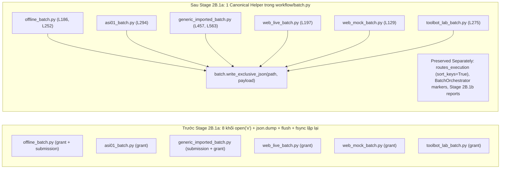

# BÁO CÁO TRIỂN KHAI STAGE 2B.1a: HỢP NHẤT AN TOÀN HÀM GHI JSON ĐỘC QUYỀN (`write_exclusive_json`)

**Dự án:** SecAgent Framework (`D:\SecAgent-W5-Judge`)  
**Giai đoạn:** Stage 2B.1a — Safe Exclusive JSON Writer Consolidation  
**Ngày thực hiện:** 2026-11-22  
**Phán quyết nghiệm thu:** `STAGE_2B1A_PASS`

---

## 1. Executive Summary

Stage 2B.1a đã hoàn tất hợp nhất có kiểm soát các thao tác tạo file JSON độc quyền tương đương về hành vi (`open("x", encoding="utf-8")` + `json.dump(payload, stream)` + `flush()` + `os.fsync(...)`) cho `grant-*` và `submission-*` trên **6 batch workflow** về một hàm canonical duy nhất: `write_exclusive_json(path, payload)` đặt tại `backend/src/workflow/batch.py:75`.

- **Phạm vi thực hiện đúng chuẩn Stage 2B.1a:** Đã xác định **8 điểm gọi Class A** tương đương 100%, di chuyển đủ **8/8 điểm** sang `write_exclusive_json`, và chủ động giữ nguyên toàn bộ các điểm Class B/C/D (gồm `routes_execution.py` dùng `sort_keys=True`, `BatchOrchestrator` claim/cancel markers, `_write_atomic`, `dispatch.py`, `mcp_actions.py`, và chuỗi lưu `.secagent.json` + SHA256 + `run-summary.json` thuộc Stage 2B.1b).
- **Kiểm chứng toàn diện:** Tất cả 8 test mới trong `backend/tests/test_stage2b1a_exclusive_json.py`, toàn bộ **14 suite trọng tâm** (**210 passed**), và toàn bộ regression suite backend (**1,616 passed**, `0` failed, `0` skipped) đều ĐẠT 100%, không phát sinh circular import hay thay đổi hành vi bảo mật/báo cáo.

---

## 2. Baseline

- **Repository:** `D:\SecAgent-W5-Judge`
- **Git HEAD:** `ce1c776fd7b939b0cd705ece87320a67a1885ac8`
- **Python:** `Python 3.13.7`
- **Trạng thái Working Tree ban đầu:** `248` mục (`65` modified, `183` untracked) — bảo toàn nguyên vẹn toàn bộ file modified và untracked tiền tồn tại (`batch.py` và 6 batch workflow là untracked files được chỉnh sửa có kiểm soát, không dùng `git diff` đơn thuần để rà soát vì git không diff untracked files).
- **`git diff --check`:** `0` lỗi khoảng trắng (exit code `0`).
- **Baseline trước khi chỉnh sửa (Pre-edit):**
  - `10` file batch/workflow baseline từ Stage 2A: `114 passed in 237.41s`.
  - Suite grant & reporting (`test_b47_remediation.py` + `test_reporting_api.py`): `89 passed in 82.67s`.
  - Baseline hành vi ghi đĩa trực tiếp (Python check trước refactor): payload `{"batch_execution_id": "batch1", "testcase_id": "GH-C01"}` tạo chính xác bytes `b'{"batch_execution_id": "batch1", "testcase_id": "GH-C01"}'`; trùng file ném `FileExistsError`; thiếu thư mục cha ném `FileNotFoundError`; payload không serialize được ném `TypeError` và giữ nguyên partial file như hành vi gốc.

---

## 3. Exclusive Write Inventory

Bảng kiểm kê đầy đủ toàn bộ các điểm `.open("x")` / JSON write liên quan trong `workflow/` và `testing/report_builder.py` (số dòng tham chiếu trước khi migrate để đối chiếu):

| File & dòng gốc | Hàm / Phương thức | Pattern file | Mục đích & Options | Phân loại | Quyết định |
| :--- | :--- | :--- | :--- | :--- | :--- |
| `offline_batch.py:186-189` | `_run_case` | `grant-{authorization_id}` | Tiêu thụ grant 1 lần (`"x"`, UTF-8, `sort_keys=False`, `flush`+`fsync`) | **A** | **Migrated** (`L186`) |
| `offline_batch.py:254-258` | `start` | `submission-{submission_id}.json` | Ghi nhận submission độc quyền (`"x"`, `flush`+`fsync`, catch `FileExistsError` -> `BatchRejected`) | **A** | **Migrated** (`L252`) |
| `asi01_batch.py:294-297` | `_run_text_case` | `grant-{authorization_id}` | Tiêu thụ grant 1 lần (`"x"`, UTF-8, `sort_keys=False`, `flush`+`fsync`) | **A** | **Migrated** (`L294`) |
| `generic_imported_batch.py:457-464` | `start` | `submission-{submission_id}.json` | Ghi nhận submission độc quyền (`"x"`, `flush`+`fsync`, catch `FileExistsError` -> `BatchRejected`) | **A** | **Migrated** (`L457`) |
| `generic_imported_batch.py:569-572` | `_run_case` | `grant-{authorization_id}` | Tiêu thụ grant 1 lần (`"x"`, UTF-8, `sort_keys=False`, `flush`+`fsync`) | **A** | **Migrated** (`L563`) |
| `web_live_batch.py:197-199` | `_run_web_case` | `grant-{authorization_id}` | Tiêu thụ grant 1 lần (`"x"`, UTF-8, `sort_keys=False`, `flush`+`fsync`) | **A** | **Migrated** (`L197`) |
| `web_mock_batch.py:129-132` | `_run_case` | `grant-{authorization_id}` | Tiêu thụ grant 1 lần (`"x"`, UTF-8, `sort_keys=False`, `flush`+`fsync`) | **A** | **Migrated** (`L129`) |
| `toolbot_lab_batch.py:275-277` | `_run_tool_case` | `grant-{authorization_id}` | Tiêu thụ grant 1 lần (`"x"`, UTF-8, `sort_keys=False`, `flush`+`fsync`) | **A** | **Migrated** (`L275`) |
| `routes_execution.py:133-138` | `issue_scoped_grant` | `operator-grant-{id}.json` | Cấp operator grant (`sort_keys=True` khác option JSON + file route HTTP) | **B** | **Preserved** (Outlier `sort_keys=True`) |
| `routes_execution.py:210-213` | `run_selected` | `submission-{submission_id}.json` | Ghi nhận single-run submission (`sort_keys=True`) | **B** | **Preserved** (Outlier `sort_keys=True`) |
| `offline_batch.py:215,231`; `asi01_batch.py:341,357`; `generic_imported_batch.py:859,888`; `web_live_batch.py:326,343`; `web_mock_batch.py:230,247`; `toolbot_lab_batch.py:330,344` | `_run_*_case` (12 sites) | `native-*.secagent.json` & `run-summary.json` | Report-tail persistence (`sort_keys=True`, gắn SHA256 + `CaseResult`) | **B** (Scope 2B.1b) | **Preserved** (Dành cho Stage 2B.1b) |
| `toolbot_lab_batch.py:308` | `_run_tool_case` | `tool-{role}.json` | Ghi raw bytes (`open("xb")`, không `json.dump`) | **B** | **Preserved** |
| `dispatch.py:212,263,286,303` | `ControlledDispatcher.run` | `claim-*`, `artifact-provenance.json`, `run-summary.json` | Không gọi `flush()`/`fsync()`; module `dispatch.py` ngoài phạm vi Stage 2B.1a | **B/C** | **Preserved** (Excluded module) |
| `mcp_actions.py:209-210` | `McpActionWorkflow.run` | `native_report.json`, `run-summary.json` | Dùng `write_bytes` / `write_text` (`indent=2`), ngoài phạm vi | **B/D** | **Preserved** (Excluded module) |
| `testing/report_builder.py:196` | `run_native_report` | `native-*.secagent.json` | Dùng `indent=2` + trailing `"\n"`, không `fsync`, ngoài phạm vi | **B** | **Preserved** (Excluded module) |
| `batch.py:271,313` | `BatchOrchestrator` (`cancel_remaining`, `run`) | `cancel-requested.json`, `active_claim` | Exclusive claim/marker nội bộ vòng đời `BatchOrchestrator` | **C** | **Preserved** (Không đụng `BatchOrchestrator`) |
| `batch.py:56-72`; `discovery.py:331`; `management.py:201`; `application_context.py:107` | `_write_atomic` & atomic writers | `.tmp` -> `os.replace` | Thay thế nguyên tử (`sort_keys=True`, `separators=(",",":")`, `os.replace`) | **D** | **Preserved** |
| `web_lab_runtime.py:77,210`; `lab_attachment.py:260,276,287`; `web_lab_assessment.py:17` | Web/Lab lifecycle helpers | `compose.env`, `attempt.json`, markers | Vòng đời Web Lab riêng, ngoài phạm vi batch grants/submissions | **C** | **Preserved** |

---

## 4. Behavioral Comparison

| Thuộc tính | Caller gốc (`8` sites Class A) | `write_exclusive_json(path, payload)` | Điểm khác biệt với các Outlier (Class B/C/D) |
| :--- | :--- | :--- | :--- |
| **File mode** | `path.open("x", encoding="utf-8")` | `path.open("x", encoding="utf-8")` (giống 100%) | `_write_atomic` dùng `.tmp` + `os.replace`; `toolbot:308` dùng `"xb"`; `mcp_actions` dùng `write_bytes`/`write_text` |
| **JSON formatting** | `json.dump(payload, stream)` (`sort_keys=False`, không `indent`) | `json.dump(payload, stream)` (giống 100%) | `routes_execution.py` và các `.secagent.json`/`run-summary.json` dùng `sort_keys=True`; `report_builder.py` dùng `indent=2` |
| **Flush & fsync** | `stream.flush()` rồi `os.fsync(stream.fileno())` | `stream.flush()` rồi `os.fsync(stream.fileno())` (giống 100%) | `dispatch.py` & `report_builder.py` không gọi `os.fsync` |
| **Errors** | Ném nguyên `FileExistsError`, `FileNotFoundError`, `PermissionError`, `TypeError`, `OSError` | Không bắt/nuốt exception (giống 100%) | Caller `start()` tự bắt `FileExistsError` -> `BatchRejected("Duplicate batch submission.")` như cũ |
| **Cleanup** | Không tự unlink khi `json.dump` lỗi | Không tự unlink khi `json.dump` lỗi (giống 100%) | `_write_atomic` có `finally: temporary.unlink(missing_ok=True)` |
| **Return value** | `None` | `None` | Giống 100% |
| **Concurrency** | Dựa vào OS-level `O_EXCL` qua mode `"x"` | Dựa vào OS-level `O_EXCL` qua mode `"x"` | Đã xác minh thực nghiệm bằng 8 worker thread tranh chấp 1 file: chỉ 1 thread thành công |

---

## 5. Architecture Decision

- **Helper chuẩn được chọn:** `write_exclusive_json(path: Path, payload: Any) -> None` đặt tại [`backend/src/workflow/batch.py:75-81`](file:///D:/SecAgent-W5-Judge/backend/src/workflow/batch.py#L75-L81), ngay cạnh `_write_atomic`.
- **Lý do chọn `workflow/batch.py`:** Toàn bộ **6 batch workflow** đều đã import trực tiếp từ `workflow.batch`. Đặt helper tại đây hoàn toàn không sinh bất kỳ import ngược hay vòng lặp phụ thuộc nào (`batch.py` giữ `workflow_imports=[]`).
- **Lý do KHÔNG dùng flag cấu hình hay Persistence Framework:** Giữ nguyên signature 2 tham số `write_exclusive_json(path, payload)` tránh biến helper thành "overly configurable writer" (không ép các site `sort_keys=True` ở `routes_execution.py` hoặc `.secagent.json` dùng `sort_keys=True` vào cùng hàm ở Stage 2B.1a), đồng thời không tạo thêm class, repository, service hay file manager mới nào.

---

## 6. Files Changed

| File | Hành động | Mô tả chính xác |
| :--- | :--- | :--- |
| [batch.py](file:///D:/SecAgent-W5-Judge/backend/src/workflow/batch.py) | Modified (`460 -> 469` LOC) | Thêm `Any` vào typing import (`L17`) và hàm `write_exclusive_json` (`L75-81`) |
| [offline_batch.py](file:///D:/SecAgent-W5-Judge/backend/src/workflow/offline_batch.py) | Modified (`291 -> 286` LOC) | Import `write_exclusive_json` (`L26`), thay 2 vị trí ghi `grant-*` (`L186`) và `submission-*` (`L252`) |
| [asi01_batch.py](file:///D:/SecAgent-W5-Judge/backend/src/workflow/asi01_batch.py) | Modified (`366 -> 364` LOC) | Import `write_exclusive_json` (`L26`), thay 1 vị trí ghi `grant-*` (`L294`) |
| [generic_imported_batch.py](file:///D:/SecAgent-W5-Judge/backend/src/workflow/generic_imported_batch.py) | Modified (`907 -> 899` LOC) | Import `write_exclusive_json` (`L27`), thay 2 vị trí ghi `submission-*` (`L457`) và `grant-*` (`L563`) |
| [web_live_batch.py](file:///D:/SecAgent-W5-Judge/backend/src/workflow/web_live_batch.py) | Modified (`350 -> 349` LOC) | Import `write_exclusive_json` (`L17`), thay 1 vị trí ghi `grant-*` (`L197`) |
| [web_mock_batch.py](file:///D:/SecAgent-W5-Judge/backend/src/workflow/web_mock_batch.py) | Modified (`255 -> 253` LOC) | Import `write_exclusive_json` (`L21`), thay 1 vị trí ghi `grant-*` (`L129`) |
| [toolbot_lab_batch.py](file:///D:/SecAgent-W5-Judge/backend/src/workflow/toolbot_lab_batch.py) | Modified (`356 -> 355` LOC) | Import `write_exclusive_json` (`L27`), thay 1 vị trí ghi `grant-*` (`L275`) |
| [test_stage2b1a_exclusive_json.py](file:///D:/SecAgent-W5-Judge/backend/tests/test_stage2b1a_exclusive_json.py) | Created (`265` LOC, `8` tests) | Bộ unit test + error injection + concurrency race + tích hợp `OfflineBatchWorkflow` & parity artifact |
| [SECAGENT_STAGE2B1A_IMPLEMENTATION_REPORT.md](file:///D:/SecAgent-W5-Judge/docs/audits/SECAGENT_STAGE2B1A_IMPLEMENTATION_REPORT.md) | Created | Báo cáo triển khai & nghiệm thu Stage 2B.1a |

*(Không chỉnh sửa bất kỳ file nào trong `routes_execution.py`, `dispatch.py`, `mcp_actions.py`, `testing/runner.py`, `testing/report_builder.py`, Judge, Target Adapters, Observers, Frontend, Bridge `:7019`, hay datasets.)*

---

## 7. Before/After Code Structure

---

## 8. Security Non-Regression

- **Tạo file độc quyền cấp OS:** Hàm giữ nguyên `path.open("x", encoding="utf-8")`; không dùng `"w"`, không dùng nhánh check-then-create, bảo vệ khỏi ghi đè và race condition.
- **Ủy quyền & Tiêu thụ Grant:** Toàn bộ logic cấp grant, kiểm tra hết hạn (`expires_at`), target/testcase/plan binding, tiêu thụ 1 lần (`grant-{authorization_id}`), `_owned_grants` isolation trong `GenericImportedBatchWorkflow`, cổng baseline `GH-C01` (`_baseline_pass` trong `Asi01BatchWorkflow`), ngân sách request (`OneRequestHttpClient`), và kiểm tra duplicate submission (`FileExistsError -> BatchRejected`) nằm nguyên ở caller; helper không can thiệp logic phân quyền.
- **Evidence & Reporting:** Không chạm vào nhãn `synthetic_mock`, phân tách `tool_service` vs `agent_run`, không chạm vào `HybridEvaluator` hoặc bất kỳ trường báo cáo nào.

---

## 9. Test Results

Toàn bộ lệnh được thực thi **sau lần chỉnh sửa mã nguồn cuối cùng**:

1. **Syntax verification (`py_compile`):**
   - Lệnh: `python -m py_compile backend/src/workflow/batch.py backend/src/workflow/offline_batch.py backend/src/workflow/asi01_batch.py backend/src/workflow/generic_imported_batch.py backend/src/workflow/web_live_batch.py backend/src/workflow/web_mock_batch.py backend/src/workflow/toolbot_lab_batch.py backend/tests/test_stage2b1a_exclusive_json.py`
   - Kết quả: Exit code `0` (0 lỗi cú pháp).
2. **Stage 2B.1a Unit, Concurrency & Parity Suite:**
   - Lệnh: `pytest backend/tests/test_stage2b1a_exclusive_json.py -v --tb=short`
   - Kết quả: **`8 passed in 3.52s`** (`0` failed, `0` skipped).
3. **14-Suite Focused Workflow & Security Regression:**
   - Lệnh: `pytest backend/tests/test_stage2b1a_exclusive_json.py backend/tests/test_batch_orchestrator.py backend/tests/test_offline_batch_api.py backend/tests/test_asi01_batch.py backend/tests/test_generic_imported_batch.py backend/tests/test_toolbot_lab_batch.py backend/tests/test_researchbot_web_batch.py backend/tests/test_web_mock_batch.py backend/tests/test_workflow_dispatch.py backend/tests/test_b47_remediation.py backend/tests/test_stage1a_dependency_boundaries.py backend/tests/test_stage1b1_dependency_boundaries.py backend/tests/test_stage1b2_api_contract_parity.py backend/tests/test_reporting_api.py -q`
   - Kết quả: **`210 passed in 266.33s (0:04:26)`** (`0` failed, `0` skipped).
4. **Full Backend Regression:**
   - Lệnh: `pytest backend/tests -q -rs`
   - Kết quả: **`1,616 passed in 330.27s (0:05:30)`** (`0` failed, `0` skipped; tăng đúng `8` test mới so với baseline `1,608` của Stage 1B.2).
5. **Import Boundary & Diff Check:**
   - AST scan trên toàn bộ `33` file `backend/src/workflow/*.py`: `workflow_cycles: []`, `batch.py deps: []`, `0` production-to-script reverse imports.
   - `git diff --check`: Exit code `0` (không lỗi khoảng trắng).
6. **Frontend:** Không chạm vào mã nguồn frontend; các kết quả Vitest (`181 passed`) từ Stage 1B.2 là tham chiếu lịch sử, không chạy lại trong Stage 2B.1a.

---

## 10. Byte-Level / Schema Parity

- **JSON byte parity trực tiếp:** `test_write_exclusive_json_matches_legacy_bytes_and_utf8` xác nhận output byte-by-byte của `write_exclusive_json` (gồm ký tự UTF-8 `"tiếng Việt"` và nested dict không `sort_keys`) trùng khớp 100% byte với đoạn `open("x")` + `json.dump` + `flush` + `os.fsync` gốc.
- **Workflow `submission-*`, `grant-*`, `.secagent.json` và `run-summary.json` parity:** `test_offline_batch_uses_exclusive_json_and_preserves_submission_grant_and_report_parity` chạy đầy đủ luồng API `/api/testing/batches/preview` -> `/batches`, xác minh exact UTF-8 JSON bytes của `submission-*.json` và `grant-stage2b1a-grant-0`, xác nhận duplicate submission bị từ chối `409`, và xác minh `run-summary.json["report_sha256"]` trùng khớp SHA256 file `native-*.secagent.json` sinh ra.
- **Unverified / Historical comparison note:** Các bài test tích hợp của 5 workflow còn lại (`asi01_batch`, `generic_imported_batch`, `web_live_batch`, `web_mock_batch`, `toolbot_lab_batch`) kiểm chứng đầy đủ qua suite test sẵn có của từng workflow (`210 passed`) thay vì viết test byte-level mới lặp lại trên từng class.

---

## 11. LOC and Complexity

| Chỉ số đo được | Giá trị thực tế |
| :--- | :--- |
| LOC ban đầu của 7 file sản xuất (`batch.py` + 6 workflow) | `460 + 291 + 366 + 907 + 350 + 255 + 356 = 2,985` LOC |
| LOC sau refactor của 7 file sản xuất | `469 + 286 + 364 + 899 + 349 + 253 + 355 = 2,975` LOC |
| Số điểm ghi JSON độc quyền tương đương (Class A) | `8` điểm |
| Số điểm đã migrate sang `write_exclusive_json` | `8` điểm (`100%` Class A) |
| Số điểm ghi `"x"` được chủ động giữ nguyên | `2` điểm `routes_execution.py` (`sort_keys=True`), `12` điểm `.secagent.json`/`run-summary.json` (Stage 2B.1b), `2` điểm `BatchOrchestrator` markers, `1` `"xb"` (`toolbot_lab_batch:307`), cùng các site ngoài scope (`dispatch.py`, `report_builder.py`, `web_lab_*`) |
| Số dòng trùng lặp loại bỏ ở 6 caller | `19` LOC net ở 6 caller (`-31` dòng lặp thân `with/dump/flush/fsync`, `+12` dòng gọi/import gọn) |
| Số dòng helper thêm vào `batch.py` | `+9` LOC (`1` import typing + hàm `write_exclusive_json` + docstring) |
| **Biến động LOC sản xuất ròng (Net)** | **`-10` LOC** (`2,985 -> 2,975` LOC) |
| Số file sản xuất tạo mới / chỉnh sửa | `0` tạo mới / `7` chỉnh sửa |
| Số test mới thêm vào | `8` test trong `backend/tests/test_stage2b1a_exclusive_json.py` (`265` LOC) |

*(Đánh giá trung thực: Stage 2B.1a giảm ròng `10` LOC mã nguồn, đúng kỳ vọng cho bước rút 1 helper 6 dòng `open/dump/flush/fsync`; giá trị chính là tập trung hóa quyền sở hữu I/O `O_EXCL + fsync` về một điểm duy nhất không tăng độ phức tạp và mở đường sạch cho Stage 2B.1b.)*

---

## 12. Remaining Duplication

Những phần còn lại đúng theo lộ trình Stage 2A để xử lý ở các bước sau (KHÔNG đụng trong Stage 2B.1a):

1. **Stage 2B.1b (Candidate C1 còn lại — ~125–175 net LOC):** Hợp nhất khối đuôi xây & lưu `native-*.secagent.json` (`sort_keys=True`, `sanitized()`, SHA256, `run-summary.json`, `CaseResult`) hiện đang lặp ở 6 batch workflows (`offline_batch.py`, `asi01_batch.py`, `generic_imported_batch.py`, `web_live_batch.py`, `web_mock_batch.py`, `toolbot_lab_batch.py`).
2. **Stage 2B.1c (Candidate C2):** Chuẩn hóa validator `unique_and_rule_only` và sửa lỗi lặp key `"model"` trong `generic_imported_batch.py:784/788`.
3. **Stage 2B.2 & 2B.3 (Candidates C3–C5):** Chuẩn hóa `launch_batch_worker` / `load_valid_grant` và tách helper nội bộ cho `GenericImportedBatchWorkflow._run_case`.

---

## 13. Limitations

- Các test thực thi `ResearchBotWebBatchWorkflow` và `GenericImportedBatchWorkflow` chạy trên mock/test fixtures (`httpx.MockTransport` / mocked docker inspection) theo quy định chỉ kiểm thử ngoại tuyến, không gọi mạng thật tới DVAA hoặc Pi Judge.
- Không chạy `vitest` hay build frontend vì Stage 2B.1a hoàn toàn không chạm mã nguồn frontend.

---

## 14. Acceptance Verdict

**`STAGE_2B1A_PASS`**

- Đã hợp nhất thành công `8/8` điểm ghi JSON độc quyền tương đương về hàm `write_exclusive_json(path, payload)` trong `backend/src/workflow/batch.py`.
- Bảo toàn 100% tính độc quyền `"x"`, `flush()`/`os.fsync()`, thông báo lỗi, quyền grant, báo cáo và các làn thực thi khác.
- `1,616/1,616` backend tests và `210/210` focused tests đều ĐẠT sau lần chỉnh sửa cuối cùng.
