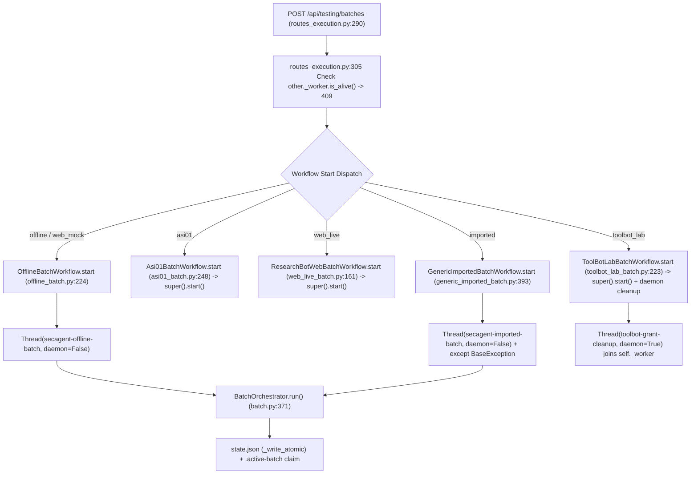
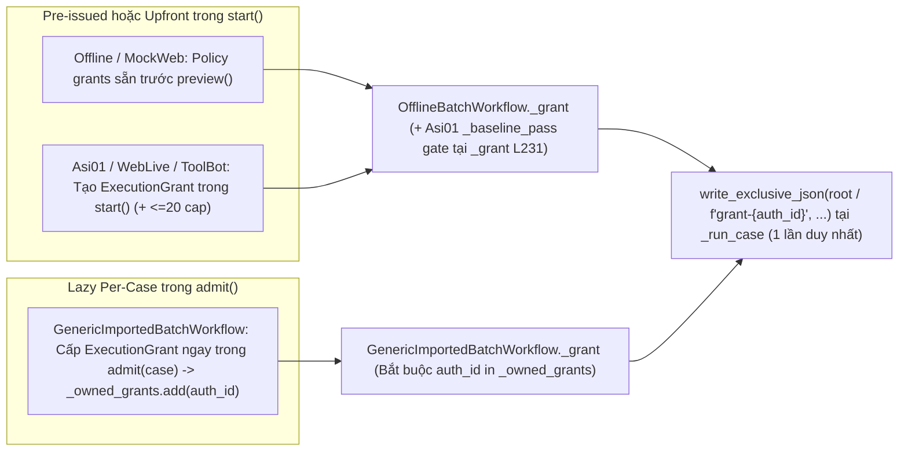

# KIỂM TOÁN AN TOÀN STAGE 2B.2a: VÒNG ĐỜI WORKER THREAD VÀ XỬ LÝ `ExecutionGrant`

**Dự án:** SecAgent Framework (`D:\SecAgent-W5-Judge`)  
**Giai đoạn:** Stage 2B.2a — Worker Lifecycle & ExecutionGrant Consolidation Safety Audit (Chỉ đọc / Read-only Audit)  
**Ngày thực hiện:** 2026-11-22  
**Trạng thái Stage 2B.2a:** **`STAGE_2B2A_PASS`**

---

## 1. Executive Summary

Kiểm toán Stage 2B.2a đã đọc và đối chiếu toàn bộ mã nguồn thực tế liên quan đến **khởi chạy worker thread (C3)** và **vòng đời `ExecutionGrant` (C4)** trên cả 6 batch workflow, `BatchOrchestrator`, `ControlledDispatcher`, `McpActionWorkflow`, và `routes_execution.py` (**không** chỉnh sửa mã nguồn hay test).

### Kết luận then chốt

1. **Về C3 — Worker Startup & Lifecycle (`Phân loại B — Shared plumbing tồn tại, lifecycle hooks giữ riêng`):**
   - **5/6 batch workflow** (`OfflineBatchWorkflow`, `Asi01BatchWorkflow`, `ToolBotLabBatchWorkflow`, `ResearchBotWebBatchWorkflow`, `MockWebBatchWorkflow`) **đã dùng chung** `OfflineBatchWorkflow.start()` (`offline_batch.py:224-271`) qua cơ chế kế thừa (`super().start(...)`).
   - Trùng lặp thực tế chỉ xảy ra giữa **2 vị trí** tạo worker thread: `OfflineBatchWorkflow.start` (`offline_batch.py:249-271`) và `GenericImportedBatchWorkflow.start` (`generic_imported_batch.py:463, 497-541`), với ~18 dòng plumbing lặp (`started = Event()`, `worker()` `try/finally` giải phóng `_active`, `Thread(..., daemon=False).start()`, `started.wait(5)`, `orchestrator.state(identity)`).
   - **Phát hiện quan trọng từ mã nguồn:** `GenericImportedBatchWorkflow.start` (`L521-529`) bọc `self._worker.start()` trong `try ... except BaseException:` để hoàn tác `dispatcher._active = False`, `_active_grant_id = None`, và `_prune_grants()`; trong khi `OfflineBatchWorkflow.start` (`L264-265`) **chưa có** khối `except BaseException:` bảo vệ nếu `Thread.start()` ném lỗi. Rút 1 helper nhỏ `launch_batch_worker(...)` trong `workflow/batch.py` vừa giảm nhẹ boilerplate (~10–18 net LOC) vừa khắc phục đồng nhất an toàn khởi động thread cho cả 5 workflow lớp con của `OfflineBatchWorkflow`.
2. **Về C4 — ExecutionGrant Loading & Validation (`Phân loại C cho Ownership/Pruning/Issuance/Gating; chỉ Category B rất nhỏ ở 6 dòng predicate` -> Đề xuất GIỮ RIÊNG / KHÔNG HỢP NHẤT):**
   - Cách cấp phát và cô lập `ExecutionGrant` khác nhau căn bản về ranh giới bảo mật: cấp sẵn bởi policy (`Offline`, `MockWeb`), cấp toàn batch upfront (`Asi01`, `WebLive`, `ToolBot`) có `daemon cleanup thread` (`ToolBotLab`), hay cấp **lazy per-case ngay trong `admit()`** kèm tập sở hữu `_owned_grants` (`GenericImported`), hay cổng baseline `_baseline_pass` (`Asi01`).
   - Phần thực sự giống nhau giữa `OfflineBatchWorkflow._grant` (`L133-138`) và `GenericImportedBatchWorkflow._grant` (`L188-193`) chỉ là **6 dòng điều kiện so khớp field** — tiết kiệm tối đa ~2–4 LOC nếu tách hàm, quá nhỏ để đánh đổi bằng độ gián tiếp trên đường kiểm tra quyền.
3. **Khuyến nghị tổng thể Stage 2B.2b:** **Chỉ triển khai C3** với một helper thuần nhỏ `launch_batch_worker(...)` trong `workflow/batch.py` (không framework thread pool, không global worker registry); **KHÔNG gộp C4**. Hoặc nếu muốn giảm thiểu chạm vào các đường chạy đã ổn định trước Stage 3, có thể cân nhắc gộp C3 nhanh rồi sang Stage 2B.3.

---

## 2. Git and Working-Tree Baseline

- **Repository:** `D:\SecAgent-W5-Judge`
- **Git HEAD:** `ce1c776fd7b939b0cd705ece87320a67a1885ac8`
- **Working Tree:** Giữ nguyên nền sau Stage 2B.1c (`entries=251`, gồm `65` modified và `186` untracked hợp pháp).
- **`git diff --check`:** Exit code `0` (0 lỗi khoảng trắng).
- **Số liệu kiểm chứng tham chiếu từ báo cáo Stage 2B.1c (không sửa code và không chạy lại trong audit chỉ đọc này):** `1,642` backend tests passed (exit code `0`), `240` focused tests passed, `0` workflow import cycles.

---

## 3. Worker Execution Call Graphs

---

## 4. Worker Lifecycle Comparison Matrix

| Thuộc tính | `OfflineBatchWorkflow` | `Asi01BatchWorkflow` | `MockWebBatchWorkflow` | `ResearchBotWebBatchWorkflow` | `ToolBotLabBatchWorkflow` | `GenericImportedBatchWorkflow` | `ControlledDispatcher` / `McpActionWorkflow` |
| :--- | :--- | :--- | :--- | :--- | :--- | :--- | :--- |
| **1. Tạo worker ở đâu** | `offline_batch.py:264` (`start`) | Kế thừa `OfflineBatchWorkflow.start` (`asi01_batch.py:276`) | Kế thừa `OfflineBatchWorkflow.start` (`web_mock_batch.py:120`) | Kế thừa `OfflineBatchWorkflow.start` (`web_live_batch.py:185`) | Kế thừa `OfflineBatchWorkflow.start` (`toolbot_lab_batch.py:248`) + daemon cleanup (`L263`) | `generic_imported_batch.py:522` (`start`) | Không tạo worker (chạy đồng bộ trong HTTP thread) |
| **2. Sync / Async** | Async worker thread | Async worker thread | Async worker thread | Async worker thread | Async worker + daemon cleanup thread | Async worker thread | Synchronous (`dispatch.py:188`, `mcp_actions.py:124`) |
| **3. Concurrency lock** | `self._lock` (`Lock`) + `dispatcher._lock` (`RLock`) + `_active` + `.active-batch` | `dispatcher._lock` bao ngoài `super().start` (tái nhập RLock) + `routes_execution:305` | Qua `OfflineBatchWorkflow.start` + `routes_execution:305` | `dispatcher._lock` bao ngoài `super().start` + `routes_execution:305` | `dispatcher._lock` bao ngoài `super().start` + `routes_execution:305` | `self._lock` + `dispatcher._lock` + `_active` + `.active-batch` + `routes_execution:305` | `dispatcher._lock` (`RLock`) / `mcp._lock` (`Lock`) |
| **4. Daemonized?** | `daemon=False` | `daemon=False` | `daemon=False` | `daemon=False` | Batch worker `daemon=False`; cleanup thread `daemon=True` | `daemon=False` | N/A |
| **5. Sở hữu `_worker`** | `self._worker` (`OfflineBatchWorkflow`) | `self._worker` (kế thừa) | `self._worker` (kế thừa) | `self._worker` (kế thừa) | `self._worker` (kế thừa) | `self._worker` (`GenericImportedBatchWorkflow`) | Không có |
| **6. Pending -> Running** | `persist("preparing")` -> `on_started=started.set` (`batch.py:419-421`), case 1 đặt `"running"` (`L428`) | Nt | Nt | Nt | Nt | Nt | Trực tiếp trong HTTP call |
| **7. Exception handling** | `worker` `finally:` giải phóng `_active`, `started.set()`; `Thread.start()` chưa bọc `except BaseException:` | Kế thừa | Kế thừa | Kế thừa | `try/except Exception:` trước `super().start` dọn `_active_grant_id`; sau đó nhờ `finally:` | `worker` `finally:` nhả `_active`, `_active_grant_id`, `_prune_grants()`; `Thread.start()` bọc `except BaseException:` | `dispatch.py:289` ghi failure `run-summary.json`, `finally:` nhả `_active` |
| **8. Cancellation** | `BatchOrchestrator.cancel_remaining` ghi `cancel-requested.json` (`batch.py:345`); `orchestrator.run` kiểm trước mỗi case (`L424`) | Nt | Nt + check `cancellation_requested()` trước attack (`L176`) | Nt + `_CancellableClient` + check trước attack (`L230,246`) | Nt | Nt + check trong `before_request` (`L571`) và `L549` | Không hỗ trợ cancel |
| **9. Final state persistence** | `_write_atomic(state.json)` + `batch-report.json` (`batch.py:529-531`) | Nt | Nt | Nt | Nt | Nt + `_verify_imported_state` (`batch.py:225`) | `run-summary.json` |
| **10. Nhả lock khi lỗi?** | `finally:` nhả `dispatcher._active` & `BatchOrchestrator._lock`; lỗi `Thread.start()` có nguy cơ kẹt `_active` | Kế thừa | Kế thừa | Kế thừa | Nt + dọn `_active_grant_id` nếu lỗi trước `super().start` | Cả `finally:` lẫn `except BaseException:` nhả `_active` & `_active_grant_id` & `_prune_grants` | `finally:` nhả `_active` (trừ lỗi `claim-` không set `_active`) |
| **11. Resumption?** | Không; owner chết ghi `"interrupted"` fail-closed (`batch.py:194-263`) | Không | Không | Không | Không | Không | Không |
| **12. Lỗi khi startup** | Trước `started`: rollback `BatchRejected`; sau `submission-` trước `Thread.start()`: `_active` chưa reset nếu `Thread.start()` fail | `submission-.exists()` check trước ghi ở `Asi01` (`L258`) + `super().start` | `super().start` | `super().start` | Reset `_active_grant_id` + `_prune_grants` | `except BaseException:` reset `_active`, `_active_grant_id`, `_prune_grants()` | `run_dir.mkdir` lỗi -> `_active=False`, giữ `claim-` (`L221-223`) |
| **13. Competing worker?** | Bị chặn bởi `dispatcher._lock`/`_active`, `.active-batch`, `BatchOrchestrator._lock`/`_active`, và `routes_execution:305` | Nt | Nt | Nt | Nt | Nt | Bị chặn bởi `dispatcher._active` / `mcp._lock` |
| **14. Tests chứng minh** | `test_offline_batch_api.py`, `test_batch_orchestrator.py` | `test_asi01_batch.py` | `test_web_mock_batch.py` | `test_researchbot_web_batch.py` | `test_toolbot_lab_batch.py` | `test_generic_imported_batch.py`, `test_b47_remediation.py` | `test_workflow_dispatch.py`, `test_structured_mcp_actions.py` |

---

## 5. ExecutionGrant Call Graphs

---

## 6. Grant Authorization and Consumption Comparison Matrix

| Thuộc tính | `OfflineBatchWorkflow` & `MockWebBatchWorkflow` | `Asi01BatchWorkflow` | `ResearchBotWebBatchWorkflow` | `ToolBotLabBatchWorkflow` | `GenericImportedBatchWorkflow` | `ControlledDispatcher` / `routes_execution.py` |
| :--- | :--- | :--- | :--- | :--- | :--- | :--- |
| **1. Issuing path** | Cấp sẵn ngoài workflow (`dispatcher.policy.grants`) | `start()` tạo 1 grant cho mỗi `"ready"` row (`L260-274`) | `start()` tạo 1 grant cho `WEB_ATTACK` (`L175-182`) | `start()` tạo 1 grant cho `TM-002` (`L236-245`) | **Lazy trong `admit(case)`** ngay trước chạy từng case (`L475-495`) | `POST /execution-grants` hoặc `run_selected` gọi `issue_scoped_grant` (`routes_execution.py:109`) |
| **2. Ownership model** | Dùng chung pool `policy.grants` | Đưa vào `policy.grants`, kiểm `len+new <= 20` | Đưa vào `policy.grants`, kiểm `len >= 20` | Gắn `self._active_grant_id`, dọn `LAB_ID`/`CASE_ID` qua `_prune_grants` | **Cô lập chặt bằng `self._owned_grants: set[str]`** và `self._active_grant_id` | Lưu `operator-grant-*.json` trên đĩa (`routes_execution.py:133`) |
| **3. Target/case binding** | `target_id`, `profile_revision`, `policy_ref`, `testcase_id`, `asset_sha256` | Nt + `_ordered` `GH-C01` trước + `REVIEWED_TEXT_TARGETS` | Nt + `WEB_ATTACK` + `runtime.identity()` | Nt + `CASE_ID == "TM-002"` + `LAB_ID` | Nt + `auth_id in _owned_grants` + `_authorized_cases` + dataset hashes | `target_id`, `profile_revision`, `policy_ref`, `testcase_id`, `asset_sha256` (`claim-auth-*`) |
| **4. Expiration check** | `grant.expires_at > now` (`offline_batch.py:137`) | Kế thừa + TTL 10 phút (`L270`) | Kế thừa + check thêm trong `check_approval` (`L226`) | Kế thừa + TTL 10 phút | `grant.expires_at > now` + `_authorization_expires_at` (`max(600, min(..., 7200))`) | `grant.expires_at > datetime.now(timezone.utc)` |
| **5. Consumption** | `write_exclusive_json(root / f"grant-{auth_id}", ...)` (`L190`) | `write_exclusive_json` (`L288`) | `write_exclusive_json` (`L197`) | `write_exclusive_json` (`L275`) | `write_exclusive_json` (`L554`) | `claim_path.open("x")` (`dispatch.py:212`) |
| **6. Replay rejection** | `not (root / ("grant-" + auth_id)).exists()` + `open("x")` | Nt | Nt | Nt | Nt (`grant-{auth_id}` tồn tại dù grant được nhét lại policy) | `(output_root / ("claim-" + key)).exists()` + `self._claimed_keys` + `open("x")` |
| **7. Ownership isolation** | Không có `_owned_grants` (giả định pool thuộc batch mock) | Không có `_owned_grants` | Không có `_owned_grants` | Lọc theo `(LAB_ID, CASE_ID)` và `_active_grant_id` | Chỉ tìm & xóa grant thuộc `self._owned_grants` (`L180, 188`) | `operator-grant-*` + `claim-auth-*` |
| **8. Synchronization** | Single active batch (`dispatcher._lock` + `_active`) | Nt | Nt | `dispatcher._lock` trong `start`, `_prune_grants`, `cleanup` thread | `dispatcher._lock` bảo vệ `admit`, `finally`, `except`, `_prune_grants` | `dispatcher._lock` (`RLock`) |
| **9. Failed submission** | Nếu `submission-` fail trước `_active=True`: không tiêu thụ `grant-*` | `submission-.exists()` check trước khi thêm `grants` vào policy (`L258`)! | Check `submission-.exists()` trước khi thêm grant (`L171`)! | Check `submission-.exists()` trước; nếu `super().start` lỗi -> `except:` dọn `_active_grant_id` & `_prune_grants` (`L249`) | `submission-` ghi trước khi `admit` tạo grant -> fail submission không tạo bất kỳ grant nào! | `run_selected` check `submission-` trước `run_dir`/`claim-` |
| **10. Corrupt/missing grant** | Thiếu grant trong `_grant()` -> `_admit_case` trả `"blocked"` hoặc `_run_case` ném `BatchRejected` | Nt | Trả `"blocked", "web_binding_or_authorization_changed"` | Ném `BatchRejected` | `_admit_case` -> `"blocked"` hoặc `_run_case` -> `BatchRejected` | Trả `admitted: False` / `DispatchRejected` |
| **11. Cleanup** | Không tự prune `policy.grants` | Không tự prune | Không tự prune | `_prune_grants()` xóa hết hạn/đã dùng/cũ `(LAB_ID, CASE_ID)` ở `__init__`, `start`, `daemon` thread | `_prune_grants()` chỉ gỡ `self._owned_grants - {self._active_grant_id}` khỏi `policy.grants` (KHÔNG xóa file `grant-*`!) | Giữ `claim-*` vĩnh viễn làm audit trail |
| **12. State mutation on lookup** | `_grant()` hoàn toàn read-only | `_grant()` read-only (`_baseline_pass` chỉ đọc) | `_grant()` read-only | `_grant()` read-only | `_grant()` read-only (`admit` mới thêm grant) | `_available_claim_key()` read-only |
| **13. Race protection** | `open("x")` + `dispatcher._active` | Nt | Nt | Nt + `_active_grant_id` giữ grant sống cho tới khi `worker.join()` xong | Nt + `dispatcher._lock` quanh mọi mutation của `policy.grants` | `dispatcher._lock` + `open("x")` |
| **14. Request budget link** | 1 grant cho 1 case (`budget=1`) | 1 grant/case (`budget=1`, tổng `<=3`) | 1 grant (`WEB_ATTACK`, `budget=2` cho preflight+attack) | 1 grant (`TM-002`, `budget=1`) | 1 grant tạo mới/case theo đúng thứ tự (`budget=1/case`), giải phóng sau mỗi case nên chạy 30+ case không chạm ngưỡng `20` grants! | 1 grant / 1 controlled run |
| **15. Tests chứng minh** | `test_offline_batch_api.py`, `test_web_mock_batch.py` | `test_asi01_batch.py` | `test_researchbot_web_batch.py` | `test_toolbot_lab_batch.py` (`test_twenty_five_sequential_tm002_batches...`) | `test_generic_imported_batch.py` (`test_thirty_testcase_batch...`), `test_b47_remediation.py` | `test_workflow_dispatch.py`, `test_workflow_admission.py` |

---

## 7. C3 Duplication Findings (Worker Startup & Lifecycle)

- **Exact references:** `offline_batch.py:249-271` vs `generic_imported_batch.py:463, 497-541`.
- **Existing behavior:** Cả hai khởi tạo `started = Event()`, bọc `self.orchestrator.run(..., batch_run_id=identity, on_started=started.set)` trong `try ... finally:` (đặt `self.dispatcher._active = False`, gọi cleanup riêng nếu có, `started.set()`), khởi chạy non-daemon `Thread`, đợi `started.wait(5.0)` (ném `BatchRejected("Batch state did not become available.")`), đọc `self.orchestrator.state(identity)` và trả dict `{workflow_schema_version, batch_run_id, status, plan_id, progress_view}`.
- **Differences:** `GenericImportedBatchWorkflow.start` bọc `Thread.start()` trong `except BaseException:` để giải phóng `_active`, `_active_grant_id`, và `_prune_grants()`; `OfflineBatchWorkflow.start` chưa bọc `Thread.start()` bằng `try/except BaseException:`. Ngoài ra, `ToolBotLabBatchWorkflow` gắn thêm `daemon cleanup` thread bên ngoài `super().start(...)`.
- **Classification:** **`B — Shared plumbing exists, but policy/lifecycle hooks remain separate`**
- **Current canonical owner:** `workflow/batch.py` (hoặc `OfflineBatchWorkflow.start` đã phục vụ 5/6 workflow).
- **Recommended helper:** `launch_batch_worker(orchestrator, dispatcher, *, batch_run_id, plan_id, plan, admit, execute, thread_name, assign_worker, on_cleanup=None, lock=...)` — chỉ ~22 dòng thuần trong `workflow/batch.py`, giúp cả `OfflineBatchWorkflow` (và 4 subclass của nó) lẫn `GenericImportedBatchWorkflow` có chung cơ chế rollback `except BaseException:` an toàn.
- **Expected reduction:** **~10–18 net LOC** (loại bỏ ~32–40 dòng boilerplate lặp, cộng ~22 dòng helper mới).
- **Refactor risk:** Thấp–Trung bình (cần bảo toàn `self._worker` để `routes_execution.py:305` và các test `workflow._worker.join(5)` hoạt động nguyên vẹn!).

---

## 8. C4 Duplication Findings (ExecutionGrant Loading & Validation)

- **Exact references:**
  - Lookup `_grant`: `offline_batch.py:130-140`, `asi01_batch.py:231-234`, `generic_imported_batch.py:185-195`.
  - Issuance & pruning `_prune_grants`: `asi01_batch.py:260-274`, `web_live_batch.py:173-182`, `toolbot_lab_batch.py:162-177, 236-263`, `generic_imported_batch.py:178-183, 475-495`.
- **Classification:** **`C — Intentional specialization; keep separate`** (chỉ có đúng 6 dòng kiểm field trong `_grant()` mang tính `B`, không đủ giá trị tách hàm).
- **Reasons:**
  1. `OfflineBatchWorkflow` (kèm `MockWeb`) không tự cấp grant; `Asi01`/`WebLive`/`ToolBot` cấp upfront có `submission-.exists()` check; `GenericImported` cấp **lazy trong `admit()`** có `_owned_grants` và dynamic expiration để chạy >=30 cases mà không đụng trần 20 grants.
  2. `_baseline_pass` ở `Asi01` và `_owned_grants` ở `GenericImported` là ranh giới bảo mật khác nhau (cấm chấp nhận grant chỉ vì thấy file chưa tồn tại trên đĩa hoặc thấy grant trong `policy.grants`).
  3. `_prune_grants` của `GenericImported` tuyệt đối chỉ gỡ grant trong `self._owned_grants`, không đụng grant của `ToolBot` hay `Asi01`.
- **Expected reduction nếu cố tách `load_valid_grant`:** Chỉ ~2–4 net LOC. **Không đáng đánh đổi rủi ro.**

---

## 9. Intentional Differences (Bắt buộc giữ nguyên)

1. **`_baseline_pass` (ASI01 & Imported-ASI01):** Ngăn chạy attack cases `GH-001/002` nếu control `GH-C01` chưa thực sự `PASS` với báo cáo đã lưu (`asi01_batch.py:231-246`, `generic_imported_batch.py:468, 503-505`).
2. **`_owned_grants` Isolation (`GenericImportedBatchWorkflow`):** Đảm bảo 30-testcase batch có thể luân chuyển grant trong ngưỡng `max_grants=20` mà không xóa nhầm hoặc dùng nhầm grant của workflow/phiên khác.
3. **`ToolBotLabBatchWorkflow` daemon cleanup thread:** Phù hợp mô hình synthetic 1-case `TM-002` cần đợi `worker.join()` mới xóa `_active_grant_id`.
4. **Synchronous lanes (`ControlledDispatcher.run` & `McpActionWorkflow.run`):** Không dùng `BatchOrchestrator` hay worker thread; giữ tách biệt tuyệt đối `tool_service` (`McpActionWorkflow`) khỏi agent-level Bridge `:7019` (Stage 3).

---

## 10. Concurrency and Security Risks

1. **Giữ thuộc tính `self._worker` trên workflow instance:** `routes_execution.py:305` kiểm tra `getattr(other, "_worker", None)` + `other._worker.is_alive()` giữa các workflow khác nhau trong unified runtime, và hầu hết test gọi `workflow._worker.join(5)`. Bất kỳ helper `launch_batch_worker` nào đều phải gán `self._worker` trước khi `.start()`.
2. **Thứ tự khóa `self._lock` vs `dispatcher._lock`:** Vì `dispatcher._lock` là `RLock` (`dispatch.py:136`), ở `Asi01`/`ToolBot`/`WebLive` đang lồng `dispatcher._lock -> super().start() -> self._lock -> dispatcher._lock`. Không được đổi thành hai `Lock` chéo chiều nhau ở ngoài `start()`.
3. **Lỗi `Thread.start()` (Cải tiến an toàn cho C3):** `OfflineBatchWorkflow.start` cần có `try / except BaseException:` giải phóng `dispatcher._active = False` như `GenericImportedBatchWorkflow.start` đã làm.
4. **Không xóa file `grant-*` khi prune:** `_prune_grants` chỉ cập nhật `dispatcher.policy.grants` trong RAM; file `grant-{authorization_id}` trên đĩa phải tồn tại vĩnh viễn để chống replay nếu grant cũ được tái chèn (`test_consumed_grant_cannot_be_replayed_even_if_reinserted`).

---

## 11. Existing Canonical Components

- `BatchOrchestrator` (`workflow/batch.py:255-540`): Đã chuẩn hóa `.active-batch` claim, `cancel-requested.json`, `state.json`, `batch-report.json`, và serialization qua `_lock`.
- `OfflineBatchWorkflow.start()` (`offline_batch.py:224-271`): Đã là lớp dùng chung cho 5/6 batch workflows.
- `write_exclusive_json` & `persist_batch_case_report` (`workflow/batch.py:75, 189`): Đã hoàn tất ở Stage 2B.1a/1b.

---

## 12. Regression Coverage Map

| Khía cạnh hành vi | Tests hiện có xác minh trực tiếp |
| :--- | :--- |
| Two simultaneous / active start rejection | `test_batch_orchestrator.py::test_duplicate_and_concurrent_batch_claims_fail_closed`, `test_toolbot_lab_batch.py::test_concurrent_submissions_remain_controlled`, `test_b47_remediation.py::test_final_transport_gate_and_concurrent_submission` |
| Start failure doesn't leak `_active` | `test_b47_remediation.py::test_long_metadata_and_start_failure_do_not_leak_active_state` (trước `Thread.start()` trên `GenericImported`), `test_workflow_dispatch.py::test_run_directory_failure_consumes_claim_without_leaving_active_dispatch` |
| Cancellation before/during batch | `test_batch_orchestrator.py::test_cancellation_preserves_completed_record_and_no_new_dispatch`, `test_offline_batch_api.py::test_cancellation_during_active_case_preserves_report_and_blocks_next`, `test_generic_imported_batch.py::test_batch_cancellation_preserves_partial_results`, `test_web_mock_batch.py::test_cancel_during_preflight_preserves_record_and_prevents_attack_request`, `test_toolbot_lab_batch.py::test_cancellation_after_active_request_preserves_result` |
| Grant replay & expiry & wrong binding | `test_generic_imported_batch.py::test_replaying_consumed_grant_is_rejected`, `test_b47_remediation.py::test_consumed_grant_cannot_be_replayed_even_if_reinserted`, `test_toolbot_lab_batch.py::test_replaying_consumed_authorization_is_rejected`, `test_workflow_admission.py::test_stale_expired_and_changed_bindings` |
| Grant ownership isolation & pruning | `test_b47_remediation.py::test_insufficient_budget_and_failed_transport_retire_only_owned_grants`, `test_generic_imported_batch.py::test_thirty_testcase_batch_executes_without_grant_capacity_exhaustion`, `test_toolbot_lab_batch.py::test_active_authorization_not_prematurely_removed` |
| ASI01 baseline gating | `test_asi01_batch.py::test_failed_clean_baseline_blocks_attack_dispatch`, `test_asi01_batch.py::test_baseline_report_fault_does_not_unlock_attack`, `test_imported_live_local.py::test_native_attack_stays_blocked_without_persisted_clean_pass` |

---

## 13. Missing Negative / Concurrency Tests

Nếu triển khai C3 ở Stage 2B.2b, cần bổ sung test ngoại tuyến cho các lỗ hổng kiểm thử hiện còn thiếu sau:
1. **`Thread.start()` raising exception (`RuntimeError`) trên `OfflineBatchWorkflow.start`:** Hiện chưa có test giả lập lỗi ngay lúc `Thread.start()` để chứng minh `dispatcher._active` được nhả về `False`.
2. **`started.wait(...)` timeout (`BatchRejected("Batch state did not become available.")`):** Chưa có test trực tiếp ép `started.wait` trả `False`.
3. **Worker execution exception trên `OfflineBatchWorkflow` & `GenericImportedBatchWorkflow`:** Chưa có test tách riêng ép callback ném lỗi không mong muốn ở `BatchOrchestrator.run` ngoài `execute()` để kiểm tra nhả `dispatcher._active` và dọn `_owned_grants`.
4. **Multiple independent workflow instances:** Chưa có test xác minh cross-workflow guard (`routes_execution.py:305`) từ chối `409 another_workflow_active` kết hợp với việc `_owned_grants` không xóa nhầm grant của instance khác trong cùng `services` registry.

---

## 14. Realistic LOC and Complexity Estimates

| Ứng viên | Hiện trạng lặp thực tế | LOC mới (helper) | LOC bớt (callers) | **Net LOC** | Nhận định chi phí / lợi ích |
| :--- | :--- | :--- | :--- | :--- | :--- |
| **C3** (`launch_batch_worker`) | Chỉ lặp ở 2 nơi (`offline_batch.py:249-271`, `generic_imported_batch.py:463,497-541`); 4 subclass đã dùng chung | `~22` LOC (`workflow/batch.py`) | `~32–40` LOC | **`-10` đến `-18` LOC** | Nhẹ, sửa được lỗi thiếu `except BaseException:` của `OfflineBatchWorkflow` nếu cần |
| **C4** (`load_valid_grant` / `_prune_grants`) | Ownership/issuance/pruning **khác bản chất**; chỉ trùng 6 dòng predicate trong `_grant()` | `~10` LOC | `~12–14` LOC | **`-2` đến `-4` LOC** | **Lợi ích quá thấp, rủi ro bảo mật cao -> KHÔNG ĐÁNG LÀM** |

---

## 15. KEEP / MERGE / DEFER Recommendation

| Thành phần | Quyết định | Lý do |
| :--- | :--- | :--- |
| **C3** — `launch_batch_worker` plumbing (`OfflineBatchWorkflow` + `GenericImportedBatchWorkflow`) | **MERGE (Scope hẹp nếu làm 2B.2b)** | Hợp nhất an toàn `Event` + worker `finally:` + `except BaseException:` + `started.wait(5)` vào `workflow/batch.py`, giữ nguyên `self._worker` và hooks dọn dẹp |
| **C4** — `_grant`, `_prune_grants`, `ExecutionGrant` issuance, `_baseline_pass`, `_owned_grants` | **KEEP SEPARATE** | Khác biệt có chủ đích về trust boundary (lazy per-case vs upfront vs pre-issued, `_owned_grants` isolation, `GH-C01` gating); tiết kiệm LOC không đáng kể (`-2..4` LOC) |
| **`OfflineBatchWorkflow.start` kế thừa bởi 4 subclass** | **KEEP** | Đã hợp nhất hiệu quả; chỉ hưởng lợi tự động nếu `OfflineBatchWorkflow.start` gọi `launch_batch_worker` |
| **ToolBot `toolbot-grant-cleanup` daemon thread** | **KEEP SEPARATE (đợi Stage 4)** | Chuyên biệt cho `ToolBotLabBatchWorkflow` (thuộc diện Stage 4 mock cleanup) |

---

## 16. Minimal Stage 2B.2b Implementation Plan

*Nếu người dùng quyết định triển khai Stage 2B.2b cho **duy nhất C3**:*
1. **Bước 1 — Thêm `launch_batch_worker` vào `backend/src/workflow/batch.py`:**
   - **Baseline:** Bảo toàn hành vi `Event.wait(5)`, gán `_worker` non-daemon (`Thread`), `dispatcher._active = False` trong `finally:` lẫn `except BaseException:`, trả nguyên dict `{workflow_schema_version, batch_run_id, status, plan_id, progress_view}`.
   - **Invariant:** Phải gán `self._worker` qua callback `set_worker` TRƯỚC `worker.start()`, khóa `dispatcher._lock` khi reset `_active`, giữ nguyên `routes_execution.py:305`.
   - **Tests mới bắt buộc (`test_stage2b2b_worker_lifecycle.py`):** Test `Thread.start()` fail, `started.wait` timeout, worker exception cleanup, và hai yêu cầu đồng thời.
   - **Stop condition:** Nếu có bất kỳ test `join()` hoặc `routes_execution:305` nào gãy, dừng lại ngay.
2. **Bước 2 — Migrate `OfflineBatchWorkflow.start` (`offline_batch.py`)** rồi chạy focused tests (`test_offline_batch_api`, `test_asi01_batch`, `test_toolbot_lab_batch`, `test_researchbot_web_batch`, `test_web_mock_batch`).
3. **Bước 3 — Migrate `GenericImportedBatchWorkflow.start` (`generic_imported_batch.py`)** với `cleanup_fn` gọi `_active_grant_id = None; self._prune_grants()` rồi chạy full backend regression (`pytest backend/tests -q -rs`).
4. **Expected Net LOC:** `-10` đến `-18` LOC.
5. **Hoặc phương án thay thế hợp lý:** Chấp nhận bỏ qua Stage 2B.2b nếu ưu tiên giá trị giảm phức tạp cao hơn ở **Stage 2B.3** (làm gọn hàm `_run_case` 349 dòng của `generic_imported_batch.py`).

---

## 17. Impact on Stage 3 Generic MCP Agent Runtime

- Việc **giữ nguyên C4 (tách biệt `_owned_grants` và lazy per-case grant)** bảo đảm khi Stage 3 bổ sung `McpAgentRuntime` cho 30 testcase ToolBot ASI05 thông qua `GenericImportedBatchWorkflow` (hoặc runtime tương đương), hệ thống giữ được cơ chế luân chuyển grant lazy để chạy cả 30 testcase không bị đụng giới hạn `20` grants.
- Nếu thực hiện **C3 (`launch_batch_worker`)**, bất kỳ batch workflow mới nào ở Stage 3 cũng dùng lại được đường khởi chạy worker thread an toàn có rollback `except BaseException:` mà không cần viết lại đoạn `Event` + `finally:`.
- Không làm ảnh hưởng Bridge `:7019` hay `McpActionWorkflow`.

---

## 18. Limitations

- Toàn bộ phân tích ở Stage 2B.2a là kiểm toán tĩnh và truy vết luồng gọi hàm từ mã nguồn (`read-only`), không chạy mới suite kiểm thử hay benchmark runtime.
- Đường chạy Live Web Lab và Live Local target chỉ kiểm tra ở mức cấu trúc mã nguồn; hành vi concurrency thực tế với container Docker chỉ quan sát gián tiếp qua mocked fixtures.

---

## 19. Final Recommendation

1. **C3 (Worker Startup):** **Nên làm nhẹ (hoặc gộp nhanh trong Stage 2B.2b)** — rút `launch_batch_worker` vào `workflow/batch.py` chủ yếu để sửa lỗ hổng `OfflineBatchWorkflow.start` thiếu `except BaseException:` rollback khi `Thread.start()` fail, không phải vì giảm nhiều LOC (~10–18 LOC).
2. **C4 (ExecutionGrant Lifecycle):** **GIỮ RIÊNG / KHÔNG HỢP NHẤT** — sự khác biệt giữa pre-issued (`Offline`), upfront (`Asi01`/`WebLive`/`ToolBot`), và lazy per-case với `_owned_grants` (`GenericImported`) cùng `_baseline_pass` là chuyên biệt bảo mật có chủ đích.
3. **Trạng thái nghiệm thu kiểm toán Stage 2B.2a:** **`STAGE_2B2A_PASS`** — đã sẵn sàng để bạn quyết định chọn chạy Stage 2B.2b (chỉ C3) hoặc đi thẳng sang Stage 2B.3.
