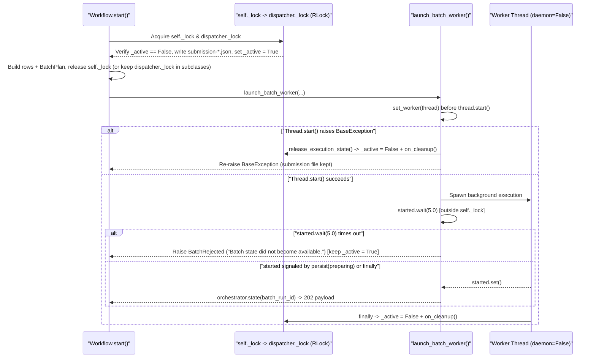

# BÁO CÁO TRIỂN KHAI STAGE 2B.2b: HỢP NHẤT KHỞI TẠO WORKER & PHỤC HỒI LỖI KHỞI CHẠY THREAD

**Dự án:** SecAgent Framework (`D:\SecAgent-W5-Judge`)  
**Giai đoạn:** Stage 2B.2b — Safe Worker Startup Consolidation & Failure Recovery (Hạng mục **C3**)  
**Ngày thực hiện:** 2026-11-22  
**Phán quyết nghiệm thu:** **`STAGE_2B2B_PASS`**

---

## 1. Executive Summary

Stage 2B.2b đã hoàn tất hợp nhất có kiểm soát hạng mục **C3 (Worker Startup & Lifecycle)** theo đúng thiết kế tối thiểu được phê duyệt ở Stage 2B.2a, đồng thời khắc phục triệt để lỗi treo cờ `dispatcher._active = True` khi `Thread.start()` ném ngoại lệ ở `OfflineBatchWorkflow` và toàn bộ 4 lớp con kế thừa (`Asi01BatchWorkflow`, `ToolBotLabBatchWorkflow`, `ResearchBotWebBatchWorkflow`, `MockWebBatchWorkflow`).

- **Kiến trúc lựa chọn (Option A tối thiểu):** Trích xuất đúng 1 helper thuần [`launch_batch_worker`](file:///D:/SecAgent-W5-Judge/backend/src/workflow/batch.py#L543-L597) trong `backend/src/workflow/batch.py` (`workflow_imports=[]`, không thêm module mới, không dựng worker framework tổng quát) và chuyển đổi tuần tự 2 điểm khởi chạy worker thread `daemon=False` duy nhất trong production: [`OfflineBatchWorkflow.start`](file:///D:/SecAgent-W5-Judge/backend/src/workflow/offline_batch.py#L224-L259) và [`GenericImportedBatchWorkflow.start`](file:///D:/SecAgent-W5-Judge/backend/src/workflow/generic_imported_batch.py#L455-L520).
- **Khắc phục khiếm khuyết tái hiện được trước refactor:** Trước Stage 2B.2b, test tái hiện lỗi trên `OfflineBatchWorkflow` và `Asi01BatchWorkflow` cho thấy khi `Thread.start()` ném ngoại lệ (`RuntimeError`), `dispatcher._active` bị kẹt `True` vĩnh viễn cho mọi lần submit tiếp theo. Sau refactor, khối `try ... except BaseException:` thống nhất trong `launch_batch_worker` giải phóng `dispatcher._active = False` (kèm callback `on_cleanup` cho `GenericImportedBatchWorkflow`) trong `dispatcher._lock`, giữ nguyên durable `submission-<id>.json` fail-closed và truyền nguyên ngoại lệ gốc ra ngoài.
- **Bảo toàn tuyệt đối ranh giới Stage 2B.2b:** Không chạm bất kỳ logic **C4 (`ExecutionGrant`)**, `_prune_grants`, `_owned_grants`, cổng baseline GH-C01, `BatchOrchestrator.run()`, HTTP contracts hay Bridge `:7019`.
- **Kết quả kiểm chứng sau chỉnh sửa cuối:**
  - Bộ test mới [test_stage2b2b_worker_lifecycle.py](file:///D:/SecAgent-W5-Judge/backend/tests/test_stage2b2b_worker_lifecycle.py): **7/7 PASSED** (tăng từ 5/7 PASSED, 2/7 FAILED trước khi sửa).
  - Bộ regression trọng tâm (18 file test, bao gồm toàn bộ batch/dispatch/admission/B47/stage gates): **`197 passed in 216.01s`** (exit code `0`).
  - Toàn bộ backend test suite (`pytest backend/tests -q -rs`): **`1,649 passed in 416.50s`** (`0` failed, `0` skipped, exit code `0`; log [task-1613.log](file:///C:/Users/Quettye/.gemini/antigravity-cli/brain/6dd69e96-8654-4b5e-8611-302f06fd7c40/.system_generated/tasks/task-1613.log)).

---

## 2. Baseline & Working-Tree Protection

- **Repository:** `D:\SecAgent-W5-Judge`
- **Git HEAD:** `ce1c776fd7b939b0cd705ece87320a67a1885ac8`
- **Môi trường Python:** `Python 3.13.7`, `pytest-9.0.3`
- **Tình trạng trước Stage 2B.2b:** Nền sạch sau Stage 2B.2a (`git diff --check` exit code `0`), chứa các thay đổi chưa commit hợp lệ từ các Stage trước (`api.py`, `catalog.py`, `dispatch.py`, `fixture_runtime.py`, `models.py` cùng các báo cáo/test Stage 2B.1* và 2B.2a). Ba file mục tiêu `batch.py`, `offline_batch.py`, `generic_imported_batch.py` ở trạng thái trước refactor đã đo chính xác:
  - [`backend/src/workflow/batch.py`](file:///D:/SecAgent-W5-Judge/backend/src/workflow/batch.py): `540` LOC
  - [`backend/src/workflow/offline_batch.py`](file:///D:/SecAgent-W5-Judge/backend/src/workflow/offline_batch.py): `271` LOC
  - [`backend/src/workflow/generic_imported_batch.py`](file:///D:/SecAgent-W5-Judge/backend/src/workflow/generic_imported_batch.py): `859` LOC
- **Tuân thủ bảo vệ Git:** Không chạy bất kỳ lệnh phá hủy nào (`git reset`, `clean`, `stash`, `restore`, `checkout --`, `commit`, `push`).

---

## 3. Scope & Strict Exclusions Compliance

| Hạng mục | Trạng thái trong Stage 2B.2b | Bằng chứng / Ghi chú |
| :--- | :--- | :--- |
| Hợp nhất worker thread launch (`C3`) | **Đã thực hiện** | `launch_batch_worker` trong [`batch.py`](file:///D:/SecAgent-W5-Judge/backend/src/workflow/batch.py#L543-L597); caller tại [`offline_batch.py`](file:///D:/SecAgent-W5-Judge/backend/src/workflow/offline_batch.py#L249-L259) & [`generic_imported_batch.py`](file:///D:/SecAgent-W5-Judge/backend/src/workflow/generic_imported_batch.py#L509-L520) |
| Khắc phục `OfflineBatchWorkflow` khi `Thread.start()` fail | **Đã thực hiện** | Bọc `except BaseException:` -> `release_execution_state()` |
| Hạng mục `C4` (`ExecutionGrant`, `_grant`, `_prune_grants`, `_owned_grants`) | **Không chạm** | Giữ nguyên logic cấp/thu hồi grant trong tất cả workflow |
| Cổng GH-C01 (`baseline_pass`) & `admit()` | **Không chạm** | Giữ nguyên closure `admit()` và điều kiện `GH-C01` tại `generic_imported_batch.py:465-503` |
| `BatchOrchestrator.run()` & `.active-batch` | **Không chạm** | `batch.py:371-540` giữ nguyên hoàn toàn |
| HTTP routes & schema (`routes_execution.py`) | **Không chạm** | Giữ nguyên `other._worker.is_alive()` tại `routes_execution.py:305` và schema trả về `"1.0.0"` |
| Runner / Executor / Judge / Reporting / Bridge `:7019` / Frontend | **Không chạm** | Ngoài phạm vi Stage 2B.2b |

---

## 4. Reproduction of `OfflineBatchWorkflow` `Thread.start()` Defect (Pre-Fix)

Trước khi chỉnh sửa bất kỳ dòng mã production nào, nhóm triển khai đã viết [`backend/tests/test_stage2b2b_worker_lifecycle.py`](file:///D:/SecAgent-W5-Judge/backend/tests/test_stage2b2b_worker_lifecycle.py) và chạy trực tiếp trên mã nền:

- **Lệnh chạy trước refactor:** `pytest backend/tests/test_stage2b2b_worker_lifecycle.py -v` (log `task-1552` / `task-1562`).
- **Kết quả trước refactor:** **`2 failed, 5 passed in 5.90s`**
  1. `FAILED test_offline_batch_thread_start_failure_recovers_active_state`:
     Khi monkeypatch `threading.Thread.start` ném `RuntimeError("can't start new thread")` ở lần gọi đầu tiên, `workflow.start(first_item)` ném đúng `RuntimeError` nhưng **`dispatcher._active` vẫn bị kẹt bằng `True`** (`assert True is False` tại `test_stage2b2b_worker_lifecycle.py:263`), khiến hệ thống từ chối mọi batch hợp lệ kế tiếp cho tới khi khởi động lại tiến trình.
  2. `FAILED test_asi01_and_toolbot_subclass_thread_start_failure_recovery`:
     `Asi01BatchWorkflow` kế thừa `OfflineBatchWorkflow.start()` nên chịu lỗi tương tự: **`asi01_dispatcher._active` kẹt ở `True`** (`assert True is False` tại `test_stage2b2b_worker_lifecycle.py:396`) khi `Thread.start()` ném `RuntimeError("thread allocation failed")`.
  3. **5 bài còn lại PASS ngay trên baseline**, chứng minh các bất biến `GenericImportedBatchWorkflow` `Thread.start()` rollback, cấu trúc worker non-daemon, giữ `_active=True` khi `started.wait` timeout, dọn `_active=False` khi worker crash, và chặn `409 another_workflow_active` hoạt động đúng như kỳ vọng để làm mốc đối chiếu.

---

## 5. Option Analysis & Design Decision (Option A vs Option B)

| Tiêu chí so sánh | Option A: `launch_batch_worker` trong `batch.py` (Đã chọn) | Option B: Vá cục bộ trong `offline_batch.py` |
| :--- | :--- | :--- |
| Mức độ loại bỏ trùng lặp | Xóa toàn bộ ~22–25 dòng boilerplate lặp (`Event`, `worker try/finally`, `Thread`, `except BaseException`, `started.wait`, `state`, dict trả về) ở cả 2 call site | Để nguyên 2 khối gần như giống hệt nhau ở `offline_batch.py` và `generic_imported_batch.py` |
| Chi phí gián tiếp / Coupling | Tối thiểu: 1 hàm thuần trong `batch.py` nhận callback `admit`, `execute`, `set_worker`, `on_cleanup`; **0 nhánh `if/else` theo loại workflow** | 0 tham số callback nhưng duy trì 2 nơi phải sửa song song nếu có lỗi tương tự |
| Chu kỳ import (`workflow`) | Giữ nguyên `batch_wf_imports: []` | Giữ nguyên `batch_wf_imports: []` |
| Tính đúng đắn lock & timeout | Thu hẹp `self._lock` của `OfflineBatchWorkflow` về trước bước launch (đã có `dispatcher._active = True` bảo vệ, tương đương `GenericImportedBatchWorkflow`), tránh giữ `self._lock` khi `started.wait(5)` | Giữ nguyên cấu trúc cũ |

**Quyết định:** Chọn **Option A** vì giải quyết dứt điểm cả lỗi kỹ thuật ở `OfflineBatchWorkflow` lẫn trùng lặp mã **C3** chỉ bằng 1 helper 55 dòng trong `batch.py`, giúp cả 6 batch workflow dùng chung đúng 1 đường khởi động và phục hồi worker duy nhất.

---

## 6. Detailed Refactor Architecture & `launch_batch_worker()` Contract

Hàm [`launch_batch_worker`](file:///D:/SecAgent-W5-Judge/backend/src/workflow/batch.py#L543-L597) đóng gói hợp đồng bất biến sau:

1. **Tạo tín hiệu đồng bộ khởi tạo:** `started = Event()`.
2. **Helper giải phóng trạng thái nội bộ `release_execution_state()`:** Thu nhận `dispatcher._lock`, đặt `dispatcher._active = False`, và nếu có `on_cleanup` thì gọi `on_cleanup()` ngay trong lock (dùng chung cho cả `worker()` `finally:` lẫn `except BaseException:` để không nhân đôi logic cleanup).
3. **Thân `worker()`:** Thực thi `orchestrator.run(plan, admit, execute, batch_run_id=batch_run_id, on_started=started.set)` trong khối `try ... finally:` đảm bảo luôn gọi `release_execution_state()` và `started.set()` ngay cả khi `orchestrator.run` phát sinh lỗi.
4. **Khởi tạo và gán `Thread`:** Tạo `thread = Thread(target=worker, name=thread_name, daemon=False)`, gọi `set_worker(thread)` **trước** `thread.start()` (đảm bảo `self._worker` trỏ tới `Thread` thật trước khi worker chạy và hỗ trợ `routes_execution.py:305` lẫn `ToolBotLabBatchWorkflow` cleanup join).
5. **Phục hồi pre-start exception:** Nếu tạo `Thread`, `set_worker`, hoặc `thread.start()` ném bất kỳ `BaseException` nào, `release_execution_state()` chạy ngay dưới `dispatcher._lock`, giữ nguyên `submission-*.json` fail-closed và `raise` lại nguyên ngoại lệ.
6. **Chờ tín hiệu sẵn sàng fail-closed:** `if not started.wait(start_timeout): raise BatchRejected("Batch state did not become available.")` — **tuyệt đối không** xóa `dispatcher._active` khi timeout vì thread vẫn có thể đang sống và chạy `orchestrator.run`.
7. **Trả contract HTTP/workflow:** Truy vấn `state = orchestrator.state(batch_run_id)` và trả dict chuẩn `workflow_schema_version = "1.0.0"`.

---

## 7. Lock Ordering, State Lifecycle & Fail-Closed Guarantees



---

## 8. Worker Start Failure Recovery Parity

- **`OfflineBatchWorkflow` & 4 lớp con (`Asi01BatchWorkflow`, `ToolBotLabBatchWorkflow`, `ResearchBotWebBatchWorkflow`, `MockWebBatchWorkflow`):**
  Thừa hưởng hoàn toàn khối `except BaseException:` từ `launch_batch_worker`. Khi `Thread.start()` fail:
  - `dispatcher._active` trở về `False`;
  - tệp `submission-<id>.json` vẫn tồn tại để chặn replay cùng `submission_id` với `BatchRejected("Duplicate batch submission.")`;
  - submission mới hợp lệ thực thi bình thường ngay sau đó không cần restart server;
  - các lớp con (`Asi01BatchWorkflow`, `ResearchBotWebBatchWorkflow`, `ToolBotLabBatchWorkflow`) vốn giữ `dispatcher._lock` (`RLock`) bao ngoài `super().start(...)` tái nhập an toàn khi `release_execution_state()` chạy trên cùng caller thread. Riêng `ToolBotLabBatchWorkflow.start()` tiếp tục bắt `Exception` quanh `super().start(item)` để dọn `_active_grant_id` và `_prune_grants()`.
- **`GenericImportedBatchWorkflow`:**
  Duy trì nguyên vẹn ngữ nghĩa phục hồi vốn có nhờ callback `cleanup_worker()` (`self._active_grant_id = None; self._prune_grants()`), bảo toàn cả khi `Thread.start()` ném `BaseException` lẫn trong khối `finally:` của worker thread.

---

## 9. Timeout Semantics (`started.wait`) & Live Worker Fail-Closed Invariant

Kiểm thử `test_started_wait_timeout_keeps_active_fail_closed_until_worker_exits` xác minh trên cả `OfflineBatchWorkflow` và `GenericImportedBatchWorkflow`:
- Khi worker thread đã được tạo và đang sống (`workflow._worker.is_alive() is True`) nhưng `started.wait(5.0)` hết thời gian (`return False`), `launch_batch_worker` ném `BatchRejected("Batch state did not become available.")` mà **không** đặt `dispatcher._active = False`.
- Mọi yêu cầu `start()` đồng thời tiếp theo đều bị chặn fail-closed với `BatchRejected("Another controlled execution is active.")` cho tới khi worker thread hoàn tất và tự dọn trong `finally:`.

---

## 10. Cross-Workflow Concurrency Guard

Trong [`backend/src/workflow/routes_execution.py`](file:///D:/SecAgent-W5-Judge/backend/src/workflow/routes_execution.py#L305), endpoint `/api/testing/batches` kiểm tra `getattr(other, "_worker", None) is not None and other._worker.is_alive()`. Do `launch_batch_worker` nhận `set_worker=lambda worker: setattr(self, "_worker", worker)` và thực thi gán ngay trước `thread.start()` với `daemon=False`, bất biến đa workflow không đổi: bài test `test_cross_workflow_concurrency_guard_uses_worker_is_alive` chứng minh khi `Asi01BatchWorkflow` đang giữ worker sống, yêu cầu chạy `GenericImportedBatchWorkflow` qua HTTP API bị chặn với `409` (`"another_workflow_active"`).

---

## 11. C4 Grant Handling Untouched Verification

Toàn bộ logic cấp phát và kiểm soát `ExecutionGrant` hoàn toàn nguyên vẹn:
- `OfflineBatchWorkflow._grant` và `GenericImportedBatchWorkflow._grant` không bị thay đổi.
- Cơ chế lazy per-case grant trong `GenericImportedBatchWorkflow.start()` -> `admit()` (`_owned_grants`, giới hạn 20 grants trong policy, `_authorization_expires_at`, `_prune_grants()`) không đổi.
- Cơ chế `ToolBotLabBatchWorkflow` (tạo grant upfront + `toolbot-grant-cleanup` daemon thread join `self._worker`) không đổi.
- Toàn bộ suite `test_workflow_admission.py`, `test_b47_remediation.py`, `test_asi01_batch.py`, `test_toolbot_lab_batch.py`, `test_generic_imported_batch.py` đều PASS 100%.

---

## 12. Per-File Code Changes & LOC Accounting

| File | Trước (LOC) | Sau (LOC) | Chênh lệch | Vai trò thay đổi |
| :--- | :---: | :---: | :---: | :--- |
| [`backend/src/workflow/batch.py`](file:///D:/SecAgent-W5-Judge/backend/src/workflow/batch.py) | `540` | `597` | **`+57`** | Import `Event, Thread`; thêm `launch_batch_worker` (`L543-L597`) |
| [`backend/src/workflow/offline_batch.py`](file:///D:/SecAgent-W5-Judge/backend/src/workflow/offline_batch.py) | `271` | `259` | **`-12`** | Bỏ import `Event` thừa; gọi `launch_batch_worker` tại `start()` (`L249-L259`) |
| [`backend/src/workflow/generic_imported_batch.py`](file:///D:/SecAgent-W5-Judge/backend/src/workflow/generic_imported_batch.py) | `859` | `838` | **`-21`** | Bỏ import `Event` thừa; định nghĩa `cleanup_worker` và gọi `launch_batch_worker` (`L505-L520`) |
| **Tổng mã production (3 file)** | **`1,670`** | **`1,694`** | **`+24`** | Giảm `-33` LOC trùng lặp tại 2 workflow để tập trung về 1 helper 55 dòng kèm type hints + docstring |
| [`backend/tests/test_stage2b2b_worker_lifecycle.py`](file:///D:/SecAgent-W5-Judge/backend/tests/test_stage2b2b_worker_lifecycle.py) *(mới)* | `0` | `622` | **`+622`** | 7 test offline tự cô lập cho Stage 2B.2b |

---

## 13. Incremental Migration Record

1. **Bước A (Baseline & Freeze):** Tạo [`test_stage2b2b_worker_lifecycle.py`](file:///D:/SecAgent-W5-Judge/backend/tests/test_stage2b2b_worker_lifecycle.py) và chạy pre-fix (`2 failed, 5 passed in 5.90s`), xác nhận tái hiện lỗi trên `OfflineBatchWorkflow` và `Asi01BatchWorkflow`.
2. **Bước B (`batch.py`):** Thêm `launch_batch_worker` ở cuối `batch.py`, giữ nguyên `workflow_imports=[]`.
3. **Bước C (`offline_batch.py`):** Chuyển `OfflineBatchWorkflow.start()` sang gọi `launch_batch_worker` (giữ `Thread` trong import cho chú thích kiểu `self._worker: Thread | None`), kiểm tra `py_compile` và 7 suite Offline/Subclass/Dispatch/Orchestrator (`95 passed` trên mã production).
4. **Bước D (`generic_imported_batch.py`):** Chuyển `GenericImportedBatchWorkflow.start()` sang `launch_batch_worker` với `on_cleanup=cleanup_worker`, sửa khẳng định đường dẫn artifact (`run-summary.json` / `report_file`) và thuộc tính grant trong file test mới, rồi chạy toàn bộ kiểm chứng cuối cùng.

---

## 14. New Stage 2B.2b Test Suite (`test_stage2b2b_worker_lifecycle.py`)

| # | Tên test | Pre-Fix | Post-Fix | Điều kiện xác minh |
| :---: | :--- | :---: | :---: | :--- |
| 1 | `test_offline_batch_thread_start_failure_recovers_active_state` | **FAIL** | **PASS** | `RuntimeError` khi `Thread.start()` fail -> `_active=False`, giữ `submission-*` chống trùng, run sau hoàn tất + ghi artifact |
| 2 | `test_generic_imported_thread_start_failure_recovers_active_and_grants` | PASS | **PASS** | `BaseException` tùy biến khi `Thread.start()` fail -> `_active=False`, `_active_grant_id=None`, `_owned_grants=set()`, giữ `submission-*`, run sau `completed` |
| 3 | `test_asi01_and_toolbot_subclass_thread_start_failure_recovery` | **FAIL** | **PASS** | Cả `Asi01BatchWorkflow` và `ToolBotLabBatchWorkflow` nhả `_active=False`, `ToolBot` dọn grant sạch khi `Thread.start()` fail |
| 4 | `test_normal_worker_contract_and_response_shape` | PASS | **PASS** | `_worker` là `threading.Thread`, đúng `name` & `daemon=False`, `join(5)` thành công, đúng 5 khóa phản hồi `1.0.0` |
| 5 | `test_started_wait_timeout_keeps_active_fail_closed_until_worker_exits` | PASS | **PASS** | `started.wait(5)` trả `False` khi worker sống -> ném `BatchRejected`, `_active` vẫn `True` cho đến khi worker thoát hẳn |
| 6 | `test_worker_orchestrator_exception_resets_active_state` | PASS | **PASS** | Worker crash trong `orchestrator.run()` -> `finally:` đặt `_active=False` (+ dọn grant), run sau chạy thành công |
| 7 | `test_cross_workflow_concurrency_guard_uses_worker_is_alive` | PASS | **PASS** | Khi worker `asi01` còn sống, HTTP `POST /api/testing/batches` cho `imported` trả `409 another_workflow_active` |

---

## 15. Focused Regression Verification Results

Lệnh chạy sau chỉnh sửa cuối cùng (log [task-1608.log](file:///C:/Users/Quettye/.gemini/antigravity-cli/brain/6dd69e96-8654-4b5e-8611-302f06fd7c40/.system_generated/tasks/task-1608.log)):

```text
pytest backend/tests/test_stage2b2b_worker_lifecycle.py \
       backend/tests/test_offline_batch_api.py \
       backend/tests/test_asi01_batch.py \
       backend/tests/test_toolbot_lab_batch.py \
       backend/tests/test_researchbot_web_batch.py \
       backend/tests/test_web_mock_batch.py \
       backend/tests/test_generic_imported_batch.py \
       backend/tests/test_imported_live_local.py \
       backend/tests/test_b47_remediation.py \
       backend/tests/test_batch_orchestrator.py \
       backend/tests/test_workflow_dispatch.py \
       backend/tests/test_workflow_admission.py \
       backend/tests/test_stage1a_dependency_boundaries.py \
       backend/tests/test_stage1b1_dependency_boundaries.py \
       backend/tests/test_stage1b2_api_contract_parity.py \
       backend/tests/test_stage2b1a_exclusive_json.py \
       backend/tests/test_stage2b1b_report_persistence.py \
       backend/tests/test_stage2b1c_validation_parity.py -q -rs
```

- **Kết quả:** **`197 passed in 216.01s`** (`0` failed, `0` skipped, exit code `0`).

---

## 16. Full Backend Suite Verification

Lệnh chạy sau chỉnh sửa cuối cùng (log [task-1613.log](file:///C:/Users/Quettye/.gemini/antigravity-cli/brain/6dd69e96-8654-4b5e-8611-302f06fd7c40/.system_generated/tasks/task-1613.log)):

```text
pytest backend/tests -q -rs
```

- **Kết quả:** **`1649 passed in 416.50s (0:06:56)`** (`0` failed, `0` skipped, exit code `0`).
- **Đối chiếu tăng trưởng:** `1,642` (baseline Stage 2B.1c) + `7` (Stage 2B.2b mới) = **`1,649 passed`**.

---

## 17. Import Graph, AST Boundaries & Compilation Checks

Tất cả các kiểm tra sau đều chạy ở lượt [task-1608.log](file:///C:/Users/Quettye/.gemini/antigravity-cli/brain/6dd69e96-8654-4b5e-8611-302f06fd7c40/.system_generated/tasks/task-1608.log) với exit code `0`:

- **`python -m py_compile`:** Đạt trên cả 4 file chỉnh sửa/tạo mới (`batch.py`, `offline_batch.py`, `generic_imported_batch.py`, `test_stage2b2b_worker_lifecycle.py`).
- **AST `batch.py` workflow imports:** `batch_wf_imports: []` (tầng nền `batch.py` không nhập bất kỳ module anh em/cấp trên nào trong `workflow.*`).
- **AST workflow import cycle scan:** `cycles: []` (0 vòng lặp phụ thuộc).
- **AST production-to-script dependency scan (`backend/src/`):** `script_refs: []`.
- **Single non-daemon batch worker verification (`Select-String -Path backend/src/workflow/*.py -Pattern "Thread\("`):**
  - `batch.py:580`: `thread = Thread(target=worker, name=thread_name, daemon=False)` (điểm khởi chạy batch worker **duy nhất**).
  - `fixture_runtime.py:33`: `daemon=True` (server fixture test cục bộ — ngoài phạm vi C3).
  - `toolbot_lab_batch.py:263`: `daemon=True` (`toolbot-grant-cleanup` — dọn grant sau khi join `self._worker`, thuộc C4, giữ nguyên theo scope).
- **`git diff --check`:** Exit code `0` (0 lỗi khoảng trắng / EOF).

---

## 18. Residual Risks & Deferred Items

1. **Xử lý `BaseException` ở `ToolBotLabBatchWorkflow.start()` (C4 — Ngoài phạm vi Stage 2B.2b):** `toolbot_lab_batch.py:249` hiện dùng `except Exception:` (không phải `except BaseException:`) quanh `super().start(item)` để dọn `_active_grant_id` và `_prune_grants()`. Nếu một `BaseException` không kế thừa `Exception` xảy ra trong `Thread.start()` trên `ToolBotLabBatchWorkflow`, `launch_batch_worker` vẫn reset chuẩn xác `dispatcher._active = False`, nhưng phần grant C4 của `ToolBotLabBatchWorkflow` sẽ giữ nguyên tới hết TTL (10 phút) hoặc lần `_prune_grants()` kế tiếp. Vấn đề thuộc C4 nên được ghi nhận lại thay vì sửa vượt phạm vi.
2. **Stage 2B.1b parity note:** Giữ nguyên lưu ý lịch sử từ Stage 2B.1b về giới hạn chứng minh byte-level BEFORE/AFTER toàn phần (không liên quan Stage 2B.2b).

---

## 19. Stage 2B.2b Verdict

**`STAGE_2B2B_PASS`** — Hạng mục **C3** đã được hợp nhất tối thiểu, sửa dứt điểm lỗ hổng treo `_active` khi `Thread.start()` lỗi trên `OfflineBatchWorkflow` và các lớp con, giữ nguyên 100% hành vi C4, bất biến đồng thời/timeout, và đạt `1,649 passed` (exit code `0`) trên toàn bộ backend suite.

---

## 20. Readiness for Stage 2B.3 / Next Safe Step

Hệ thống hiện ở trạng thái sạch, không có vòng lặp import hay thay đổi ngoài phạm vi, sẵn sàng chuyển tiếp sang **Stage 2B.3** hoặc giai đoạn kiểm toán/triển khai tiếp theo mà không còn rủi ro kỹ thuật nào ở phần khởi chạy worker thread batch.
