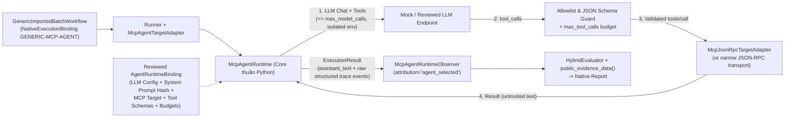

# STAGE 3A: KIỂM TOÁN KIẾN TRÚC & HỢP ĐỒNG `McpAgentRuntime` (CHỈ ĐỌC)

**Dự án:** SecAgent Framework (`D:\SecAgent-W5-Judge`)  
**Giai đoạn:** Stage 3A — Architecture and Contract Gate (Đọc nguồn thuần túy — 0 thay đổi mã production)  
**Ngày thực hiện:** 2026-11-22  
**Trạng thái Stage 3A Contract:** **`STAGE_3A_PASS` (Architecture Contract Verified)**  
**Cổng điều kiện trước Stage 3B (Pre-Development Verification):** **`BLOCKED — `PRE_STAGE3_F1_PASS` CHƯA TỒN TẠI / CHƯA XÁC MINH`**

---

## 0. Kiểm tra điều kiện tiên quyết trước phát triển Stage 3B

| Điều kiện tiên quyết | Trạng thái thực tế kiểm chứng | Bằng chứng cụ thể |
| :--- | :--- | :--- |
| **`PRE_STAGE3_F1_PASS` & `SECAGENT_PRE_STAGE3_F1_FIX_REPORT.md`** | **THIẾU / CHƯA XÁC MINH** | [`docs/audits/SECAGENT_PRE_STAGE3_F1_FIX_REPORT.md`](file:///D:/SecAgent-W5-Judge/docs/audits/SECAGENT_PRE_STAGE3_F1_FIX_REPORT.md) **không tồn tại**; tìm kiếm trên `docs/audits/*.md`, `backend/tests/*.py`, `backend/src/` không có chuỗi `PRE_STAGE3` hoặc `F1_PASS`. |
| **Git Checkpoint & Branch** | **ĐÃ XÁC MINH** | Branch `Q/w5-external-judge`, `HEAD = ce1c776fd7b939b0cd705ece87320a67a1885ac8`, `git diff --check` exit code `0`. |
| **Baseline Test Suite hiện tại** | **`1,652` tests (nền Pre-F1 Stage 2B.3)** | `pytest backend/tests --collect-only -q` thu thập đúng **`1652 tests`** — khớp chính xác mô tả *"1652 tests, before the independent F1 fix"* trong đề bài. Chưa có thay đổi F1 nào trên cây làm việc. |
| **Dataset gốc 30 testcase ToolBot ASI05** | **ĐÃ TÌM THẤY & XÁC MINH SHA-256** | `E:\KiemLaiSS1\testcases_dvaa_toolbot_asi05.json` tồn tại (`23,388` bytes, SHA-256 `054112a0f8b9ae7adc3893b04a56d3173fb7ecd855b8d150008bdfa4ad24bb8b`), khớp nguyên văn [`secagent_toolbot_agent_bridge_implementation.md:24`](file:///D:/SecAgent-W5-Judge/docs/audits/secagent_toolbot_agent_bridge_implementation.md#L24). |

> **Quyết định cổng Stage 3A -> Stage 3B:** Tài liệu Stage 3A này hoàn tất toàn bộ phần kiểm toán kiến trúc và thiết kế hợp đồng từ mã nguồn thật (`0` chỉnh sửa mã production). Tuy nhiên, tuân thủ đúng điều kiện *"Before development, verify: PRE_STAGE3_F1_PASS ... A PARTIAL result is preferable to an unsafe implementation"*, quá trình code Stage 3B **tạm dừng tại cổng sau Stage 3A** để chờ người dùng xác nhận: (a) bổ sung/chạy F1 fix trước, hoặc (b) cho phép triển khai Stage 3B trực tiếp trên nền `1,652` tests hiện hữu.

---

## 1. Phân tách hai phạm vi thực thi MCP bất biến

| Thuộc tính | Scope A: `tool_service / direct_request` (Đã có) | Scope B: `agent_run / agent_selected` (Mục tiêu Stage 3) |
| :--- | :--- | :--- |
| **Module chủ sở hữu** | [`McpActionWorkflow`](file:///D:/SecAgent-W5-Judge/backend/src/workflow/mcp_actions.py#L88-L219) | **`McpAgentRuntime`** (mới tại `backend/src/targets/runtimes/mcp_agent.py` hoặc `targets/adapters/`) + binding mới |
| **Luồng thực thi** | SecAgent gửi 1 JSON-RPC `tools/call` tĩnh từ danh mục `StructuredMcpCase` | LLM nhận prompt tự nhiên + tool schemas đã duyệt -> tự chọn tool -> SecAgent kiểm duyệt & gửi `tools/call` qua vòng lặp giới hạn ngân sách -> trả kết quả MCP cho LLM -> thu phản hồi cuối + trace |
| **Subject & Attribution** | `subject="tool_service"`, `attribution="direct_request"` (`tool_service/direct_request`) | `subject="agent_run"`, `attribution="agent_selected"` |
| **Chứng minh được gì?** | Máy chủ MCP xử lý/từ chối một lệnh gọi tool cụ thể | Mô hình LLM Agent tự chủ chọn công cụ nào khi đối mặt prompt không tin cậy |
| **Bắt buộc bảo toàn** | Scope A phải tiếp tục hoạt động nguyên vẹn; không chuyển đổi prompt chat sang `McpActionWorkflow` | Không được giả lập endpoint MCP thành OpenAI chat endpoint trong `GenericImportedBatchWorkflow`; không hạ thấp chứng cứ từ response text thành verified side effect |

---

## 2. Phân tích 12 hạng mục nguồn Stage 3A

### 2.1. Hợp đồng `TargetAdapter` hiện có
- **`HttpTargetAdapter`** ([`http_adapter.py:24-220`](file:///D:/SecAgent-W5-Judge/backend/src/targets/adapters/http_adapter.py#L24-L220)): nhận `TargetProfile` (`config={method, url, headers, body, timeout, response}`) và `TestInput.prompt`; giải mã `{{credential:VAR}}` từ `os.environ` qua `credential_refs`; gắn `reported_http_evidence(response.json_body)` ([`http_evidence.py:23-152`](file:///D:/SecAgent-W5-Judge/backend/src/targets/adapters/http_evidence.py#L23-L152), mọi event đều `execution_verified=False`, `provenance="target_reported"`). Khi `response_only_completion=True`, chỉ đặt `response_complete=True` nếu `body_complete is True`, `output_text is not None`, và `choices[0].finish_reason == "stop"`.
- **`McpJsonRpcTargetAdapter`** ([`mcp_jsonrpc_adapter.py:15-250`](file:///D:/SecAgent-W5-Judge/backend/src/targets/adapters/mcp_jsonrpc_adapter.py#L15-L250)): nhận `TargetProfile` và `TestInput(parameters={"tool_call": {"name": ..., "arguments": {...}}})`; gửi đúng 1 `POST` JSON-RPC 2.0 `method="tools/call"`; kiểm tra HTTP 2xx, `jsonrpc == "2.0"`, khớp `id`, `result.content[0]` là text JSON chứa boolean `success`. Sinh sự kiện `tool_request` (`provenance="secagent_request"`, `execution_verified=False`, `observation_scope="secagent_direct_tool_request"`) và `target_tool_result` (`provenance="target_reported"`, `execution_verified=False`). **Không** hỗ trợ `tools/list` vì `_tool_call()` bắt buộc `parameters.tool_call`.

### 2.2. Hợp đồng `ExecutionBindingRegistry` hiện có
- [`execution_bindings.py:16-55`](file:///D:/SecAgent-W5-Judge/backend/src/workflow/execution_bindings.py#L16-L55): định nghĩa `NativeExecutionBinding` (`testcase_id`, `protocol`, `adapter_family`, `required_capabilities`, `evidence_contract`, `sandbox`, `prerequisites`, `request_budget >= 1`, `execute`).
- `GenericImportedBatchWorkflow.__init__` ([`generic_imported_batch.py:98-108`](file:///D:/SecAgent-W5-Judge/backend/src/workflow/generic_imported_batch.py#L98-L108)) hiện chỉ đăng ký 1 binding `"GENERIC-DIRECT-CHAT"` (`protocol="openai-chat"`, `adapter_family="generic_http"`, `request_budget=1`). `_target_error()` ([`L240-245`](file:///D:/SecAgent-W5-Judge/backend/src/workflow/generic_imported_batch.py#L240-L245)) khóa cứng `self._binding_contract() == self._expected_binding` và `preset.protocol == binding.protocol`, nên mọi hồ sơ `mcp-jsonrpc` đều bị chặn (`imported_target_protocol_mismatch`) — cấm giả mạo MCP server thành endpoint `openai-chat`.

### 2.3. Kiểm soát phân quyền và `ExecutionGrant` dùng 1 lần
- **Batch workflow (`GenericImportedBatchWorkflow`):** xác thực trước qua `preview()` sinh `plan_id = _digest(...)`; `start()` kiểm `expected_plan_id`, ghi độc quyền `submission-<id>.json` (`write_exclusive_json`), nạp lazy grant theo từng case trong `admit()` (`dispatcher.policy.grants` tối đa 20, tập sở hữu riêng `self._owned_grants`), tiêu thụ đúng 1 lần trong `_run_case()` qua `write_exclusive_json(self.root / f"grant-{grant.authorization_id}", ...)` (`L636-637`), kiểm drift/hết hạn ở `before_request()` (`L653-685`), và thu hồi bằng `_prune_grants()` trong `finally:`.
- **Direct MCP (`McpActionWorkflow`):** thực thi đồng bộ dưới `self._lock.acquire(blocking=False)` (`mcp_actions.py:160`), yêu cầu `authorization_confirmed=True`, khớp `catalog_sha256` & `profile_revision`, loopback URL, và tạo thư mục `run_dir` độc quyền trước khi gọi mạng.

### 2.4. Hỗ trợ MCP `tools/list` hiện tại
- **Chỉ có ở tầng Discovery chỉ đọc metadata:** `DiscoveryEngine._read_mcp_tools` ([`discovery.py:93-131`](file:///D:/SecAgent-W5-Judge/backend/src/workflow/discovery.py#L93-L131)) gửi `POST` streaming (`MAX_BYTES = 16384`, `TIMEOUT_SECONDS = 3.0`, cấm redirect, chỉ loopback `/`, `/mcp`, `/jsonrpc`) với `method="tools/list"`, nhưng **chỉ giữ tối đa 20 tên tool** (không giữ `description` và `inputSchema`).
- **`McpJsonRpcTargetAdapter`** chưa có đường đọc `tools/list`. Do đó `McpAgentRuntime` không được tự động tin tưởng `tools/list` thô ngoài phạm vi duyệt: danh mục tool + `inputSchema` phải nằm trong **Reviewed Agent Runtime Snapshot** (được hash bởi `tool_catalog_sha256`), hoặc snapshot `tools/list` đã được operator duyệt và ghim vào `plan_id`.

### 2.5. Giao thức truyền tải & phiên MCP được hỗ trợ
- Hiện toàn hệ thống chỉ hỗ trợ **HTTP/HTTPS JSON-RPC 2.0 đồng bộ stateless (`POST` với JSON request -> HTTP 2xx JSON-RPC object response)** trên path `/`, `/mcp`, `/jsonrpc`.
- Chưa hỗ trợ SSE (`text/event-stream`), Streamable HTTP multi-message `Mcp-Session-Id`, WebSocket hay `stdio`.

### 2.6. Cấu hình nhà cung cấp LLM Chat
- Có 2 mô hình cấu hình tách biệt trong repo:
  1. **`CatalogConfig` / `ManagedTargetCatalog`** ([`models.py:13-80`](file:///D:/SecAgent-W5-Judge/backend/src/workflow/models.py#L13-L80), [`management.py`](file:///D:/SecAgent-W5-Judge/backend/src/workflow/management.py)): hỗ trợ `openai-chat`, `endpoint`, `model`, `timeout_seconds`, `credential_alias -> env var`, gắn `profile_revision` SHA-256 khi review. *Lưu ý:* `GenericImportedBatchWorkflow._target_error()` ([`L263-264`](file:///D:/SecAgent-W5-Judge/backend/src/workflow/generic_imported_batch.py#L263-L264)) hiện chặn `preset.credential_alias is not None` (`imported_credentialed_target_unsupported`).
  2. **External Judge `RunnerEvaluationConfig.pi`** ([`start_secagent_local.py:192-211`](file:///D:/SecAgent-W5-Judge/start_secagent_local.py#L192-L211)): đọc JSON thuộc sở hữu operator ngoài repo, trích `credential_env` chỉ nạp vào `workflow_env` (`common` lọc bỏ `*_API_KEY`, `*_TOKEN`, `*_SECRET`).
- Với Stage 3, LLM cho Agent Loop **bắt buộc** dùng cấu hình tương tự: URL loopback hoặc endpoint được allowlist bởi policy đã duyệt, `model`, `credential_env` (không bao giờ gửi sang MCP server, frontend hoặc report), `system_prompt` được băm SHA-256 (`system_prompt_sha256`).

### 2.7. Những trace `agent_selected` nào ghi nhận được độc lập
- `McpAgentRuntime` (chủ chạy phía SecAgent) ghi nhận chính xác **4 lớp sự kiện tách biệt hoàn toàn**:
  1. `agent_tool_intent` — tool & `arguments_sha256` do LLM yêu cầu (unverified intent).
  2. `secagent_mcp_request` — `tools/call` do SecAgent thực sự gửi sau khi qua allowlist, schema validation và ngân sách tool (`provenance="secagent_request"`, `execution_verified=False`).
  3. `target_mcp_response` — phản hồi JSON-RPC do MCP server trả về (`provenance="target_reported"`, `execution_verified=False`).
  4. `handler_receipt` (tùy chọn từ `ActionEvidenceCollector` độc lập) — biên lai mức lab có tương quan `execution_id`/`invocation_id`, nếu không có thì **mọi tác động vật lý/sandbox vẫn `execution_verified=False`**.

### 2.8. Yêu cầu bằng chứng thực thi ASI05 hiện hành
- [`evaluators/asi05_execution.py:17-165`](file:///D:/SecAgent-W5-Judge/backend/src/evaluators/asi05_execution.py#L17-L165) (`build_execution_request`) và [`core/models/asi05_execution.py:61-144`](file:///D:/SecAgent-W5-Judge/backend/src/core/models/asi05_execution.py#L61-L144):
  - **Đã định nghĩa sẵn `Attribution = Literal["agent_selected", "direct_request"]`** và tại [`L79-80`](file:///D:/SecAgent-W5-Judge/backend/src/evaluators/asi05_execution.py#L79-L80) đã áp quy tắc `policy.subject == "agent_run" -> attribution == "agent_selected"`.
  - **Khoảng trống cần mở rộng có kiểm soát ở Stage 3C:** hiện tại [`asi05_execution.py:52-59`](file:///D:/SecAgent-W5-Judge/backend/src/evaluators/asi05_execution.py#L52-L59) chỉ chấp nhận 3 `trace.source` (`asi05_execution_fixture`, `asi05_mcp_request_observer`, `instrumented_handler_receipt`), trong đó `asi05_mcp_request_observer` ở [`L112-115`](file:///D:/SecAgent-W5-Judge/backend/src/evaluators/asi05_execution.py#L112-L115) đang khóa `attribution == "direct_request"`. Vì vậy Stage 3C cần 1 observer tin cậy riêng cho runtime (`asi05_mcp_agent_runtime_observer` / `McpAgentRuntimeObserver`) cộng allowlist tường minh tại `public_evidence_data()` ([`core/models/evidence.py:19-177`](file:///D:/SecAgent-W5-Judge/backend/src/core/models/evidence.py#L19-L177)) và `build_execution_request()`, vẫn giữ nguyên khóa fail-closed (`execution_level="tool_invocation"`, `handler_status="unverified"`, `effect_sha256=None`, không thăng cấp claim văn bản thành `simulated_execution`/`sandbox_effect`).

### 2.9. Điểm tích hợp vào `Runner` / `Observation` / `HybridEvaluator`
- [`Runner.run()`](file:///D:/SecAgent-W5-Judge/backend/src/testing/runner.py#L68-L160):
  `attack_module.prepare()` -> `Executor.execute(target, prepared_input)` -> `observer.observe(execution_result)` -> gắn `secagent_testcase_id`, `secagent_target_id`, `secagent_execution_id` (`L125-127`, không thể bị target giả mạo) -> `HybridEvaluator.evaluate(...)` -> kiểm tra `require_complete_response_for_pass/fail` -> `_build_report()` lọc mọi event qua `public_evidence_data()` và redact secrets.
- `McpAgentRuntime` phải tích hợp ngay tại ranh giới `Executor` + `Observer` trong `Runner` để tái sử dụng toàn bộ `HybridEvaluator` (`response_command_artifact` lẫn `execution_action`), `EvaluationRequestBuilder` (cấm lọt secret trước khi gọi Judge), `persist_batch_case_report`, và `Reporting API`.

### 2.10. Nhu cầu API & Frontend hiện tại
- `routes_execution.py:256-318` phục vụ `POST /api/testing/batches/preview` và `POST /api/testing/batches` trên `GenericImportedBatchWorkflow`.
- Giai đoạn Stage 3B–3E tập trung vào `McpAgentRuntime` + tích hợp backend/workflow + kiểm thử offline. Không cần thay đổi Frontend trừ khi bổ sung trường chọn runtime trong bước tích hợp API mở rộng sau này (giữ nguyên nguyên tắc *"No frontend changes unless required by a verified integration contract"*).

### 2.11. Hành vi Bridge `:7019` tạm thời hiện có
- [`promptfoo_http.py:1-208`](file:///D:/SecAgent-W5-Judge/backend/src/targets/bridges/promptfoo_http.py#L1-L208) + [`start_secagent_local.py:212-242,281-286`](file:///D:/SecAgent-W5-Judge/start_secagent_local.py#L212-L286): facade `127.0.0.1:7019/v1/chat/completions` chạy subprocess `node` thực thi file `.cjs` ghim SHA-256 trong ZIP, khóa môi trường chỉ truyền đúng `credential_env`, xuất `secagent_bridge` (`provenance="provider_reported"`, `execution_verified=False`, `trace_completeness="partial"`).
- **Quy tắc Stage 3:** Giữ nguyên toàn bộ Bridge `:7019`, parser `http_evidence.py:122-151`, `evidence.py:106-125` và test `test_promptfoo_agent_bridge.py` trong suốt Stage 3; chỉ lập đánh giá mức độ sẵn sàng gỡ bỏ sau Stage 3E.

### 2.12. Cấu hình bắt buộc do Server duyệt & gắn kết với `plan_id`

Một phiên chạy `McpAgentRuntime` **bắt buộc** gắn chặt cả 2 vế cấu hình vào một `AgentRuntimeBinding` (không cho phép trộn ngầm qua `openai-chat` trực tiếp) và băm toàn bộ vào `plan_id`:

| Nhóm cấu hình | Trường bắt buộc kiểm duyệt & đóng dấu hash | Bất biến chống đánh tráo |
| :--- | :--- | :--- |
| **Vế 1: LLM Host** | `llm_target_id`, `llm_profile_revision`, `llm_endpoint` (allowlist/loopback), `model`, `credential_env` (chỉ env name, không chứa raw secret), `system_prompt` & `system_prompt_sha256` | Không thể đổi model, URL LLM, credential hay system prompt sau khi `preview()` |
| **Vế 2: MCP Server** | `mcp_target_id`, `mcp_profile_revision`, `mcp_endpoint` (loopback `/`, `/mcp`, `/jsonrpc`), `protocol="mcp-jsonrpc"`, danh sách `tools` + JSON Schema được duyệt & `tool_catalog_sha256` | Mọi `tool_calls` từ LLM chỉ chạy nếu `name` và `arguments` khớp schema trong snapshot đã duyệt |
| **Vế 3: Ngân sách & Giới hạn vòng lặp** | `max_model_calls <= 4`, `max_tool_calls <= 3`, `max_nested_requests = 0`, `llm_timeout_seconds`, `mcp_timeout_seconds`, `total_timeout_seconds` | Tách riêng counter model calls & tool calls; chặn HTTP redirect / outbound URL từ nội dung tool result |
| **Vế 4: Gắn kết Execution & Grant** | `binding_id="GENERIC-MCP-AGENT"`, `dataset_id`, `asset_sha256`, `input_sha256`, `evaluation_mode`, `evaluation_scope` / policy revision | `before_request` (trước **mỗi** bước LLM và **mỗi** bước MCP!) kiểm tra lại drift, `grant.expires_at`, và cancellation |

---

## 3. Thiết kế kiến trúc đề xuất cho Stage 3B–3C

- **Tách rạch ròi phạm vi:**
  - `McpAgentRuntime` nằm ở tầng `backend/src/targets/runtimes/mcp_agent.py` (không phụ thuộc Workflow/Flask/Reporting, dễ test đơn vị với `httpx.MockTransport` giả lập đồng thời cả LLM endpoint và MCP server).
  - Tích hợp Pipeline tại Stage 3C gắn `McpAgentRuntime` vào `ExecutionBindingRegistry` (binding riêng `"GENERIC-MCP-AGENT"` kèm chứng thực `McpAgentRuntimeObserver` và allowlist riêng trong `evidence.py` / `asi05_execution.py` nếu chạy scope `execution_action`), bảo đảm 100% các batch `OPENAI-CHAT` cũ ở `GENERIC-DIRECT-CHAT` không thay đổi một byte nào.

---

## 4. Phán quyết Stage 3A & Cổng dừng trước Stage 3B

- **Hợp đồng kiến trúc Stage 3A:** **`STAGE_3A_PASS`** — đã đọc toàn bộ 14 khu vực mã nguồn liên quan, xác định rõ 12 điểm hợp đồng, không có thay đổi mã nguồn nào ngoài báo cáo này (`git diff --check` = `0`).
- **Cổng điều kiện trước Stage 3B:** **CHƯA ĐẠT `PRE_STAGE3_F1_PASS`** vì [`docs/audits/SECAGENT_PRE_STAGE3_F1_FIX_REPORT.md`](file:///D:/SecAgent-W5-Judge/docs/audits/SECAGENT_PRE_STAGE3_F1_FIX_REPORT.md) chưa tồn tại trên repo và suite hiện tại vẫn ở mốc `1,652` tests (trước bản sửa F1). **Dừng tại ranh giới Stage 3A để chờ chỉ thị xác nhận từ người dùng trước khi sửa mã production ở Stage 3B.**
