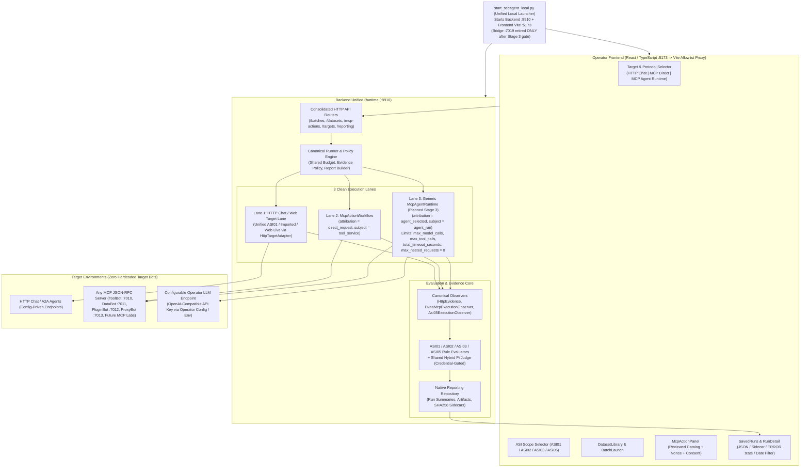

# SecAgent Target Architecture (Corrected Post-Audit Design)

**Status:** Corrected Target Architecture (supersedes v1 pre-correction design)  
**Aligned With:** [`SECAGENT_AUDIT_CORRECTIONS.md`](./SECAGENT_AUDIT_CORRECTIONS.md), [`SECAGENT_FULL_ARCHITECTURE_AUDIT.md`](./SECAGENT_FULL_ARCHITECTURE_AUDIT.md), [`SECAGENT_MCP_ARCHITECTURE_DECISION.md`](./SECAGENT_MCP_ARCHITECTURE_DECISION.md), [`SECAGENT_CODEBASE_CLEANUP_ROADMAP.md`](./SECAGENT_CODEBASE_CLEANUP_ROADMAP.md)  
**Repository:** `D:\SecAgent-W5-Judge`

---

## 1. Architectural Thesis

SecAgent's target architecture should be a **single Unified Runtime** with clean, protocol-driven execution lanes — NOT target-specific Python workflows, NOT hardcoded Node `.cjs` bridges (`:7019`), and NOT blurred verdicts across incompatible testing scopes.

Critically, MCP testing requires **two complementary execution lanes** sharing the same MCP client, Runner, Evidence contract, and Reporting pipeline:

1. **Direct MCP Tool-Action Lane (`McpActionWorkflow`, `attribution="direct_request"`, `subject="tool_service"`):** Deterministic, reviewed-catalog testing of MCP tool handlers (`tools/list`, `tools/call`) directly against an MCP server without an autonomous LLM intermediary.
2. **Agent-Level MCP Runtime Lane (`McpAgentRuntime`, `attribution="agent_selected"`, `subject="agent_run"`):** Generic, configurable Python runtime hosting an LLM tool-selection loop over any MCP server (`ToolBot :7010`, `DataBot :7011`, `PluginBot :7012`, `ProxyBot :7013`, or future labs) to execute natural-language security testcases (including the 30 imported ToolBot ASI05 prompts) with full step/tool-call provenance and hard loop limits.

---

## 2. Target System Topology

---

## 3. Core Design Rules & Contracts

### 3.1 Generic `McpAgentRuntime` Contract (Replaces Bridge `:7019` in Stage 3)

Bridge `:7019` (`backend/src/targets/bridges/promptfoo_http.py`) is classified as **`TEMPORARY_MIGRATION_DEPENDENCY`**, not target architecture, because it pins external `.cjs` provider hashes (`5dd6892f...`, `f33e588d...`, `3b30eb2d...`) tied specifically to `toolbot-provider.cjs`, `:7010/mcp`, and `deepseek-chat`.

In the Target Architecture, `backend/src/targets/runtimes/mcp_agent.py` *(planned in Stage 3)* replaces Bridge `:7019` cleanly with:
- **Zero Target-Specific Adapters:** Adding `DataBot (:7011)`, `PluginBot (:7012)`, `ProxyBot (:7013)`, or a new AIGoat MCP server requires only an operator target profile (`mcp_endpoint`, `system_prompt`, optional `tool_allowlist`, `model_profile`), never new Python/Node provider code.
- **Zero Hardcoded Providers:** Uses configurable OpenAI-compatible client settings controlled by operator `runtime.json` / environment variables — never hardcoded `deepseek-chat`.
- **Reuse First:** Reuses `McpJsonRpcTargetAdapter` (for `tools/list` -> tool schemas and `tools/call` execution), canonical `Runner` lifecycle hooks, and `Asi05ExecutionObserver` / `DvaaMcpExecutionObserver`.
- **Mandatory Loop Safeguards:**
  - `max_model_calls` (prevents runaway reasoning loops)
  - `max_tool_calls` (prevents unbounded tool invocation loops)
  - `total_timeout_seconds` (wall-clock cap across model + tool turns)
  - `max_nested_requests = 0` (prevents recursive agent re-entry / amplification)
  - Deterministic termination states (`completed`, `max_model_calls_reached`, `max_tool_calls_reached`, `timeout`, `blocked_by_policy`, `error`)
- **Full Provenance & Traceability:** Records ordered `tool_calls[]`, normalized `trace.source`, model profile, SHA256 digest/identifier of the active system prompt template, and exact stop reason in every run artifact.

### 3.2 Strict Scope Separation (`direct_request` vs `agent_selected` vs External Promptfoo)

Enforced end-to-end through `backend/src/evaluators/asi05_execution.py` and Native Reports:

| Dimension | `McpActionWorkflow` | `McpAgentRuntime` | External Promptfoo Baseline (`toolbot-provider.cjs`) |
|---|---|---|---|
| **`subject`** | `tool_service` | `agent_run` | External agent run |
| **`attribution`** | `direct_request` | `agent_selected` | External agent tool-selection |
| **Input Type** | Structured `(tool_name, arguments)` from reviewed catalog | Natural-language prompt (e.g., 30 imported ASI05 prompts `e4ea927a...`) | Natural-language YAML prompt suite |
| **Security Meaning** | Tests whether the **MCP tool server** enforces validation/containment directly | Tests whether the **LLM Agent + system prompt + tool boundary** refuses or misuses tools | Benchmark behavioral baseline under `.cjs` prompt/model variant (`5dd6892f`, `f33e588d`, `3b30eb2d`) |
| **Aggregation Rule** | Reported separately; NEVER merged into `agent_selected` pass/fail totals | Reported separately; compared qualitatively with Promptfoo only when system prompt & model provenance match | Never conflated across differing `.cjs` system prompts (`asi05-official-01` vs `asi02-controlled-v4` vs missing Context `.cjs`) |

---

## 4. Before vs Target Architecture Comparison (Verified Baseline)

| Metric / Dimension | Current State (Measured) | Target State (Post-Stage 5) | Notes |
|---|---:|---:|---|
| **Production Source (`backend/src` + launcher + `frontend/src` prod)** | `168` files / `21,915` LOC | `~20,595 – 21,135` LOC | Net production reduction **`~780–1,320` LOC** (`~3.6%–6.0%`), excluding file moves |
| **Protected Test Suite (`backend/tests` + `frontend` tests/specs)** | `142` files / `26,803` LOC | Maintained (`>= 26,803` coverage depth) | Never shrink coverage just to pad LOC metrics; Bridge tests swap to `McpAgentRuntime` tests in Stage 3 |
| **Research Scripts (`backend/scripts/`)** | `20` files / `4,299` LOC | Separated cleanly; `run_native_smoke` shared core moved to `backend/src/testing/` | Moving scripts to `experiments/` = `0` LOC savings, not counted as cleanup |
| **HTTP Execution Lanes** | 4 overlapping workflow files (`asi01_batch`, `generic_imported_batch`, `web_live_batch`, `offline_batch`) | 1 shared `Runner` HTTP batch pipeline | Eliminates duplicated retry/summary/evidence plumbing |
| **MCP Direct Execution** | `McpActionWorkflow` + Vite proxy + Nonce + Catalog Pin | Same (`direct_request`, `tool_service`) | Preserves all Phase 3 P0 security controls |
| **MCP Agent-Level Execution** | Temporary Node `.cjs` Bridge `:7019` (`ToolBot :7010` + `deepseek-chat` hardcoded) | Generic Python `McpAgentRuntime` (`agent_selected`, `agent_run`) | Works across `ToolBot :7010`, `DataBot :7011`, `PluginBot :7012`, `ProxyBot :7013` via config only |
| **Cross-Layer Coupling** | 7 `backend/src/workflow/` modules import from `backend/scripts/run_native_smoke.py`; `web_live_batch` imports `web_mock_batch` | Zero `src -> scripts` imports; shared helpers live cleanly in `src/testing/` & `src/workflow/` | Verified clean dependency DAG |

---

## 5. Verification Status Separation (Strict Truthfulness Baseline)

1. **Historical Pre-Audit Baselines (from Phase 3 records; NOT re-run in this audit):**
   - Full `pytest` backend suite (`1,584` passed)
   - Full `vitest` suite (`181` passed)
   - Mocked Playwright Chrome suite (`19` passed, `1` skipped real-dataset check)
   - Saved controlled run history readability (`554` historical runs; `MCP_IN_ROOT=0`, `CONTRACT_SUM=0`, `ASI03_POL=0`, `ASI05_POL=0` at `run-summary.json` level)
2. **Offline Checks Executed Directly During This Audit (`task-666`):**
   - `python -m py_compile start_secagent_local.py backend/src/targets/bridges/promptfoo_http.py backend/src/workflow/api.py backend/src/workflow/mcp_actions.py backend/src/evaluators/asi05_execution.py` — **PASS**
   - `pytest backend/tests/test_promptfoo_agent_bridge.py backend/tests/test_structured_mcp_actions.py backend/tests/test_tool_action_observer.py backend/tests/test_web_mock_batch.py backend/tests/test_toolbot_lab_batch.py -q` — **46 passed in 39.58s**
3. **Unverified / Untested Live Dependencies (Require Explicit Pre-Release Verification):**
   - Live DVAA MCP servers (`ToolBot :7010`, `DataBot :7011`, `PluginBot :7012`, `ProxyBot :7013`) against future `McpAgentRuntime`
   - Live Shared Hybrid Pi Judge execution with active operator credentials
   - Context `.cjs` behavior referenced in `E:\KiemLaiSS1\promptfooconfig_toolbot_asi05_secagent_context.yaml` (file missing on disk; unverified)
